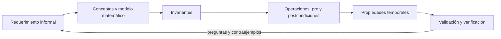

# Ingeniería de Software - Requerimientos y especificaciones

## 4.3 Proceso de formalización de requerimientos.

---

Formalizar un requerimiento no es traducir palabra por palabra una frase a símbolos: es un proceso de análisis en el que se descubren los conceptos del dominio, las suposiciones implícitas y los casos que nadie había pensado. El producto es una especificación precisa, pero buena parte del valor está en las preguntas que surgen al escribirla. Este tema describe las etapas del proceso, las notaciones más usadas, como la lógica de predicados, la lógica temporal y la notación Z, y lo aplica a un sistema bancario, con una demostración automática de que una operación preserva sus invariantes.

### Etapas

1. **Comprender el requerimiento** en su contexto: quién lo pidió, para qué, y qué palabras tienen un significado técnico en el dominio.
2. **Identificar los conceptos** y modelarlos matemáticamente: los conjuntos de entidades, como cuentas o usuarios; sus atributos, como funciones, y sus relaciones.
3. **Escribir los invariantes:** las propiedades que el estado del sistema cumple siempre.
4. **Especificar las operaciones** con sus **precondiciones**, lo que debe valer para poder ejecutarlas, y sus **postcondiciones**, cómo queda el estado después.
5. **Especificar las propiedades temporales**, sobre secuencias de estados, con lógica temporal.
6. **Validar** la especificación con los interesados, traduciéndola de vuelta a lenguaje natural y con ejemplos, y **verificarla**: que sea consistente, que las operaciones preserven los invariantes, y que de ella se deriven las propiedades esperadas.

Cada paso produce preguntas para el cliente. Las respuestas cambian la especificación, y el proceso se repite.

### Notaciones

- **Lógica de predicados:** para invariantes y relaciones entre entidades, como $\forall c \in \mathit{Cuentas}\; \mathit{saldo}(c) \ge 0.$
- **Lógica temporal:** para el comportamiento en el tiempo (tema 4.1).
- **Notación Z** (Abrial y Spivey, Oxford, años ochenta): basada en teoría de conjuntos, organiza la especificación en **esquemas**, cajas con declaraciones arriba y predicados abajo. Un esquema de estado declara las variables y los invariantes; uno de operación incluye $\Delta\mathit{Estado},$ el estado antes y después, con las variables primadas para el después, y las entradas y salidas, marcadas con `?` y `!`. Los métodos B y VDM son parientes cercanos, y B se ha usado industrialmente, por ejemplo en el control de la línea 14 del metro de París.
- **Máquinas de estados:** para el comportamiento reactivo, como un protocolo o una interfaz.

Una especificación formal dice **qué** hace el sistema, no **cómo**: la postcondición de una operación de ordenamiento dice que el resultado es una permutación ordenada de la entrada, no qué algoritmo usar.

### Verificación de la especificación

Una especificación con invariantes y operaciones permite una verificación clave: que cada operación, ejecutada en un estado que cumple los invariantes y su precondición, produzca un estado que también los cumpla. En lógica de Hoare, vista en el curso de Lenguajes de Programación, $\{\mathit{Inv} \land \mathit{Pre}\}\ \mathit{Op}\ \{\mathit{Inv}\}.$ Con un solucionador SMT, la verificación es automática: se le pide un estado que cumpla $\mathit{Inv} \land \mathit{Pre}$ y en el que, después de la operación, $\mathit{Inv}$ no se cumpla. Si no existe, la operación es correcta **para todos los estados y entradas**, algo que ninguna prueba con casos puede establecer; si existe, el solucionador da el contraejemplo.



### Implementación en Python

El programa resuelve los ejercicios 3 y 4 con Z3: modela un banco de tres cuentas con sus invariantes y demuestra que la transferencia los preserva cuando la precondición exige cuentas distintas y saldo suficiente, y encuentra contraejemplos si se omite cualquiera de las dos. Para el ejercicio 1 comprueba exhaustivamente un controlador de dos elevadores y muestra que cumple el invariante pero puede bloquearse. Para el ejercicio 2 comprueba una traza de mensajes contra la especificación temporal con su excepción.

```python
from z3 import Array, IntSort, Ints, Store, Select, Solver, And, Not, unsat

# ---------- Ejercicios 3 y 4: invariantes y la operación Transferir, demostrados con Z3 ----------
# Tres cuentas 0, 1, 2. Estado: arreglo de saldos. Invariantes: saldos ≥ 0 y suma constante (= TOTAL).
s0 = Array("saldo", IntSort(), IntSort())
o, d, m, TOTAL = Ints("origen destino monto TOTAL")
def suma(a): return Select(a, 0) + Select(a, 1) + Select(a, 2)
def inv(a): return And(*(Select(a, i) >= 0 for i in range(3)), suma(a) == TOTAL)
cuenta = lambda x: And(x >= 0, x <= 2)
pre = And(cuenta(o), cuenta(d), o != d, m > 0, Select(s0, o) >= m)
def transferir_ingenua(a):                       # calcula ambos saldos con el estado anterior
    return Store(Store(a, o, Select(a, o) - m), d, Select(a, d) + m)
def demuestra(nombre, precondicion, operacion):
    s = Solver(); s1 = operacion(s0)
    s.add(inv(s0), precondicion, Not(inv(s1)))      # ¿hay un estado válido donde la operación rompa un invariante?
    if s.check() == unsat: print(f"   {nombre}: preserva los invariantes para todo estado y todo monto (demostrado)")
    else:
        md = s.model()
        antes = [md.eval(Select(s0, i)).as_long() for i in range(3)]; despues = [md.eval(Select(s1, i)).as_long() for i in range(3)]
        print(f"   {nombre}: contraejemplo origen = {md[o]}, destino = {md[d]}, monto = {md[m]}: saldos {antes} → {despues}")
print("ejercicio 4:")
demuestra("Transferir con origen ≠ destino", pre, transferir_ingenua)
pre_sin_distintas = And(cuenta(o), cuenta(d), m > 0, Select(s0, o) >= m)
demuestra("Transferir ingenua sin exigir origen ≠ destino", pre_sin_distintas, transferir_ingenua)
demuestra("Transferir sin exigir saldo suficiente", And(cuenta(o), cuenta(d), o != d, m > 0), transferir_ingenua)

# ---------- Ejercicio 1: dos elevadores que nunca están en el mismo piso ----------
PISOS = 5
def controlador(e1, e2, d1, d2):
    """Cada elevador va a su destino; el controlador no deja mover a un elevador hacia el piso ocupado por el otro."""
    paso = lambda e, dest: e + (dest > e) - (dest < e)
    n1 = paso(e1, d1); n1 = e1 if n1 == e2 else n1
    n2 = paso(e2, d2); n2 = e2 if n2 == n1 else n2
    return n1, n2
estados = {(e1, e2) for e1 in range(PISOS) for e2 in range(PISOS) if e1 != e2}
violaciones = [(e, (d1, d2)) for e in estados for d1 in range(PISOS) for d2 in range(PISOS) if (lambda n: n[0] == n[1])(controlador(*e, d1, d2))]
print(f"ejercicio 1: invariante e₁ ≠ e₂ comprobado en {len(estados)} estados × {PISOS ** 2} pares de destinos: {len(violaciones)} violaciones")
e = (0, 4)
for _ in range(10):
    n = controlador(*e, 4, 0)                           # se cruzan: cada uno quiere ir al extremo del otro
    e = n
print(f"   pero si los dos quieren cruzarse, el sistema se detiene en {e}: la seguridad se cumple y la vivacidad no")

# ---------- Ejercicio 2: entrega en 500 ms salvo falla de conexión ----------
def cumple(eventos, plazo=500):
    """G(envía(m) → F[0,500] (recibe(m) ∨ falla_conexión))"""
    resultado = []
    for t, ev, msg in eventos:
        if ev == "envia":
            ok = any(t <= t2 <= t + plazo and (ev2 == "recibe" and msg2 == msg or ev2 == "falla") for t2, ev2, msg2 in eventos)
            resultado.append((msg, "cumple" if ok else "viola"))
    return resultado
traza = [(0, "envia", "m1"), (120, "recibe", "m1"), (200, "envia", "m2"), (900, "recibe", "m2"),
         (1000, "envia", "m3"), (1300, "falla", None), (2000, "envia", "m4"), (2400, "recibe", "m4")]
print("ejercicio 2:", cumple(traza))
```

Salida:

```text
ejercicio 4:
   Transferir con origen ≠ destino: preserva los invariantes para todo estado y todo monto (demostrado)
   Transferir ingenua sin exigir origen ≠ destino: contraejemplo origen = 0, destino = 0, monto = 17678: saldos [43526, 8945, 26286] → [61204, 8945, 26286]
   Transferir sin exigir saldo suficiente: contraejemplo origen = 1, destino = 2, monto = 1103: saldos [21654, 1102, 8404] → [21654, -1, 9507]
ejercicio 1: invariante e₁ ≠ e₂ comprobado en 20 estados × 25 pares de destinos: 0 violaciones
   pero si los dos quieren cruzarse, el sistema se detiene en (2, 3): la seguridad se cumple y la vivacidad no
ejercicio 2: [('m1', 'cumple'), ('m2', 'viola'), ('m3', 'cumple'), ('m4', 'cumple')]
```

### Ejercicios Propuestos

1. **Formalización.** Formaliza el requerimiento "el sistema de elevadores debe garantizar que nunca dos elevadores se encuentren en el mismo piso simultáneamente".

2. **Lógica temporal.** Especifica formalmente: "cada mensaje enviado debe ser recibido dentro de 500 ms, a menos que la conexión falle".

3. **Invariantes.** Identifica y formaliza al menos tres invariantes de un sistema de transacciones bancarias.

4. **Especificación.** Completa la especificación de la operación de transferencia:

    ```latex
    \begin{schema}{Transferir}
        \Delta SistemaBancario \\
        origen?: Cuenta \\
        destino?: Cuenta \\
        monto?: Monto \\
        resultado!: Resultado
    \where
        /* precondiciones */
        /* postcondiciones */
    \end{schema}
    ```

### Soluciones

**Ejercicio 1.** Con $E$ el conjunto de elevadores y $\mathit{piso} : E \times \mathit{Tiempo} \to \mathit{Pisos},$

$$\forall t\; \forall e_1, e_2 \in E\; \big(e_1 \ne e_2 \to \mathit{piso}(e_1, t) \ne \mathit{piso}(e_2, t)\big),$$

o, como invariante del estado, que $\mathit{piso}$ sea **inyectiva** en cada instante. Formalizar el requerimiento hace visible que es extraño: en un edificio, elevadores en cubos distintos pueden estar en el mismo piso sin problema; el requerimiento tiene sentido solo si comparten un cubo, como en los sistemas de dos cabinas en un mismo cubo. Y tiene una consecuencia que el enunciado no prevé: con 2 elevadores que comparten un cubo y quieren cruzarse, ninguno puede pasar al otro. El controlador del programa cumple el invariante en todos los estados y destinos, pero cuando los elevadores quieren intercambiar extremos se detienen frente a frente: la propiedad de **seguridad** se cumple y la de **vivacidad**, que cada solicitud termine por atenderse, no. La especificación completa necesita ambas, y en este caso la segunda es imposible sin restringir los destinos de cada cabina.

**Ejercicio 2.**

$$\mathbf{G}\,\big(\mathit{env}(m) \to \mathbf{F}_{[0,\,500\,\mathrm{ms}]}\,(\mathit{rec}(m) \lor \mathit{falla})\big).$$

La excepción se formaliza como una alternativa dentro del plazo. Quedan preguntas: si una falla de conexión **antes** del envío también excusa la entrega; si el mensaje debe recibirse exactamente una vez, y qué debe pasar después de la falla, por ejemplo reintentar. En la traza del programa, el mensaje 2 viola la especificación, porque llega a los 700 ms; el 3 la cumple, porque la conexión falla 300 ms después de enviarlo.

**Ejercicio 3.** Con $\mathit{Cuentas}$ el conjunto de cuentas, $\mathit{saldo} : \mathit{Cuentas} \to \mathbb{Z}$ y $\mathit{Movs}$ el registro de movimientos:

1. **Saldos no negativos**, para cuentas sin sobregiro: $\forall c \in \mathit{Cuentas}\; \mathit{saldo}(c) \ge 0.$
2. **Conservación del dinero** en las transferencias internas: $\sum_{c \in \mathit{Cuentas}} \mathit{saldo}(c) = \mathit{Total},$ que solo cambia con depósitos y retiros externos.
3. **El saldo es la suma de los movimientos:** $\forall c\; \mathit{saldo}(c) = \sum_{\mu \in \mathit{Movs},\, \mu.\mathit{cuenta} = c} \mu.\mathit{monto},$ lo que permite auditar cualquier saldo.
4. **Los movimientos no se modifican:** $\mathit{Movs} \subseteq \mathit{Movs}',$ es decir, el registro solo crece; una corrección es un movimiento nuevo de reversión.

Los montos se representan con enteros, en centavos, nunca con punto flotante, para que la conservación sea exacta.

**Ejercicio 4.**

```latex
\begin{schema}{Transferir}
    \Delta SistemaBancario \\
    origen?, destino?: Cuenta \\
    monto?: \nat \\
    resultado!: Resultado
\where
    origen? \in cuentas \land destino? \in cuentas \\
    origen? \neq destino? \\
    monto? > 0 \\
    saldo(origen?) \geq monto? \\
    saldo' = saldo \oplus \{origen? \mapsto saldo(origen?) - monto?,\ destino? \mapsto saldo(destino?) + monto?\} \\
    cuentas' = cuentas \\
    resultado! = ok
\end{schema}
```

La postcondición usa la **sobrescritura** de funciones, $\oplus,$ y dice explícitamente que nada más cambia. Las cuatro precondiciones son necesarias, y el programa lo demuestra con Z3: con todas, la operación preserva los invariantes para **todo** estado y **todo** monto; sin "origen ≠ destino", la sobrescritura con la misma cuenta dos veces conserva solo el segundo valor, y una transferencia de una cuenta a sí misma **crea** dinero, el contraejemplo que encuentra Z3; sin "saldo suficiente", un saldo queda negativo. Una especificación completa agrega los casos de error en esquemas aparte, con $\Xi\mathit{SistemaBancario},$ el estado sin cambios, y un resultado distinto, como `saldo_insuficiente` o `misma_cuenta`, y la operación total es la disyunción de los esquemas.

### Referencias

1. Spivey, J. M., _The Z Notation: A Reference Manual_. Prentice Hall, 1992.
2. Woodcock, J., and Davies, J., _Using Z: Specification, Refinement, and Proof_. Prentice Hall, 1996.
3. Abrial, J.-R., _The B-Book: Assigning Programs to Meanings_. Cambridge University Press, 1996.
4. Behm, P., Benoit, P., Faivre, A., and Meynadier, J.-M., Météor: a successful application of B in a large project. _FM'99_, 1999.
5. Lamport, L., _Specifying Systems: The TLA+ Language and Tools_. Addison-Wesley, 2002.
6. de Moura, L., and Bjørner, N., Z3: an efficient SMT solver. _TACAS_, 2008.
