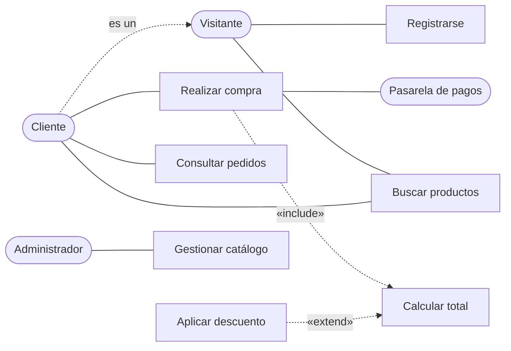

# Ingeniería de Software - Requerimientos y especificaciones

## 4.4 Casos de uso.

---

Un **caso de uso** describe cómo un actor usa el sistema para lograr un objetivo, como una secuencia de interacciones que termina con un resultado de valor para ese actor. Ivar Jacobson los introdujo en 1987, en su trabajo en Ericsson y luego en el método Objectory, y se incorporaron a UML y al Proceso Unificado. Su fuerza es que describen el sistema **desde fuera**, en el lenguaje de los usuarios, y que organizan los requerimientos funcionales alrededor de objetivos, no de funciones sueltas. Este tema define sus elementos, la plantilla de especificación, las relaciones entre casos de uso y el diagrama, y muestra cómo derivar de ellos casos de prueba y estimaciones de esfuerzo.

### Elementos

- **Actor:** un rol que alguien o algo desempeña al interactuar con el sistema: una persona, otro sistema o un dispositivo. El **actor principal** inicia el caso de uso para lograr su objetivo; los **actores secundarios** son los que el sistema necesita para lograrlo, como una pasarela de pagos. Un actor es un rol, no una persona: la misma persona puede ser cliente y administrador.
- **Caso de uso:** un objetivo del actor principal, nombrado con un verbo y un objeto: "Realizar compra", no "Compras" ni "Botón de pago". Cockburn distingue tres niveles: el de **resumen**, de objetivos de negocio que abarcan varias sesiones; el de **usuario**, el principal, un objetivo que se logra en una sesión, y el de **subfunción**, un paso reutilizado por varios.
- **Escenario:** una secuencia concreta de pasos. El **flujo principal** es el escenario en el que todo sale bien; los **flujos alternos** son variaciones que también logran el objetivo, y las **excepciones** son las situaciones en que el objetivo no se logra y cómo se manejan.

### Plantilla

| Sección                | Contenido                                                                 |
| ---------------------- | ------------------------------------------------------------------------- |
| Nombre y nivel         | Verbo y objeto; usuario, resumen o subfunción                             |
| Actores                | Principal y secundarios                                                   |
| Interesados e intereses | Quién más se ve afectado y qué necesita, como el área de finanzas         |
| Precondiciones         | Lo que el sistema garantiza antes de empezar                              |
| Garantías mínimas      | Lo que vale aunque el objetivo falle, como "no se cobra sin pedido"        |
| Postcondiciones        | Lo que vale si el objetivo se logra                                       |
| Flujo principal        | Pasos numerados, cada uno una acción del actor o del sistema              |
| Flujos alternos        | Por número de paso: dónde se desvían y a dónde regresan                   |
| Excepciones            | Por número de paso: qué falla y cómo se maneja                            |

Cada paso describe una **intención**, no la interfaz: "el cliente elige el método de pago", no "el cliente hace clic en el botón azul".

### Relaciones

- **Inclusión** (`«include»`): un caso de uso **siempre** ejecuta otro como parte de su flujo, para reutilizar pasos comunes. Calcular el total es parte de toda compra.
- **Extensión** (`«extend»`): un caso de uso agrega comportamiento **opcional** a otro en un **punto de extensión**, bajo una condición. Aplicar un descuento extiende el cálculo del total solo si hay un cupón. La flecha va del que extiende al extendido, y el extendido no sabe nada del que lo extiende.
- **Generalización:** entre actores o entre casos de uso, cuando uno especializa a otro. Un cliente registrado es un visitante que además puede comprar.

El error más común es usar las relaciones para describir una **descomposición funcional**, con un árbol de casos de uso que se incluyen unos a otros como si fueran llamadas a procedimientos. Los casos de uso describen objetivos, no la estructura del programa, y las inclusiones deben ser pocas y sin ciclos.



### Usos derivados

- **Pruebas:** cada escenario es un caso de prueba de aceptación, y cada flujo alterno y cada excepción, uno más.
- **Planeación:** los casos de uso, o sus escenarios, son las unidades de entrega de las iteraciones.
- **Estimación:** el método de **puntos de casos de uso** de Karner (1993) pondera los actores, con 1 para uno que es otro sistema con una API, 2 para uno que usa un protocolo y 3 para una persona con interfaz gráfica, y los casos de uso, con 5, 10 o 15 según tengan hasta 3, de 4 a 7 o más de 7 transacciones. La suma se ajusta con factores técnicos y de entorno, y Karner propone 20 horas-persona por punto.

### Implementación en Python

El programa representa el caso de uso del ejercicio 2 como datos, con sus flujos alternos y excepciones, y genera de él un escenario de prueba por cada camino. Para el ejercicio 4 registra las relaciones y verifica que las inclusiones no formen ciclos. Para los ejercicios 1 y 3 estima el esfuerzo del comercio electrónico con puntos de casos de uso, con factores de ajuste supuestos.

```python
from dataclasses import dataclass, field

# ---------- Ejercicio 2: el caso de uso como datos, y sus escenarios de prueba ----------
@dataclass
class CasoDeUso:
    nombre: str; actor: str; pre: list; post: list; principal: list
    alternos: dict = field(default_factory=dict)        # nombre: (paso donde se desvía, pasos, paso al que regresa o None)
    excepciones: dict = field(default_factory=dict)     # nombre: (paso donde ocurre, manejo)
    def escenarios(self):
        yield "básico", [f"{i}. {p}" for i, p in enumerate(self.principal, 1)], "éxito"
        for n, (desde, pasos, vuelve) in self.alternos.items():
            ruta = [f"{i}. {p}" for i, p in enumerate(self.principal[:desde - 1], 1)] + [f"{desde}{chr(97 + k)}. {p}" for k, p in enumerate(pasos)]
            if vuelve: ruta += [f"{i}. {p}" for i, p in enumerate(self.principal[vuelve - 1:], vuelve)]
            yield f"alterno: {n}", ruta, "éxito"
        for n, (en, manejo) in self.excepciones.items():
            yield f"excepción: {n}", [f"{i}. {p}" for i, p in enumerate(self.principal[:en], 1)] + [f"{en}x. {manejo}"], "fallo controlado"
compra = CasoDeUso(
    "Realizar compra", "Cliente",
    pre=["el cliente tiene artículos en el carrito", "el cliente está autenticado"],
    post=["se registró un pedido pagado", "se reservó el inventario", "se envió la confirmación por correo"],
    principal=["el cliente revisa el carrito", "el sistema calcula subtotal, impuestos y envío", "el cliente elige la dirección de envío",
               "el cliente elige el método de pago", "el sistema solicita la autorización del cobro", "el sistema registra el pedido y reserva el inventario",
               "el sistema muestra la confirmación y envía el correo"],
    alternos={"aplica cupón de descuento": (2, ["el cliente captura un cupón", "el sistema valida el cupón y recalcula el total"], 3),
              "agrega una dirección nueva": (3, ["el cliente captura una dirección", "el sistema valida el código postal"], 4)},
    excepciones={"pago rechazado": (5, "el sistema informa el rechazo y regresa al paso 4 sin crear el pedido"),
                 "artículo agotado": (6, "el sistema cancela la autorización, quita el artículo y regresa al paso 1"),
                 "sesión expirada": (3, "el sistema pide autenticarse y conserva el carrito")})
print("ejercicio 2:", compra.nombre, "| escenarios de prueba derivados:")
for nombre, ruta, fin in compra.escenarios(): print(f"   {nombre:32} {len(ruta)} pasos → {fin}: {' / '.join(r.split('. ')[0] for r in ruta)}")

# ---------- Ejercicio 4: relaciones entre casos de uso, sin ciclos de inclusión ----------
relaciones = [("Realizar Pedido", "include", "Calcular Total"), ("Realizar Pedido", "include", "Registrar Pago"),
              ("Aplicar Descuento", "extend", "Calcular Total")]
precondiciones = {"Realizar Pedido": "Autenticar Usuario"}
def ciclos(rel):
    g = {}
    for a, t, b in rel:
        if t == "include": g.setdefault(a, []).append(b)
    def dfs(n, camino):
        if n in camino: return camino[camino.index(n):] + [n]
        for m in g.get(n, []):
            c = dfs(m, camino + [n])
            if c: return c
    return next((c for n in g if (c := dfs(n, []))), None)
print("ejercicio 4:", [f"{a} «{t}» {b}" for a, t, b in relaciones], "| precondición:", precondiciones)
print("   ciclos de inclusión:", ciclos(relaciones), "| con Calcular Total «include» Realizar Pedido:",
      ciclos(relaciones + [("Calcular Total", "include", "Realizar Pedido")]))

# ---------- Ejercicios 1 y 3: puntos de casos de uso (Karner) del comercio electrónico ----------
actores = {"Cliente": "complejo", "Visitante": "complejo", "Administrador": "complejo",
           "Pasarela de pagos": "simple", "Servicio de paquetería": "promedio"}       # simple: API; promedio: protocolo; complejo: persona con GUI
peso_actor = {"simple": 1, "promedio": 2, "complejo": 3}
casos = {"Buscar productos": 4, "Ver producto": 2, "Gestionar carrito": 5, "Realizar compra": 9, "Registrarse": 3,
         "Autenticarse": 3, "Consultar pedidos": 3, "Cancelar pedido": 5, "Gestionar catálogo": 8, "Gestionar inventario": 6}  # transacciones
def peso_cu(t): return 5 if t <= 3 else 10 if t <= 7 else 15
UAW = sum(peso_actor[c] for c in actores.values())
UUCW = sum(peso_cu(t) for t in casos.values())
TCF, ECF = 1.0, 0.95                                     # factores técnicos y de entorno supuestos
UCP = (UAW + UUCW) * TCF * ECF
print(f"ejercicio 1: {len(actores)} actores (UAW = {UAW}), {len(casos)} casos de uso (UUCW = {UUCW})")
print(f"   UCP = ({UAW} + {UUCW}) · {TCF} · {ECF} = {UCP:.2f} | esfuerzo con 20 h por UCP: {UCP * 20:,.0f} horas-persona")
```

Salida:

```text
ejercicio 2: Realizar compra | escenarios de prueba derivados:
   básico                           7 pasos → éxito: 1 / 2 / 3 / 4 / 5 / 6 / 7
   alterno: aplica cupón de descuento 8 pasos → éxito: 1 / 2a / 2b / 3 / 4 / 5 / 6 / 7
   alterno: agrega una dirección nueva 8 pasos → éxito: 1 / 2 / 3a / 3b / 4 / 5 / 6 / 7
   excepción: pago rechazado        6 pasos → fallo controlado: 1 / 2 / 3 / 4 / 5 / 5x
   excepción: artículo agotado      7 pasos → fallo controlado: 1 / 2 / 3 / 4 / 5 / 6 / 6x
   excepción: sesión expirada       4 pasos → fallo controlado: 1 / 2 / 3 / 3x
ejercicio 4: ['Realizar Pedido «include» Calcular Total', 'Realizar Pedido «include» Registrar Pago', 'Aplicar Descuento «extend» Calcular Total'] | precondición: {'Realizar Pedido': 'Autenticar Usuario'}
   ciclos de inclusión: None | con Calcular Total «include» Realizar Pedido: ['Realizar Pedido', 'Calcular Total', 'Realizar Pedido']
ejercicio 1: 5 actores (UAW = 12), 10 casos de uso (UUCW = 90)
   UCP = (12 + 90) · 1.0 · 0.95 = 96.90 | esfuerzo con 20 h por UCP: 1,938 horas-persona
```

### Ejercicios Propuestos

1. **Actores y casos de uso.** Para un sistema de comercio electrónico, identifica al menos 5 actores, de 8 a 10 casos de uso principales y sus relaciones.

2. **Especificación.** Especifica el caso de uso "Realizar compra", con el flujo principal, dos flujos alternos, tres excepciones, y las pre y postcondiciones.

3. **Diagrama.** Dibuja el diagrama de casos de uso del sistema, con los actores, las relaciones de inclusión y extensión, y la herencia entre actores.

4. **Relaciones.** Identifica y justifica las relaciones entre los casos de uso Autenticar Usuario, Realizar Pedido, Aplicar Descuento, Calcular Total y Registrar Pago.

### Soluciones

**Ejercicio 1.** Actores: **Visitante**, que navega sin cuenta; **Cliente**, que es un visitante registrado; **Administrador** del catálogo; **Pasarela de pagos** y **Servicio de paquetería**, sistemas externos. Casos de uso: Buscar productos, Ver producto, Gestionar carrito, Realizar compra, Registrarse, Autenticarse, Consultar pedidos, Cancelar pedido, Gestionar catálogo y Gestionar inventario. Las relaciones están en el diagrama y en el ejercicio 4. Con un número de transacciones supuesto para cada caso de uso, el método de Karner da 96.9 puntos y, a 20 horas por punto, unas 1 900 horas-persona; la cifra depende mucho de los factores de ajuste, y conviene calibrar las horas por punto con proyectos anteriores de la organización.

**Ejercicio 2.**

- **Actor principal:** Cliente. **Secundarios:** Pasarela de pagos, Servicio de correo.
- **Precondiciones:** el cliente está autenticado y tiene artículos en el carrito.
- **Garantía mínima:** no se cobra sin registrar un pedido, ni se registra un pedido sin cobro autorizado.
- **Postcondiciones:** hay un pedido pagado, el inventario está reservado y se envió la confirmación.
- **Flujo principal:**
  1. El cliente revisa el carrito.
  2. El sistema calcula el subtotal, los impuestos y el envío.
  3. El cliente elige la dirección de envío.
  4. El cliente elige el método de pago.
  5. El sistema solicita la autorización del cobro a la pasarela.
  6. El sistema registra el pedido y reserva el inventario.
  7. El sistema muestra la confirmación y envía el correo.
- **Flujos alternos:** 2a, el cliente captura un cupón; el sistema lo valida, recalcula el total y continúa en 3. 3a, el cliente agrega una dirección nueva; el sistema valida el código postal y continúa en 4.
- **Excepciones:** 3x, la sesión expiró: el sistema pide autenticarse y conserva el carrito. 5x, la pasarela rechaza el pago: el sistema informa el motivo y regresa al paso 4, sin crear el pedido. 6x, un artículo se agotó entre el paso 1 y el 6: el sistema cancela la autorización, quita el artículo y regresa al paso 1.

La excepción 6x muestra por qué la garantía mínima importa: si el pedido se registrara antes de autorizar el pago, o el cobro se hiciera sin poder reservar el inventario, habría estados inconsistentes. El programa genera los seis escenarios de prueba, uno por camino.

**Ejercicio 3.** El diagrama de la sección de relaciones. Mermaid no tiene un tipo de diagrama de casos de uso, y en una herramienta UML los actores se dibujan como figuras humanas, los casos de uso como elipses dentro de un rectángulo que marca el límite del sistema, la herencia con una flecha de punta hueca de Cliente a Visitante, y las relaciones de inclusión y extensión con flechas punteadas y su estereotipo.

**Ejercicio 4.**

- **Realizar Pedido «include» Calcular Total:** todo pedido calcula su total, siempre.
- **Realizar Pedido «include» Registrar Pago:** el pago es parte obligatoria del pedido. Si el pago pudiera hacerse después, como en un pago contra entrega, sería un caso de uso aparte.
- **Aplicar Descuento «extend» Calcular Total:** es opcional, ocurre solo si hay un cupón o una promoción, y Calcular Total no depende de él.
- **Autenticar Usuario** no se relaciona con «include»: es una **precondición** de Realizar Pedido. Incluirlo en cada caso de uso que requiere sesión es el error de descomposición funcional que se mencionó; además, autenticarse es un objetivo por sí mismo, un caso de uso de usuario independiente.

El programa verifica que las inclusiones no formen un ciclo, y detecta el que aparecería si Calcular Total incluyera a Realizar Pedido.

### Referencias

1. Jacobson, I., Christerson, M., Jonsson, P., and Övergaard, G., _Object-Oriented Software Engineering: A Use Case Driven Approach_. Addison-Wesley, 1992.
2. Cockburn, A., _Writing Effective Use Cases_. Addison-Wesley, 2000.
3. Jacobson, I., Spence, I., and Kerr, B., Use-Case 2.0. _Communications of the ACM_ 59(5), 2016.
4. Karner, G., Resource estimation for Objectory projects. Objective Systems SF AB, 1993.
5. Object Management Group, _OMG Unified Modeling Language (UML)_, versión 2.5.1, 2017.
