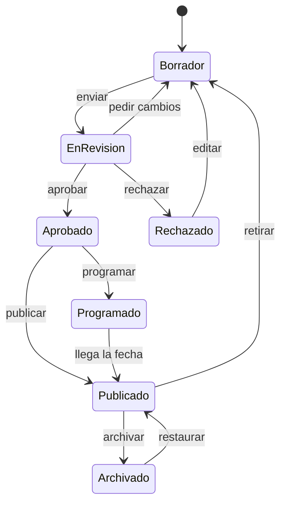

# Ingeniería de Software - Requerimientos y especificaciones

## 4.5 Alternativas y complementos para la formalización de requerimientos.

---

Entre el lenguaje natural libre y los métodos formales matemáticos hay un abanico de técnicas que dan precisión sin exigir una formación en lógica a quienes las leen. Cada una es buena para un tipo de requerimiento: las tablas de decisión para reglas con muchas condiciones, los diagramas de estados para el comportamiento que depende de la historia, los escenarios para el comportamiento observable, los prototipos para la interfaz. Este tema las presenta, muestra cómo se complementan con la formalización y cómo elegir entre ellas según el tipo de sistema.

### Técnicas

- **Lenguaje natural estructurado:** plantillas y patrones con vocabulario controlado. La sintaxis EARS define cinco patrones: **ubicuo**, "el *sistema* deberá *respuesta*"; **por evento**, "cuando *disparador*, el *sistema* deberá..."; **por estado**, "mientras *estado*, ..."; **opcional**, "donde *característica*, ..."; y **no deseado**, "si *condición no deseada*, entonces ...". Elimina buena parte de la ambigüedad sin dejar el lenguaje natural.
- **Historias de usuario:** "como *rol*, quiero *capacidad*, para *beneficio*", con **criterios de aceptación**. No son una especificación completa sino una promesa de conversación, y el criterio INVEST de Wake pide que sean independientes, negociables, valiosas, estimables, pequeñas y comprobables.
- **Especificación por ejemplos y BDD:** los criterios de aceptación se escriben como escenarios concretos en el formato Gherkin, *Dado* un contexto, *Cuando* ocurre un evento, *Entonces* se espera un resultado, que herramientas como Cucumber o behave ejecutan como pruebas automáticas. La especificación no puede quedar desactualizada sin que falle una prueba.
- **Tablas de decisión:** para reglas que combinan varias condiciones. Cada columna es una regla, con una combinación de condiciones y su acción. Su ventaja es que permiten verificar **completitud**, que toda combinación tenga una acción, y **consistencia**, que ninguna tenga dos acciones contradictorias.
- **Máquinas y diagramas de estados:** para el comportamiento que depende de lo que pasó antes, con estados, eventos y transiciones. Permiten verificar que todo estado sea alcanzable, que no haya estados sin salida no deseados y que cada evento tenga una respuesta definida en cada estado.
- **Prototipos y bocetos:** para la interfaz de usuario, donde una imagen se valida mejor que un párrafo.
- **Modelos de datos:** diagramas de entidades y relaciones, o de clases, para el vocabulario del dominio.

### Elección

La técnica depende de la **criticidad** del sistema, de quién debe leer la especificación y del **tipo** de requerimiento:

| Situación                                               | Técnica principal                                    |
| ------------------------------------------------------- | ---------------------------------------------------- |
| Sistema crítico, con una falla catastrófica             | Métodos formales en el núcleo, más estados y EARS    |
| Producto con incertidumbre y usuarios por descubrir     | Historias de usuario, prototipos y BDD               |
| Reglas de negocio con muchas condiciones                | Tablas de decisión                                   |
| Comportamiento que depende de la historia               | Máquinas de estados                                  |
| Requerimientos legales o contractuales                  | Lenguaje estructurado con identificadores y rastreo  |

Las técnicas no se excluyen: un mismo sistema usa historias para organizar el trabajo, escenarios para los criterios de aceptación, una tabla de decisión para la regla de crédito y una máquina de estados para el flujo de un pedido.



### Implementación en Python

El programa resuelve el ejercicio 3 evaluando las reglas del enunciado sobre las clases de equivalencia y los valores límite de cada condición, lo que revela las combinaciones sin ninguna regla, y propone una tabla completa y sin traslapes que incorpora la antigüedad. Para el ejercicio 4 implementa la máquina de estados del diagrama y verifica que todos los estados sean alcanzables, que ninguno quede sin salida y que se rechacen los eventos inválidos.

```python
from itertools import product

# ---------- Ejercicio 3: tabla de decisión de crédito ----------
def reglas_enunciado(score, ingreso, antig):
    acciones = []
    if score > 700 and ingreso > 5000: acciones.append("aprobar")
    if 600 <= score <= 700 and ingreso > 3000: acciones.append("revisión manual")
    if score < 600 or ingreso < 2000: acciones.append("rechazar")
    return acciones
# clases de equivalencia con sus fronteras: un representante por intervalo y los valores límite
scores = [550, 599, 600, 650, 700, 701, 750]
ingresos = [1500, 1999, 2000, 2500, 3000, 3001, 4000, 5000, 5001, 8000]
huecos, choques = {}, {}
for s, i in product(scores, ingresos):
    a = reglas_enunciado(s, i, 0)
    if not a: huecos.setdefault(s, []).append(i)
    if len(a) > 1: choques[(s, i)] = a
print("ejercicio 3: combinaciones sin ninguna regla (score: ingresos):", huecos)
print("   combinaciones con más de una regla:", choques or "ninguna")

def tabla_completa(score, ingreso, antig):
    """Versión completa y sin traslapes. La antigüedad > 2 años sube un nivel la decisión en la zona intermedia."""
    if score < 600 or ingreso < 2000: return "rechazar"
    if score > 700 and ingreso > 5000: return "aprobar"
    if score > 700 and ingreso > 3000: return "aprobar" if antig > 2 else "revisión manual"
    if score >= 600 and ingreso > 3000: return "revisión manual"
    return "revisión manual" if antig > 2 else "rechazar"          # 600-700 con ingreso 2000-3000, o > 700 con 2000-3000
from collections import Counter
casos = list(product(scores, ingresos, (1, 3)))
print("   tabla completa: cada combinación tiene exactamente una acción:", all(isinstance(tabla_completa(*c), str) for c in casos),
      "| reparto:", dict(Counter(tabla_completa(*c) for c in casos)))
print("   ejemplos:", {c: tabla_completa(*c) for c in [(720, 4000, 1), (720, 4000, 3), (650, 2500, 1), (650, 2500, 3), (700, 3001, 0)]})

# ---------- Ejercicio 4: máquina de estados de la publicación en un blog ----------
T = {("Borrador", "enviar"): "En revisión", ("En revisión", "aprobar"): "Aprobado", ("En revisión", "rechazar"): "Rechazado",
     ("En revisión", "pedir cambios"): "Borrador", ("Rechazado", "editar"): "Borrador", ("Aprobado", "publicar"): "Publicado",
     ("Aprobado", "programar"): "Programado", ("Programado", "llega la fecha"): "Publicado", ("Publicado", "archivar"): "Archivado",
     ("Publicado", "retirar"): "Borrador", ("Archivado", "restaurar"): "Publicado"}
estados = {e for e, _ in T} | set(T.values())
def alcanzables(desde):
    vistos, pila = {desde}, [desde]
    while pila:
        e = pila.pop()
        for (o, _), dst in T.items():
            if o == e and dst not in vistos: vistos.add(dst); pila.append(dst)
    return vistos
print("ejercicio 4: estados:", sorted(estados))
print("   inalcanzables desde Borrador:", sorted(estados - alcanzables("Borrador")) or "ninguno",
      "| estados sin salida:", sorted(e for e in estados if not any(o == e for o, _ in T)) or "ninguno",
      "| desde todos se puede llegar a Publicado:", all("Publicado" in alcanzables(e) for e in estados))
def ejecuta(eventos, estado="Borrador"):
    for ev in eventos:
        if (estado, ev) not in T: return f"evento '{ev}' inválido en {estado}"
        estado = T[(estado, ev)]
    return estado
print("   traza válida:", ejecuta(["enviar", "pedir cambios", "enviar", "aprobar", "publicar", "archivar"]),
      "| inválida:", ejecuta(["publicar"]))
```

Salida:

```text
ejercicio 3: combinaciones sin ninguna regla (score: ingresos): {600: [2000, 2500, 3000], 650: [2000, 2500, 3000], 700: [2000, 2500, 3000], 701: [2000, 2500, 3000, 3001, 4000, 5000], 750: [2000, 2500, 3000, 3001, 4000, 5000]}
   combinaciones con más de una regla: ninguna
   tabla completa: cada combinación tiene exactamente una acción: True | reparto: {'rechazar': 75, 'revisión manual': 51, 'aprobar': 14}
   ejemplos: {(720, 4000, 1): 'revisión manual', (720, 4000, 3): 'aprobar', (650, 2500, 1): 'rechazar', (650, 2500, 3): 'revisión manual', (700, 3001, 0): 'revisión manual'}
ejercicio 4: estados: ['Aprobado', 'Archivado', 'Borrador', 'En revisión', 'Programado', 'Publicado', 'Rechazado']
   inalcanzables desde Borrador: ninguno | estados sin salida: ninguno | desde todos se puede llegar a Publicado: True
   traza válida: Archivado | inválida: evento 'publicar' inválido en Borrador
```

### Ejercicios Propuestos

1. **Selección de técnicas.** Indica y justifica la mejor técnica de especificación para un sistema de control de un reactor nuclear, una aplicación móvil de redes sociales, un sistema de inventarios para una PYME y un sistema de procesamiento de transacciones bancarias.

2. **Transformación.** Reescribe con tres técnicas diferentes el requerimiento "el sistema debe procesar las órdenes rápidamente y notificar si hay problemas".

3. **Tabla de decisión.** Crea una tabla de decisión para aprobar créditos con estas reglas: aprobar automáticamente si el score es mayor que 700 y el ingreso mayor que 5 000; revisión manual si el score está entre 600 y 700 y el ingreso es mayor que 3 000; rechazar si el score es menor que 600 o el ingreso menor que 2 000; considerar además la antigüedad laboral, que favorece si es mayor que 2 años.

4. **Diagrama de estados.** Elabora un diagrama de estados para la publicación de contenido en un blog, con los estados Borrador, En revisión, Aprobado, Publicado, Archivado y Rechazado.

### Soluciones

**Ejercicio 1.**

- **Reactor nuclear:** métodos formales, como B, SCADE o TLA+, para la lógica de protección, con verificación de modelos y demostración; máquinas de estados para los modos de operación, y requerimientos en lenguaje estructurado con rastreo completo para el regulador. La criticidad justifica el costo.
- **Red social móvil:** historias de usuario y prototipos validados con usuarios reales, porque el riesgo principal es construir algo que nadie quiera usar, y BDD para los criterios de aceptación de las funciones delicadas, como la privacidad.
- **Inventarios de una PYME:** casos de uso o historias, un modelo de datos y prototipos de las pantallas, de bajo costo y legibles para el dueño del negocio.
- **Transacciones bancarias:** tablas de decisión para las reglas, como límites, comisiones y validaciones; máquinas de estados para el ciclo de vida de una transacción; especificación formal de los invariantes contables, como la conservación del dinero del tema 4.3, y escenarios BDD como pruebas de regresión.

**Ejercicio 2.** El requerimiento tiene tres vaguedades: qué es "rápidamente", qué es un "problema" y a quién se notifica. Antes de reescribirlo hay que preguntarlo; con respuestas supuestas:

1. **EARS:** "Cuando se reciba una orden, el sistema deberá confirmarla en a lo más 2 segundos en el percentil 95. Si una orden no puede procesarse, entonces el sistema deberá notificar al cliente por correo y al operador en el panel de incidencias en a lo más 1 minuto, indicando el motivo."
2. **Historia de usuario:** "Como cliente, quiero que mi orden se confirme de inmediato y que se me avise si hay un problema, para saber si debo comprar en otro lugar." Criterios: confirmación en menos de 2 segundos; aviso con el motivo y una acción sugerida.
3. **Escenario BDD:**

    ```gherkin
    Escenario: orden con un artículo agotado
      Dado un cliente con una orden de 2 artículos
      Y el artículo "SKU-17" sin existencias
      Cuando el cliente envía la orden
      Entonces el sistema responde en menos de 2 segundos
      Y la orden queda en estado "pendiente de confirmación"
      Y el cliente recibe un correo que menciona "SKU-17" como agotado
    ```

**Ejercicio 3.** Las reglas del enunciado tienen **huecos**: el programa encuentra combinaciones a las que ninguna regla se aplica. Un score de 600 a 700 con un ingreso de 2 000 a 3 000 no se aprueba, ni se revisa, ni se rechaza; tampoco un score mayor que 700 con un ingreso de 2 000 a 5 000. No hay traslapes, pero las fronteras son delicadas: "entre 600 y 700" debe decidir si incluye los extremos, y el programa los incluye. La antigüedad no dice cómo "favorece". Una tabla completa, que la usa para subir un nivel la decisión en las zonas intermedias:

| Score     | Ingreso         | Antigüedad > 2 años | Antigüedad ≤ 2 años |
| --------- | --------------- | ------------------- | ------------------- |
| < 600     | cualquiera      | Rechazar            | Rechazar            |
| cualquiera | < 2 000        | Rechazar            | Rechazar            |
| > 700     | > 5 000         | Aprobar             | Aprobar             |
| > 700     | 3 001 a 5 000   | Aprobar             | Revisión manual     |
| 600 a 700 | > 3 000         | Revisión manual     | Revisión manual     |
| ≥ 600     | 2 000 a 3 000   | Revisión manual     | Rechazar            |

Las filas se evalúan en orden, y la primera que aplica decide. El programa comprueba que cada combinación de las clases y fronteras recibe exactamente una acción. Las decisiones para los huecos son propuestas que el área de crédito debe validar: la tabla hace visible la pregunta, no la responde.

**Ejercicio 4.** El diagrama de la sección de elección. Además de los seis estados del enunciado, conviene un estado **Programado**, para publicar en una fecha futura. Las decisiones que el diagrama obliga a tomar: si un rechazo es definitivo o se puede editar y reenviar, que es la opción del diagrama; si un artículo publicado puede volver a borrador para corregirse, y si un archivado puede restaurarse. El programa verifica tres propiedades: todos los estados son alcanzables desde Borrador, ninguno queda sin salida, y desde cualquiera se puede llegar a Publicado; y rechaza un evento inválido, como publicar un borrador sin revisión.

### Referencias

1. Mavin, A., Wilkinson, P., Harwood, A., and Novak, M., Easy approach to requirements syntax (EARS). _IEEE International Requirements Engineering Conference_, 2009.
2. Cohn, M., _User Stories Applied_. Addison-Wesley, 2004.
3. Adzic, G., _Specification by Example_. Manning, 2011.
4. Harel, D., Statecharts: a visual formalism for complex systems. _Science of Computer Programming_ 8(3), 1987.
5. Wiegers, K., and Beatty, J., _Software Requirements_. Microsoft Press, 2013.
