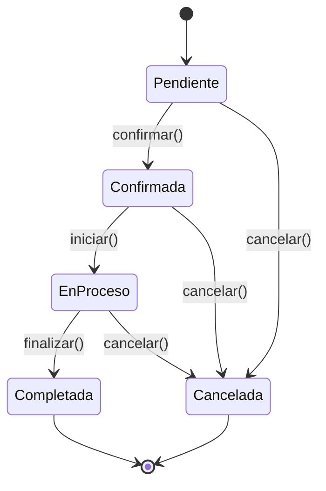
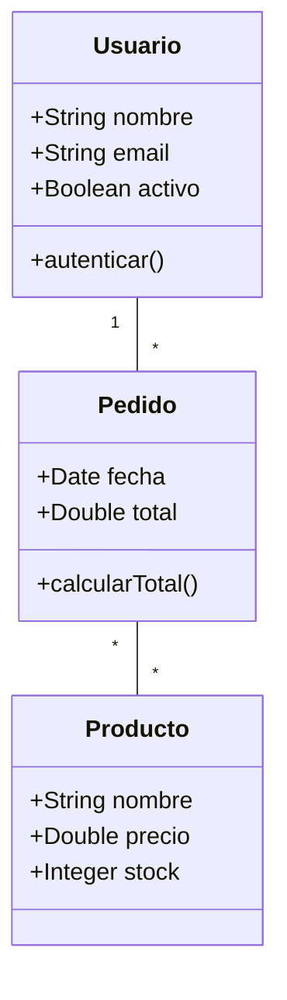
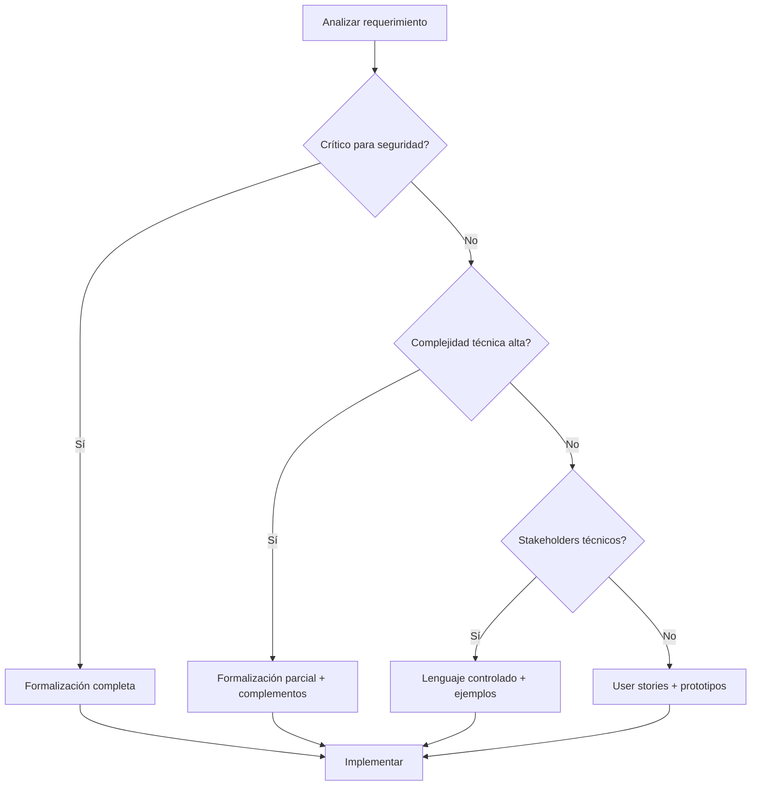

# Ingeniería de Software - Requerimientos y especificaciones

## 4.5 Alternativas y complementos para la formalización de requerimientos.

---

La formalización completa de requerimientos no siempre es práctica o necesaria. Según Boehm y Turner (2003), "el desafío está en encontrar el balance adecuado entre rigor formal y agilidad, dependiendo del contexto del proyecto". Esta guía explora alternativas y complementos a los métodos formales tradicionales.

### Definición y Contexto

Las **alternativas de formalización** son enfoques que buscan lograr precisión en los requerimientos sin recurrir a notaciones matemáticas completas. Los **complementos** son técnicas que se pueden usar junto con métodos formales para mejorar el proceso de ingeniería de requerimientos.

### Escala de Formalidad en Requerimientos

Podemos representar el nivel de formalidad como un continuo:

$$
F(n) = \frac{\sum_{i=1}^{n} w_i \cdot f_i}{\sum_{i=1}^{n} w_i}
$$

Donde:

- $f_i$ es el nivel de formalidad del requerimiento $i$
- $w_i$ es el peso (importancia) del requerimiento $i$
- $n$ es el número total de requerimientos

### Alternativas a la Formalización Completa

#### 1. Lenguaje Controlado o Restringido

Técnica que limita el vocabulario y la estructura gramatical para reducir ambigüedades.

**Ejemplo de reglas**:

- Usar solo voz activa
- Limitar longitudes de oraciones (máximo 25 palabras)
- Especificar términos obligatorios y prohibidos
- Definir estructuras sintácticas permitidas

**Ejemplo de requerimiento con lenguaje controlado**:

> "El sistema debe validar el formato del email cuando el usuario presione el botón Registrar. El formato debe incluir un símbolo @ y un dominio válido."

#### 2. Templates Estructurados

Plantillas predefinidas que guían la especificación de requerimientos.

**Template para requerimientos funcionales**:

```
ID: [Identificador único]
Título: [Nombre descriptivo]
Descripción: [Qué debe hacer el sistema]
Actor: [Quién interactúa con el sistema]
Precondición: [Condiciones previas]
Postcondición: [Resultado esperado]
Criterios de aceptación: [Condiciones verificables]
```

#### 3. User Stories con Criterios de Aceptación

Popular en metodologías ágiles, proporcionan flexibilidad con cierto nivel de precisión.

**Estructura**:

```
Como [rol]
Quiero [característica]
Para [beneficio]
```

**Criterios de aceptación**:

- Dado [contexto]
- Cuando [acción]
- Entonces [resultado]

**Ejemplo**:

```gherkin
Como usuario registrado
Quiero restablecer mi contraseña
Para acceder a mi cuenta si la olvidé

Criterios de aceptación:
- Dado que estoy en la página de login
- Cuando hago clic en "Olvidé mi contraseña"
- E ingreso mi email registrado
- Entonces debo recibir un email con enlace de restablecimiento
- Y el enlace debe expirar en 24 horas
```

#### 4. Tablas de Decisión

Útiles para requerimientos con múltiples condiciones y resultados.

**Ejemplo: Sistema de descuentos**:

| Monto Compra | Cliente Premium | Temporada Alta | Descuento |
| ------------ | --------------- | -------------- | --------- |
| < $100       | No              | No             | 0%        |
| < $100       | Sí              | No             | 5%        |
| $100-$500    | No              | No             | 10%       |
| $100-$500    | Sí              | No             | 15%       |
| > $500       | No              | No             | 15%       |
| > $500       | Sí              | No             | 20%       |
| Cualquiera   | Cualquiera      | Sí             | 5%        |

#### 5. Diagramas de Estado

Representan comportamientos del sistema ante diferentes eventos.



### Complementos a la Formalización

#### 1. Prototipos y Mockups

Ayudan a visualizar requerimientos y obtener retroalimentación temprana.

**Tipos**:

- Prototipos de baja fidelidad (sketches)
- Prototipos de alta fidelidad (interactivos)
- Wireframes y mockups

#### 2. Ejemplos y Scenarios

Los ejemplos concretos complementan la especificación formal abstracta.

**Ejemplo**:

| Entrada            | Resultado Esperado      |
| ------------------ | ----------------------- |
| "user@example"     | Error: formato inválido |
| "user@example.com" | Éxito: email válido     |
| "user@.com"        | Error: formato inválido |

#### 3. Modelado de Dominio

Representación visual de conceptos del dominio y sus relaciones.



#### 4. Técnicas de Priorización

Complementan la especificación al identificar qué requerimientos formalizar primero.

**Fórmula de valor vs. costo**:

$$
P_i = \frac{V_i}{C_i} \times \frac{R_i}{T_i}
$$

Donde:

- $P_i$: Prioridad del requerimiento $i$
- $V_i$: Valor para el negocio
- $C_i$: Costo de implementación
- $R_i$: Reducción de riesgo
- $T_i$: Tiempo de implementación

### Marco de Decisión para Seleccionar el Enfoque



### Ejemplo Integrado: Sistema de Reservas

#### Requerimiento con Múltiples Representaciones

**User Story**:

```
Como cliente
Quiero buscar habitaciones disponibles
Para realizar una reserva
```

**Criterios de aceptación (Gherkin)**:

```gherkin
Scenario: Búsqueda con fechas válidas
  Dado que estoy en la página de búsqueda
  Cuando ingreso fechas de check-in y check-out válidas
  Y selecciono "Buscar"
  Entonces debo ver una lista de habitaciones disponibles

Scenario: Búsqueda con fechas inválidas
  Dado que estoy en la página de búsqueda
  Cuando ingreso fechas donde check-out es anterior a check-in
  Y selecciono "Buscar"
  Entonces debo ver un mensaje de error
```

**Tabla de decisiones para disponibilidad**:

| Tipo Habitación | Temporada | Mínimo Noches | Anticipación Máxima |
| --------------- | --------- | ------------- | ------------------- |
| Standard        | Baja      | 1             | 30 días             |
| Standard        | Alta      | 2             | 60 días             |
| Suite           | Baja      | 2             | 60 días             |
| Suite           | Alta      | 3             | 90 días             |

### Ejercicios Propuestos

#### Ejercicio 1: Selección de Técnicas

Para cada escenario, indique la mejor técnica de especificación y justifique:

1. Sistema de control de reactor nuclear
2. Aplicación móvil de redes sociales
3. Sistema de gestión de inventarios para PYME
4. Software de procesamiento de transacciones bancarias

#### Ejercicio 2: Transformación de Requerimientos

Tome el siguiente requerimiento ambiguo y transfórmelo usando tres técnicas diferentes:

"El sistema debe procesar las órdenes rápidamente y notificar si hay problemas."

#### Ejercicio 3: Creación de Tabla de Decisión

Cree una tabla de decisión para un sistema de aprobación de créditos con las siguientes reglas:

- Aprobar automáticamente si score > 700 e ingreso > $5000
- Revisión manual si score entre 600-700 e ingreso > $3000
- Rechazar si score < 600 o ingreso < $2000
- Considerar también antigüedad laboral (>2 años favorece)

#### Ejercicio 4: Diagrama de Estados

Elabore un diagrama de estados para el proceso de publicación de contenido en un blog con los estados: Borrador, En Revisión, Aprobado, Publicado, Archivado y Rechazado.

### Ventajas y Desventajas Comparativas

#### Métodos Formales Completo

**Ventajas**: Precisión máxima, verificación formal, adecuado para sistemas críticos
**Desventajas**: Alto costo, curva de aprendizaje, difícil para no técnicos

#### Enfoques Híbridos

**Ventajas**: Balance costo-beneficio, comunicación mejorada, más flexibilidad
**Desventajas**: Puede dejar ambigüedades, menos capacidad de verificación formal

#### Enfoques Ligeros

**Ventajas**: Rápidos, comprensibles, buenos para iteración ágil
**Desventajas**: Menos precisos, pueden ocultar complejidades

### Referencias

1. Boehm, B., & Turner, R. (2003). _Balancing Agility and Discipline: A Guide for the Perplexed_. Capítulo 4.
2. Cockburn, A. (2004). _Crystal Clear: A Human-Powered Methodology for Small Teams_. Sección sobre especificación ligera.
3. Pfleeger, S. L., & Atlee, J. M. (2010). _Software Engineering: Theory and Practice_. Capítulo 4.
4. Evans, E. (2003). _Domain-Driven Design: Tackling Complexity in the Heart of Software_. Parte II.
5. Adzic, G. (2011). _Specification by Example: How Successful Teams Deliver the Right Software_.

### Recursos Adicionales

- Herramientas para especificación por ejemplo: Cucumber, SpecFlow
- Herramientas para prototipado: Figma, Adobe XD, Balsamiq
- Frameworks para documentación: Asciidoc, Markdown con extensiones
- Plantillas para diferentes tipos de requerimientos
