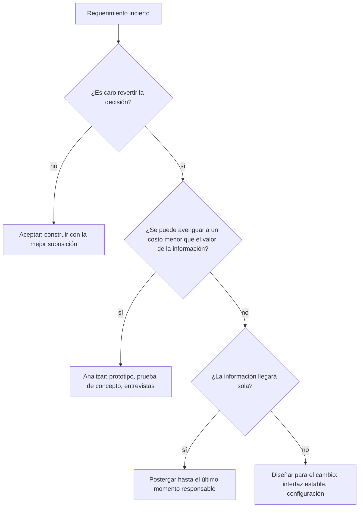

# Ingeniería de Software - Requerimientos y especificaciones

## 4.6 Aceptabilidad de incertidumbre en los requerimientos.

---

Ningún proyecto conoce todos sus requerimientos al empezar. Los usuarios descubren lo que necesitan al usar el sistema, el negocio cambia, la tecnología cambia, y algunas cosas, como la demanda futura, son inciertas por naturaleza. La pregunta práctica no es cómo eliminar la incertidumbre, que es imposible, sino **cuánta aceptar**, **cuándo invertir en reducirla** y **cómo diseñar** para que la que queda cueste poco. Este tema clasifica las fuentes de incertidumbre, presenta un criterio económico para decidir cuándo vale la pena reducirla, y las técnicas para escribir requerimientos y diseñar sistemas que la toleren.

### Fuentes

- **Del conocimiento** (epistémica): lo que no se sabe pero podría averiguarse, como las reglas de un sistema heredado sin documentación, o lo que de verdad necesitan los usuarios. Se reduce investigando: entrevistas, prototipos, pruebas de concepto.
- **De la variabilidad** (aleatoria): lo que es incierto por naturaleza, como cuántos usuarios habrá en dos años. No se reduce investigando; se maneja con rangos, escenarios y diseños que se adaptan.
- **Del lenguaje:** requerimientos vagos, como "fácil de usar" u "optimizar", que cada lector interpreta distinto. Se reduce cuantificando: definir la métrica, la escala y el umbral, al estilo de la notación Planguage de Gilb.
- **De la volatilidad:** requerimientos que se sabe que cambiarán, como reglas fiscales o promociones.

El **cono de incertidumbre** de Boehm y McConnell describe cómo se reduce durante el proyecto: al inicio, las estimaciones pueden equivocarse por un factor de cuatro en cada sentido, y el rango se estrecha conforme se toman decisiones y se construye. Pero el cono solo se estrecha si el proyecto **actúa** para reducir la incertidumbre; si no, se mantiene ancho hasta el final.

### Cuándo reducirla

Reducir la incertidumbre cuesta, en estudios, prototipos y tiempo, y su beneficio es evitar el costo de una decisión equivocada. La teoría de la decisión da el criterio: el **valor esperado de la información perfecta**, la diferencia entre el costo esperado de decidir ahora y el de decidir sabiendo la respuesta, es lo máximo que vale la pena pagar por averiguarla. Si un estudio cuesta menos que lo que ahorra en esperanza, conviene hacerlo. De ahí se derivan reglas prácticas:

- **Reducir** la incertidumbre de las decisiones caras de revertir, como la arquitectura, el modelo de datos, o una integración con un sistema externo, y en las que el error es probable.
- **Aceptarla** en las decisiones baratas de cambiar, como el texto de una pantalla, y construir con la mejor suposición.
- **Postergar** la decisión hasta el **último momento responsable** de Poppendieck, el punto en que no decidir empieza a costar más que decidir, cuando la información llegará sola con el tiempo, como la respuesta de los usuarios a una primera versión.
- **Diseñar para el cambio** cuando la incertidumbre es irreducible: interfaces estables con implementaciones intercambiables, configuración en lugar de código, y arquitecturas que escalan horizontalmente. Es comprar una **opción real**, un derecho a cambiar después a un costo bajo.



### Requerimientos tolerantes

Un requerimiento tolerante a la incertidumbre especifica lo que de verdad importa y deja libre lo demás:

- **Expresar la necesidad, no la solución:** "los datos se guardan en una base de datos relacional compatible con SQL estándar" en lugar de nombrar un producto, salvo que la organización lo exija.
- **Usar rangos y escenarios:** "debe soportar 10 000 usuarios simultáneos con un tiempo de respuesta de 2 segundos, y escalar a 30 000 agregando servidores sin cambios de código".
- **Separar lo estable de lo volátil:** las reglas que cambian en tablas o archivos de configuración.
- **Marcar la incertidumbre explícitamente:** "supuesto: la API del sistema de nómina responde en menos de 1 segundo; por validar en la iteración 2".

### Implementación en Python

El programa resuelve el ejercicio 1 identificando, para cada requerimiento, sus fuentes de incertidumbre: los términos vagos que detecta en el texto, la falta de un criterio medible y las dependencias del contexto. Para el ejercicio 4 hace el análisis de decisión: compara el costo esperado de construir con la interpretación actual con el de estudiar primero, calcula el valor de la información perfecta, el umbral de probabilidad a partir del cual conviene estudiar, y el efecto de un estudio imperfecto.

```python
import re

# ---------- Ejercicio 1: indicadores de incertidumbre en el texto y en el contexto ----------
VAGOS = r"\b(fácil|rápid\w*|optimiz\w*|eficiente\w*|amigable|flexible|robust\w*|adecuad\w*|suficiente\w*|mejor\w*|intuitiv\w*)\b"
reqs = {
    1: ("El sistema debe ser fácil de usar", {"medible": False, "dependencia externa": False, "supuesto a futuro": False}),
    2: ("Debe integrarse con los sistemas legacy existentes", {"medible": False, "dependencia externa": True, "supuesto a futuro": False}),
    3: ("Debe soportar un crecimiento del 200% en usuarios en 2 años", {"medible": True, "dependencia externa": False, "supuesto a futuro": True}),
    4: ("El tiempo de procesamiento debe optimizarse", {"medible": False, "dependencia externa": False, "supuesto a futuro": False}),
}
print("ejercicio 1: fuentes de incertidumbre de cada requerimiento")
for k, (texto, ctx) in reqs.items():
    vagos = re.findall(VAGOS, texto, re.I)
    fuentes = ([f"término vago {vagos}"] if vagos else []) + (["sin criterio medible"] if not ctx["medible"] else []) + \
              (["depende de sistemas ajenos y poco documentados"] if ctx["dependencia externa"] else []) + \
              (["pronóstico de demanda"] if ctx["supuesto a futuro"] else [])
    print(f"   {k}. {texto!r}: {len(fuentes)} {'fuente' if len(fuentes) == 1 else 'fuentes'} → {'; '.join(fuentes)}")

# ---------- Ejercicio 4: ¿vale la pena reducir la incertidumbre antes de construir? ----------
p_cambio = 0.40                     # probabilidad de que la interpretación actual del requerimiento resulte equivocada
costo_construir = 60_000
costo_rehacer = 90_000              # rehacer después de construir sobre la interpretación equivocada
costo_estudio = 12_000              # prototipo y entrevistas que revelan la interpretación correcta
valor_retraso = 4_000               # costo de oportunidad de las 3 semanas del estudio
sin_estudio = costo_construir + p_cambio * costo_rehacer
con_estudio = costo_estudio + valor_retraso + costo_construir   # se construye directamente lo correcto
evpi = sin_estudio - costo_construir                            # valor de la información perfecta
print(f"ejercicio 4: exposición al riesgo = {p_cambio} · {costo_rehacer:,} = {p_cambio * costo_rehacer:,.0f}")
print(f"   construir ya: costo esperado {sin_estudio:,.0f} | estudiar primero: {con_estudio:,.0f} | "
      f"valor de la información perfecta {evpi:,.0f}")
print("   decisión:", "estudiar primero" if con_estudio < sin_estudio else "construir ya")
umbral = (costo_estudio + valor_retraso) / costo_rehacer
print(f"   estudiar conviene si P(cambio) > (estudio + retraso)/rehacer = {umbral:.1%}")
for p in (0.1, 0.2, 0.4, 0.6):
    print(f"   P = {p:.0%}: construir ya {costo_construir + p * costo_rehacer:,.0f} frente a estudiar {con_estudio:,.0f}")
# estudio imperfecto: solo detecta el error con probabilidad 0.7
detecta = 0.7
imperfecto = costo_estudio + valor_retraso + costo_construir + p_cambio * (1 - detecta) * costo_rehacer
print(f"   con un estudio que detecta el error el {detecta:.0%} de las veces: {imperfecto:,.0f}")
```

Salida:

```text
ejercicio 1: fuentes de incertidumbre de cada requerimiento
   1. 'El sistema debe ser fácil de usar': 2 fuentes → término vago ['fácil']; sin criterio medible
   2. 'Debe integrarse con los sistemas legacy existentes': 2 fuentes → sin criterio medible; depende de sistemas ajenos y poco documentados
   3. 'Debe soportar un crecimiento del 200% en usuarios en 2 años': 1 fuente → pronóstico de demanda
   4. 'El tiempo de procesamiento debe optimizarse': 2 fuentes → término vago ['optimizarse']; sin criterio medible
ejercicio 4: exposición al riesgo = 0.4 · 90,000 = 36,000
   construir ya: costo esperado 96,000 | estudiar primero: 76,000 | valor de la información perfecta 36,000
   decisión: estudiar primero
   estudiar conviene si P(cambio) > (estudio + retraso)/rehacer = 17.8%
   P = 10%: construir ya 69,000 frente a estudiar 76,000
   P = 20%: construir ya 78,000 frente a estudiar 76,000
   P = 40%: construir ya 96,000 frente a estudiar 76,000
   P = 60%: construir ya 114,000 frente a estudiar 76,000
   con un estudio que detecta el error el 70% de las veces: 86,800
```

### Ejercicios Propuestos

1. **Análisis.** Determina el nivel y las fuentes de incertidumbre de estos requerimientos y propón cómo manejarla:

    1. "El sistema debe ser fácil de usar".
    2. "Debe integrarse con los sistemas heredados existentes".
    3. "Debe soportar un crecimiento del 200 % en usuarios en 2 años".
    4. "El tiempo de procesamiento debe optimizarse".

2. **Especificación tolerante.** Reescribe para que toleren la incertidumbre: "el sistema debe usar la base de datos Oracle 19c"; "la interfaz debe seguir los lineamientos de Material Design 3"; "debe soportar exactamente 10 000 usuarios simultáneos".

3. **Marco de decisión.** Desarrolla un marco para decidir cuándo aceptar la incertidumbre, analizar más, postergar la decisión o implementar una solución flexible.

4. **Riesgo.** Para un requerimiento con 40 % de incertidumbre y alto impacto de negocio, calcula el riesgo, propón un plan de mitigación y compara el costo de reducir la incertidumbre con el de un cambio posterior.

### Soluciones

**Ejercicio 1.** Un "porcentaje de incertidumbre" asignado a ojo da una falsa precisión; es más útil identificar sus **fuentes**, porque cada una se maneja distinto.

1. **"Fácil de usar":** del lenguaje; término vago sin criterio. Se maneja cuantificando: "el 90 % de los usuarios nuevos completa una compra sin ayuda en menos de 3 minutos, en una prueba con 8 usuarios", y validando con prototipos.
2. **"Integrarse con los sistemas heredados":** del conocimiento; no se sabe qué sistemas, qué datos, ni qué interfaces tienen. Es la de mayor riesgo técnico, y se reduce con un inventario de los sistemas y una **prueba de concepto** de la integración más difícil en la primera iteración.
3. **"Crecer 200 % en 2 años":** de la variabilidad; el número es preciso, pero es un pronóstico. Se maneja diseñando para escalar horizontalmente, con pruebas de carga al triple de la carga actual, y revisando el pronóstico cada trimestre.
4. **"Optimizarse":** del lenguaje; sin métrica ni meta. Se maneja preguntando qué proceso, cuánto tarda hoy y cuánto debería tardar, por ejemplo "el cierre diario baja de 4 horas a menos de 1".

**Ejercicio 2.**

1. "El sistema debe usar una base de datos relacional con transacciones ACID y SQL estándar, con acceso a través de una capa de persistencia que permita cambiar de producto." Si Oracle es una restricción real, por licencias existentes o por el equipo de operación, se mantiene como **restricción organizacional explícita**, con su justificación.
2. "La interfaz debe seguir el sistema de diseño de la organización, basado actualmente en Material Design 3, con los componentes centralizados en una biblioteca", para que una nueva versión se adopte en un lugar.
3. "Debe soportar al menos 10 000 usuarios simultáneos con un percentil 95 de respuesta de 2 segundos, y escalar linealmente agregando servidores." "Exactamente" no tiene sentido como requerimiento de capacidad: lo que importa es el mínimo garantizado y cómo crecer.

**Ejercicio 3.** El diagrama de decisión de la sección de cuándo reducirla es el marco. Sus preguntas, en orden: ¿es cara de revertir la decisión?; si no, se acepta la incertidumbre. Si lo es, ¿se puede averiguar la respuesta por menos de lo que vale la información?; si sí, se analiza. Si no, ¿llegará la información sola, con el uso o con el tiempo?; si sí, se posterga hasta el último momento responsable; si no, se diseña una solución flexible. El marco se aplica a cada decisión importante, y la decisión y su razón se registran, por ejemplo en un registro de decisiones de arquitectura (tema 5).

**Ejercicio 4.** "40 % de incertidumbre" se interpreta como una probabilidad de 40 % de que la interpretación actual sea equivocada. Con un costo de rehacer de 90 000, la exposición es $0.40 \cdot 90\,000 = 36\,000,$ que es también el **valor de la información perfecta**: lo máximo que vale la pena pagar por saber la respuesta. Un estudio con prototipo y entrevistas de 12 000, más 4 000 de costo de oportunidad por el retraso, da un costo esperado de 76 000 frente a 96 000 de construir ya: conviene estudiar. El umbral es

$$P^* = \frac{C_{\text{estudio}} + C_{\text{retraso}}}{C_{\text{rehacer}}} = \frac{16\,000}{90\,000} \approx 17.8\,\%,$$

y por debajo de él conviene construir ya. Un estudio real no es perfecto; si solo detecta el error en el 70 % de los casos, el costo esperado sube a 86 800 y sigue conviniendo. El plan de mitigación: un prototipo validado con los usuarios clave en las primeras dos semanas, diseño de la parte incierta detrás de una interfaz que permita cambiarla, y un punto de decisión explícito al terminar el estudio. Las cifras son supuestas; el método es el que importa.

### Referencias

1. McConnell, S., _Software Estimation: Demystifying the Black Art_. Microsoft Press, 2006. Capítulo 4.
2. Poppendieck, M., and Poppendieck, T., _Lean Software Development_. Addison-Wesley, 2003.
3. Gilb, T., _Competitive Engineering_. Butterworth-Heinemann, 2005.
4. Hubbard, D. W., _How to Measure Anything_. Wiley, 2014.
5. Boehm, B. W., _Software Engineering Economics_. Prentice Hall, 1981.
6. Ebert, C., and De Man, J., Requirements uncertainty: influencing factors and concrete improvements. _ICSE_, 2005.
