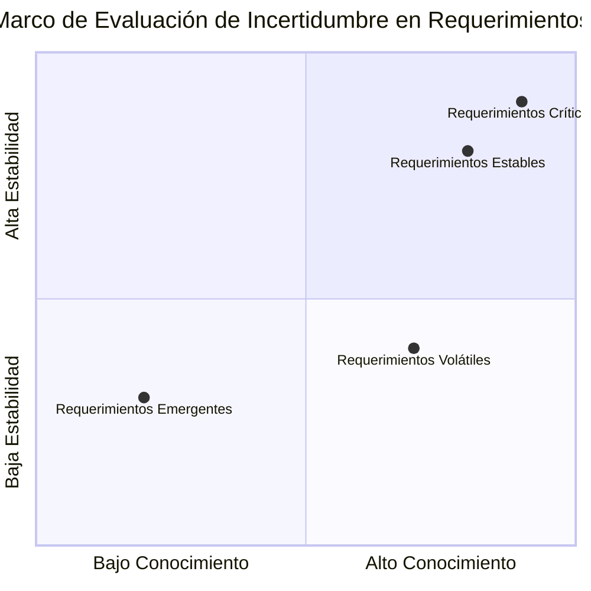
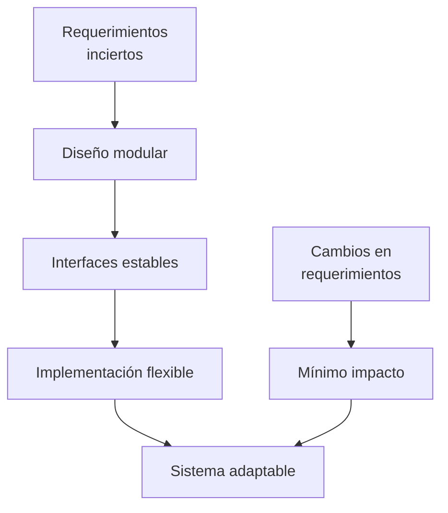
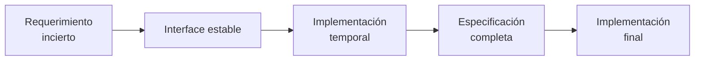

# Ingeniería de Software - Requerimientos y especificaciones

## 4.6 Aceptabilidad de incertidumbre en los requerimientos.

---

La incertidumbre en los requerimientos es una realidad inevitable en la ingeniería de software. Según Pfleeger y Atlee (2010), "la incertidumbre en los requerimientos surge de la naturaleza cambiante de los negocios, la evolución tecnológica y las limitaciones en la comprensión inicial de los problemas del dominio". Esta guía explora cómo gestionar y aceptar diferentes niveles de incertidumbre en el proceso de ingeniería de requerimientos.

### Definición y Conceptos Básicos

#### Incertidumbre en Requerimientos

La **incertidumbre en requerimientos** se define como la falta de certeza o precisión completa sobre las necesidades del sistema, sus restricciones o el entorno operativo. Matemáticamente, podemos representar la incertidumbre de un requerimiento $r$ como:

$$
U(r) = 1 - \frac{C(r)}{C_{\text{max}}(r)}
$$

Donde:

- $U(r)$ es el nivel de incertidumbre del requerimiento $r$ (0 a 1)
- $C(r)$ es el nivel de certeza actual sobre $r$
- $C_{\text{max}}(r)$ es el nivel máximo posible de certeza sobre $r$

#### Tipos de Incertidumbre

1. **Incertidumbre epistemológica**: Surge de conocimiento incompleto
2. **Incertidumbre ontológica**: Surge de la inherente variabilidad del dominio
3. **Incertidumbre de especificación**: Relacionada con cómo expresar los requerimientos
4. **Incertidumbre de medición**: Relacionada con la cuantificación de atributos

### Factores que Contribuyen a la Incertidumbre

#### 1. Complejidad del Dominio

Dominios novedosos o altamente complejos presentan mayor incertidumbre:

$$
U_d \propto \frac{1}{E_d}
$$

Donde $U_d$ es la incertidumbre del dominio y $E_d$ es la experiencia en el dominio.

#### 2. Volatilidad de Stakeholders

Cambios en necesidades, prioridades o composición de stakeholders:

$$
U_s(t) = U_{s0} \cdot e^{k \cdot t}
$$

Donde $U_s(t)$ es la incertidumbre por stakeholders en el tiempo $t$, y $k$ es la tasa de cambio.

#### 3. Evolución Tecnológica

Nuevas tecnologías introducen incertidumbre técnica:

$$
U_t \propto \frac{I_n}{E_t}
$$

Donde $I_n$ es la innovación tecnológica y $E_t$ es la experiencia técnica.

### Marco de Evaluación de Incertidumbre



### Estrategias para Manejar Incertidumbre

#### 1. Tolerancia a la Incertidumbre

Establecer umbrales aceptables de incertidumbre por tipo de requerimiento:

$$
A(r) = \begin{cases}
\text{Aceptable} & \text{si } U(r) \leq U_{\text{umbral}}(r) \\
\text{No aceptable} & \text{si } U(r) > U_{\text{umbral}}(r)
\end{cases}
$$

#### 2. Especificación Tolerante a Cambios

Usar técnicas que accomoden evolución:

**Ejemplo de requerimiento flexible**:

```gherkin
Como usuario
Quiero buscar productos por varios criterios
Para encontrar rápidamente lo que necesito

Criterios de búsqueda pueden incluir:
- Nombre del producto
- Categoría
- Rango de precios
- Marca
- Características específicas [por definir]
```

#### 3. Arquitecturas Adaptables

Diseñar sistemas que puedan evolucionar con los requerimientos:



### Técnicas de Cuantificación de Incertidumbre

#### 1. Análisis de Probabilidades

Asignar probabilidades a diferentes interpretaciones:

Para un requerimiento $r$ con $n$ interpretaciones posibles:

$$
P(r) = \{p_1, p_2, ..., p_n\} \quad \text{donde} \quad \sum_{i=1}^{n} p_i = 1
$$

#### 2. Lógica Difusa

Para requerimientos con límites no precisos:

$$
\mu_{\text{rapido}}(t) = \begin{cases}
0 & \text{si } t > 5s \\
\frac{5 - t}{4} & \text{si } 1s < t \leq 5s \\
1 & \text{si } t \leq 1s
\end{cases}
$$

#### 3. Teoría de Dempster-Shafer

Para evidencia incompleta o conflictiva:

$$
Bel(A) = \sum_{B \subseteq A} m(B)
$$

$$
Pl(A) = \sum_{B \cap A \neq \emptyset} m(B)
$$

Donde $Bel(A)$ es la creencia en $A$ y $Pl(A)$ es la plausibilidad de $A$.

### Ejemplos de Incertidumbre y Estrategias

#### Ejemplo 1: Requerimiento de Rendimiento Incierto

**Requerimiento ambiguo**: "El sistema debe responder rápidamente"

**Estrategias**:

1. Especificación progresiva: "Respuesta en menos de 2s para el 90% de peticiones"
2. Mecanismos de medición: Implementar monitorización desde el inicio
3. Cláusulas de revisión: Revisar umbrales cada 3 meses

#### Ejemplo 2: Requerimiento con Dependencias Externas

**Requerimiento**: "Integración con sistema de pago externo"

**Estrategias**:

1. Interfaces abstractas: Definir interface estable independiente del proveedor
2. Mocks y stubs: Desarrollar contra interfaces simuladas
3. Contratos flexibles: Cláusulas que permiten cambiar proveedores

### Ejercicios Propuestos

#### Ejercicio 1: Análisis de Incertidumbre

Para cada requerimiento, calcule el nivel de incertidumbre y proponga estrategias de manejo:

1. "El sistema debe ser fácil de usar"
2. "Debe integrarse con los sistemas legacy existentes"
3. "Debe soportar un crecimiento del 200% en usuarios en 2 años"
4. "El tiempo de procesamiento debe optimizarse"

#### Ejercicio 2: Especificación Tolerante

Reescriba los siguientes requerimientos para hacerlos más tolerantes a incertidumbre:

1. "El sistema debe usar la base de datos Oracle 19c"
2. "La interfaz debe seguir los lineamientos de Material Design v3"
3. "Debe soportar exactamente 10,000 usuarios concurrentes"

#### Ejercicio 3: Marco de Decisión

Desarrolle un marco de decisión para determinar cuándo:

- Aceptar la incertidumbre
- Realizar más análisis
- Postergar la decisión
- Implementar soluciones flexibles

#### Ejercicio 4: Análisis de Riesgo

Para un requerimiento con 40% de incertidumbre y alto impacto de negocio:

- Calcule el riesgo asociado
- Proponga un plan de mitigación
- Estime el costo de reducción de incertidumbre vs. costo de cambio posterior

### Modelo de Costo de Incertidumbre

El costo total de la incertidumbre puede modelarse como:

$$
C_{\text{total}} = C_{\text{reducción}} + C_{\text{impacto}} + C_{\text{oportunidad}}
$$

Donde:

- $C_{\text{reducción}}$: Costo de reducir la incertidumbre (investigación, análisis)
- $C_{\text{impacto}}$: Costo del impacto de la incertidumbre (cambios, retrabajo)
- $C_{\text{oportunidad}}$: Costo de oportunidad por postergar decisiones

### Patrones para Manejar Incertidumbre

#### 1. Patrón de Especificación Retardada



#### 2. Patrón de Tolerancia a Variación

```
REQUERIMIENTO: Soporte para [función]
VARIACIONES POSIBLES: [v1, v2, v3]
VARIACIÓN POR DEFECTO: [v1]
MECANISMO SELECCIÓN: [configuración, auto-detección]
```

#### 3. Patrón de Decisión Reversible

```
DECISIÓN: [Decisión técnica]
DRIVERS: [Factores que influyen]
ALTERNATIVAS: [Opciones posibles]
REVERSIBILIDAD: [Alta/Media/Baja]
COSTO REVERSIÓN: [Estimación]
```

### Referencias

1. Pfleeger, S. L., & Atlee, J. M. (2010). _Software Engineering: Theory and Practice_. Capítulo 4: "Requirements Engineering".
2. Boehm, B., & Turner, R. (2003). _Balancing Agility and Discipline: A Guide for the Perplexed_. Capítulo 5: "Risk Management".
3. Cockburn, A. (2004). _Crystal Clear: A Human-Powered Methodology for Small Teams_. Sección sobre manejo de incertidumbre.
4. Evans, E. (2003). _Domain-Driven Design: Tackling Complexity in the Heart of Software_. Parte III: "Refactoring Toward Deeper Insight".
5. Wiegers, K., & Beatty, J. (2013). _Software Requirements_. Capítulo 28: "Requirements Uncertainty".

### Recursos Adicionales

- Técnicas de estimación bajo incertidumbre: PERT, Monte Carlo
- Herramientas de gestión de riesgos
- Métodos de priorización con incertidumbre: Cost of Delay, WSJF
- Frameworks para decision-making under uncertainty: Cynefin framework
