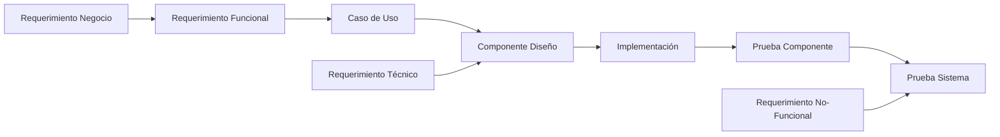
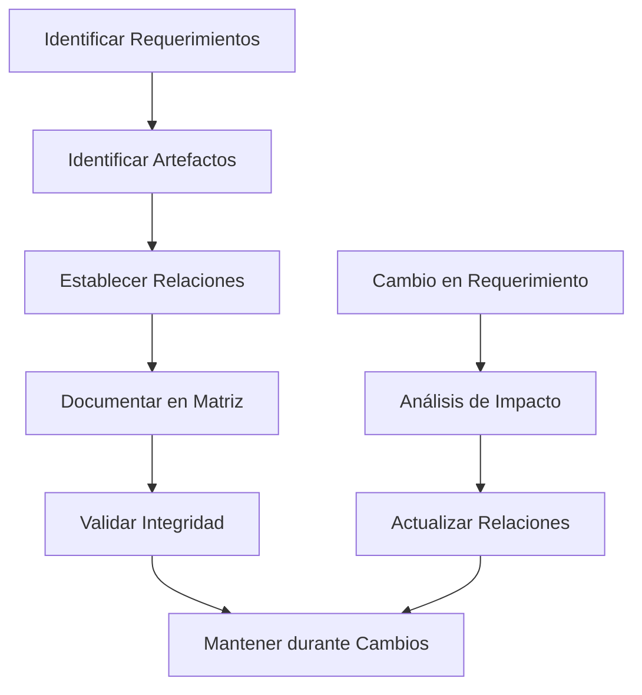
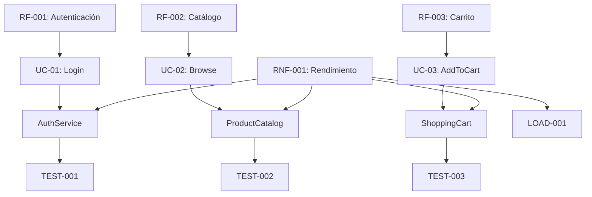

# Ingeniería de Software - Requerimientos y especificaciones

## 4.7 Rastreo de requerimientos.

---

El rastreo de requerimientos (requirements traceability) es una disciplina fundamental en la ingeniería de software que establece y mantiene conexiones entre diversos artefactos del ciclo de desarrollo. Según Gotel y Finkelstein (1994), el rastreo de requerimientos es "la capacidad de describir y seguir la vida de un requerimiento, en ambas direcciones, a través de los procesos de desarrollo".

### Definición y Conceptos Básicos

#### Rastreo de Requerimientos

El **rastreo de requerimientos** es el proceso de establecer, mantener y visualizar las relaciones entre requerimientos y otros artefactos del desarrollo de software. Matemáticamente, podemos representar las relaciones de rastreo como:

$$
T \subseteq R \times A
$$

Donde:

- $T$ es el conjunto de relaciones de rastreo
- $R$ es el conjunto de requerimientos
- $A$ es el conjunto de artefactos (diseño, código, pruebas, etc.)

#### Matriz de Rastreo

La matriz de rastreo es una representación tabular de las relaciones:

| Requerimiento | Artefacto | Tipo Relación | Dirección |
| ------------- | --------- | ------------- | --------- |
| RF-001        | UC-01     | Implementa    | Forward   |
| RF-001        | TEST-05   | Verifica      | Backward  |

### Tipos de Rastreo

#### 1. Rastreo Horizontal vs. Vertical

- **Horizontal**: Entre requerimientos de mismo nivel
- **Vertical**: Entre requerimientos y artefactos de implementación

#### 2. Rastreo Forward vs. Backward

- **Forward**: Desde requerimientos hacia artefactos
- **Backward**: Desde artefactos hacia requerimientos

#### 3. Rastreo Interno vs. Externo

- **Interno**: Entre requerimientos
- **Externo**: Entre requerimientos y artefactos

### Beneficios del Rastreo de Requerimientos

#### 1. Impact Analysis

Identificar el efecto de cambios en requerimientos:

$$
I(c) = \{a \in A | \exists r \in R \text{ afectado por } c \land (r, a) \in T\}
$$

Donde $I(c)$ es el impacto del cambio $c$.

#### 2. Verificación de Completitud

Asegurar que todos los requerimientos están implementados:

$$
C = \frac{|R_{\text{implementados}}|}{|R|} \times 100\%
$$

#### 3. Cumplimiento de Normativas

Demostrar que los requerimientos regulatorios están satisfechos.

### Estructura de Datos para Rastreo

#### Representación Graph-Based



#### Esquema de Base de Datos de Rastreo

```sql
CREATE TABLE Requirement (
    id VARCHAR(20) PRIMARY KEY,
    description TEXT,
    priority INTEGER,
    source VARCHAR(100),
    status VARCHAR(20)
);

CREATE TABLE Artifact (
    id VARCHAR(20) PRIMARY KEY,
    type VARCHAR(50),
    name VARCHAR(100),
    version VARCHAR(20)
);

CREATE TABLE Traceability (
    requirement_id VARCHAR(20),
    artifact_id VARCHAR(20),
    relationship_type VARCHAR(50),
    direction VARCHAR(10),
    strength FLOAT, -- 0.0 to 1.0
    PRIMARY KEY (requirement_id, artifact_id),
    FOREIGN KEY (requirement_id) REFERENCES Requirement(id),
    FOREIGN KEY (artifact_id) REFERENCES Artifact(id)
);
```

### Métricas de Rastreo

#### 1. Completeness of Traceability

$$
C_t = \frac{|T_{\text{actual}}|}{|T_{\text{ideal}}|} \times 100\%
$$

#### 2. Traceability Accuracy

$$
A_t = \frac{|T_{\text{correct}}|}{|T_{\text{total}}|} \times 100\%
$$

#### 3. Change Impact Factor

Para un requerimiento $r$:

$$
IF(r) = |\{a \in A | (r, a) \in T\}|
$$

### Proceso de Establecimiento de Rastreo



### Técnicas de Rastreo

#### 1. Rastreo Basado en Tags

Incrustar identificadores en artefactos:

```java
// @requirement RF-001
public class UserAuthentication {
    // @requirement RF-001.1
    public boolean validateCredentials(String user, String pass) {
        // Implementation for RF-001.1
    }

    // @requirement RF-001.2
    public void resetPassword(String email) {
        // Implementation for RF-001.2
    }
}
```

#### 2. Rastreo Basado en Herramientas

Uso de herramientas especializadas como DOORS, Jama Connect, o soluciones open-source.

#### 3. Rastreo Automático

Técnicas de NLP y machine learning para descubrir relaciones automáticamente.

### Ejemplo Completo: Sistema de E-commerce

#### Matriz de Rastreo Parcial

| Requerimiento         | Caso de Uso      | Componente     | Prueba   | Estado |
| --------------------- | ---------------- | -------------- | -------- | ------ |
| RF-001: Autenticación | UC-01: Login     | AuthService    | TEST-001 | (✓)    |
| RF-002: Catálogo      | UC-02: Browse    | ProductCatalog | TEST-002 | (✓)    |
| RF-003: Carrito       | UC-03: AddToCart | ShoppingCart   | TEST-003 | ⏳     |
| RNF-001: Rendimiento  | -                | AllComponents  | LOAD-001 | (✓)    |

#### Visualización de Dependencias



### Ejercicios Propuestos

#### Ejercicio 1: Crear Matriz de Rastreo

Para los siguientes requerimientos de un sistema de biblioteca, cree una matriz de rastreo completa:

1. RF-001: Búsqueda de libros por título, autor o categoría
2. RF-002: Préstamo de libros con registro de fechas
3. RF-003: Devolución de libros con cálculo de multas
4. RNF-001: Respuesta en menos de 2 segundos para búsquedas
5. RNF-002: Soporte para 100 usuarios concurrentes

Identifique al menos 3 artefactos por requerimiento (diseño, implementación, prueba).

#### Ejercicio 2: Análisis de Impacto

Un cambio requiere modificar RF-002 para incluir renovación de préstamos. Asumiendo las siguientes relaciones:

- RF-002 → UC-02 (Préstamo)
- UC-02 → C02 (LoanService)
- C02 → T02 (TestPréstamo)
- RF-002 → RNF-002 (Concurrencia)

Calcule el impacto del cambio y visualice las relaciones afectadas.

#### Ejercicio 3: Métricas de Rastreo

Para un proyecto con:

- 50 requerimientos
- 200 artefactos
- 350 relaciones de rastreo identificadas
- 320 relaciones correctas
- Idealmente debería haber 500 relaciones

Calcule:

1. Completeness of Traceability $(C_t)$
2. Traceability Accuracy $(A_t)$
3. Traceability Density promedio por requerimiento

#### Ejercicio 4: Diseño de Esquema de Rastreo

Diseñe un esquema de base de datos mejorado que incluya:

- Histórico de cambios en relaciones
- Atributos de calidad de rastreo
- Soporte para diferentes tipos de artefactos
- Consultas eficientes para análisis de impacto

### Herramientas y Implementación

#### Herramientas Populares

- **IBM DOORS**: Enterprise requirements management
- **Jama Connect**: Modern requirements platform
- **Polarion**: ALM with requirements management
- **Open-source**: RestBible, ReqView

#### Implementación con APIs

Ejemplo de API REST para gestión de rastreo:

```python
# Ejemplo de API para traceability
@app.route('/api/traceability', methods=['POST'])
def create_trace_link():
    data = request.json
    requirement_id = data['requirement_id']
    artifact_id = data['artifact_id']
    relationship = data['relationship']

    # Validar existencia
    if not Requirement.exists(requirement_id):
        return jsonify({'error': 'Requirement not found'}), 404

    if not Artifact.exists(artifact_id):
        return jsonify({'error': 'Artifact not found'}), 404

    # Crear relación
    trace_id = Traceability.create(
        requirement_id,
        artifact_id,
        relationship
    )

    return jsonify({'trace_id': trace_id}), 201

@app.route('/api/impact-analysis/<requirement_id>')
def impact_analysis(requirement_id):
    impacted_artifacts = Traceability.get_impacted_artifacts(requirement_id)
    return jsonify({'impacted_artifacts': impacted_artifacts})
```

### Buenas Prácticas

#### 1. Establecer Políticas de Rastreo

Definir qué se rastrea, cómo y cuándo.

#### 2. Automatizar cuando sea Posible

Usar herramientas y scripts para minimizar esfuerzo manual.

#### 3. Mantener la Consistencia

Revisar regularmente la integridad de las relaciones.

#### 4. Balancear Esfuerzo y Beneficio

No sobre-engineer el proceso de rastreo.

### Referencias

1. Gotel, O. C. Z., & Finkelstein, A. C. W. (1994). _An Analysis of the Requirements Traceability Problem_. IEEE International Conference on Requirements Engineering.
2. Pfleeger, S. L., & Atlee, J. M. (2010). _Software Engineering: Theory and Practice_. Capítulo 4: "Requirements Engineering".
3. Sommerville, I. (2010). _Software Engineering_ (9th edition). Capítulo 4: "Requirements Engineering".
4. Ramesh, B., & Jarke, M. (2001). _Toward Reference Models for Requirements Traceability_. IEEE Transactions on Software Engineering.
5. Cleland-Huang, J., Gotel, O., & Zisman, A. (2012). _Software and Systems Traceability_. Springer.

### Recursos Adicionales

- Herramientas de traceability open-source
- Plantillas de matrices de rastreo
- Frameworks para automatización de traceability
- Casos de estudio de implementación en grandes proyectos
