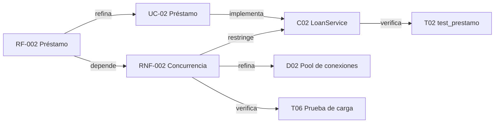

# Ingeniería de Software - Requerimientos y especificaciones

## 4.7 Rastreo de requerimientos.

---

El **rastreo** (*traceability*) de requerimientos es la capacidad de seguir la vida de un requerimiento hacia atrás, hasta la necesidad o la persona que lo originó, y hacia adelante, hasta el diseño, el código y las pruebas que lo realizan y lo verifican. Gotel y Finkelstein lo definieron así en 1994, distinguiendo el rastreo **previo a la especificación**, sobre el origen de cada requerimiento, del **posterior**, sobre lo que se construye a partir de él. Este tema describe para qué sirve el rastreo, cómo se representa con matrices y grafos, cómo se usa para analizar el impacto de un cambio, cómo se mide y qué herramientas lo apoyan.

### Para qué sirve

- **Análisis de impacto:** antes de cambiar un requerimiento, saber qué diseños, módulos y pruebas se ven afectados, y por tanto cuánto cuesta el cambio.
- **Cobertura:** comprobar que todo requerimiento tenga diseño, código y pruebas, y que toda prueba verifique algún requerimiento.
- **Justificación:** saber por qué existe cada pieza del sistema; código sin requerimiento puede ser funcionalidad sobrante o un requerimiento no documentado.
- **Certificación:** las normas de sistemas críticos, como DO-178C en aviación, ISO 26262 en automóviles o IEC 62304 en dispositivos médicos, exigen rastreo bidireccional completo como evidencia.
- **Mantenimiento:** al corregir un defecto, saber qué requerimiento se incumplía y qué otras pruebas deben repetirse.

### Representación

Las relaciones de rastreo forman un **grafo dirigido** cuyos nodos son artefactos, como requerimientos, casos de uso, componentes de diseño, módulos de código y pruebas, y cuyas aristas tienen un tipo: *refina*, *implementa*, *verifica*, *depende de*, *restringe*. La **matriz de rastreo** es la vista tabular del grafo: una fila por requerimiento y una columna por artefacto, o por tipo de artefacto, con una marca donde hay relación. Una fila vacía en la columna de pruebas es un requerimiento sin verificar; una columna vacía es un artefacto sin justificación.

El **análisis de impacto** es un problema de **alcanzabilidad** en el grafo: los artefactos afectados por un cambio en un nodo son los alcanzables desde él, y un recorrido en anchura da además su **distancia**, que aproxima cuán directamente se ven afectados. El análisis inverso, desde un módulo hacia los requerimientos, dice qué requerimientos hay que revalidar si ese módulo cambia.



### Métricas

Si se conoce el conjunto ideal de relaciones, por ejemplo por una auditoría, la calidad del rastreo se mide como la de un sistema de recuperación de información:

$$\text{exactitud} = \frac{\text{correctas}}{\text{identificadas}}, \qquad \text{completitud} = \frac{\text{correctas}}{\text{ideales}}.$$

Son la **precisión** y la **exhaustividad**, y su media armónica, la medida $F_1,$ las resume. La **densidad**, relaciones por requerimiento, sirve para detectar requerimientos sin rastreo o demasiado grandes. Hay investigación activa sobre la recuperación automática de relaciones de rastreo con técnicas de procesamiento de lenguaje natural, evaluada con estas mismas métricas.

### Herramientas

El rastreo manual en una hoja de cálculo se desactualiza pronto. Las herramientas de gestión de requerimientos, como IBM DOORS, Jama Connect o Polarion, mantienen las relaciones como datos y marcan como **sospechosas** las relaciones cuyo origen cambió. En proyectos ágiles, el rastreo se obtiene de las convenciones de trabajo: cada commit menciona la historia que implementa, cada prueba de aceptación lleva el identificador del requerimiento, y la herramienta de seguimiento enlaza historias, commits y ejecuciones de pruebas.

### Implementación en Python

El programa resuelve el ejercicio 1 construyendo el grafo de rastreo de la biblioteca y obteniendo de él la matriz, con los artefactos alcanzables de cada requerimiento agrupados por tipo y la verificación de que todo módulo tenga prueba. Para el ejercicio 2 calcula el impacto del cambio con un recorrido en anchura y la trazabilidad hacia atrás de un módulo. Para el ejercicio 3 calcula las métricas.

```python
from collections import defaultdict, deque

# ---------- Ejercicio 1: matriz de rastreo de la biblioteca ----------
trazas = [   # (origen, destino, tipo)
    ("RF-001", "UC-01 Buscar libros", "refina"), ("UC-01 Buscar libros", "C01 CatalogoService", "implementa"),
    ("C01 CatalogoService", "T01 test_busqueda", "verifica"), ("RNF-001", "C01 CatalogoService", "restringe"),
    ("RNF-001", "D01 índice de texto completo", "refina"), ("RNF-001", "T05 prueba de carga búsqueda p95 < 2 s", "verifica"),
    ("RF-002", "UC-02 Préstamo", "refina"), ("UC-02 Préstamo", "C02 LoanService", "implementa"), ("C02 LoanService", "T02 test_prestamo", "verifica"),
    ("RF-003", "UC-03 Devolución", "refina"), ("UC-03 Devolución", "C03 MultaCalculator", "implementa"),
    ("C03 MultaCalculator", "T03 test_multas_limites", "verifica"), ("RNF-002", "D02 pool de conexiones", "refina"),
    ("RNF-002", "T06 prueba de carga 100 usuarios", "verifica"), ("RF-002", "RNF-002", "depende"), ("RNF-002", "C02 LoanService", "restringe"),
]
reqs = ["RF-001", "RF-002", "RF-003", "RNF-001", "RNF-002"]
g = defaultdict(list)
for o, d, t in trazas: g[o].append((d, t))
def alcanzables(nodo):
    vistos, cola = {nodo: 0}, deque([nodo])
    while cola:
        n = cola.popleft()
        for m, _ in g[n]:
            if m not in vistos: vistos[m] = vistos[n] + 1; cola.append(m)
    return {k: v for k, v in vistos.items() if k != nodo}
def clase(a): return {"UC": "caso de uso", "C0": "código", "T0": "prueba", "D0": "diseño", "RN": "requerimiento", "RF": "requerimiento"}[a[:2]]
print("ejercicio 1: matriz de rastreo (requerimiento → artefactos alcanzables por tipo)")
for r in reqs:
    por_tipo = defaultdict(list)
    for a in alcanzables(r): por_tipo[clase(a)].append(a.split()[0])
    faltan = {"código", "prueba"} - set(por_tipo)
    print(f"   {r:7} " + " | ".join(f"{k}: {', '.join(sorted(v))}" for k, v in sorted(por_tipo.items())) + (f"  FALTA: {sorted(faltan)}" if faltan else ""))
codigo = {d for _, d, _ in trazas if d.startswith("C0")}
sin_prueba = [c for c in sorted(codigo) if not any(t == "verifica" for t in (x[1] for x in g[c]))]
print("   código sin prueba asociada:", sin_prueba or "ninguno")

# ---------- Ejercicio 2: análisis de impacto de cambiar RF-002 ----------
impacto = alcanzables("RF-002")
print("ejercicio 2: el cambio en RF-002 alcanza", len(impacto), "artefactos:", {k.split()[0]: f"distancia {v}" for k, v in sorted(impacto.items(), key=lambda x: x[1])})
inverso = defaultdict(list)
for o, d, t in trazas: inverso[d].append(o)
afectan_a_c02 = sorted({o for o in inverso["C02 LoanService"]})
print("   trazabilidad hacia atrás de C02 LoanService:", afectan_a_c02, "→ al modificarlo hay que revalidar también RNF-002")

# ---------- Ejercicio 3: métricas ----------
reqs_n, artefactos, identificadas, correctas, ideales = 50, 200, 350, 320, 500
print(f"ejercicio 3: completitud C_t = correctas/ideales = {correctas}/{ideales} = {correctas / ideales:.1%}"
      f" (con todas las identificadas {identificadas / ideales:.0%})")
print(f"   exactitud A_t = correctas/identificadas = {correctas}/{identificadas} = {correctas / identificadas:.1%} | "
      f"falsas {identificadas - correctas}, faltantes {ideales - correctas}")
print(f"   densidad: {identificadas / reqs_n:.1f} relaciones por requerimiento ({correctas / reqs_n:.1f} correctas, {ideales / reqs_n:.0f} ideales)")
p, r = correctas / identificadas, correctas / ideales
print(f"   como recuperación de información: precisión {p:.3f}, exhaustividad {r:.3f}, F1 = {2 * p * r / (p + r):.3f}")
```

Salida:

```text
ejercicio 1: matriz de rastreo (requerimiento → artefactos alcanzables por tipo)
   RF-001  caso de uso: UC-01 | código: C01 | prueba: T01
   RF-002  caso de uso: UC-02 | código: C02 | diseño: D02 | prueba: T02, T06 | requerimiento: RNF-002
   RF-003  caso de uso: UC-03 | código: C03 | prueba: T03
   RNF-001 código: C01 | diseño: D01 | prueba: T01, T05
   RNF-002 código: C02 | diseño: D02 | prueba: T02, T06
   código sin prueba asociada: ninguno
ejercicio 2: el cambio en RF-002 alcanza 6 artefactos: {'UC-02': 'distancia 1', 'RNF-002': 'distancia 1', 'C02': 'distancia 2', 'D02': 'distancia 2', 'T06': 'distancia 2', 'T02': 'distancia 3'}
   trazabilidad hacia atrás de C02 LoanService: ['RNF-002', 'UC-02 Préstamo'] → al modificarlo hay que revalidar también RNF-002
ejercicio 3: completitud C_t = correctas/ideales = 320/500 = 64.0% (con todas las identificadas 70%)
   exactitud A_t = correctas/identificadas = 320/350 = 91.4% | falsas 30, faltantes 180
   densidad: 7.0 relaciones por requerimiento (6.4 correctas, 10 ideales)
   como recuperación de información: precisión 0.914, exhaustividad 0.640, F1 = 0.753
```

### Ejercicios Propuestos

1. **Matriz.** Crea una matriz de rastreo completa para los requerimientos de una biblioteca, con al menos tres artefactos por requerimiento, de diseño, implementación y prueba:

    1. RF-001: búsqueda de libros por título, autor o categoría.
    2. RF-002: préstamo de libros con registro de fechas.
    3. RF-003: devolución de libros con cálculo de multas.
    4. RNF-001: respuesta en menos de 2 segundos para las búsquedas.
    5. RNF-002: soporte para 100 usuarios simultáneos.

2. **Impacto.** Un cambio en RF-002 agrega la renovación de préstamos. Con las relaciones RF-002 → UC-02 (Préstamo), UC-02 → C02 (LoanService), C02 → T02 (TestPréstamo) y RF-002 → RNF-002 (Concurrencia), calcula el impacto del cambio.

3. **Métricas.** Un proyecto tiene 50 requerimientos, 200 artefactos, 350 relaciones identificadas, de las cuales 320 son correctas, y debería tener 500. Calcula la completitud, la exactitud y la densidad del rastreo.

### Soluciones

**Ejercicio 1.**

| Requerimiento | Caso de uso o diseño               | Implementación          | Prueba                                      |
| ------------- | ---------------------------------- | ----------------------- | ------------------------------------------- |
| RF-001        | UC-01 Buscar libros                | C01 CatalogoService     | T01 test_busqueda                           |
| RF-002        | UC-02 Préstamo                     | C02 LoanService         | T02 test_prestamo                           |
| RF-003        | UC-03 Devolución                   | C03 MultaCalculator     | T03 test_multas_limites                     |
| RNF-001       | D01 Índice de texto completo       | C01 CatalogoService     | T05 Prueba de carga, p95 < 2 s              |
| RNF-002       | D02 Pool de conexiones             | C02 LoanService         | T06 Prueba de carga, 100 usuarios           |

Los requerimientos no funcionales no se rastrean a un módulo propio, sino a **decisiones de diseño**, como el índice o el pool de conexiones, y a los módulos que **restringen**; y se verifican con pruebas de carga, no unitarias. El programa obtiene la matriz del grafo y comprueba que ningún módulo quede sin prueba. La prueba T03 se llama "límites" porque el cálculo de multas tiene fronteras, como el día exacto de vencimiento, que son los casos que más fallan (tema 6).

**Ejercicio 2.** Con las relaciones del enunciado, el impacto **directo** son UC-02 y RNF-002; a distancia 2, C02, y a distancia 3, T02. Pero el análisis completo debe seguir también las aristas que salen de RNF-002: la decisión de diseño D02 y la prueba de carga T06, que deben revisarse porque la renovación agrega una operación concurrente sobre los préstamos, por ejemplo dos renovaciones simultáneas del mismo libro. En total son 6 artefactos. El análisis inverso desde C02 muestra que al modificarlo hay que revalidar RNF-002 aunque el cambio venga de RF-002: un cambio funcional puede romper un requerimiento no funcional. El costo del cambio se estima sumando el trabajo en cada artefacto afectado, más las pruebas de regresión.

**Ejercicio 3.**

- **Completitud:** $C_t = 320 / 500 = 64\,\%.$ Si se usaran las 350 identificadas, saldría 70 %, pero 30 de ellas son incorrectas y no cuentan.
- **Exactitud:** $A_t = 320 / 350 \approx 91.4\,\%.$
- **Densidad:** $350 / 50 = 7$ relaciones por requerimiento; 6.4 correctas, frente a 10 ideales.

El rastreo es **exacto pero incompleto**: lo que hay es casi todo correcto, pero faltan 180 relaciones, el 36 % de las necesarias, y un análisis de impacto sobre él pasaría por alto artefactos afectados. La medida $F_1 = 0.753$ lo resume en un número. Las 200 cifras de artefactos no intervienen en estas métricas; servirían para calcular la cobertura de artefactos, la fracción que tiene al menos una relación.

### Referencias

1. Gotel, O. C. Z., and Finkelstein, A. C. W., An analysis of the requirements traceability problem. _IEEE International Conference on Requirements Engineering_, 1994.
2. Ramesh, B., and Jarke, M., Toward reference models for requirements traceability. _IEEE Transactions on Software Engineering_ 27(1), 2001.
3. Cleland-Huang, J., Gotel, O., and Zisman, A. (eds.), _Software and Systems Traceability_. Springer, 2012.
4. Wiegers, K., and Beatty, J., _Software Requirements_. Microsoft Press, 2013. Capítulo 29.
5. RTCA, _DO-178C: Software Considerations in Airborne Systems and Equipment Certification_, 2011.
