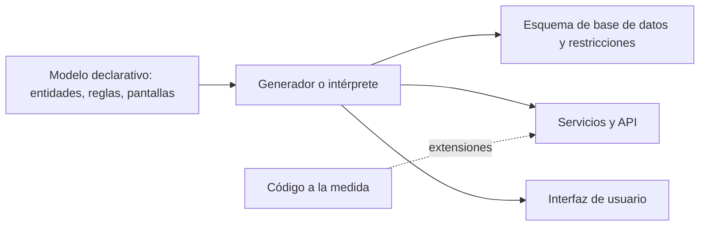

# Ingeniería de Software - Requerimientos y especificaciones

## 4.8 Herramientas para el desarrollo acelerado de aplicaciones.

---

El **desarrollo rápido de aplicaciones** (RAD, *rapid application development*) es tanto un método como una familia de herramientas. Como método, lo propuso James Martin en 1991: ciclos cortos de prototipado con participación intensa de los usuarios, en lugar de largas fases de especificación. Como herramientas, son los entornos que reducen la cantidad de código que hay que escribir a mano, desde los generadores de interfaces de los años noventa, como Visual Basic y Delphi, hasta las plataformas **low-code** y **no-code** actuales y los asistentes de programación basados en modelos de lenguaje. Este tema las relaciona con la ingeniería de requerimientos, porque su mayor valor está en validar requerimientos con prototipos funcionales, describe sus tipos, cómo funcionan por dentro, sus límites y cómo evaluar su conveniencia económica.

### Relación con los requerimientos

Un prototipo funcional responde preguntas que una especificación no puede: si el flujo de trabajo es el correcto, si faltan datos, si la interfaz se entiende. Las herramientas RAD hacen que un prototipo así cueste días en lugar de semanas, lo que permite usarlo como técnica de **obtención y validación de requerimientos**. Hay que decidir desde el principio si el prototipo es **desechable**, solo para aprender, o **evolutivo**, la base del sistema final: muchos problemas de calidad vienen de convertir en producto un prototipo construido para desecharse.

### Tipos de herramientas

- **Plataformas low-code:** modelado visual de datos, pantallas y flujos, con la posibilidad de escribir código para lo que el modelo no cubre. Ejemplos: OutSystems, Mendix, Microsoft Power Apps.
- **Plataformas no-code:** para usuarios sin formación en programación, con más restricciones. Ejemplos: Airtable, Bubble, AppSheet.
- **Frameworks con generación de código y convenciones:** Ruby on Rails, Django y su administrador generado, Laravel; dan estructura y generan las partes repetitivas, con código completo bajo control del equipo.
- **Herramientas de prototipado de interfaces:** Figma o Penpot, para prototipos navegables sin lógica.
- **Generadores a partir de especificaciones:** clientes y servidores a partir de OpenAPI, o esquemas de base de datos a partir de modelos.
- **Asistentes de programación** basados en modelos de lenguaje, que generan código a partir de descripciones; aceleran la escritura, pero el código generado debe revisarse y probarse como cualquier otro.

### Cómo funcionan

Casi todas siguen el enfoque de la **ingeniería dirigida por modelos**: el desarrollador describe el sistema con un **modelo declarativo** de entidades, campos, reglas, pantallas y flujos, y la plataforma lo **interpreta** en tiempo de ejecución o lo **traduce** a código, a un esquema de base de datos, a restricciones y a interfaces. Las reglas simples se convierten en restricciones declarativas, y las que involucran varias entidades, en disparadores o en código de servicio. La productividad viene de que el modelo es mucho más pequeño que el código que genera; los límites vienen de que solo puede expresarse lo que el lenguaje del modelo prevé.



### Límites y riesgos

- **Dependencia del proveedor:** el modelo está en un formato propietario; migrar a otra plataforma suele significar reescribir.
- **Techo de expresividad:** lo que el modelo no prevé se resuelve con extensiones de código, a veces más difíciles que programarlo todo.
- **Desempeño y escala:** el código genérico es menos eficiente que el escrito para el caso.
- **Costo de licencias** recurrente, a menudo por usuario, que crece con la adopción.
- **Calidad y gobierno:** aplicaciones creadas fuera del área de tecnología, sin pruebas, control de versiones ni revisión de seguridad.

### Implementación en Python

El programa resuelve el ejercicio 2 con un generador "low-code" mínimo: a partir de un modelo declarativo de la biblioteca, con entidades, tipos, referencias y reglas, genera el esquema de una base de datos SQLite con sus restricciones y disparadores, lo ejecuta y prueba las reglas de negocio con préstamos válidos e inválidos. Para el ejercicio 3 calcula el retorno de la inversión, la reducción del tiempo al mercado y el punto de equilibrio con un flujo de caja mensual, con y sin un costo de licencia recurrente.

```python
import sqlite3

# ---------- Ejercicio 2: un generador "low-code" mínimo: del modelo declarativo a la base de datos y sus reglas ----------
modelo = {
    "libro":    {"campos": {"isbn": "texto único", "titulo": "texto", "autor": "texto", "ejemplares": "entero >= 0"}},
    "socio":    {"campos": {"credencial": "texto único", "nombre": "texto", "correo": "texto"}},
    "prestamo": {"campos": {"libro": "ref libro", "socio": "ref socio", "fecha": "fecha", "vence": "fecha", "devuelto": "fecha opcional"},
                 "reglas": ["vence > fecha", "un socio tiene a lo más 3 préstamos abiertos", "solo se presta si hay ejemplares"]},
}
TIPOS = {"texto": "TEXT NOT NULL", "entero": "INTEGER NOT NULL", "fecha": "TEXT NOT NULL", "fecha opcional": "TEXT"}
def genera_ddl(m):
    sql = []
    for tabla, d in m.items():
        cols = ["id INTEGER PRIMARY KEY"]
        for c, t in d["campos"].items():
            if t.startswith("ref "): cols.append(f"{c} INTEGER NOT NULL REFERENCES {t[4:]}(id)")
            elif t.endswith(" único"): cols.append(f"{c} {TIPOS[t[:-6]]} UNIQUE")
            elif ">=" in t: base, lim = t.split(" >= "); cols.append(f"{c} {TIPOS[base]} CHECK ({c} >= {lim})")
            else: cols.append(f"{c} {TIPOS[t]}")
        if tabla == "prestamo": cols.append("CHECK (vence > fecha)")
        sql.append(f"CREATE TABLE {tabla} ({', '.join(cols)});")
    # reglas que no caben en restricciones de columna: se generan como disparadores
    sql.append("""CREATE TRIGGER max_prestamos BEFORE INSERT ON prestamo
      WHEN (SELECT count(*) FROM prestamo WHERE socio = NEW.socio AND devuelto IS NULL) >= 3
      BEGIN SELECT RAISE(ABORT, 'el socio ya tiene 3 préstamos abiertos'); END;""")
    sql.append("""CREATE TRIGGER hay_ejemplares BEFORE INSERT ON prestamo
      WHEN (SELECT ejemplares FROM libro WHERE id = NEW.libro) <= (SELECT count(*) FROM prestamo WHERE libro = NEW.libro AND devuelto IS NULL)
      BEGIN SELECT RAISE(ABORT, 'no hay ejemplares disponibles'); END;""")
    return sql
ddl = genera_ddl(modelo)
print("ejercicio 2: del modelo se generan", len(ddl), "sentencias; por ejemplo:"); print("  ", ddl[2])
db = sqlite3.connect(":memory:"); db.execute("PRAGMA foreign_keys = ON")
for s in ddl: db.execute(s)
db.executemany("INSERT INTO libro (isbn, titulo, autor, ejemplares) VALUES (?, ?, ?, ?)",
               [("978-1", "Pedro Páramo", "Rulfo", 1), ("978-2", "Ficciones", "Borges", 5)])
db.execute("INSERT INTO socio (credencial, nombre, correo) VALUES ('S1', 'Ana', 'ana@x.mx')")
pruebas = [("préstamo válido", (1, 1, "2026-11-01", "2026-11-15")), ("vence antes de la fecha", (2, 1, "2026-11-01", "2026-10-30")),
           ("libro sin ejemplares libres", (1, 1, "2026-11-02", "2026-11-16")), ("segundo préstamo", (2, 1, "2026-11-02", "2026-11-16")),
           ("tercer préstamo", (2, 1, "2026-11-03", "2026-11-17")), ("cuarto préstamo", (2, 1, "2026-11-04", "2026-11-18")),
           ("socio inexistente", (2, 9, "2026-11-04", "2026-11-18"))]
for nombre, v in pruebas:
    try: db.execute("INSERT INTO prestamo (libro, socio, fecha, vence) VALUES (?, ?, ?, ?)", v); r = "aceptado"
    except sqlite3.DatabaseError as e: r = f"rechazado: {e}"
    print(f"   {nombre:28} {r}")

# ---------- Ejercicio 3: retorno de la inversión ----------
trad_costo, trad_meses = 100_000, 6
rad_licencia, rad_desarrollo, rad_meses = 20_000, 40_000, 2.5
valor_mes = 15_000
rad_costo = rad_licencia + rad_desarrollo
ventaja = (trad_meses - rad_meses) * valor_mes
beneficio = (trad_costo - rad_costo) + ventaja
print(f"ejercicio 3: ahorro {trad_costo - rad_costo:,} + valor por entregar {trad_meses - rad_meses} meses antes {ventaja:,.0f} = {beneficio:,.0f}")
print(f"   ROI = beneficio / inversión = {beneficio:,.0f} / {rad_costo:,} = {beneficio / rad_costo:.0%} | reducción del tiempo al mercado {(trad_meses - rad_meses) / trad_meses:.1%}")
def flujo(costo, meses_dev, licencia_anual=0, horizonte=36):
    acum, puntos = 0.0, []
    for mes in range(1, horizonte + 1):
        if mes <= meses_dev: acum -= costo / meses_dev
        elif mes - 1 < meses_dev: acum -= costo * (meses_dev - (mes - 1)) / meses_dev; acum += valor_mes * (mes - meses_dev)
        else: acum += valor_mes
        if mes % 12 == 0: acum -= licencia_anual
        puntos.append(acum)
    equilibrio = next((m for m, a in enumerate(puntos, 1) if a >= 0), None)
    return equilibrio, puntos
for nombre, (c, m, lic) in {"tradicional": (trad_costo, trad_meses, 0), "RAD": (rad_costo, rad_meses, 0),
                            "RAD con licencia anual de 20 000": (rad_costo, rad_meses, rad_licencia)}.items():
    eq, p = flujo(c, m, lic)
    print(f"   {nombre:33} punto de equilibrio en el mes {eq} | acumulado a 12, 24 y 36 meses: {p[11]:>9,.0f} {p[23]:>9,.0f} {p[35]:>9,.0f}")
```

Salida:

```text
ejercicio 2: del modelo se generan 5 sentencias; por ejemplo:
   CREATE TABLE prestamo (id INTEGER PRIMARY KEY, libro INTEGER NOT NULL REFERENCES libro(id), socio INTEGER NOT NULL REFERENCES socio(id), fecha TEXT NOT NULL, vence TEXT NOT NULL, devuelto TEXT, CHECK (vence > fecha));
   préstamo válido              aceptado
   vence antes de la fecha      rechazado: CHECK constraint failed: vence > fecha
   libro sin ejemplares libres  rechazado: no hay ejemplares disponibles
   segundo préstamo             aceptado
   tercer préstamo              aceptado
   cuarto préstamo              rechazado: el socio ya tiene 3 préstamos abiertos
   socio inexistente            rechazado: FOREIGN KEY constraint failed
ejercicio 3: ahorro 40,000 + valor por entregar 3.5 meses antes 52,500 = 92,500
   ROI = beneficio / inversión = 92,500 / 60,000 = 154% | reducción del tiempo al mercado 58.3%
   tradicional                       punto de equilibrio en el mes 13 | acumulado a 12, 24 y 36 meses:   -10,000   170,000   350,000
   RAD                               punto de equilibrio en el mes 7 | acumulado a 12, 24 y 36 meses:    82,500   262,500   442,500
   RAD con licencia anual de 20 000  punto de equilibrio en el mes 7 | acumulado a 12, 24 y 36 meses:    62,500   222,500   382,500
```

### Ejercicios Propuestos

1. **Comparación.** Compara una plataforma low-code, un framework y una herramienta de prototipado, según su curva de aprendizaje, su flexibilidad, su costo total de propiedad y el desempeño del resultado.

2. **Diseño.** Diseña una aplicación de gestión de biblioteca en una plataforma low-code hipotética, con su modelo de datos, pantallas principales, flujos de trabajo e integraciones.

3. **Retorno de la inversión.** Un proyecto tiene un costo tradicional estimado de 100 000 en 6 meses; con una herramienta RAD, cuesta 20 000 de licencias y 40 000 de desarrollo, en 2.5 meses. El valor de entregar antes es de 15 000 al mes. Calcula el ROI, la reducción del tiempo al mercado y el punto de equilibrio.

4. **Limitaciones.** Identifica las limitaciones técnicas de usar herramientas RAD en un sistema de transacciones financieras de alta frecuencia, una aplicación con algoritmos complejos de aprendizaje automático y software embebido para dispositivos IoT.

### Soluciones

**Ejercicio 1.**

| Criterio            | Low-code, como Power Apps                 | Framework, como Django                       | Prototipado, como Figma                   |
| ------------------- | ----------------------------------------- | -------------------------------------------- | ----------------------------------------- |
| Curva de aprendizaje | Baja para lo básico; media para extender | Media: requiere programar                    | Baja                                      |
| Flexibilidad        | Limitada por el modelo de la plataforma   | Total: es código                             | Solo interfaz, sin lógica real            |
| Costo total         | Licencias por usuario, recurrentes        | Desarrolladores; sin licencias               | Licencias por diseñador, bajas            |
| Desempeño           | Suficiente para aplicaciones internas     | El que el equipo logre optimizar             | No aplica: no produce un sistema          |
| Mejor uso           | Aplicaciones internas de flujo de trabajo | Productos y sistemas que evolucionarán años  | Validar requerimientos de interfaz        |

No compiten directamente: una combinación frecuente es prototipar en Figma, validar con usuarios y construir en un framework, o resolver con low-code las aplicaciones internas sencillas para liberar a los desarrolladores.

**Ejercicio 2.**

- **Modelo de datos:** Libro, con ISBN único, título, autor y número de ejemplares no negativo; Socio, con credencial única, nombre y correo; Préstamo, que referencia un libro y un socio, con fecha, vencimiento y devolución opcional.
- **Reglas:** el vencimiento es posterior a la fecha; un socio tiene a lo más 3 préstamos abiertos; solo se presta si quedan ejemplares libres.
- **Pantallas:** catálogo con búsqueda, ficha del libro con su disponibilidad, alta de préstamo con el lector de la credencial, devolución con el cálculo de la multa, y un tablero de préstamos vencidos.
- **Flujos:** un recordatorio automático por correo dos días antes del vencimiento, y la notificación al siguiente socio en la lista de espera cuando se devuelve un libro reservado.
- **Integraciones:** el directorio institucional para autenticar a los socios, el correo, y un servicio de catálogo por ISBN, como Open Library, para no capturar los datos de cada libro.

El programa muestra cómo una plataforma convierte un modelo así en una base de datos con sus reglas: las reglas de un solo registro se vuelven restricciones `CHECK` y de llave foránea, y las que cuentan registros de otra tabla, como el máximo de préstamos, disparadores. Las pruebas confirman que cada regla rechaza el caso que debe rechazar.

**Ejercicio 3.** El beneficio es el ahorro, $100\,000 - 60\,000 = 40\,000,$ más el valor de entregar 3.5 meses antes, $3.5 \cdot 15\,000 = 52\,500,$ en total 92 500. Sobre la inversión de 60 000, el **ROI es de 154 %**. La **reducción del tiempo al mercado** es $(6 - 2.5)/6 \approx 58.3\,\%.$ El **punto de equilibrio**, el momento en que el valor acumulado cubre el costo, llega a los 6.5 meses con RAD, en el mes 7, frente a los 12.7 del desarrollo tradicional, en el mes 13. El cálculo del enunciado trata la licencia como un pago único; si es **anual**, como es habitual, a 36 meses se pagan 60 000 en licencias y la ventaja acumulada de RAD se reduce de 92 500 a 32 500. Sigue siendo favorable en este caso, pero el resultado se invierte en sistemas con muchos usuarios y vida larga, lo que hace del costo total de propiedad a varios años la cifra que debe compararse.

**Ejercicio 4.**

- **Transacciones de alta frecuencia:** exigen latencias de microsegundos, control fino de la memoria y de la red, y determinismo; las plataformas low-code añaden capas de interpretación y no permiten ese control. Solo sirven para las herramientas internas de operación, como paneles de monitoreo.
- **Aprendizaje automático complejo:** los modelos se entrenan y sirven con bibliotecas especializadas y aceleradores; las plataformas ofrecen componentes predefinidos, pero no la experimentación, el versionado de datos y modelos, ni el control del entrenamiento. Pueden consumir un modelo ya desplegado a través de una API.
- **IoT embebido:** memoria de kilobytes, procesadores pequeños, tiempo real y consumo de energía; el código generado por plataformas de propósito general no cabe ni se ejecuta ahí. Lo que sí existe son herramientas de generación de código para sistemas embebidos desde modelos, como Simulink y SCADE, con un enfoque distinto, orientado a la certificación.

### Referencias

1. Martin, J., _Rapid Application Development_. Macmillan, 1991.
2. Schmidt, D. C., Model-driven engineering. _Computer_ 39(2), 2006.
3. Sahay, A., Indamutsa, A., Di Ruscio, D., and Pierantonio, A., Supporting the understanding and comparison of low-code development platforms. _Euromicro SEAA_, 2020.
4. Brambilla, M., Cabot, J., and Wimmer, M., _Model-Driven Software Engineering in Practice_. Morgan & Claypool, 2017.
5. Sommerville, I., _Software Engineering_. Pearson, 2016. Capítulos 2 y 5.
