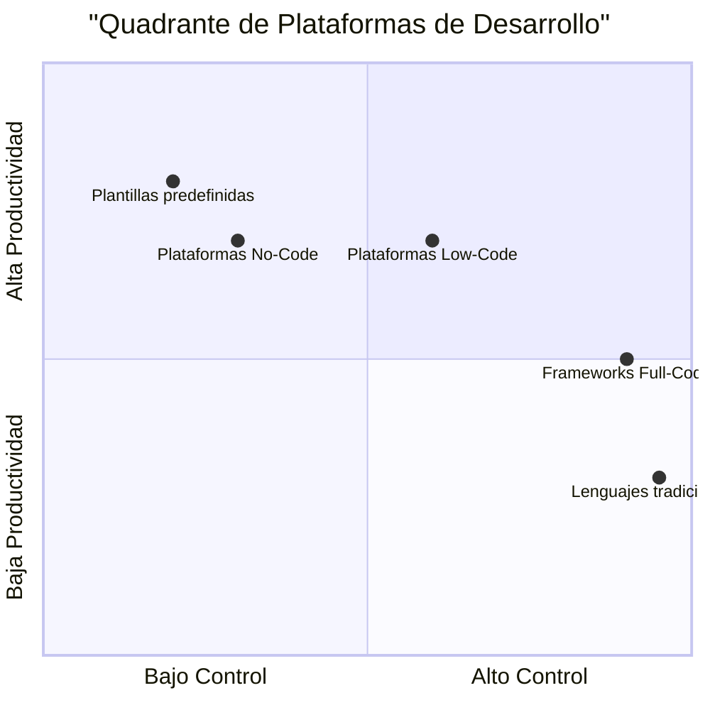
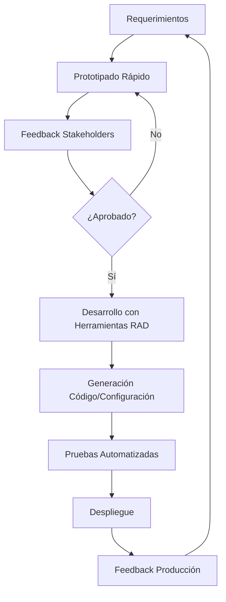
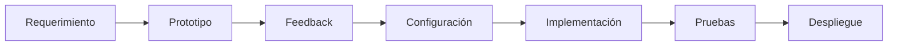

# Ingeniería de Software - Requerimientos y especificaciones

## 4.8 Herramientas para el desarrollo acelerado de aplicaciones.

---

Las herramientas para el desarrollo acelerado de aplicaciones (RAD - Rapid Application Development) permiten crear software más rápido mediante abstracciones, automatización y reutilización. Según Pfleeger y Atlee (2010), "las herramientas RAD cambian el balance entre esfuerzo manual y automatizado, permitiendo entregas más rápidas sin comprometer necesariamente la calidad".

### Definición y Conceptos Básicos

#### Desarrollo Acelerado de Aplicaciones

El **RAD** es una metodología que prioriza el desarrollo rápido y la entrega iterativa mediante el uso de herramientas especializadas, prototipado y feedback continuo. Matemáticamente, podemos expresar la aceleración como:

$$
A = \frac{T_{\text{tradicional}}}{T_{\text{RAD}}} = \frac{\sum_{i=1}^{n} t_i}{\sum_{j=1}^{m} a_j}
$$

Donde:

- $A$ es el factor de aceleración
- $T_{\text{tradicional}}$ es el tiempo de desarrollo tradicional
- $T_{\text{RAD}}$ es el tiempo usando herramientas RAD
- $t_i$ son las tareas manuales
- $a_j$ son las tareas automatizadas

### Clasificación de Herramientas RAD

#### 1. Low-Code/No-Code Platforms



#### 2. Model-Driven Development (MDD)

Herramientas que generan código a partir de modelos:

$$
M \xrightarrow{T} C
$$

Donde $M$ es el modelo, $T$ es la transformación, y $C$ es el código generado.

#### 3. Frameworks y Librerías

Componentes reutilizables que aceleran el desarrollo:

$$
V_{\text{desarrollo}} = V_{\text{personalizado}} + V_{\text{reutilizado}} \times r
$$

Donde $r$ es el factor de reutilización (0 ≤ r ≤ 1).

### Herramientas Específicas por Categoría

#### Plataformas Low-Code/No-Code

**Ejemplo: Flujo en Microsoft Power Apps**:

```powerapps
// Definición de una pantalla de registro
Screen(
    Title: "Registro de Usuario",
    Controls: [
        TextInput(
            Name: "txtNombre",
            Placeholder: "Ingrese nombre"
        ),
        TextInput(
            Name: "txtEmail",
            Placeholder: "Ingrese email",
            Validation: IsEmail(@@txtEmail)
        ),
        Button(
            Text: "Registrar",
            OnSelect: SubmitForm(frmUsuario)
        )
    ],
    DataSource: 'Usuarios'
)
```

#### Frameworks Full-Code Acelerados

**Ejemplo: Spring Boot (Java)**:

```java
// Aplicación completa con Spring Boot
@SpringBootApplication
@RestController
public class DemoApplication {

    @GetMapping("/api/usuarios")
    public List<Usuario> getUsuarios() {
        return usuarioRepository.findAll();
    }

    @PostMapping("/api/usuarios")
    public Usuario crearUsuario(@RequestBody Usuario usuario) {
        return usuarioRepository.save(usuario);
    }

    public static void main(String[] args) {
        SpringApplication.run(DemoApplication.class, args);
    }
}
```

#### Herramientas de Prototipado Rápido

**Ejemplo: Figma para UI/UX**:

```json
{
  "component": "LoginForm",
  "variants": [
    {
      "name": "Desktop",
      "properties": {
        "width": 400,
        "height": 300,
        "elements": ["username", "password", "submit"]
      }
    },
    {
      "name": "Mobile",
      "properties": {
        "width": 300,
        "height": 400,
        "elements": ["username", "password", "submit", "rememberMe"]
      }
    }
  ]
}
```

### Proceso de Desarrollo con Herramientas RAD



### Ventajas y Desventajas

#### Ventajas

- **Reducción de tiempo**: $T_{\text{RAD}} = T_{\text{tradicional}} \times k$ donde $0.3 \leq k \leq 0.7$
- **Menor expertise requerido**
- **Consistencia y estandarización**
- **Mejor colaboración**

#### Desventajas

- **Vendor lock-in** potencial
- **Limitaciones** funcionales o técnicas
- **Rendimiento** subóptimo en algunos casos
- **Costo de licencias**

### Métricas de Evaluación

#### 1. RAD Efficiency Factor

$$
E_{\text{RAD}} = \frac{L_{\text{generadas}}}{L_{\text{manuales}}} \times \frac{Q_{\text{resultado}}}{Q_{\text{esperada}}}
$$

#### 2. Return on Investment (ROI)

$$
ROI_{\text{RAD}} = \frac{\text{Beneficios} - \text{Costos}}{\text{Costos}} \times 100\%
$$

#### 3. Time-to-Market Reduction

$$
TTR = \frac{TTM_{\text{tradicional}} - TTM_{\text{RAD}}}{TTM_{\text{tradicional}}} \times 100\%
$$

### Ejemplo Completo: Sistema de Gestión de Incidencias

#### Configuración en plataforma low-code (pseudocódigo)

```yaml
app:
  name: 'SistemaIncidencias'
  version: '1.0'

dataModels:
  - name: 'Incidencia'
    fields:
      - name: 'titulo'
        type: 'string'
        required: true
      - name: 'descripcion'
        type: 'text'
      - name: 'estado'
        type: 'enum'
        values: ['abierta', 'en_progreso', 'resuelta']
      - name: 'prioridad'
        type: 'enum'
        values: ['baja', 'media', 'alta']

screens:
  - name: 'ListaIncidencias'
    type: 'list'
    dataSource: 'Incidencia'
    filters: ['estado', 'prioridad']

  - name: 'DetalleIncidencia'
    type: 'detail'
    dataSource: 'Incidencia'
    actions: ['editar', 'eliminar']

workflows:
  - name: 'CreacionIncidencia'
    trigger: 'form_submit'
    actions:
      - 'notificar_asignacion'
      - 'crear_tarea_automatica'
```

### Ejercicios Propuestos

#### Ejercicio 1: Análisis de Herramientas

Compare tres herramientas RAD diferentes (una low-code, un framework, y una herramienta de prototipado) usando los criterios:

- Curva de aprendizaje
- Flexibilidad
- Costo total de propiedad
- Rendimiento resultante

#### Ejercicio 2: Diseño de Aplicación RAD

Diseñe una aplicación de gestión de biblioteca usando una plataforma low-code hipotética. Incluya:

- Modelo de datos
- Pantallas principales
- Flujos de trabajo
- Integraciones necesarias

#### Ejercicio 3: Cálculo de ROI

Para un proyecto con:

- Costo tradicional estimado: \$100,000
- Costo herramienta RAD: \$20,000 (licencias) + \$40,000 (desarrollo)
- Tiempo tradicional: 6 meses
- Tiempo RAD: 2.5 meses
- Valor de entrega temprana: \$15,000/mes

Calcule:

1. ROI financiero
2. Time-to-Market Reduction
3. Punto de equilibrio

#### Ejercicio 4: Evaluación de Limitaciones

Identifique las limitaciones técnicas que podrían surgir al usar herramientas RAD para:

- Sistema de transacciones financieras de alta frecuencia
- Aplicación con algoritmos de machine learning complejos
- Software embebido para dispositivos IoT

### Integración con Ingeniería de Requerimientos

#### Trazabilidad en Entornos RAD



#### Especificación de Requerimientos para RAD

Los requerimientos deben estructurarse para aprovechar las herramientas RAD:

**Formato recomendado**:

```json
{
  "requirementId": "RF-001",
  "description": "Gestión de usuarios",
  "priority": "high",
  "radCompatible": true,
  "components": [
    {
      "type": "dataModel",
      "entity": "User",
      "fields": ["name", "email", "role"]
    },
    {
      "type": "uiScreen",
      "name": "UserManagement",
      "actions": ["create", "read", "update", "delete"]
    }
  ]
}
```

### Buenas Prácticas

#### 1. Selección Adecuada de Herramientas

Evaluar según:

- Complejidad del dominio
- Habilidades del equipo
- Requerimientos no funcionales
- Estrategia a largo plazo

#### 2. Governance y Estándares

Establecer:

- Guías de uso de la herramienta
- Patrones de implementación
- Procesos de revisión
- Estrategia de mantenimiento

#### 3. Híbrido Approach

Combinar herramientas RAD con desarrollo tradicional cuando sea necesario:

$$
S_{\text{final}} = S_{\text{RAD}} + S_{\text{personalizado}}
$$

### Referencias

1. Pfleeger, S. L., & Atlee, J. M. (2010). _Software Engineering: Theory and Practice_. Capítulo 14: "Software Process Models".
2. Sommerville, I. (2010). _Software Engineering_ (9th edition). Capítulo 17: "Rapid Software Development".
3. Boehm, B., & Turner, R. (2003). _Balancing Agility and Discipline: A Guide for the Perplexed_. Capítulo 6.
4. Martin, J. (1991). _Rapid Application Development_. Macmillan.
5. Fitzgerald, B. (2000). _Systems Development Methodologies: The Problem of Tenses_. Information Technology & People.

### Recursos Adicionales

- Herramientas RAD populares: Mendix, OutSystems, Microsoft Power Platform
- Frameworks aceleradores: Spring Boot, Ruby on Rails, Django
- Plataformas de prototipado: Figma, Adobe XD, Sketch
- Comparativas y benchmarks de herramientas
