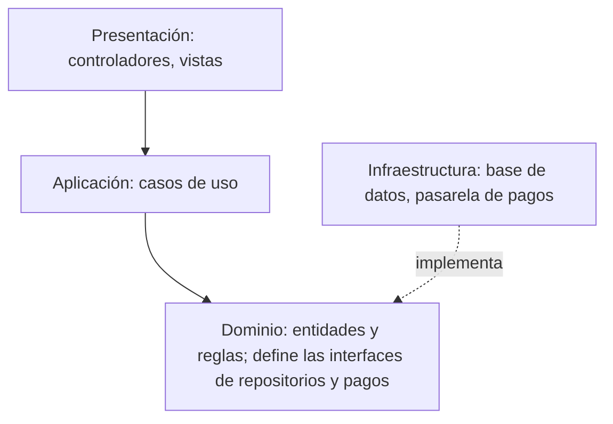

# Ingeniería de Software - Arquitectura de software

## 5.1 Capas y componentes.

---

La **arquitectura de software** es la estructura de alto nivel de un sistema: sus elementos, las relaciones entre ellos y los principios que guían su diseño y su evolución. Bass, Clements y Kazman la definen como el conjunto de estructuras necesarias para razonar sobre el sistema, que comprenden los elementos de software, sus relaciones y las propiedades de ambos. Las decisiones arquitectónicas son las que cuestan más cambiar después. Este tema presenta las dos ideas más básicas para estructurar un sistema, los **componentes**, unidades con interfaces explícitas, y las **capas**, una forma de organizarlos por nivel de abstracción, con las reglas de dependencia que las hacen útiles y su aplicación a un caso concreto.

### Componentes

Un **componente** es una unidad del sistema con responsabilidades definidas, que **provee** interfaces a otros y **requiere** interfaces de otros (tema 2.1). Los componentes se conectan mediante **conectores**: llamadas a procedimientos, mensajes, eventos, flujos de datos o accesos a datos compartidos. Una arquitectura se describe como una configuración de componentes y conectores. Los criterios para decidir los límites de los componentes son la **cohesión**, que lo que cambia junto esté junto, y el **acoplamiento** bajo, que un cambio dentro de un componente no obligue a cambiar otros.

### Capas

El estilo de **capas** organiza los componentes en niveles, cada uno con una responsabilidad y un nivel de abstracción, en el que cada capa usa los servicios de la capa inferior y ofrece servicios a la superior. Dijkstra lo usó en el sistema operativo THE en 1968, y es la estructura de la pila de protocolos de red. La organización más común en sistemas de información tiene tres o cuatro capas:

- **Presentación:** la interfaz con el usuario o con otros sistemas: pantallas, controladores HTTP, serialización. Traduce las peticiones y las respuestas; no contiene reglas de negocio.
- **Aplicación o servicios:** coordina los casos de uso, con las transacciones y la seguridad de cada operación.
- **Dominio o negocio:** las entidades y las reglas del negocio, la parte más valiosa y estable.
- **Infraestructura o persistencia:** acceso a bases de datos, servicios externos, archivos y mensajes.

Las reglas que dan valor a las capas son de **dependencia**: una capa solo depende de las inferiores, nunca de las superiores. En las capas **estrictas**, solo de la inmediata inferior; en las **relajadas**, de cualquiera inferior. Una refinación importante es la **inversión de dependencias**: la capa de negocio no depende de la infraestructura concreta, sino de interfaces que ella misma define, como `RepositorioProductos`, y la infraestructura las implementa. Así el negocio se prueba sin base de datos, y la base de datos se cambia sin tocar el negocio. Es la idea central de la arquitectura **hexagonal**, de puertos y adaptadores, de Cockburn, y de la arquitectura **limpia** de Martin.



### Ventajas y desventajas

Las capas separan las responsabilidades, permiten sustituir una capa sin afectar a las demás, facilitan las pruebas y reparten el trabajo entre equipos. Sus costos son el **rendimiento**, porque cada petición atraviesa todas las capas, a veces solo para pasar datos sin transformarlos, el antipatrón del **sumidero**; la tentación de saltarse capas, que erosiona la estructura, y que un cambio que atraviesa todas las capas, como agregar un campo, toca todos los niveles.

### Implementación en Python

El programa resuelve el ejercicio 3 separando el procesamiento de órdenes en presentación, negocio e infraestructura, con el negocio dependiendo solo de interfaces, y lo prueba con implementaciones en memoria de los repositorios y los pagos, incluida una que simula una carrera entre dos órdenes. Para el ejercicio 4 calcula las dependencias entre capas, su densidad y la inestabilidad de cada capa.

```python
from dataclasses import dataclass
from decimal import Decimal
from typing import Protocol

# ---------- Ejercicio 3: el procesamiento de órdenes separado en capas ----------
# --- dominio y lógica de negocio: no conoce ni la interfaz ni la base de datos, solo interfaces ---
class ErrorNegocio(Exception): pass
class RepositorioProductos(Protocol):
    def precio(self, producto: str) -> Decimal: ...
    def existencia(self, producto: str) -> int: ...
    def descuenta(self, producto: str, cantidad: int) -> None: ...
class Pagos(Protocol):
    def autoriza(self, tarjeta: str, monto: Decimal) -> str | None: ...
    def captura(self, autorizacion: str) -> None: ...
    def cancela(self, autorizacion: str) -> None: ...
@dataclass(frozen=True)
class Orden:
    producto: str; cantidad: int; total: Decimal; autorizacion: str
class ServicioOrdenes:
    def __init__(self, productos: RepositorioProductos, pagos: Pagos): self.productos, self.pagos = productos, pagos
    def procesa(self, producto: str, cantidad: int, tarjeta: str) -> Orden:
        if cantidad <= 0: raise ErrorNegocio("cantidad inválida")
        if self.productos.existencia(producto) < cantidad: raise ErrorNegocio("existencia insuficiente")   # antes de cobrar
        total = self.productos.precio(producto) * cantidad
        aut = self.pagos.autoriza(tarjeta, total)
        if aut is None: raise ErrorNegocio("pago rechazado")
        try:
            self.productos.descuenta(producto, cantidad)
        except Exception:
            self.pagos.cancela(aut); raise                    # compensación: no se cobra sin descontar el inventario
        self.pagos.captura(aut)
        return Orden(producto, cantidad, total, aut)
# --- persistencia y servicios externos: implementaciones intercambiables ---
class ProductosEnMemoria:
    def __init__(self, datos): self.datos = datos
    def precio(self, p): return self.datos[p][0]
    def existencia(self, p): return self.datos[p][1]
    def descuenta(self, p, n):
        precio, ex = self.datos[p]
        if ex < n: raise RuntimeError("conflicto de concurrencia: otra orden tomó la existencia")
        self.datos[p] = (precio, ex - n)
class PagosFalsos:
    def __init__(self): self.bitacora = []
    def autoriza(self, tarjeta, monto):
        ok = not tarjeta.endswith("0000"); self.bitacora.append(f"autoriza {monto} {'ok' if ok else 'rechazo'}")
        return f"AUT-{len(self.bitacora)}" if ok else None
    def captura(self, a): self.bitacora.append(f"captura {a}")
    def cancela(self, a): self.bitacora.append(f"cancela {a}")
# --- presentación: traduce entradas y errores, no contiene reglas ---
def controlador_http(servicio, peticion):
    try:
        o = servicio.procesa(peticion["producto"], int(peticion["cantidad"]), peticion["tarjeta"])
        return 201, {"total": str(o.total), "autorizacion": o.autorizacion}
    except ErrorNegocio as e: return 422, {"error": str(e)}
    except (KeyError, ValueError): return 400, {"error": "petición mal formada"}
    except RuntimeError as e: return 409, {"error": str(e)}
productos = ProductosEnMemoria({"P1": (Decimal("19.90"), 5)}); pagos = PagosFalsos()
svc = ServicioOrdenes(productos, pagos)
for pet in ({"producto": "P1", "cantidad": "3", "tarjeta": "4111"}, {"producto": "P1", "cantidad": "0", "tarjeta": "4111"},
            {"producto": "P1", "cantidad": "9", "tarjeta": "4111"}, {"producto": "P1", "cantidad": "1", "tarjeta": "4000-0000"},
            {"producto": "P1", "cantidad": "dos"}):
    print("ejercicio 3:", pet, "→", *controlador_http(svc, pet))
class ProductosConCarrera(ProductosEnMemoria):            # simula que otra orden gana la carrera entre la comprobación y el descuento
    def descuenta(self, p, n): raise RuntimeError("conflicto de concurrencia: otra orden tomó la existencia")
svc2 = ServicioOrdenes(ProductosConCarrera({"P1": (Decimal("19.90"), 5)}), pagos)
print("   con carrera:", *controlador_http(svc2, {"producto": "P1", "cantidad": "1", "tarjeta": "4111"}), "| pagos:", pagos.bitacora[-2:])
print("   existencia final de P1:", productos.existencia("P1"), "| 3 × 19.90 =", Decimal("19.90") * 3, "exacto, frente a", 19.90 * 3, "en punto flotante")

# ---------- Ejercicio 4: métricas de dependencias entre capas ----------
capas = {"presentación": 5, "negocio": 8, "persistencia": 3}
dep_pres, dep_neg = 5 * 2, 8 * 1.5
total_dep = dep_pres + dep_neg
posibles = 5 * 8 + 8 * 3                                     # dependencias permitidas: solo hacia la capa inmediata inferior
print(f"ejercicio 4: dependencias {dep_pres:.0f} + {dep_neg:.0f} = {total_dep:.0f} de {posibles} posibles entre capas adyacentes "
      f"→ densidad {total_dep / posibles:.2f}")
for capa, n, ce, ca in (("presentación", 5, dep_pres, 0), ("negocio", 8, dep_neg, dep_pres), ("persistencia", 3, 0, dep_neg)):
    print(f"   {capa:13} Ce = {ce:4.0f} | Ca = {ca:4.0f} | inestabilidad I = {ce / (ce + ca) if ce + ca else 0:.2f} | "
          f"acoplamiento eferente medio {ce / n:.2f} | aferente medio {ca / n:.2f}")
```

Salida:

```text
ejercicio 3: {'producto': 'P1', 'cantidad': '3', 'tarjeta': '4111'} → 201 {'total': '59.70', 'autorizacion': 'AUT-1'}
ejercicio 3: {'producto': 'P1', 'cantidad': '0', 'tarjeta': '4111'} → 422 {'error': 'cantidad inválida'}
ejercicio 3: {'producto': 'P1', 'cantidad': '9', 'tarjeta': '4111'} → 422 {'error': 'existencia insuficiente'}
ejercicio 3: {'producto': 'P1', 'cantidad': '1', 'tarjeta': '4000-0000'} → 422 {'error': 'pago rechazado'}
ejercicio 3: {'producto': 'P1', 'cantidad': 'dos'} → 400 {'error': 'petición mal formada'}
   con carrera: 409 {'error': 'conflicto de concurrencia: otra orden tomó la existencia'} | pagos: ['autoriza 19.90 ok', 'cancela AUT-4']
   existencia final de P1: 2 | 3 × 19.90 = 59.70 exacto, frente a 59.699999999999996 en punto flotante
ejercicio 4: dependencias 10 + 12 = 22 de 64 posibles entre capas adyacentes → densidad 0.34
   presentación  Ce =   10 | Ca =    0 | inestabilidad I = 1.00 | acoplamiento eferente medio 2.00 | aferente medio 0.00
   negocio       Ce =   12 | Ca =   10 | inestabilidad I = 0.55 | acoplamiento eferente medio 1.50 | aferente medio 1.25
   persistencia  Ce =    0 | Ca =   12 | inestabilidad I = 0.00 | acoplamiento eferente medio 0.00 | aferente medio 4.00
```

### Ejercicios Propuestos

1. **Capas.** Analiza una aplicación de mensajería como WhatsApp: ¿cómo se estructuraría en capas?, ¿qué componentes tendría cada capa?, ¿qué tipo de comunicación existe entre ellas?

2. **Componentes.** Diseña al menos tres componentes de un sistema de reservas de hotel, con sus interfaces, sus dependencias y la capa a la que pertenece cada uno.

3. **Refactorización.** Separa en capas este código:

    ```java
    public class MonolithicApp {
        public void processOrder(String productId, int quantity, String creditCard) {
            if (quantity <= 0) {
                System.out.println("Cantidad inválida");
                return;
            }
            double price = database.getPrice(productId);
            double total = price * quantity;
            boolean paymentSuccess = paymentProcessor.charge(creditCard, total);
            if (paymentSuccess) {
                database.updateInventory(productId, quantity);
                System.out.println("Orden procesada exitosamente");
            } else {
                System.out.println("Error en el pago");
            }
        }
    }
    ```

4. **Métricas.** Un sistema tiene 5 componentes de presentación, 8 de negocio y 3 de persistencia. Cada componente de presentación depende en promedio de 2 de negocio, y cada uno de negocio de 1.5 de persistencia. Calcula las métricas de acoplamiento.

### Soluciones

**Ejercicio 1.** Una aplicación de mensajería tiene dos lados, el cliente y el servidor, cada uno con sus capas:

- **Cliente:** presentación, con las pantallas de conversaciones y el editor de mensajes; aplicación, con el envío, la recepción y la sincronización; dominio, con los mensajes, conversaciones y contactos; infraestructura, con la base de datos local, el cifrado de extremo a extremo, basado en el protocolo Signal, y la conexión de red.
- **Servidor:** una capa de conexión que mantiene millones de conexiones persistentes; enrutamiento y entrega, con una cola para los destinatarios desconectados; servicios de cuentas, grupos y multimedia, y almacenamiento.

La comunicación entre capas de un mismo lado es por **llamadas** locales; entre cliente y servidor, por **mensajes** asíncronos sobre una conexión persistente, porque el servidor debe poder entregar mensajes al cliente sin que este los pida; y las notificaciones a teléfonos inactivos van por los servicios de notificaciones del sistema operativo. El cifrado de extremo a extremo tiene una consecuencia arquitectónica: el servidor no puede leer los mensajes, de modo que funciones como la búsqueda se implementan en el cliente.

**Ejercicio 2.**

| Componente               | Capa            | Interfaz provista                                          | Requiere                                  |
| ------------------------ | --------------- | ---------------------------------------------------------- | ----------------------------------------- |
| Disponibilidad           | Dominio         | `disponibles(fechas, tipo) → habitaciones`                 | RepositorioReservas                       |
| Reservas                 | Aplicación      | `reserva(huésped, habitación, fechas) → reserva`, `cancela(id)` | Disponibilidad, Pagos, Notificaciones |
| Tarifas                  | Dominio         | `precio(tipo, fechas, temporada) → monto`                  | RepositorioTarifas                        |
| Pagos                    | Infraestructura | adaptador de la pasarela                                   | servicio externo                          |
| API de reservas          | Presentación    | `POST /reservas`, `GET /disponibilidad`                    | Reservas, Disponibilidad                  |

Las dependencias van de arriba hacia abajo, y Reservas depende de la **interfaz** de Pagos, no de la pasarela concreta.

**Ejercicio 3.** El código original mezcla tres responsabilidades y tiene, además, defectos de lógica que la separación hace evidentes: **cobra antes de comprobar la existencia**, de modo que puede cobrar un producto agotado; si la actualización del inventario falla después del cobro, el dinero queda cobrado sin orden, y usa `double` para el dinero, que produce errores de redondeo, como $3 \cdot 19.90 = 59.699999\dots$ en punto flotante. La versión en capas en Java, compilada y ejecutada:

```java
interface ProductRepository { BigDecimal price(String id); int stock(String id); void decreaseStock(String id, int qty); }
interface PaymentGateway { Optional<String> authorize(String card, BigDecimal amount); void capture(String auth); void cancel(String auth); }

// Negocio
class BusinessException extends RuntimeException { BusinessException(String m) { super(m); } }
record Order(String productId, int quantity, BigDecimal total, String authorization) {}
class OrderService {
    private final ProductRepository products; private final PaymentGateway payments;
    OrderService(ProductRepository products, PaymentGateway payments) { this.products = products; this.payments = payments; }
    Order process(String productId, int quantity, String card) {
        if (quantity <= 0) throw new BusinessException("cantidad inválida");
        if (products.stock(productId) < quantity) throw new BusinessException("existencia insuficiente");
        BigDecimal total = products.price(productId).multiply(BigDecimal.valueOf(quantity));
        String auth = payments.authorize(card, total).orElseThrow(() -> new BusinessException("pago rechazado"));
        try { products.decreaseStock(productId, quantity); }
        catch (RuntimeException e) { payments.cancel(auth); throw e; }
        payments.capture(auth);
        return new Order(productId, quantity, total, auth);
    }
}
```

y la presentación, que solo traduce resultados y errores:

```java
// Presentación
class OrderController {
    private final OrderService service;
    OrderController(OrderService service) { this.service = service; }
    String post(String productId, int quantity, String card) {
        try { Order o = service.process(productId, quantity, card); return "201 total=" + o.total(); }
        catch (BusinessException e) { return "422 " + e.getMessage(); }
    }
}
```

El servicio comprueba la existencia antes de cobrar, **autoriza** el pago, descuenta el inventario y solo entonces **captura** el cobro; si el descuento falla, por ejemplo porque otra orden tomó la última unidad entre la comprobación y el descuento, cancela la autorización. Usa `BigDecimal` para el dinero y excepciones en lugar de mensajes impresos, y la presentación las traduce a códigos HTTP. La versión del programa en Python es la misma estructura y prueba los cinco casos y la carrera.

**Ejercicio 4.** Hay $5 \cdot 2 = 10$ dependencias de presentación a negocio y $8 \cdot 1.5 = 12$ de negocio a persistencia, 22 en total, de 64 posibles entre capas adyacentes: una densidad de 0.34. La inestabilidad $I = C_e / (C_a + C_e)$ de cada capa es 1 para presentación, 0.55 para negocio y 0 para persistencia, decreciente hacia abajo, como pide el principio de dependencias estables del tema 2.1. Eso dice que la persistencia es la capa más difícil de cambiar, porque todo depende de ella; es la razón para invertir esa dependencia, haciendo que la persistencia implemente interfaces definidas por el negocio y que la capa más estable sea el dominio.

### Referencias

1. Bass, L., Clements, P., and Kazman, R., _Software Architecture in Practice_. Addison-Wesley, 2021.
2. Buschmann, F., Meunier, R., Rohnert, H., Sommerlad, P., and Stal, M., _Pattern-Oriented Software Architecture_, volumen 1. Wiley, 1996.
3. Martin, R. C., _Clean Architecture_. Prentice Hall, 2017.
4. Cockburn, A., Hexagonal architecture, 2005. alistair.cockburn.us.
5. Dijkstra, E. W., The structure of the "THE"-multiprogramming system. _Communications of the ACM_ 11(5), 1968.
