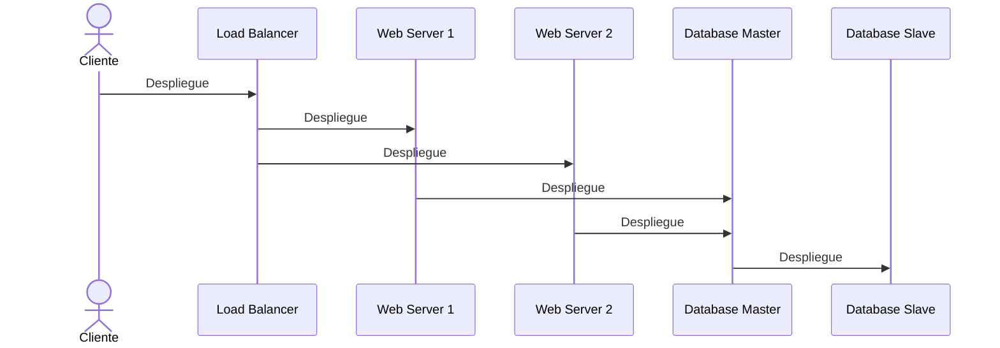
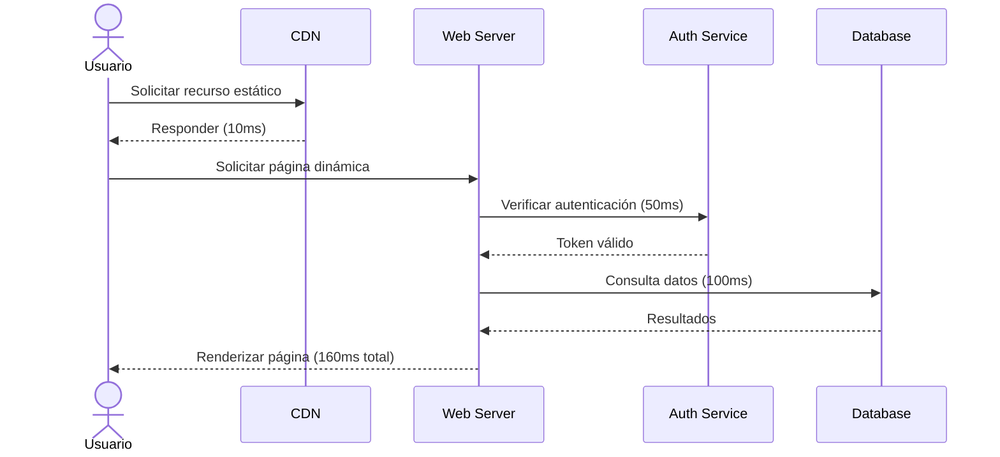

# Ingeniería de Software - Arquitectura de software

## 5.2 Características sistémicas.

---

Las características sistémicas, también conocidas como atributos de calidad o requisitos no funcionales, son propiedades emergentes de un sistema software que determinan su calidad global y su capacidad para satisfacer las necesidades de los stakeholders. Según Sommerville (2010), "los atributos de calidad son características del software que reflejan cómo el sistema realiza sus funciones, en lugar de qué funciones realiza".

Estas características son fundamentales en la arquitectura de software ya que:

- Guían las decisiones de diseño arquitectónico
- Determinan la estructura y organización del sistema
- Afectan directamente la experiencia del usuario final
- Influyen en el costo y esfuerzo de desarrollo

### Clasificación de las Características Sistémicas

#### Atributos de calidad según ISO 25010

```
graph TD
    A[Características Sistémicas] --> B[Características de Calidad Externa]
    A --> C[Características de Calidad Interna]

    B --> D[Funcionalidad]
    B --> E[Fiabilidad]
    B --> F[Rendimiento]
    B --> G[Usabilidad]
    B --> H[Seguridad]

    C --> I[Mantenibilidad]
    C --> J[Modificabilidad]
    C --> K[Testabilidad]
    C --> L[Escalabilidad]
    C --> M[Reusabilidad]
```

### Principales Características Sistémicas

#### Rendimiento (Performance)

El rendimiento se refiere a la capacidad del sistema para responder a las solicitudes dentro de tiempos aceptables bajo determinadas condiciones de carga.

**Métricas clave:**

- Tiempo de respuesta: $T_r = T_{fin} - T_{inicio}$
- Rendimiento (throughput): $R = \frac{N}{t}$ donde $N$ es el número de peticiones y $t$ es el tiempo
- Utilización de recursos: $ U = \frac{T_{ocupado}}{T_{total}} \times 100\% $

**Factores que afectan el rendimiento:**

- Algoritmos ineficientes
- Acoplamiento estrecho entre componentes
- Patrones de comunicación inadecuados
- Gestión deficiente de recursos

#### Escalabilidad

Capacidad del sistema para manejar incrementos en la carga de trabajo sin degradación del rendimiento, mediante la adición de recursos.

**Tipos de escalabilidad:**

- Escalabilidad vertical (scale-up): Añadir recursos a un nodo existente
- Escalabilidad horizontal (scale-out): Añadir más nodos al sistema

**Fórmula de escalabilidad (Ley de Amdahl):**
$$ S = \frac{1}{(1 - p) + \frac{p}{n}} $$

Donde:

- $S$ es la mejora de velocidad
- $p$ es la proporción de código paralelizable
- $n$ es el número de procesadores

#### Fiabilidad (Reliability)

Capacidad del sistema para mantener su nivel de desempeño bajo condiciones establecidas durante un período de tiempo determinado.

**Métricas de fiabilidad:**

- MTBF (Mean Time Between Failures): Tiempo medio entre fallos
- MTTR (Mean Time To Repair): Tiempo medio de reparación
- Disponibilidad: $ A = \frac{MTBF}{MTBF + MTTR} \times 100\% $

**Ejemplo de cálculo de disponibilidad:**
Si un sistema tiene un MTBF de 1000 horas y un MTTR de 10 horas:

$$ A = \frac{1000}{1000 + 10} \times 100\% = 99.01\% $$

#### Seguridad (Security)

Capacidad del sistema para proteger la información y los recursos contra accesos no autorizados, modificaciones malintencionadas o daños.

**Principios de seguridad:**

- Confidencialidad: Protección contra accesos no autorizados
- Integridad: Prevención de modificaciones no autorizadas
- Disponibilidad: Garantizar el acceso autorizado cuando sea necesario
- Autenticación: Verificación de identidad
- Autorización: Control de acceso a recursos

#### Mantenibilidad

Facilidad con la que un sistema puede ser modificado para corregir fallos, mejorar性能 o adaptarse a cambios en el entorno.

**Factores que afectan la mantenibilidad:**

- Complejidad ciclomática
- Acoplamiento entre módulos
- Cohesión de los componentes
- Documentación adecuada
- Calidad del código

**Fórmula de complejidad ciclomática (McCabe):**
$$ V(G) = E - N + 2P $$

Donde:

- $V(G)$ es la complejidad ciclomática
- $E$ es el número de aristas del grafo de flujo
- $N$ es el número de nodos del grafo de flujo
- $P$ es el número de componentes conexos

#### Usabilidad

Facilidad con la que los usuarios pueden aprender, utilizar y satisfacer sus necesidades mediante el sistema.

**Aspectos clave:**

- Curva de aprendizaje
- Eficiencia de uso
- Satisfacción subjetiva
- Accesibilidad
- Prevención de errores

### Trade-offs entre Características Sistémicas

Las características sistémicas suelen presentar relaciones de compromiso (trade-offs). Mejorar una característica often perjudica a otra:

```
graph LR
    A[Alta seguridad] -- trade-off --> B[Rendimiento]
    C[Alta disponibilidad] -- trade-off --> D[Coste]
    E[Usabilidad] -- trade-off --> F[Seguridad]
    G[Escalabilidad] -- trade-off --> H[Complejidad]
```

**Ejemplo de trade-off:** Aumentar la seguridad (más encriptación, autenticación multifactor) generalmente reduce el rendimiento.

### Tácticas Arquitectónicas para Mejorar Características Sistémicas

#### Tácticas para rendimiento

- Introducir concurrencia
- Reducir overhead computacional
- Gestionar recursos eficientemente
- Utilizar caching

#### Tácticas para modificabilidad

- Modularización
- Abstraction
- Encapsulación
- Uso de interfaces estables

#### Tácticas para seguridad

- Autenticación robusta
- Autorización y control de acceso
- Detección de intrusiones
- Cifrado de datos

#### Tácticas para disponibilidad

- Redundancia de componentes
- Replicación de datos
- Monitorización proactiva
- Recuperación rápida ante fallos

### Ejemplo: Análisis de Características Sistémicas en un Sistema de E-commerce

```java
// Ejemplo de implementación que considera múltiples características sistémicas
public class OrderService {
    private final CacheManager cacheManager; // Para mejorar rendimiento
    private final SecurityService securityService; // Para seguridad
    private final Logger logger; // Para mantenibilidad
    private final CircuitBreaker circuitBreaker; // Para disponibilidad

    @Transactional
    public Order processOrder(OrderRequest request) {
        // Verificación de seguridad
        if (!securityService.isAuthorized(request.getUserId(), "CREATE_ORDER")) {
            throw new SecurityException("Usuario no autorizado");
        }

        // Usar cache para mejorar rendimiento
        Order cachedOrder = cacheManager.getFromCache(request.getOrderId());
        if (cachedOrder != null) {
            return cachedOrder;
        }

        // Usar circuit breaker para disponibilidad
        return circuitBreaker.execute(() -> {
            try {
                Order order = createOrder(request);
                cacheManager.addToCache(order.getId(), order); // Cache para rendimiento
                logger.log("Order created: " + order.getId()); // Logs para mantenibilidad
                return order;
            } catch (Exception e) {
                logger.logError("Error creating order", e);
                throw e;
            }
        });
    }
}
```

### Ejercicios Propuestos

#### Ejercicio 1: Identificación de Características Sistémicas

Para cada escenario, identifica las características sistémicas más relevantes:

1. Sistema de control de tráfico aéreo
2. Red social con millones de usuarios
3. Aplicación móvil de banca
4. Sistema de reservas de hotel
5. Plataforma de video streaming

#### Ejercicio 2: Análisis de Trade-offs

Analiza los trade-offs en los siguientes casos:

1. Implementar autenticación biométrica en una aplicación móvil
2. Añadir replicación de datos en tiempo real para mejorar disponibilidad
3. Implementar logging exhaustivo para mejorar mantenibilidad

#### Ejercicio 3: Cálculo de Métricas

1. Un sistema tiene un MTBF de 500 horas y un MTTR de 2 horas. Calcula la disponibilidad.
2. Un proceso tiene 45 nodos y 60 aristas en su grafo de flujo. Calcula la complejidad ciclomática.
3. Si el 70% de un algoritmo es paralelizable, ¿cuál es la mejora máxima con 4 procesadores?

#### Ejercicio 4: Diseño de Tácticas Arquitectónicas

Propone tácticas arquitectónicas para mejorar:

1. La escalabilidad de un sistema de mensajería instantánea
2. La seguridad de una aplicación de salud con datos sensibles
3. El rendimiento de un sistema de procesamiento de imágenes

#### Ejercicio 5: Caso de Estudio - Sistema de Votación Electrónica

Diseña un sistema de votación electrónica considerando:

1. Qué características sistémicas son críticas y por qué
2. Qué trade-offs existirían entre seguridad y usabilidad
3. Qué tácticas arquitectónicas implementarías

### Modelado de Características Sistémicas

#### Diagrama de Despliegue para Alta Disponibilidad



#### Diagrama de Secuencia para Analizar Rendimiento



### Referencias

#### Bibliografía Básica

1. Sommerville, Ian. (2010). "Software Engineering" (9th edition). Addison Wesley. (Capítulo 11: Arquitectura y diseño de software)
2. Pfleeger, S. L., & Atlee, J. M. (2010). "Software Engineering: Theory and Practice" (4th Edition). Prentice Hall. (Capítulo 4: Diseño arquitectónico)

#### Bibliografía Complementaria

3. Bass, L., Clements, P., & Kazman, R. (2012). "Software Architecture in Practice" (3rd Edition). Addison-Wesley.
4. ISO/IEC 25010:2011. "Systems and software engineering — Systems and software Quality Requirements and Evaluation (SQuaRE) — System and software quality models"

### Conclusión

Las características sistémicas son fundamentales para el éxito de cualquier sistema software. Un arquitecto debe comprender no solo cada característica individualmente, sino también las complejas interrelaciones y trade-offs entre ellas. La toma de decisiones arquitectónicas debe basarse en un análisis cuidadoso de los requisitos de calidad prioritarios para el sistema en desarrollo, considerando siempre el contexto específico y las necesidades de los stakeholders.

La arquitectura de software exitosa es aquella que encuentra el equilibrio adecuado entre las diferentes características sistémicas, priorizando aquellas que son críticas para el dominio específico mientras gestiona proactivamente los trade-offs inevitables.
