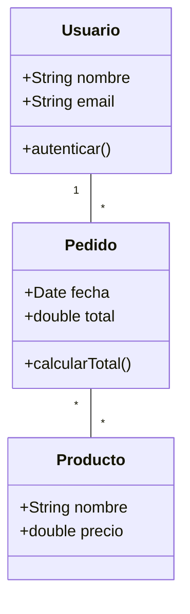
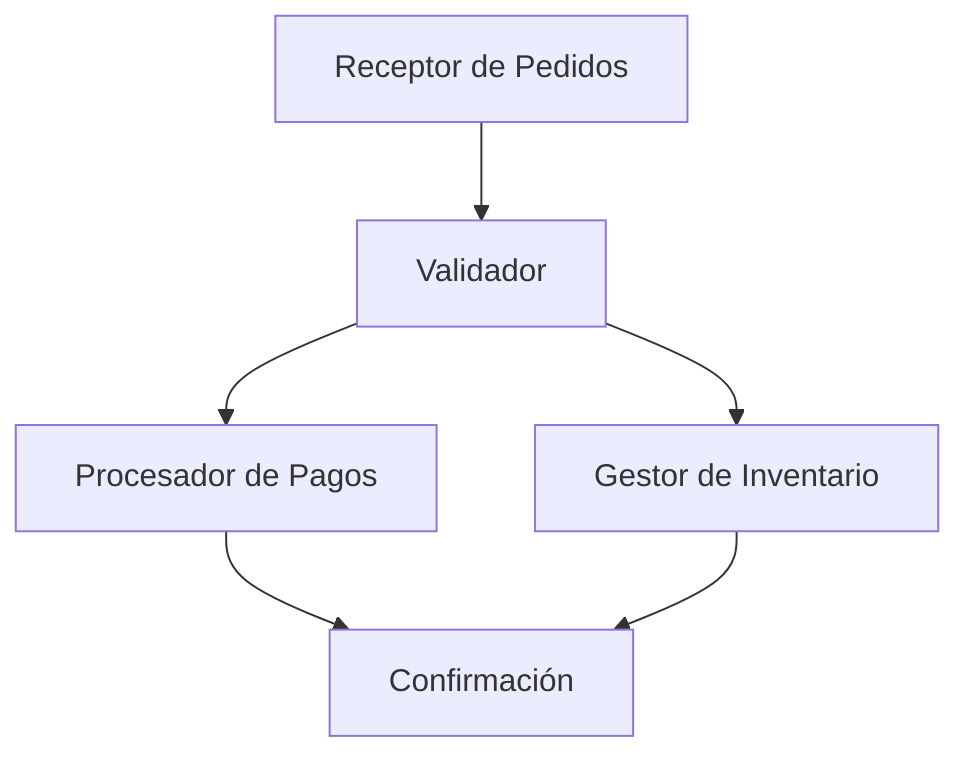
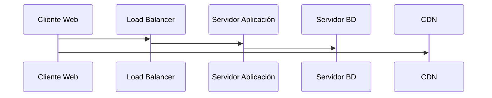
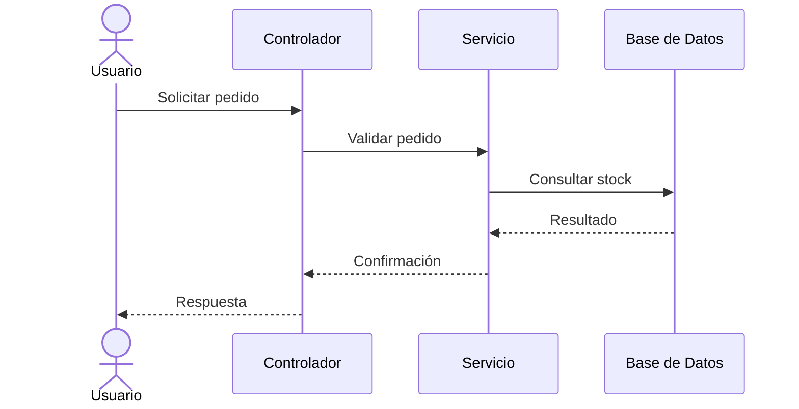
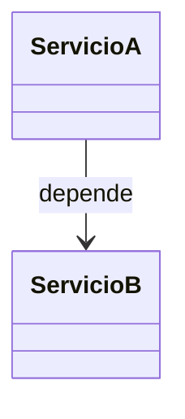
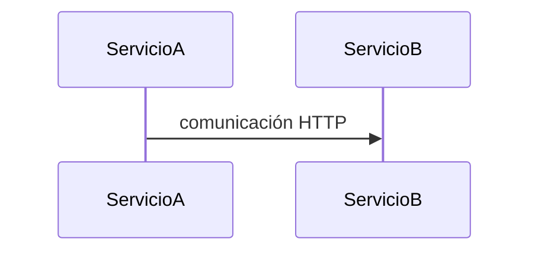

# Ingeniería de Software - Arquitectura de software

## 5.3 Enfoque de vistas para documentación de arquitecturas de software.

---

El enfoque de vistas para documentación de arquitecturas de software es un método sistemático para describir y comunicar la arquitectura de un sistema mediante múltiples perspectivas o vistas. Según Clements et al. (2003), "una vista arquitectónica representa un aspecto particular del sistema, mostrando cómo aborda ciertas preocupaciones de los stakeholders".

Este enfoque, popularizado por el método "4+1 Vistas" de Kruchten, permite:

- Comunicar efectivamente la arquitectura a diferentes stakeholders
- Gestionar la complejidad mediante separación de concerns
- Facilitar el análisis de atributos de calidad
- Proporcionar una documentación completa y coherente

### Fundamentos del Enfoque de Vistas

#### Definición de Vista Arquitectónica

Una vista arquitectónica es una representación de un conjunto de elementos del sistema y las relaciones entre ellos, desde la perspectiva de un conjunto relacionado de preocupaciones (ISO/IEC/IEEE 42010).

**Fórmula de cobertura de stakeholders:**

$$ C = \frac{N\_{sat}}{N\_{total}} \times 100\% $$

Donde:

- $C$ es el porcentaje de cobertura de stakeholders
- $N_{sat}$ es el número de stakeholders cuyas preocupaciones están satisfechas
- $N_{total}$ es el número total de stakeholders relevantes

### El Modelo 4+1 Vistas de Kruchten

#### Vista Lógica

Describe la funcionalidad que el sistema proporciona a los usuarios finales.

**Elementos clave:**

- Clases, interfaces y colaboraciones
- Relaciones de herencia, asociación y dependencia
- Patrones de diseño utilizados



#### Vista de Procesos

Muestra los aspectos concurrentes y de tiempo de ejecución del sistema.

**Elementos clave:**

- Procesos, hilos y tareas
- Comunicación interprocesos
- Sincronización y coordinación



#### Vista de Desarrollo

Describe la organización del software en el entorno de desarrollo.

**Elementos clave:**

- Módulos, componentes y subsistemas
- Dependencias de compilación
- Configuración de gestión de versiones

```
Estructura de paquetes:
com/
  empresa/
    sistema/
      dominio/
        Usuario.java
        Pedido.java
        Producto.java
      aplicacion/
        ServicioUsuarios.java
        ServicioPedidos.java
      infraestructura/
        Persistencia.java
        APIExterna.java
```

#### Vista Física

Muestra la asignación de elementos software al hardware.

**Elementos clave:**

- Nodos de procesamiento
- Dispositivos de almacenamiento
- Conectores de comunicación



#### Vista de Escenarios (+1)

Ilustra cómo los casos de uso se realizan a través de las otras vistas.

**Propósito:**

- Validar y demostrar la arquitectura
- Mostrar la interacción entre componentes
- Facilitar la comprensión para stakeholders no técnicos

### Otras Perspectivas de Documentación

#### Vista de Comportamiento

Describe la dinámica del sistema y las interacciones entre componentes.



#### Vista de Implementación

Detalla la estructura física de los artefactos de implementación.

**Ejemplo de estructura:**

```
sistema/
  src/
    main/
      java/          # Código fuente
      resources/     # Configuraciones
  target/
    classes/         # Bytecode compilado
    lib/             # Dependencias
  deployment/
    docker/          # Configuración contenedores
    kubernetes/      # Orquestación
```

### Template para Documentación de Vistas

#### Estructura de documentación por vista

**1. Identificación de la vista**

- Nombre y tipo de vista
- Stakeholders principales
- Preocupaciones abordadas

**2. Elementos arquitectónicos**

- Componentes y conectores
- Propiedades y relaciones
- Restricciones y supuestos

**3. Contexto y descomposición**

- Relación con otras vistas
- Nivel de granularidad
- Patrones arquitectónicos aplicados

**4. Rationale**

- Decisiones arquitectónicas
- Alternativas consideradas
- Trade-offs evaluados

### Ejemplo: Documentación de Vista Lógica para Sistema E-commerce

#### 1. Identificación

**Vista:** Lógica
**Stakeholders:** Desarrolladores, Arquitectos
**Preocupaciones:** Funcionalidad, mantenibilidad, extensibilidad

#### 2. Elementos principales

```java
// Ejemplo de componentes en código
public interface ServicioPedidos {
    Pedido crearPedido(Carrito carrito);
    boolean cancelarPedido(String idPedido);
    List<Pedido> obtenerHistorial(String idUsuario);
}

@Service
public class ServicioPedidosImpl implements ServicioPedidos {
    private final RepositorioPedidos repositorio;
    private final ServicioPagos servicioPagos;

    @Override
    public Pedido crearPedido(Carrito carrito) {
        // Lógica de negocio para crear pedido
        Pedido pedido = new Pedido(carrito);
        servicioPagos.procesarPago(pedido);
        return repositorio.guardar(pedido);
    }
}
```

#### 3. Relaciones y patrones

- Patrón Strategy para diferentes métodos de pago
- Patrón Observer para notificaciones de estado
- Patrón Factory para creación de pedidos

#### 4. Rationale

Se eligió una estructura modular para facilitar:

- Testing individual de componentes
- Evolución independiente de módulos
- Reemplazo de implementaciones

### Técnicas para Vista de Escenarios

#### Matriz de Trazabilidad de Escenarios

| Escenario             | Componentes Involucrados             | Vista Lógica | Vista Procesos | Vista Física |
| --------------------- | ------------------------------------ | ------------ | -------------- | ------------ |
| Realizar pedido       | ServicioPedidos, ServicioPagos       | ✓            | ✓              | ✓            |
| Consultar historial   | RepositorioPedidos, ServicioUsuarios | ✓            |                | ✓            |
| Actualizar inventario | ServicioInventario, BD               | ✓            | ✓              | ✓            |

#### Fórmula de cobertura de escenarios:

$$ CE = \frac{E\_{cubiertos}}{E\_{totales}} \times 100\% $$

Donde:

- $CE$ es el porcentaje de cobertura de escenarios
- $E_{cubiertos}$ es el número de escenarios cubiertos por las vistas
- $E_{totales}$ es el número total de escenarios críticos

### Ejercicios Propuestos

#### Ejercicio 1: Identificación de Vistas

Para un sistema de banca online, identifica:

1. Qué stakeholders estarían interesados en cada vista
2. Qué elementos incluirías en la vista de procesos
3. Cómo relacionarías la vista física con la de desarrollo

#### Ejercicio 2: Documentación de Vista Lógica

Crea la documentación de la vista lógica para un sistema de:

1. Reservas de hotel
2. Red social
3. Plataforma de e-learning

Incluye diagramas de clases, interfaces principales y patrones utilizados.

#### Ejercicio 3: Análisis de Consistencia

Dadas las siguientes vistas, identifica inconsistencias:

**Vista Lógica:**



**Vista de Desarrollo:**

```
moduloX/
  src/
    ServicioA.java   # Depende de moduloY
moduloY/
  src/
    ServicioB.java
```

**Vista Física:**



#### Ejercicio 4: Creación de Vista de Escenarios

Para un sistema de delivery de comida, desarrolla:

1. 3 escenarios clave
2. Diagramas de secuencia para cada escenario
3. Matriz de trazabilidad con las otras vistas

#### Ejercicio 5: Evaluación de Completitud

Evalúa la completitud de la documentación arquitectónica usando:

$$ C = \frac{V\_{documentadas}}{V\_{necesarias}} \times 100\% $$

$$ E = \frac{S\_{satisfechos}}{S\_{totales}} \times 100\% $$

Donde:

- $C$ es completitud de vistas
- $E$ es efectividad con stakeholders
- $V_{documentadas}$ es vistas documentadas
- $V_{necesarias}$ es vistas necesarias
- $S_{satisfechos}$ es stakeholders satisfechos
- $S_{totales}$ es stakeholders totales

### Mejores Prácticas para Documentación

#### Principios de documentación efectiva

1. **Consistencia**: Mantener convenciones y estándares uniformes
2. **Actualización**: Mantener la documentación sincronizada con el código
3. **Relevancia**: Enfocarse en lo importante para los stakeholders
4. **Modularidad**: Documentar por partes manejables
5. **Accesibilidad**: Hacer la documentación fácil de encontrar y usar

#### Técnicas para mantener documentación actualizada

- Integrar con herramientas de CI/CD
- Usar documentación como código
- Automatizar generación de diagramas
- Establecer revisiones periódicas

### Referencias

#### Bibliografía Básica

1. Sommerville, Ian. (2010). "Software Engineering" (9th edition). Addison Wesley. (Capítulo 11: Architectural design)
2. Pfleeger, S. L., & Atlee, J. M. (2010). "Software Engineering: Theory and Practice" (4th Edition). Prentice Hall. (Capítulo 6: Architecture)

#### Bibliografía Complementaria

3. Clements, P., et al. (2003). "Documenting Software Architectures: Views and Beyond"
4. Kruchten, P. (1995). "Architectural Blueprints—The 4+1 View Model of Software Architecture"
5. ISO/IEC/IEEE 42010:2011 "Systems and software engineering — Architecture description"

### Conclusión

El enfoque de vistas para documentación de arquitecturas proporciona un marco sistemático para comunicar y analizar diseños arquitectónicos complejos. Al presentar múltiples perspectivas de un sistema, este enfoque permite satisfacer las necesidades de información de diferentes stakeholders mientras se mantiene una coherencia global en la documentación.

La efectividad de este método reside en su capacidad para:

- Gestionar la complejidad mediante separación de concerns
- Facilitar el análisis de atributos de calidad específicos
- Proporcionar una base para la evaluación arquitectónica
- Servir como guía para la implementación y evolución del sistema

Una documentación arquitectónica bien estructurada usando el enfoque de vistas no es solo un artefacto de diseño, sino una herramienta vital para la comunicación, el mantenimiento y la evolución exitosa de los sistemas software.
