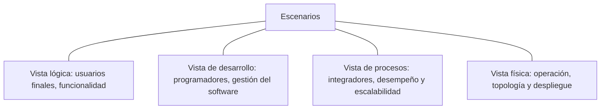
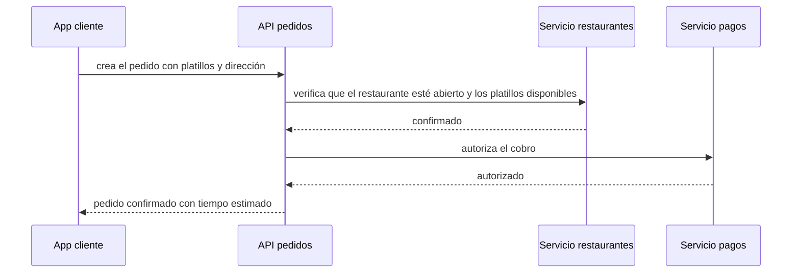

# Ingeniería de Software - Arquitectura de software

## 5.3 Enfoque de vistas para documentación de arquitecturas de software.

---

Un solo diagrama no puede describir una arquitectura: la estructura de clases, los procesos en ejecución, la organización del código y la distribución en máquinas son estructuras distintas, que interesan a personas distintas. El **enfoque de vistas** documenta la arquitectura con varias **vistas**, cada una una representación de una estructura del sistema desde la perspectiva de un grupo de interesados, y relacionadas entre sí. Este tema presenta el modelo 4+1 de Kruchten, la norma ISO/IEC/IEEE 42010, los enfoques C4 y *Views and Beyond*, la consistencia entre vistas y la forma de evaluar la completitud de la documentación.

### El modelo 4+1

Kruchten propuso en 1995 cuatro vistas y una quinta que las une:

- **Vista lógica:** la funcionalidad que el sistema ofrece a sus usuarios, con las abstracciones principales del dominio y sus relaciones; diagramas de clases, de paquetes y de componentes. Interesa a analistas y diseñadores.
- **Vista de procesos:** el comportamiento en ejecución: procesos, hilos, concurrencia, sincronización y comunicación; diagramas de secuencia, de actividad y de comunicación. Atiende el desempeño, la escalabilidad y la disponibilidad. Interesa a los integradores.
- **Vista de desarrollo** o de implementación: la organización del código en módulos, paquetes, capas y bibliotecas, con sus dependencias de compilación. Interesa a los programadores y a la gestión de la configuración.
- **Vista física** o de despliegue: el mapeo del software a nodos de hardware, contenedores y redes. Interesa a los ingenieros de operación.
- **Escenarios**, el "+1": un conjunto pequeño de casos de uso importantes que recorren las otras cuatro vistas, muestran cómo colaboran sus elementos y sirven para validar la arquitectura.



### Otros enfoques

- **ISO/IEC/IEEE 42010:** la norma que fija el vocabulario: un sistema tiene **interesados** con **preocupaciones**; un **punto de vista** establece las convenciones para construir vistas que atienden ciertas preocupaciones, y una **vista** aplica un punto de vista a un sistema concreto. La norma no prescribe qué vistas usar, sino que la descripción justifique cuáles eligió para qué interesados.
- **Views and Beyond** (SEI): organiza las vistas en tres tipos, de **módulos**, de **componentes y conectores** en ejecución, y de **asignación** al entorno, y agrega documentación de las interfaces, del comportamiento y de las **razones** de las decisiones.
- **Modelo C4** (Brown): cuatro niveles de acercamiento, **contexto**, el sistema y su entorno; **contenedores**, las aplicaciones y bases de datos; **componentes** dentro de cada contenedor, y **código**. Es ligero y popular en equipos ágiles.
- **Registros de decisiones arquitectónicas** (ADR, Nygard): un documento breve por decisión, con su contexto, la decisión, el estado y las consecuencias. Documentan el **porqué**, que los diagramas no muestran.

### Consistencia entre vistas

Las vistas describen el mismo sistema, y deben corresponderse: cada elemento lógico debe estar en algún módulo de la vista de desarrollo y desplegado en algún nodo de la física; cada dependencia lógica debe tener un mecanismo en ejecución; y las dependencias de compilación deben ser coherentes con la forma de comunicación. Las inconsistencias son comunes porque cada vista se actualiza por separado. Mantener la documentación como **datos**, o generarla desde el código y la infraestructura, permite verificarlas automáticamente.

### Implementación en Python

El programa resuelve el ejercicio 3 representando las tres vistas como datos y comprobando reglas de correspondencia entre ellas, primero sobre las vistas del enunciado y después sobre una versión corregida. Para el ejercicio 4 construye la matriz de rastreo de los escenarios de un servicio de comida a domicilio a sus elementos, y verifica que todos tengan una ubicación en las demás vistas. Para el ejercicio 5 calcula la completitud de las vistas y la efectividad con los interesados.

```python
# ---------- Ejercicio 3: consistencia entre vistas, comprobada sobre un modelo ----------
logica = {"elementos": {"ServicioA", "ServicioB"}, "dependencias": {("ServicioA", "ServicioB")}}
desarrollo = {"modulos": {"moduloX": {"ServicioA"}, "moduloY": {"ServicioB"}},
              "dependencias": {("moduloX", "moduloY")}}
fisica = {"nodos": {}, "conectores": {("ServicioA", "ServicioB"): "HTTP"}}       # el enunciado no dice en qué nodos corre cada uno
def revisa(logica, desarrollo, fisica, api_separada=None):
    hallazgos = []
    modulo_de = {e: m for m, es in desarrollo["modulos"].items() for e in es}
    for e in sorted(logica["elementos"]):
        if e not in modulo_de: hallazgos.append(f"{e} no aparece en la vista de desarrollo")
        if e not in fisica["nodos"]: hallazgos.append(f"{e} no tiene nodo asignado en la vista física")
    for a, b in sorted(logica["dependencias"]):
        if (a, b) not in fisica["conectores"]: hallazgos.append(f"la dependencia {a} → {b} no tiene conector en tiempo de ejecución")
        remoto = fisica["conectores"].get((a, b)) in ("HTTP", "gRPC", "mensajes")
        dep_codigo = (modulo_de.get(a), modulo_de.get(b)) in desarrollo["dependencias"]
        if remoto and dep_codigo and not api_separada:
            hallazgos.append(f"{a} llama a {b} por {fisica['conectores'][(a, b)]}, pero su módulo depende en compilación del módulo que implementa a {b}")
    for (m1, m2) in sorted(desarrollo["dependencias"]):
        es1, es2 = desarrollo["modulos"][m1], desarrollo["modulos"][m2]
        if not any((a, b) in logica["dependencias"] for a in es1 for b in es2):
            hallazgos.append(f"{m1} depende de {m2} sin una dependencia lógica que lo justifique")
    return hallazgos
print("ejercicio 3: inconsistencias encontradas:")
for h in revisa(logica, desarrollo, fisica): print("   -", h)
corr_des = {"modulos": {"moduloX": {"ServicioA"}, "moduloY": {"ServicioB"}, "moduloY-api": {"ContratoB"}},
            "dependencias": {("moduloX", "moduloY-api"), ("moduloY", "moduloY-api")}}
corr_log = {"elementos": {"ServicioA", "ServicioB", "ContratoB"},
            "dependencias": {("ServicioA", "ServicioB"), ("ServicioA", "ContratoB"), ("ServicioB", "ContratoB")}}
corr_fis = {"nodos": {"ServicioA": "contenedor-a", "ServicioB": "contenedor-b", "ContratoB": "biblioteca en ambos"},
            "conectores": {("ServicioA", "ServicioB"): "HTTP", ("ServicioA", "ContratoB"): "enlace", ("ServicioB", "ContratoB"): "enlace"}}
r = revisa(corr_log, corr_des, corr_fis, api_separada=True)
print("   versión corregida:", r if r else "sin inconsistencias" , "(la dependencia en compilación es hacia el contrato, no hacia la implementación)")

# ---------- Ejercicio 4: escenarios del servicio de comida a domicilio y su rastreo a las vistas ----------
escenarios = {
    "E1 hacer un pedido": ["App cliente", "API pedidos", "Servicio pagos", "Servicio restaurantes"],
    "E2 asignar repartidor": ["Servicio pedidos", "Servicio asignación", "App repartidor", "Servicio geolocalización"],
    "E3 seguir la entrega": ["App cliente", "Servicio geolocalización", "App repartidor"],
}
vistas = {"App cliente": ("lógica: Pedido", "desarrollo: app-movil", "física: teléfono"),
          "API pedidos": ("lógica: Pedido", "desarrollo: pedidos", "física: clúster"),
          "Servicio pedidos": ("lógica: Pedido", "desarrollo: pedidos", "física: clúster"),
          "Servicio pagos": ("lógica: Pago", "desarrollo: pagos", "física: clúster + pasarela externa"),
          "Servicio restaurantes": ("lógica: Restaurante, Menú", "desarrollo: restaurantes", "física: clúster"),
          "Servicio asignación": ("lógica: Asignación", "desarrollo: logistica", "física: clúster"),
          "Servicio geolocalización": ("lógica: Ubicación", "desarrollo: geo", "física: clúster + caché en memoria"),
          "App repartidor": ("lógica: Entrega", "desarrollo: app-repartidor", "física: teléfono")}
print("ejercicio 4: matriz de rastreo de escenarios a elementos")
todos = sorted({e for es in escenarios.values() for e in es})
abrev = {e: "".join(p[0] for p in e.split()).upper() + ("A" if e == "Servicio pagos" else "E" if e == "Servicio pedidos" else "") for e in todos}
print("   " + " " * 26 + " ".join(f"{abrev[e]:>4}" for e in todos), "|", ", ".join(f"{abrev[e]} = {e}" for e in todos))
for esc, elems in escenarios.items(): print(f"   {esc:26}" + " ".join(f"{'X' if e in elems else '·':>4}" for e in todos))
sin_vista = [e for e in todos if e not in vistas]
print("   elementos de los escenarios sin ubicación en las demás vistas:", sin_vista or "ninguno")

# ---------- Ejercicio 5: completitud y efectividad ----------
necesarias = {"lógica", "procesos", "desarrollo", "física", "escenarios", "datos", "seguridad"}
documentadas = {"lógica", "desarrollo", "física", "escenarios"}
interesados = {"desarrolladores": True, "operación": True, "seguridad": False, "dirección": True, "auditoría": False}
C = len(documentadas & necesarias) / len(necesarias); E = sum(interesados.values()) / len(interesados)
print(f"ejercicio 5: C = {len(documentadas & necesarias)}/{len(necesarias)} = {C:.0%} | faltan {sorted(necesarias - documentadas)}")
print(f"   E = {sum(interesados.values())}/{len(interesados)} = {E:.0%} | insatisfechos: {[k for k, v in interesados.items() if not v]}")
```

Salida:

```text
ejercicio 3: inconsistencias encontradas:
   - ServicioA no tiene nodo asignado en la vista física
   - ServicioB no tiene nodo asignado en la vista física
   - ServicioA llama a ServicioB por HTTP, pero su módulo depende en compilación del módulo que implementa a ServicioB
   versión corregida: sin inconsistencias (la dependencia en compilación es hacia el contrato, no hacia la implementación)
ejercicio 4: matriz de rastreo de escenarios a elementos
                               AP   AC   AR   SA   SG  SPA  SPE   SR | AP = API pedidos, AC = App cliente, AR = App repartidor, SA = Servicio asignación, SG = Servicio geolocalización, SPA = Servicio pagos, SPE = Servicio pedidos, SR = Servicio restaurantes
   E1 hacer un pedido           X    X    ·    ·    ·    X    ·    X
   E2 asignar repartidor        ·    ·    X    X    X    ·    X    ·
   E3 seguir la entrega         ·    X    X    ·    X    ·    ·    ·
   elementos de los escenarios sin ubicación en las demás vistas: ninguno
ejercicio 5: C = 4/7 = 57% | faltan ['datos', 'procesos', 'seguridad']
   E = 3/5 = 60% | insatisfechos: ['seguridad', 'auditoría']
```

### Ejercicios Propuestos

1. **Vistas.** Para un sistema de banca en línea, identifica qué interesados se interesan en cada vista, qué elementos incluirías en la vista de procesos y cómo se relaciona la vista física con la de desarrollo.

2. **Vista lógica.** Documenta la vista lógica de un sistema de reservas de hotel, una red social y una plataforma de aprendizaje en línea, con diagramas de clases, interfaces principales y patrones.

3. **Consistencia.** Identifica las inconsistencias entre estas vistas: en la lógica, ServicioA depende de ServicioB; en la de desarrollo, ServicioA está en `moduloX`, que depende de `moduloY`, donde está ServicioB; en la física, un diagrama de secuencia muestra que ServicioA se comunica con ServicioB por HTTP.

4. **Escenarios.** Para un servicio de comida a domicilio, desarrolla 3 escenarios clave, un diagrama de secuencia para cada uno y una matriz de rastreo con las demás vistas.

5. **Completitud.** Evalúa la completitud de la documentación arquitectónica con $C = V_{\text{documentadas}} / V_{\text{necesarias}}$ y su efectividad con $E = S_{\text{satisfechos}} / S_{\text{totales}},$ con $V$ las vistas y $S$ los interesados.

### Soluciones

**Ejercicio 1.**

| Vista       | Interesados                                      | Contenido en banca en línea                                     |
| ----------- | ------------------------------------------------ | --------------------------------------------------------------- |
| Lógica      | Analistas de negocio, diseñadores                | Cliente, Cuenta, Movimiento, Transferencia, Beneficiario         |
| Procesos    | Integradores, responsables de desempeño          | Ver abajo                                                       |
| Desarrollo  | Programadores, gestión de la configuración       | Módulos por dominio, bibliotecas comunes, pipeline de compilación |
| Física      | Operación, seguridad de la infraestructura       | Zona desmilitarizada, clúster de aplicación, base de datos principal y réplica, centro alterno |
| Escenarios  | Todos, en especial dirección y auditoría         | Transferir a un tercero, consultar saldo, bloquear una tarjeta  |

La vista de procesos incluye las solicitudes web atendidas por réplicas sin estado, las transacciones de transferencia con su aislamiento, la comunicación síncrona con el núcleo bancario y asíncrona con las notificaciones, los procesos por lotes nocturnos de conciliación, y los tiempos límite y reintentos de cada llamada. La relación entre la física y la de desarrollo es el **mapeo de artefactos a nodos**: cada módulo de la vista de desarrollo produce un artefacto desplegable, como una imagen de contenedor, que la vista física asigna a nodos; ese mapeo debe estar documentado, por ejemplo en los manifiestos de despliegue.

**Ejercicio 2.** Para el sistema de reservas de hotel, la vista lógica tiene las clases Hotel, TipoHabitación, Habitación, Tarifa, Reserva, Huésped y Pago, con las relaciones del tema 4.4; las interfaces principales `Disponibilidad`, `Reservas` y `Tarifas` del tema 5.1; y patrones como **repositorio** para la persistencia y **estrategia** para el cálculo de tarifas por temporada. Para una red social: Usuario, Publicación, Comentario, Reacción, Relación de seguimiento y Feed, con el patrón **publicador-suscriptor** para distribuir las publicaciones a los seguidores y **CQRS** para separar la escritura de publicaciones de la lectura del feed. Para el aprendizaje en línea: Curso, Módulo, Lección, Evaluación, Inscripción y Progreso, con **composite** para la estructura de curso, módulos y lecciones, y **estado** para el progreso del estudiante. Los diagramas de clases correspondientes siguen la notación del tema 5.3 del curso de Lenguajes de Programación.

**Ejercicio 3.** El programa encuentra tres problemas, y hay uno más de forma:

1. **La vista física no es física:** un diagrama de secuencia describe interacciones en ejecución, que pertenecen a la vista de procesos. La vista física debe mostrar los **nodos**: en qué máquinas o contenedores se despliega cada servicio. Ninguno de los dos servicios tiene un nodo asignado.
2. **Comunicación remota con dependencia de compilación:** si ServicioA llama a ServicioB por HTTP, son procesos separados, y `moduloX` no debería depender en compilación de `moduloY`, el módulo que **implementa** a ServicioB. Esa dependencia permitiría llamar directamente a la implementación, saltándose la red, y obliga a recompilar A con cada cambio interno de B. La corrección es un módulo de **contrato**, como `moduloY-api` con la especificación OpenAPI o los tipos de la API, del que dependen ambos.
3. La vista lógica no dice **qué** tipo de dependencia es, si síncrona o asíncrona, ni qué pasa si B no responde.

En la versión corregida, con el contrato como elemento lógico, cada servicio en su contenedor y las dependencias de compilación hacia el contrato, el programa no encuentra inconsistencias.

**Ejercicio 4.** Los tres escenarios son E1, hacer un pedido; E2, asignar un repartidor, y E3, seguir la entrega en el mapa. El diagrama de secuencia de E1:



E2 lo inicia el servicio de pedidos cuando el restaurante acepta: el servicio de asignación consulta la ubicación de los repartidores cercanos en el servicio de geolocalización, ofrece el pedido a uno en su aplicación y espera su aceptación, con un tiempo límite para ofrecerlo al siguiente. E3 consiste en que la aplicación del repartidor envía su posición cada pocos segundos al servicio de geolocalización, y la del cliente la consulta o la recibe por una conexión persistente. La matriz de rastreo del programa relaciona cada escenario con los elementos que recorre, y cada elemento con su ubicación en las vistas lógica, de desarrollo y física. Un elemento que aparece en un escenario sin estar en las demás vistas indica que la documentación está incompleta.

**Ejercicio 5.** Con las siete vistas que necesitaría el sistema de ejemplo, las cuatro de Kruchten más escenarios, datos y seguridad, y cuatro documentadas, todas salvo procesos, datos y seguridad, $C = 4/7 \approx 57\,\%;$ con tres de cinco grupos de interesados satisfechos, $E = 3/5 = 60\,\%.$ Las métricas solo tienen sentido si "necesarias" se define a partir de las preocupaciones de los interesados, como pide la norma 42010; y son complementarias: una documentación completa que nadie lee tiene $C$ alto y $E$ bajo. Los faltantes concretos, la vista de procesos y la de seguridad, son justo los que necesitan los interesados insatisfechos.

### Referencias

1. Kruchten, P. B., The 4+1 view model of architecture. _IEEE Software_ 12(6), 1995.
2. ISO/IEC/IEEE 42010:2022, _Software, systems and enterprise: Architecture description_.
3. Clements, P., et al., _Documenting Software Architectures: Views and Beyond_. Addison-Wesley, 2010.
4. Brown, S., _The C4 Model for Visualising Software Architecture_. c4model.com.
5. Nygard, M., Documenting architecture decisions, 2011. cognitect.com.
