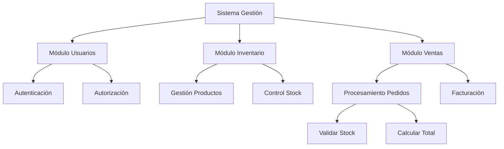
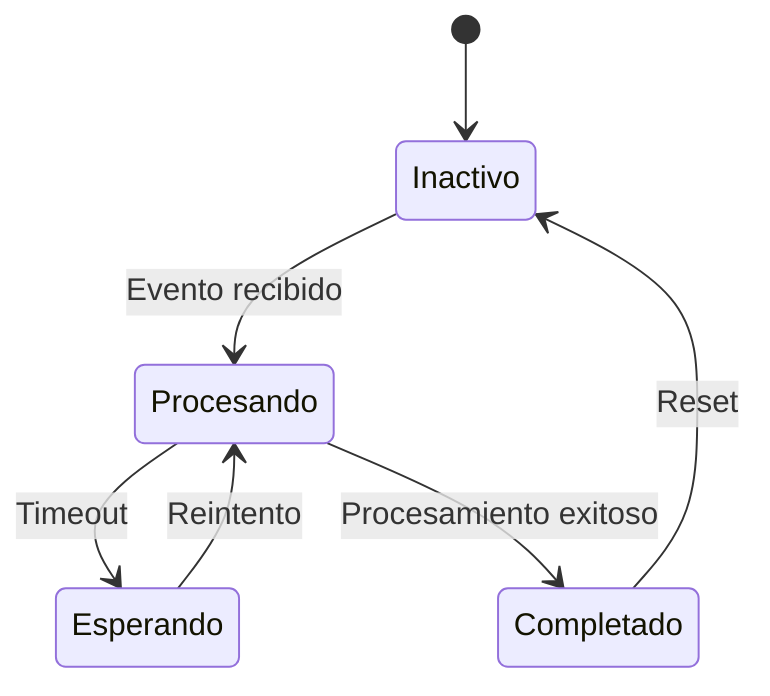
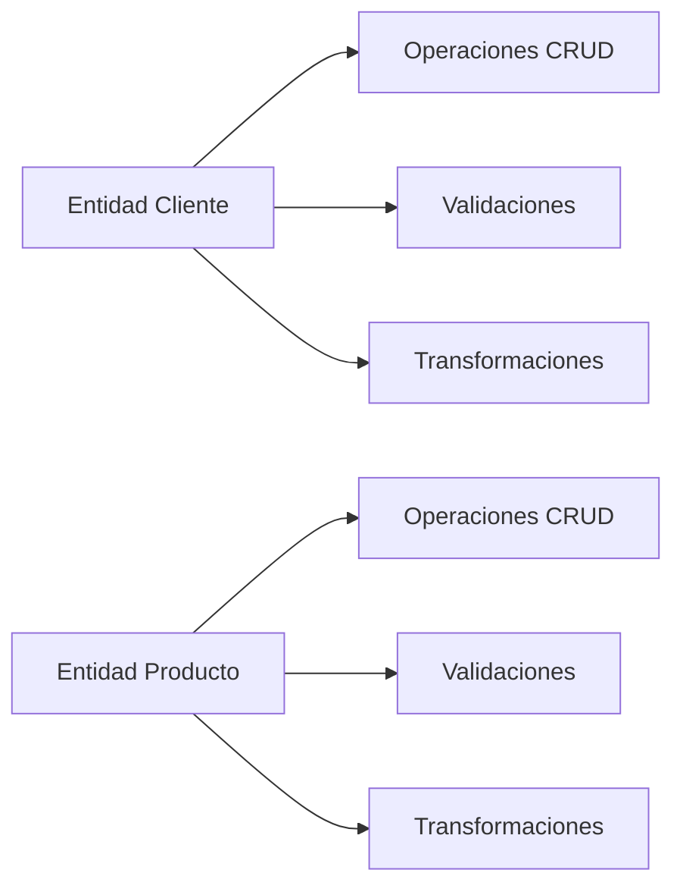
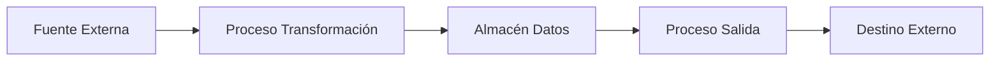
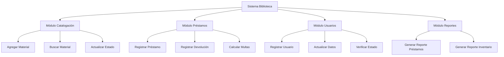

# Ingeniería de Software - Arquitectura de software

## 5.4 Métodos tradicionales para el diseño de arquitecturas de software.

---

Los métodos tradicionales para el diseño de arquitecturas de software representan enfoques sistemáticos y estructurados que han sido fundamentales en la evolución de la ingeniería de software. Según Sommerville (2010), "el diseño arquitectónico es el proceso de identificar los subsistemas que componen un sistema y el framework para el control y la comunicación entre estos subsistemas".

Estos métodos, desarrollados principalmente entre las décadas de 1970 y 1990, se caracterizan por su enfoque planificado, documentación exhaustiva y énfasis en la predictibilidad del proceso de desarrollo.

### Características de los Métodos Tradicionales

#### Principios Fundamentales

**Planificación exhaustiva:** Diseño detallado antes de la implementación
**Documentación formal:** Especificaciones completas y estructuradas
**Secuencialidad:** Fases bien definidas y consecutivas
**Control de cambios:** Procesos formales para modificación de requisitos

**Fórmula de completitud del diseño:**

$$ C_d = \frac{R\_{cubiertos}}{R\_{totales}} \times 100\% $$

Donde:

- $C_d$ es el porcentaje de completitud del diseño
- $R_{cubiertos}$ es el número de requisitos cubiertos en el diseño
- $R_{totales}$ es el número total de requisitos

### Métodos Estructurados

#### Diseño Estructurado (Yourdon y Constantine)

Enfoque que enfatiza la modularidad y el acoplamiento débil con alta cohesión.

**Métricas de diseño estructurado:**

- Cohesión: Grado en que los elementos de un módulo pertenecen juntos
- Acoplamiento: Medida de interdependencia entre módulos
- Complejidad ciclomática: $ V(G) = E - N + 2P $

**Ejemplo de estructura modular:**

```
Sistema de Gestión
├── Módulo Usuarios
│   ├── Submódulo Autenticación
│   └── Submódulo Autorización
├── Módulo Inventario
│   ├── Submódulo Gestión Productos
│   └── Submódulo Control Stock
└── Módulo Ventas
    ├── Submódulo Procesamiento Pedidos
    └── Submódulo Facturación
```

#### Diagramas de Estructura (Structure Charts)



### Método Jackson System Development (JSD)

#### Fases del JSD

1. **Modelado de entidades:** Identificar entidades y acciones
2. **Especificación de funciones:** Definir transformaciones de datos
3. **Diseño de sistema:** Implementar funciones en procesos

**Ejemplo de especificación JSD:**

```
ENTITY Cliente
  ACTIONS: registrar, actualizar, eliminar
  ATTRIBUTES: id, nombre, email

ENTITY Producto
  ACTIONS: crear, modificar, descontinuar
  ATTRIBUTES: id, nombre, precio, stock
```

### Método Ward-Mellor para Sistemas de Tiempo Real

#### Extensiones para sistemas embebidos y de tiempo real

**Características:**

- Modelado de procesos continuos y discretos
- Especificación de timing constraints
- Manejo de eventos asíncronos

**Fórmula de análisis de tiempo de respuesta:**
$$ T\_{respuesta} = T\_{procesamiento} + T\_{\text{comunicación}} + T\_{cola} $$



### Método de Diseño por Contratos (Bertrand Meyer)

#### Principios de diseño por contratos

**Precondiciones:** Condiciones que deben cumplirse antes de ejecutar una operación
**Postcondiciones:** Condiciones garantizadas después de ejecutar una operación
**Invariantes:** Condiciones que siempre se mantienen verdaderas

**Ejemplo en pseudocódigo:**

```
CONTRACT OperaciónRetirarDinero
  PRECONDITION: saldo >= monto AND monto > 0
  POSTCONDITION: saldo = saldo_anterior - monto
  INVARIANT: saldo >= 0
END CONTRACT
```

### Técnicas de Descomposición

#### Descomposición funcional

**Enfoque top-down:**
$$ Sistema = \sum_{i=1}^{n} Funcionalidad_i $$

**Ejemplo de descomposición:**

```
Sistema de Reservas
├── Gestión Usuarios (20%)
├── Búsqueda Disponibilidad (30%)
├── Procesamiento Pagos (25%)
└── Gestión Reservas (25%)
```

#### Descomposición por datos (Data-Driven Design)

**Enfoque basado en estructuras de datos:**



### Método de Transformación de Datos

#### Modelo de flujo de datos (Data Flow Diagrams)



**Niveles de DFD:**

- DFD Contexto (Nivel 0)
- DFD Nivel 1 (Descomposición funcional)
- DFD Nivel 2+ (Descomposición detallada)

### Técnicas de Especificación Formal

#### Notaciones formales para diseño arquitectónico

**Algebra de procesos:**
$$ P = a.P_1 + b.P_2 $$
$$ Q = c.Q_1 | d.Q_2 $$

**Lenguaje Z para especificación de estados:**

```
SistemaEstado
  estado: Conjunto[Elemento]
  operación: Estado → Estado

  ∀ s: Estado • precondición(s) ⇒ postcondición(operación(s))
```

### Métricas de Calidad en Diseño Tradicional

#### Métricas de acoplamiento y cohesión

**Acoplamiento entre módulos:**
$$ Acoplamiento = \frac{\sum Conexiones_{externas}}{\sum Conexiones_{totales}} $$

**Cohesión intramodular:**
$$ \text{Cohesión} = \frac{\sum Relaciones\_{internas}}{\sum Posibles Relaciones\_{internas}} $$

#### Complejidad de diseño

**Fórmula de complejidad arquitectónica:**
$$ C_a = \sum_{i=1}^{n} (W_i \times C_i) $$

Donde:

- $C_a$ es la complejidad arquitectónica total
- $W_i$ es el peso del componente i
- $C_i$ es la complejidad del componente i

### Ejemplo Completo: Sistema de Biblioteca

#### Diseño estructurado tradicional



#### Especificación de interfaces

```pascal
// Ejemplo en estilo Pascal de especificación tradicional
INTERFACE ModuloPrestamos;

TYPE
  TPrestamo = RECORD
    idUsuario: Integer;
    idMaterial: Integer;
    fechaPrestamo: Date;
    fechaDevolucion: Date;
    estado: TEstadoPrestamo;
  END;

PROCEDURE RegistrarPrestamo(usuario: Integer; material: Integer);
(* Pre: usuario existe y está activo, material disponible *)
(* Post: préstamo registrado, material marcado como prestado *)

FUNCTION ConsultarPrestamosVencidos: TListaPrestamos;
(* Retorna lista de préstamos con fecha de devución vencida *)

END_INTERFACE;
```

### Ejercicios Propuestos

#### Ejercicio 1: Diseño Estructurado

Para un sistema de hospital, realiza:

1. Descomposición funcional en 3 niveles
2. Diagrama de estructura jerárquica
3. Cálculo de acoplamiento entre módulos principales

#### Ejercicio 2: Especificación Formal

Desarrolla contratos formales para:

1. Sistema de transferencias bancarias
2. Sistema de control de acceso
3. Sistema de reservas de vuelos

Incluye precondiciones, postcondiciones e invariantes.

#### Ejercicio 3: Métricas de Calidad

Dado un sistema con:

- 15 módulos
- 45 conexiones internas
- 25 conexiones externas
- 120 posibles relaciones internas
- 80 relaciones internas actuales

Calcula:

1. Grado de acoplamiento
2. Nivel de cohesión
3. Complejidad relativa

#### Ejercicio 4: Transformación de Datos

Modela el flujo de datos para:

1. Proceso de compra en e-commerce
2. Sistema de procesamiento de pedidos
3. Sistema de gestión académica

Incluye DFDs de contexto, nivel 1 y nivel 2.

#### Ejercicio 5: Análisis Comparativo

Compara los métodos tradicionales con enfoques ágiles en:

1. Gestión de cambios de requisitos
2. Documentación requerida
3. Adaptabilidad a proyectos complejos
4. Predictibilidad de resultados

### Limitaciones y Críticas

#### Problemas comunes en métodos tradicionales

**Rigidez:** Dificultad para adaptarse a cambios
**Sobredocumentación:** Costo elevado de mantenimiento de documentación
**Retrasos:** Largos períodos de diseño antes de implementación
**Desalineación:** Possible discrepancia entre diseño e implementación

**Fórmula de costo de cambio:**
$$ C\_{cambio} = C\_{\text{diseño}} + C\_{\text{implementación}} + C\_{pruebas} + C\_{\text{documentación}} $$

### Evolución hacia Métodos Modernos

#### Transición a enfoques iterativos e incrementales

**Mejoras incorporadas:**

- Prototipado rápido para validación temprana
- Diseño iterativo con feedback continuo
- Documentación just-in-time
- Énfasis en working software sobre documentación exhaustiva

### Referencias

#### Bibliografía Básica

1. Sommerville, Ian. (2010). "Software Engineering" (9th edition). Addison Wesley. (Capítulos 6, 7, 11)
2. Pfleeger, S. L., & Atlee, J. M. (2010). "Software Engineering: Theory and Practice" (4th Edition). Prentice Hall. (Capítulos 4, 6)

#### Bibliografía Complementaria

3. Yourdon, E., & Constantine, L. L. (1979). "Structured Design: Fundamentals of a Discipline of Computer Program and Systems Design"
4. Jackson, M. A. (1983). "System Development"
5. Ward, P. T., & Mellor, S. J. (1985). "Structured Development for Real-Time Systems"
6. Meyer, B. (1997). "Object-Oriented Software Construction"

### Conclusión

Los métodos tradicionales para el diseño de arquitecturas de software representan la base fundamental sobre la cual se han desarrollado las prácticas modernas de ingeniería de software. Aunque estos enfoques pueden parecer rígidos en comparación con metodologías ágiles contemporáneas, sus principios de modularidad, descomposición sistemática y documentación estructurada continúan siendo relevantes.

El valor de los métodos tradicionales reside en:

- Su enfoque sistemático para manejar complejidad
- La emphasis en la planificación y el diseño anticipado
- La documentación exhaustiva que facilita el mantenimiento
- Las técnicas probadas para el análisis y diseño de sistemas

En la práctica moderna, lo más efectivo suele ser una combinación de principios tradicionales sólidos con la flexibilidad de enfoques ágiles, adaptando las técnicas según las necesidades específicas del proyecto y el contexto organizacional.
