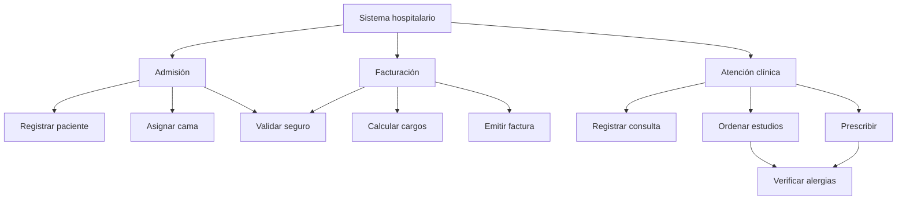
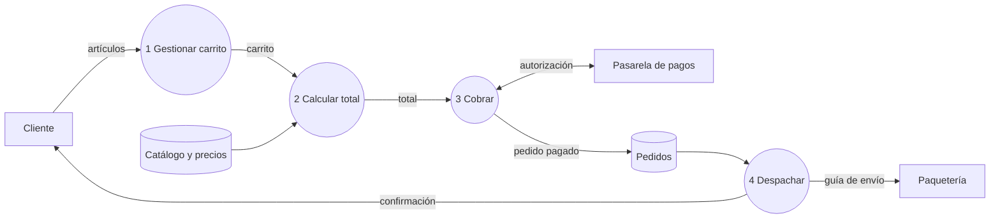

# Ingeniería de Software - Arquitectura de software

## 5.4 Métodos tradicionales para el diseño de arquitecturas de software.

---

Antes de que existieran los patrones arquitectónicos, la orientación a objetos dominante o los microservicios, la disciplina desarrolló métodos sistemáticos para pasar de los requerimientos a una estructura de módulos. Estos **métodos tradicionales**, de los años setenta y ochenta, comparten un rasgo: un procedimiento paso a paso, con modelos gráficos y criterios explícitos de calidad. Muchas de sus ideas siguen vigentes bajo otros nombres: el ocultamiento de información de Parnas es el encapsulamiento, la cohesión y el acoplamiento de Constantine siguen siendo los criterios centrales del diseño, y el diseño por contrato de Meyer está en las aserciones, los tipos y las pruebas basadas en propiedades. Este tema presenta el diseño estructurado, los diagramas de flujo de datos, el criterio de Parnas, los métodos de Jackson y de Ward y Mellor, y el diseño por contrato.

### Diseño estructurado

El **diseño estructurado** de Yourdon y Constantine (1979) descompone el sistema **funcionalmente**, de arriba hacia abajo: la función principal se divide en subfunciones, y estas en otras, hasta llegar a módulos simples. El resultado se dibuja en un **diagrama de estructura**, un árbol de módulos con las llamadas entre ellos y los datos que se pasan. La calidad se evalúa con dos criterios que propusieron ellos mismos:

- **Cohesión**, qué tan relacionadas están las tareas de un módulo, en una escala de peor a mejor: coincidental, lógica, temporal, procedimental, comunicacional, secuencial y **funcional**, en la que el módulo hace una sola cosa.
- **Acoplamiento**, cuánto depende un módulo de otros, de peor a mejor: por contenido, cuando un módulo modifica el interior de otro; común, por datos globales; externo; de control, cuando se pasa una bandera que decide el comportamiento del otro; de estampa, por estructuras completas; y **de datos**, solo con los parámetros necesarios.

Las métricas de **fan-in**, cuántos módulos llaman a uno, y **fan-out**, a cuántos llama, completan el análisis: un fan-in alto indica reutilización, y un fan-out alto, un módulo que coordina demasiado. Henry y Kafura combinaron ambos en la medida $\text{longitud} \cdot (\text{fan-in} \cdot \text{fan-out})^2$ con los flujos de información.

### Diagramas de flujo de datos

El **análisis estructurado** de DeMarco modela el sistema como **procesos** que transforman datos, **flujos** de datos entre ellos, **almacenes** y **entidades externas**. Se dibuja por niveles: el **diagrama de contexto**, nivel 0, muestra el sistema como un solo proceso con sus entidades externas; el **nivel 1** lo divide en los procesos principales, y cada proceso se detalla en un nivel inferior, conservando los flujos de entrada y salida del padre, una regla llamada **balanceo**. El diseño estructurado transforma después el diagrama de flujo de datos en un diagrama de estructura, con el análisis de transformación o de transacción.

### El criterio de Parnas

En su artículo de 1972, Parnas comparó dos descomposiciones del mismo programa: una por los **pasos del procesamiento**, como en un diagrama de flujo, y otra por las **decisiones de diseño que probablemente cambien**, ocultando cada una en un módulo. La segunda resultó mucho más fácil de modificar, porque cada cambio quedaba dentro de un módulo. El **ocultamiento de información** es desde entonces el criterio fundamental para dividir un sistema en módulos.

### Otros métodos

- **Jackson System Development** (JSD, 1983): modela primero las entidades del mundo real y sus acciones a lo largo del tiempo, como procesos secuenciales, y deriva el sistema de ese modelo. Su antecesor, JSP, deriva la estructura de un programa de la estructura de sus datos de entrada y salida.
- **Ward y Mellor** (1985): extiende el análisis estructurado a sistemas de tiempo real, con flujos de control, procesos de control y máquinas de estados.

### Diseño por contrato

Meyer formalizó en Eiffel la relación entre un módulo y quien lo usa como un **contrato**: la **precondición** es la obligación de quien llama, la **postcondición** la del módulo, y el **invariante de clase** una propiedad que toda operación pública conserva. Si una precondición falla, el error está en quien llama; si falla una postcondición, en el módulo. Las aserciones se verifican en tiempo de ejecución durante el desarrollo y las pruebas, documentan el comportamiento con precisión y, con herramientas de verificación, pueden demostrarse.



### Implementación en Python

El programa resuelve el ejercicio 2 con un decorador que verifica precondiciones, postcondiciones e invariantes, aplicado a transferencias bancarias, control de acceso y reservas de vuelos; ejecuta miles de operaciones aleatorias para comprobar que ninguna postcondición falle, y muestra cómo el contrato detecta un error introducido a propósito. Para el ejercicio 1 calcula el fan-in, el fan-out y la medida de Henry y Kafura del diagrama de estructura del hospital, y para el ejercicio 3, las métricas del enunciado.

```python
import functools, random

# ---------- Ejercicio 2: diseño por contrato con verificación en tiempo de ejecución ----------
class ViolacionContrato(AssertionError): pass
def contrato(pre=None, post=None, inv=None):
    def deco(f):
        @functools.wraps(f)
        def envoltura(self, *a, **k):
            if inv and not inv(self): raise ViolacionContrato(f"invariante antes de {f.__name__}")
            if pre and not pre(self, *a, **k): raise ViolacionContrato(f"precondición de {f.__name__}")   # culpa de quien llama
            viejo = self.instantanea()
            r = f(self, *a, **k)
            if post and not post(self, viejo, r, *a, **k): raise ViolacionContrato(f"postcondición de {f.__name__}")   # culpa del método
            if inv and not inv(self): raise ViolacionContrato(f"invariante después de {f.__name__}")
            return r
        return envoltura
    return deco
class Banco:
    def __init__(self, saldos): self.saldos = dict(saldos)
    def instantanea(self): return dict(self.saldos)
    @contrato(pre=lambda s, o, d, m: o in s.saldos and d in s.saldos and o != d and 0 < m <= s.saldos[o],
              post=lambda s, v, r, o, d, m: s.saldos[o] == v[o] - m and s.saldos[d] == v[d] + m
                   and all(s.saldos[c] == v[c] for c in v if c not in (o, d)),
              inv=lambda s: all(x >= 0 for x in s.saldos.values()))
    def transfiere(self, o, d, m): self.saldos[o] -= m; self.saldos[d] += m
class Acceso:
    def __init__(self): self.permisos, self.dentro = {"ana": {"lab"}, "luis": set()}, set()
    def instantanea(self): return set(self.dentro)
    @contrato(pre=lambda s, u, z: u in s.permisos, post=lambda s, v, r, u, z: r == (z in s.permisos[u]) and ((u, z) in s.dentro) == (r or (u, z) in v),
              inv=lambda s: all(z in s.permisos[u] for u, z in s.dentro))
    def entra(self, u, z):
        if z in self.permisos[u]: self.dentro.add((u, z)); return True
        return False
class Vuelo:
    def __init__(self, capacidad): self.capacidad, self.asientos = capacidad, {}
    def instantanea(self): return dict(self.asientos)
    @contrato(pre=lambda s, p, a: 1 <= a <= s.capacidad and a not in s.asientos and p not in s.asientos.values(),
              post=lambda s, v, r, p, a: s.asientos == v | {a: p},
              inv=lambda s: len(s.asientos) <= s.capacidad and len(set(s.asientos.values())) == len(s.asientos))
    def reserva(self, pasajero, asiento): self.asientos[asiento] = pasajero
# pruebas aleatorias: miles de operaciones; las precondiciones violadas se cuentan, las postcondiciones no deben fallar
rng = random.Random(6)
b, rechazos = Banco({"A": 500, "B": 300, "C": 0}), 0
for _ in range(5000):
    try: b.transfiere(rng.choice("ABCD"), rng.choice("ABC"), rng.randint(-10, 400))
    except ViolacionContrato as e: rechazos += "precondición" in str(e)
print(f"ejercicio 2: 5000 transferencias aleatorias: {rechazos} rechazadas por precondición, 0 fallas de postcondición | suma {sum(b.saldos.values())}")
class BancoConError(Banco):
    @contrato(pre=lambda s, o, d, m: o in s.saldos and d in s.saldos and 0 < m <= s.saldos[o],          # falta o != d
              post=lambda s, v, r, o, d, m: sum(s.saldos.values()) == sum(v.values()))
    def transfiere(self, o, d, m): x, y = self.saldos[o], self.saldos[d]; self.saldos[o] = x - m; self.saldos[d] = y + m
try: BancoConError({"A": 100}).transfiere("A", "A", 40)
except ViolacionContrato as e: print("   versión con error, transferencia de A a A:", e)
v = Vuelo(3); v.reserva("Ana", 1); v.reserva("Luis", 2)
for intento in (("Eva", 2), ("Ana", 3), ("Eva", 4)):
    try: v.reserva(*intento)
    except ViolacionContrato as e: print(f"   reserva {intento}: {e}")
a = Acceso(); print("   acceso: ana al lab", a.entra("ana", "lab"), "| luis al lab", a.entra("luis", "lab"), "| dentro:", sorted(a.dentro))

# ---------- Ejercicio 1: diagrama de estructura del hospital y su acoplamiento ----------
llama = {"Sistema hospitalario": ["Admisión", "Atención clínica", "Facturación"],
         "Admisión": ["Registrar paciente", "Asignar cama", "Validar seguro"],
         "Atención clínica": ["Registrar consulta", "Ordenar estudios", "Prescribir"],
         "Facturación": ["Calcular cargos", "Validar seguro", "Emitir factura"],
         "Prescribir": ["Verificar alergias"], "Ordenar estudios": ["Verificar alergias"], "Asignar cama": [], "Registrar consulta": []}
mods = sorted({m for k, vs in llama.items() for m in [k, *vs]})
fan_out = {m: len(llama.get(m, [])) for m in mods}
fan_in = {m: sum(m in vs for vs in llama.values()) for m in mods}
print("ejercicio 1: módulos con fan-in > 1 (reutilizados):", {m: fan_in[m] for m in mods if fan_in[m] > 1})
print("   Henry-Kafura (fan-in · fan-out)² de los módulos de nivel 2:", {m: (fan_in[m] * fan_out[m]) ** 2 for m in ("Admisión", "Atención clínica", "Facturación")})

# ---------- Ejercicio 3: métricas del enunciado ----------
modulos, internas, externas, posibles, actuales = 15, 45, 25, 120, 80
print(f"ejercicio 3: acoplamiento = {externas}/({internas} + {externas}) = {externas / (internas + externas):.1%} | "
      f"cohesión = {actuales}/{posibles} = {actuales / posibles:.1%} | conexiones por módulo = {(internas + externas) / modulos:.2f}")
print("   las 45 conexiones internas y las 80 relaciones internas actuales no pueden ser la misma cantidad: miden cosas distintas")
```

Salida:

```text
ejercicio 2: 5000 transferencias aleatorias: 3613 rechazadas por precondición, 0 fallas de postcondición | suma 800
   versión con error, transferencia de A a A: postcondición de transfiere
   reserva ('Eva', 2): precondición de reserva
   reserva ('Ana', 3): precondición de reserva
   reserva ('Eva', 4): precondición de reserva
   acceso: ana al lab True | luis al lab False | dentro: [('ana', 'lab')]
ejercicio 1: módulos con fan-in > 1 (reutilizados): {'Validar seguro': 2, 'Verificar alergias': 2}
   Henry-Kafura (fan-in · fan-out)² de los módulos de nivel 2: {'Admisión': 9, 'Atención clínica': 9, 'Facturación': 9}
ejercicio 3: acoplamiento = 25/(45 + 25) = 35.7% | cohesión = 80/120 = 66.7% | conexiones por módulo = 4.67
   las 45 conexiones internas y las 80 relaciones internas actuales no pueden ser la misma cantidad: miden cosas distintas
```

### Ejercicios Propuestos

1. **Diseño estructurado.** Para un sistema de hospital, haz una descomposición funcional en 3 niveles, su diagrama de estructura y el cálculo del acoplamiento entre los módulos principales.

2. **Contratos.** Escribe contratos formales, con precondiciones, postcondiciones e invariantes, para un sistema de transferencias bancarias, uno de control de acceso y uno de reservas de vuelos.

3. **Métricas.** Un sistema tiene 15 módulos, 45 conexiones internas, 25 externas, 120 relaciones internas posibles y 80 actuales. Calcula el grado de acoplamiento, el nivel de cohesión y la complejidad relativa.

4. **Flujo de datos.** Modela con diagramas de flujo de datos de contexto, de nivel 1 y de nivel 2 el proceso de compra de un comercio electrónico, un sistema de procesamiento de pedidos y un sistema de gestión académica.

5. **Comparación.** Compara los métodos tradicionales con los ágiles en la gestión de cambios de requerimientos, la documentación, la adaptabilidad a proyectos complejos y la predictibilidad.

### Soluciones

**Ejercicio 1.** El diagrama de estructura de la sección de diseño por contrato tiene tres niveles: el sistema; Admisión, Atención clínica y Facturación; y sus subfunciones. Dos módulos tienen fan-in 2, Validar seguro y Verificar alergias, y son candidatos a una biblioteca común, lo que es bueno. Los tres módulos principales tienen un acoplamiento **de datos** con sus subordinados si cada llamada pasa solo lo necesario, como el identificador del paciente y la póliza para validar el seguro. Hay que vigilar dos riesgos: que Admisión y Facturación compartan un registro global del paciente, acoplamiento común, y que una bandera "es urgencia" cambie el comportamiento de Asignar cama, acoplamiento de control; la alternativa es un módulo propio para la admisión de urgencias. Con fan-in 1 y fan-out 3, la medida de Henry y Kafura de los tres módulos de nivel 2 es $(1 \cdot 3)^2 = 9$ antes de multiplicar por su longitud.

**Ejercicio 2.** Con la notación de la sección de diseño por contrato:

- **Transferencia:** precondición, ambas cuentas existen, son distintas, y $0 \lt m \le \mathit{saldo}(o);$ postcondición, $\mathit{saldo}'(o) = \mathit{saldo}(o) - m,$ $\mathit{saldo}'(d) = \mathit{saldo}(d) + m$ y las demás cuentas no cambian; invariante, ningún saldo es negativo.
- **Control de acceso:** precondición, el usuario existe; postcondición, el resultado es verdadero exactamente si la zona está entre sus permisos, y solo entonces el usuario queda registrado dentro; invariante, todo usuario dentro de una zona tiene permiso para ella.
- **Reserva de vuelo:** precondición, el asiento existe, está libre, y el pasajero no tiene otro asiento; postcondición, la tabla de asientos es la anterior más el nuevo par; invariante, no hay más reservas que asientos ni un pasajero con dos asientos.

El programa verifica los contratos en ejecución: en 5 000 transferencias aleatorias, las inválidas son rechazadas por la precondición y ninguna viola la postcondición. Con un error introducido a propósito, una versión que olvida exigir cuentas distintas y lee ambos saldos antes de escribir, la postcondición de conservación detecta que transferir de una cuenta a sí misma crea dinero, el mismo error que encontró Z3 en el tema 4.3, ahora por ejecución.

**Ejercicio 3.** Con las fórmulas de la sección de diseño estructurado: acoplamiento $= 25 / (45 + 25) \approx 35.7\,\%,$ la fracción de conexiones que cruzan los límites del subsistema; cohesión $= 80 / 120 \approx 66.7\,\%.$ La "complejidad relativa" no está definida en el enunciado; una medida razonable son las conexiones por módulo, $70 / 15 \approx 4.67.$ Los datos tienen una inconsistencia que conviene señalar: hay 45 conexiones internas pero 80 relaciones internas actuales, de modo que miden cosas distintas, probablemente relaciones entre módulos las primeras y entre elementos de un mismo módulo las segundas. Una métrica sin una definición operativa precisa no se puede comparar entre proyectos.

**Ejercicio 4.** Para el proceso de compra, el diagrama de contexto tiene al sistema y sus entidades externas, Cliente, Pasarela de pagos y Paquetería; el de nivel 1:



y el nivel 2 del proceso 3 lo divide en validar los datos de pago, solicitar la autorización, registrar el pedido y emitir el comprobante, con los mismos flujos de entrada y salida que el proceso 3, la regla de balanceo. Los otros dos sistemas siguen el mismo método: para el de pedidos, las entidades son Cliente, Almacén y Transportista; para el académico, Estudiante, Profesor y Servicios Escolares, con almacenes de Alumnos, Cursos y Calificaciones.

**Ejercicio 5.**

| Aspecto                       | Tradicionales                                   | Ágiles                                             |
| ----------------------------- | ----------------------------------------------- | -------------------------------------------------- |
| Cambios de requerimientos     | Costosos: rehacer modelos y documentos aprobados | Esperados: se incorporan en la siguiente iteración |
| Documentación                 | Extensa, con modelos completos antes de programar | Mínima suficiente; el código y las pruebas como documentación |
| Proyectos complejos           | Fuertes para la complejidad estable y conocida  | Fuertes para la complejidad incierta y cambiante   |
| Predictibilidad               | Alta si los supuestos se cumplen                | Del alcance, baja; del plazo y el costo, alta      |

Las ideas de los métodos tradicionales que siguen usándose en cualquier proceso, ágil o no, son la cohesión y el acoplamiento, el ocultamiento de información y los contratos; lo que cambió es que ya no se aplican en una fase de diseño separada sino de forma continua.

### Referencias

1. Yourdon, E., and Constantine, L. L., _Structured Design_. Prentice Hall, 1979.
2. DeMarco, T., _Structured Analysis and System Specification_. Yourdon Press, 1978.
3. Parnas, D. L., On the criteria to be used in decomposing systems into modules. _Communications of the ACM_ 15(12), 1972.
4. Meyer, B., Applying "design by contract". _Computer_ 25(10), 1992.
5. Henry, S., and Kafura, D., Software structure metrics based on information flow. _IEEE Transactions on Software Engineering_ 7(5), 1981.
6. Jackson, M. A., _System Development_. Prentice Hall, 1983.
