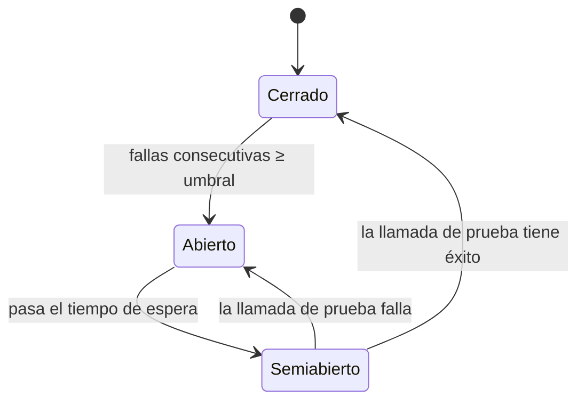

# Ingeniería de Software - Arquitectura de software

## 5.5 Enfoques emergentes para el desarrollo de arquitecturas de software.

---

Desde mediados de la década de 2000, la computación en la nube, los dispositivos móviles y la escala de los servicios de internet cambiaron las preguntas de la arquitectura. Un sistema ya no corre en un servidor que se compra y se mantiene durante años, sino en recursos que se rentan por minuto y fallan con regularidad; ya no lo usan cientos de empleados sino millones de personas; y ya no se publica una vez al año sino muchas veces al día. Los **enfoques emergentes**, como los eventos, los microservicios, las funciones sin servidor, el diseño a partir de las API y las mallas de servicios, son respuestas a esas condiciones. Este tema presenta cada uno con sus beneficios y costos, y los **patrones de resiliencia** que todos necesitan, porque en un sistema distribuido las fallas parciales son la norma.

### Arquitectura dirigida por eventos

Los componentes se comunican publicando **eventos**, hechos que ya ocurrieron como "pedido enviado", en un intermediario, como Kafka, RabbitMQ o un servicio de la nube, y los interesados se suscriben a ellos. El productor no conoce a los consumidores, lo que reduce el acoplamiento y permite agregar consumidores sin cambiar al productor. A cambio, el flujo es más difícil de seguir, la entrega suele ser **al menos una vez**, de modo que los consumidores deben ser **idempotentes**, y la consistencia entre servicios es **eventual**. Los mensajes que fallan repetidamente se apartan a una **cola de mensajes muertos** para revisarlos sin bloquear a los demás.

### Microservicios

Una aplicación se divide en servicios pequeños, cada uno alrededor de una **capacidad de negocio**, con su propia base de datos, desplegable de forma independiente y a cargo de un equipo. Lewis y Fowler los describieron en 2014. Sus límites se trazan con los **contextos delimitados** del diseño dirigido por el dominio de Evans: regiones del modelo en las que cada término tiene un significado único. Los beneficios son el despliegue y el escalamiento independientes y la autonomía de los equipos. Los costos son los de todo sistema distribuido: latencia y fallas de red, consistencia entre bases de datos, observabilidad, pruebas de extremo a extremo y operación de decenas de servicios. Para un equipo pequeño o un dominio todavía incierto, un **monolito modular** suele ser mejor punto de partida. La migración desde un monolito se hace de forma incremental con el patrón **estrangulador** de Fowler: los servicios nuevos se ponen delante del monolito y le quitan funciones una a una. Las transacciones entre servicios se reemplazan por **sagas**: una secuencia de transacciones locales con acciones de compensación si un paso falla.

### Sin servidor

En el modelo **sin servidor** (*serverless*) o de funciones como servicio, el código se despliega como funciones que la plataforma ejecuta en respuesta a eventos y escala automáticamente desde cero, cobrando por invocación. Elimina la administración de servidores y es económico con cargas variables; a cambio, hay latencia de **arranque en frío**, límites de duración y memoria, dependencia del proveedor y dificultad para depurar.

### Diseño a partir de la API

En el enfoque **API first**, el contrato de la API se diseña y acuerda antes de implementarla, en OpenAPI para las API síncronas y en **AsyncAPI** para las de mensajes (temas 2.2 y 2.3). Del contrato se generan servidores simulados, clientes, documentación y pruebas de contrato, y los equipos pueden trabajar en paralelo.

### Malla de servicios

Una **malla de servicios** (*service mesh*), como Istio o Linkerd, agrega a cada servicio un proxy, el **sidecar**, que intercepta su tráfico de red y aplica de forma uniforme el cifrado mutuo, los reintentos, los tiempos límite, el balanceo y la telemetría, sin cambiar el código de los servicios. Es útil con muchos servicios en varios lenguajes, y agrega complejidad operativa y latencia.

### Patrones de resiliencia

- **Tiempo límite:** ninguna llamada remota espera indefinidamente.
- **Reintentos con retroceso exponencial y jitter:** reintentar una falla transitoria esperando cada vez más, con un componente aleatorio para que miles de clientes no reintenten sincronizados y saturen al servicio que se recupera. Solo para operaciones idempotentes.
- **Interruptor de circuito** (*circuit breaker*, Nygard): tras varias fallas seguidas, el circuito se **abre** y las llamadas fallan de inmediato sin llegar al servicio, lo que le da tiempo de recuperarse y evita que los clientes agoten sus hilos esperando. Pasado un tiempo, pasa a **semiabierto** y deja pasar una llamada de prueba: si tiene éxito se **cierra**, y si falla vuelve a abrirse.
- **Mamparo** (*bulkhead*): recursos separados, como grupos de hilos o conexiones, para cada dependencia, de modo que una dependencia lenta no consuma los recursos de las demás.
- **Respaldo** (*fallback*): una respuesta degradada pero útil cuando la dependencia falla, como productos populares en lugar de recomendaciones personalizadas.



### Implementación en Python

El programa resuelve el ejercicio 4 con un reloj simulado: un interruptor de circuito con sus tres estados y métricas, protegiendo un servicio que falla durante 35 segundos, con respaldo; reintentos con retroceso exponencial y jitter, y un mamparo. Para el ejercicio 1 implementa un bus de eventos con suscripciones por tipo y canal, reintentos por canal y una cola de mensajes muertos. Para el ejercicio 3 valida un fragmento del contrato OpenAPI de la API de reservas con un validador de la especificación.

```python
import random
from collections import defaultdict, deque

class Reloj:                                                # tiempo simulado, en segundos
    t = 0.0
    @classmethod
    def duerme(cls, s): cls.t += s

# ---------- Ejercicio 4: patrones de resiliencia ----------
class CircuitoAbierto(Exception): pass
class CircuitBreaker:
    def __init__(self, umbral=3, espera=10.0):
        self.umbral, self.espera, self.estado, self.fallas, self.abierto_en = umbral, espera, "cerrado", 0, None
        self.metricas = defaultdict(int); self.transiciones = []
    def _cambia(self, nuevo): self.transiciones.append(f"{Reloj.t:.0f}s {self.estado}→{nuevo}"); self.estado = nuevo
    def llama(self, f, *a):
        if self.estado == "abierto":
            if Reloj.t - self.abierto_en < self.espera: self.metricas["rechazadas"] += 1; raise CircuitoAbierto()
            self._cambia("semiabierto")                        # deja pasar una llamada de prueba
        try: r = f(*a)
        except Exception:
            self.metricas["fallas"] += 1; self.fallas += 1
            if self.estado == "semiabierto" or self.fallas >= self.umbral: self._cambia("abierto"); self.abierto_en = Reloj.t
            raise
        self.metricas["éxitos"] += 1; self.fallas = 0
        if self.estado == "semiabierto": self._cambia("cerrado")
        return r
def reintenta(f, intentos=5, base=0.1, tope=5.0, rng=random.Random(1)):
    """Retroceso exponencial con jitter completo: espera aleatoria en [0, min(tope, base·2^k)]."""
    esperas = []
    for k in range(intentos):
        try: return f(), esperas
        except CircuitoAbierto: raise
        except Exception:
            if k == intentos - 1: raise
            e = rng.uniform(0, min(tope, base * 2 ** k)); esperas.append(round(e, 3)); Reloj.duerme(e)
class Bulkhead:
    def __init__(self, maximo): self.maximo, self.en_uso, self.rechazadas = maximo, 0, 0
    def entra(self):
        if self.en_uso >= self.maximo: self.rechazadas += 1; return False
        self.en_uso += 1; return True
    def sale(self): self.en_uso -= 1
def con_respaldo(f, respaldo):
    try: return f()
    except Exception as e: return respaldo(e)
# servicio de recomendaciones que falla entre t = 5 s y t = 40 s
def recomendaciones(usuario):
    if 5 <= Reloj.t < 40: raise ConnectionError("tiempo de espera agotado")
    return [f"producto-{(len(usuario) % 7) + i}" for i in range(3)]
cb = CircuitBreaker(umbral=3, espera=10)
populares = ["producto-1", "producto-2", "producto-3"]
resultados = []
for paso in range(30):
    Reloj.t = paso * 2.0
    r = con_respaldo(lambda: cb.llama(recomendaciones, "ana"), lambda e: ("respaldo", type(e).__name__))
    resultados.append("R" if isinstance(r, tuple) and r[1] == "CircuitoAbierto" else "F" if isinstance(r, tuple) else "ok")
print("ejercicio 4: circuit breaker, una llamada cada 2 s (ok, F = falla con respaldo, R = rechazada sin llamar):")
print("   ", " ".join(resultados))
print("   transiciones:", cb.transiciones, "| métricas:", dict(cb.metricas))
intentos = iter([ConnectionError, ConnectionError, ConnectionError, None])
def inestable():
    e = next(intentos)
    if e: raise e("falla transitoria")
    return "ok"
Reloj.t = 0; r, esperas = reintenta(inestable)
print("   reintentos con retroceso exponencial y jitter:", r, "tras esperas", esperas, f"(total {Reloj.t:.3f} s)")
bh = Bulkhead(maximo=4); aceptadas = sum(bh.entra() for _ in range(10))
print(f"   bulkhead de 4 para el servicio lento: {aceptadas} aceptadas, {bh.rechazadas} rechazadas de inmediato; los demás servicios no se afectan")

# ---------- Ejercicio 1: notificaciones dirigidas por eventos, con reintentos y cola de mensajes muertos ----------
class Bus:
    def __init__(self): self.subs, self.cola, self.muertos, self.entregas = defaultdict(list), deque(), [], []
    def suscribe(self, tipo, canal): self.subs[tipo].append(canal)
    def publica(self, evento): self.cola.append((evento, None, 0))
    def procesa(self, canales, max_intentos=4):
        while self.cola:
            evento, solo, intento = self.cola.popleft()
            for canal in ([solo] if solo else self.subs[evento["tipo"]]):
                ok = canales[canal](evento, intento)
                if ok: self.entregas.append((evento["id"], canal, intento + 1))
                elif intento + 1 < max_intentos: self.cola.append((evento, canal, intento + 1))   # reintento de ese canal
                else: self.muertos.append((evento["id"], canal))
bus = Bus()
bus.suscribe("pedido_enviado", "email"); bus.suscribe("pedido_enviado", "push"); bus.suscribe("pago_fallido", "sms")
canales = {"email": lambda e, i: True, "push": lambda e, i: i >= 2, "sms": lambda e, i: False}   # push falla 2 veces; sms siempre
bus.publica({"id": "E1", "tipo": "pedido_enviado"}); bus.publica({"id": "E2", "tipo": "pago_fallido"})
bus.procesa(canales)
print("ejercicio 1: entregas (evento, canal, intentos):", bus.entregas, "| a la cola de mensajes muertos:", bus.muertos)

# ---------- Ejercicio 3: contrato OpenAPI validado ----------
import yaml
from openapi_spec_validator import validate
espec = yaml.safe_load("""
openapi: 3.1.0
info: {title: API de reservas de hotel, version: 1.2.0}
paths:
  /v1/reservas:
    post:
      operationId: creaReserva
      security: [{oauth2: [reservas.escribir]}]
      parameters:
        - {name: Idempotency-Key, in: header, required: true, schema: {type: string}}
      requestBody:
        required: true
        content:
          application/json:
            schema: {$ref: '#/components/schemas/NuevaReserva'}
      responses:
        '201': {description: Reserva creada, content: {application/json: {schema: {$ref: '#/components/schemas/Reserva'}}}}
        '409': {description: Habitación no disponible, content: {application/problem+json: {schema: {type: object}}}}
components:
  securitySchemes:
    oauth2:
      type: oauth2
      flows: {clientCredentials: {tokenUrl: 'https://auth.hotel.mx/token', scopes: {reservas.escribir: crear reservas}}}
  schemas:
    NuevaReserva:
      type: object
      required: [habitacion, entrada, salida, huesped]
      properties:
        habitacion: {type: string}
        entrada: {type: string, format: date}
        salida: {type: string, format: date}
        huesped: {type: string}
    Reserva:
      allOf:
        - {$ref: '#/components/schemas/NuevaReserva'}
        - {type: object, required: [id, estado], properties: {id: {type: string}, estado: {enum: [confirmada, cancelada]}}}
""")
validate(espec)
print("ejercicio 3: la especificación OpenAPI", espec["openapi"], "es válida | operaciones:",
      [f"{m.upper()} {p}" for p, ops in espec["paths"].items() for m in ops])
```

Salida:

```text
ejercicio 4: circuit breaker, una llamada cada 2 s (ok, F = falla con respaldo, R = rechazada sin llamar):
    ok ok ok F F F R R R R F R R R R F R R R R ok ok ok ok ok ok ok ok ok ok
   transiciones: ['10s cerrado→abierto', '20s abierto→semiabierto', '20s semiabierto→abierto', '30s abierto→semiabierto', '30s semiabierto→abierto', '40s abierto→semiabierto', '40s semiabierto→cerrado'] | métricas: {'éxitos': 13, 'fallas': 5, 'rechazadas': 12}
   reintentos con retroceso exponencial y jitter: ok tras esperas [0.013, 0.169, 0.306] (total 0.488 s)
   bulkhead de 4 para el servicio lento: 4 aceptadas, 6 rechazadas de inmediato; los demás servicios no se afectan
ejercicio 1: entregas (evento, canal, intentos): [('E1', 'email', 1), ('E1', 'push', 3)] | a la cola de mensajes muertos: [('E2', 'sms')]
ejercicio 3: la especificación OpenAPI 3.1.0 es válida | operaciones: ['POST /v1/reservas']
```

### Ejercicios Propuestos

1. **Eventos.** Diseña un sistema de notificaciones dirigido por eventos que permita suscribirse a tipos de notificación, procese los eventos de forma asíncrona, soporte correo, SMS y notificaciones push, y reintente con retroceso exponencial ante fallas.

2. **Microservicios.** Para una aplicación monolítica, propón criterios para identificar los contextos delimitados, una estrategia de descomposición, un plan de migración incremental y mecanismos de consistencia eventual.

3. **API first.** Para un sistema de reservas de hotel, desarrolla la especificación OpenAPI, el diseño de las operaciones asíncronas con AsyncAPI, la estrategia de versionado y los mecanismos de autenticación y autorización.

4. **Resiliencia.** Implementa un interruptor de circuito con estados y métricas, reintentos con retroceso exponencial y jitter, un mamparo para aislar recursos, y mecanismos de respaldo.

### Soluciones

**Ejercicio 1.** Los servicios de negocio publican eventos, como `pedido_enviado` o `pago_fallido`, en un intermediario; un **servicio de preferencias** guarda a qué tipos y por qué canales quiere cada usuario recibir avisos; y un **despachador** consume los eventos, consulta las preferencias y produce un mensaje por canal, que un **trabajador por canal** entrega con su proveedor. Cada canal tiene su propia cola, para que una falla del proveedor de SMS no retrase los correos; los reintentos usan retroceso exponencial con jitter, y tras un número máximo de intentos el mensaje va a la cola de mensajes muertos. Cada evento lleva un identificador único, y los trabajadores registran los ya entregados para no duplicar un aviso si el intermediario lo entrega dos veces. En el programa, el correo se entrega al primer intento, la notificación push al tercero, y el SMS, que siempre falla, termina en la cola de mensajes muertos sin afectar a los otros canales.

**Ejercicio 2.**

1. **Contextos delimitados:** se buscan en el lenguaje del negocio, donde un mismo término cambia de significado, como "producto" en el catálogo y en el almacén; en los equipos y áreas del negocio; en los datos que cambian juntos, y en el análisis del código, con módulos de alta cohesión y bajo acoplamiento, como en el tema 2.1.
2. **Descomposición:** empezar por un contexto con pocas dependencias y alto valor de independizarse, por ejemplo uno que cambia con frecuencia o que necesita escalar distinto; no empezar por el núcleo más acoplado.
3. **Migración incremental con el estrangulador:** poner una puerta de entrada delante del monolito; implementar la función en el servicio nuevo; desviar el tráfico gradualmente, con la posibilidad de volver atrás; mover los datos de esa función a la base del servicio, con una fase de sincronización; y retirar el código del monolito. Repetir contexto por contexto.
4. **Consistencia eventual:** sagas con acciones de compensación, el patrón de **bandeja de salida transaccional** para publicar un evento en la misma transacción que el cambio de datos, consumidores idempotentes, y procesos de conciliación que detecten y corrijan diferencias.

**Ejercicio 3.** El programa valida un fragmento de la especificación OpenAPI 3.1 con la operación de crear una reserva: el esquema de la petición y de la respuesta, el error 409 en formato de detalles de problema, la cabecera `Idempotency-Key` obligatoria y la seguridad con OAuth 2.0. La especificación completa agrega la consulta de disponibilidad, la consulta, modificación y cancelación de reservas, y la paginación de las colecciones. Las operaciones **asíncronas** se describen en AsyncAPI: los canales `reservas.confirmada`, `reservas.cancelada` y `pagos.reembolsado`, con el esquema de cada mensaje, para que otros sistemas, como limpieza o facturación, reaccionen a ellos. El **versionado** sigue SemVer, con la versión mayor en la ruta, `/v1/`, y un periodo de retiro anunciado con las cabeceras `Deprecation` y `Sunset`. La **autenticación** usa OAuth 2.0: el flujo de credenciales de cliente para los sistemas de las agencias, y el de código de autorización con PKCE para las aplicaciones de los huéspedes; la **autorización** usa alcances como `reservas.leer` y `reservas.escribir`, y reglas por recurso, como que un huésped solo vea sus propias reservas.

**Ejercicio 4.** Es el programa. El interruptor tiene un umbral de 3 fallas consecutivas y una espera de 10 segundos. En la simulación, el servicio funciona hasta el segundo 4; a partir del 5 falla, y tras tres fallas, en el segundo 10, el circuito se abre: las siguientes llamadas se rechazan sin llegar al servicio. Cada 10 segundos pasa a semiabierto y prueba una llamada; mientras el servicio sigue caído vuelve a abrirse, y en el segundo 40, cuando ya se recuperó, la prueba tiene éxito y el circuito se cierra. El usuario recibe siempre una respuesta, la real o el **respaldo** de productos populares, y el servicio caído recibe 5 llamadas en lugar de 17. Los reintentos esperan tiempos aleatorios acotados por 0.1, 0.2 y 0.4 segundos, el jitter completo de Brooker, y el reintento se detiene ante un circuito abierto, porque reintentar contra un servicio que se sabe caído solo agrega carga. El mamparo limita a 4 las llamadas simultáneas al servicio lento y rechaza el resto de inmediato. En producción no se implementan a mano: bibliotecas como Resilience4j en Java, Polly en .NET, o la malla de servicios, los ofrecen configurables.

### Referencias

1. Newman, S., _Building Microservices_. O'Reilly, 2021.
2. Lewis, J., and Fowler, M., Microservices, 2014. martinfowler.com.
3. Evans, E., _Domain-Driven Design_. Addison-Wesley, 2003.
4. Nygard, M. T., _Release It!_. Pragmatic Bookshelf, 2018.
5. Richardson, C., _Microservices Patterns_. Manning, 2018.
6. Brooker, M., Exponential backoff and jitter. AWS Architecture Blog, 2015.
