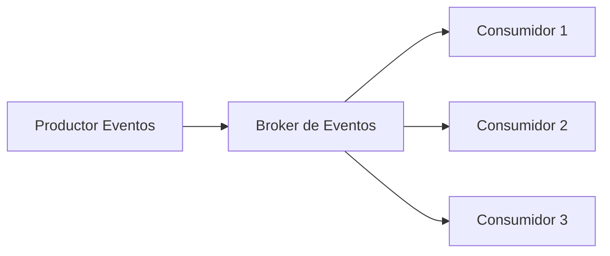
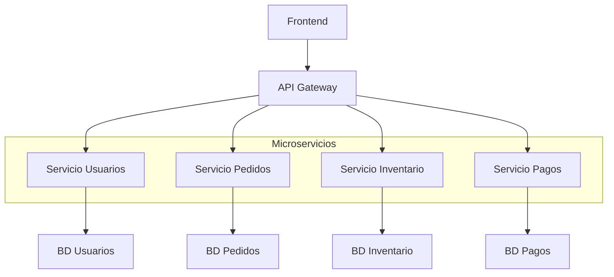
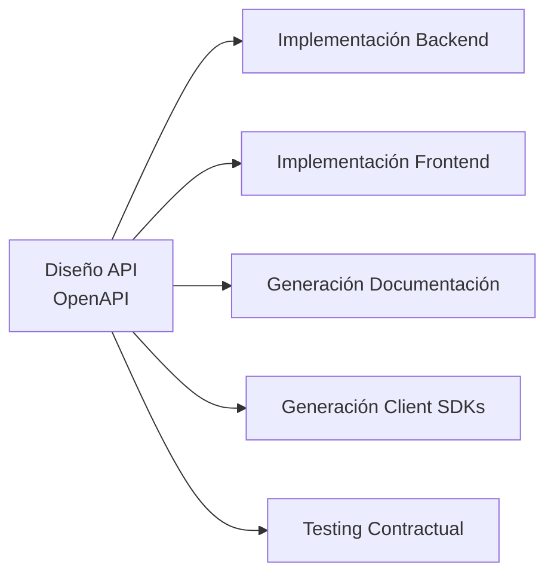
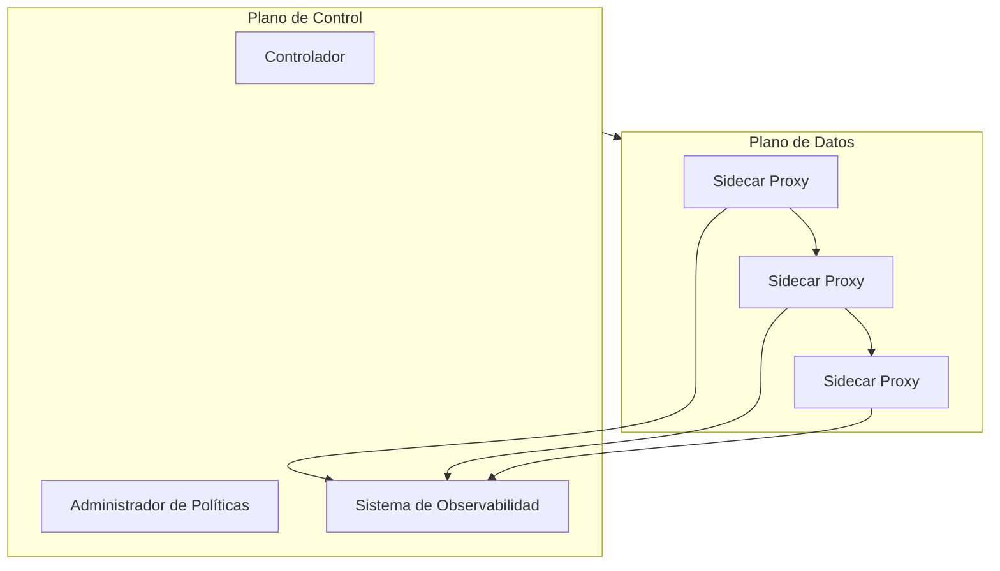

# Ingeniería de Software - Arquitectura de software

## 5.5 Enfoques emergentes para el desarrollo de arquitecturas de software.

---

Los enfoques emergentes para el desarrollo de arquitecturas de software representan la evolución de las prácticas arquitectónicas en respuesta a los nuevos desafíos tecnológicos y empresariales. Según Pfleeger y Atlee (2010), "la arquitectura de software debe evolucionar para abordar la creciente complejidad, la necesidad de adaptabilidad y los entornos de computación distribuida moderna".

Estos enfoques emergentes se caracterizan por su énfasis en la adaptabilidad, descentralización, autonomía de componentes y capacidad de respuesta al cambio continuo.

### Características de los Enfoques Emergentes

#### Principios Fundamentales

**Evolución continua:** Arquitecturas que evolucionan con el negocio
**Descentralización:** Eliminación de puntos únicos de fallo y control
**Autonomía:** Componentes con capacidad de decisión independiente
**Resiliencia:** Tolerancia a fallos y auto-recuperación
**Observabilidad:** Capacidad de entender el estado interno mediante outputs externos

**Fórmula de valor de adaptabilidad:**

$$ V\_a = \frac{C\_{evitados} + B\_{oportunidades}}{C\_{\text{implementación}}} \times 100 $$

Donde:

- $V_a$ es el valor de adaptabilidad
- $C_{evitados}$ es el costo de cambios evitados
- $B_{oportunidades}$ es el beneficio de oportunidades capturadas
- $C_{\text{implementación}}$ es el costo de implementación

### Arquitecturas Orientadas a Eventos (Event-Driven Architecture - EDA)

#### Patrones fundamentales de EDA

**Productor-Consumidor:** Separación entre generación y procesamiento de eventos
**Event Sourcing:** Almacenamiento del estado como secuencia de eventos
**CQRS:** Segregación de responsabilidades de consulta y comando



#### Ejemplo de implementación EDA

```typescript
// Ejemplo en TypeScript con NestJS y Kafka
@Controller()
export class OrderController {
  constructor(private readonly eventPublisher: EventPublisher) {}

  @Post('orders')
  async createOrder(@Body() createOrderDto: CreateOrderDto) {
    const orderCreatedEvent = {
      type: 'ORDER_CREATED',
      data: {
        id: uuidv4(),
        ...createOrderDto,
        status: 'PENDING',
        timestamp: new Date(),
      },
    };

    // Publicar evento
    await this.eventPublisher.publish('orders-topic', orderCreatedEvent);

    return { id: orderCreatedEvent.data.id, status: 'processing' };
  }
}

@Consumer('orders-topic')
export class OrderProcessor {
  @EventHandler('ORDER_CREATED')
  async handleOrderCreated(event: OrderEvent) {
    // Procesar el evento asincrónicamente
    await this.validateOrder(event.data);
    await this.processPayment(event.data);
    await this.updateInventory(event.data);

    // Publicar evento de completado
    await this.eventPublisher.publish('orders-topic', {
      type: 'ORDER_COMPLETED',
      data: { ...event.data, status: 'COMPLETED' },
    });
  }
}
```

### Arquitecturas Basadas en Microservicios

#### Principios de diseño de microservicios

**Deployabilidad independiente:** Cada servicio se despliega de forma autónoma
**Alta cohesión:** Servicios organizados alrededor de capacidades empresariales
**Tolerancia a fallos:** Diseño para resiliencia

**Fórmula de madurez de microservicios:**
$$ M\_m = \frac{S\_{\text{autónomos}} + D\_{independientes} + R\_{resilientes}}{T\_{total}} \times 100\% $$

Donde:

- $M\_m$ es el índice de madurez de microservicios
- $S\_{\text{autónomos}}$ es el número de servicios autónomos
- $D\_{independientes}$ es el número de despliegues independientes
- $R\_{resilientes}$ es el número de servicios resilientes
- $T\_{total}$ es el total de servicios

#### Patrón de servicio por capacidad empresarial



### Arquitecturas Sin Servidor (Serverless)

#### Modelo de ejecución serverless

**Características principales:**

- Ejecución bajo demanda (scale-to-zero)
- Pago por uso real
- Gestión automática de infraestructura

**Fórmula de costo serverless:**
$$ C_{serverless} = \sum_{i=1}^{n} (E_i \times P_e) + (M_i \times P_m) $$

Donde:

- $C_{serverless}$ es el costo total
- $E_i$ es las ejecuciones de la función i
- $P_e$ es el precio por ejecución
- $M_i$ es la memoria utilizada
- $P_m$ es el precio por GB-segundo

#### Ejemplo de función serverless

```python
# Ejemplo en Python para AWS Lambda
import json
import boto3
from typing import Dict, Any

dynamodb = boto3.resource('dynamodb')
table = dynamodb.Table('users-table')

def lambda_handler(event: Dict[str, Any], context: Any) -> Dict[str, Any]:
    """Función serverless para gestionar usuarios"""

    http_method = event['httpMethod']
    user_id = event['pathParameters']['id'] if event['pathParameters'] else None

    try:
        if http_method == 'GET':
            if user_id:
                # Obtener usuario específico
                response = table.get_item(Key={'id': user_id})
                return {'statusCode': 200, 'body': json.dumps(response.get('Item', {}))}
            else:
                # Listar todos los usuarios
                response = table.scan()
                return {'statusCode': 200, 'body': json.dumps(response.get('Items', []))}

        elif http_method == 'POST':
            # Crear nuevo usuario
            user_data = json.loads(event['body'])
            table.put_item(Item=user_data)
            return {'statusCode': 201, 'body': json.dumps(user_data)}

        elif http_method == 'DELETE' and user_id:
            # Eliminar usuario
            table.delete_item(Key={'id': user_id})
            return {'statusCode': 204, 'body': ''}

        else:
            return {'statusCode': 400, 'body': json.dumps({'error': 'Método no permitido'})}

    except Exception as e:
        return {'statusCode': 500, 'body': json.dumps({'error': str(e)})}
```

### Arquitecturas Orientadas a APIs (API-First)

#### Diseño API-First

**Principios:**

- El diseño de APIs precede a la implementación
- Contratos primero (OpenAPI, AsyncAPI)
- Desarrollo paralelo entre equipos



#### Ejemplo de contrato OpenAPI

```yaml
openapi: 3.0.0
info:
  title: User Management API
  version: 1.0.0
  description: API para gestión de usuarios

paths:
  /users:
    get:
      summary: Listar usuarios
      responses:
        '200':
          description: Lista de usuarios
          content:
            application/json:
              schema:
                type: array
                items:
                  $ref: '#/components/schemas/User'
    post:
      summary: Crear usuario
      requestBody:
        required: true
        content:
          application/json:
            schema:
              $ref: '#/components/schemas/User'
      responses:
        '201':
          description: Usuario creado

components:
  schemas:
    User:
      type: object
      required:
        - id
        - name
        - email
      properties:
        id:
          type: string
          format: uuid
        name:
          type: string
        email:
          type: string
          format: email
        createdAt:
          type: string
          format: date-time
```

### Arquitecturas de Malla de Servicios (Service Mesh)

#### Componentes de service mesh



**Beneficios:**

- Gestión centralizada de tráfico entre servicios
- Observabilidad unificada
- Aplicación consistente de políticas
- Seguridad de servicio a servicio

### Patrones Emergentes de Resiliencia

#### Circuit Breaker Pattern

**Estados del circuit breaker:**

- Cerrado: Las solicitudes pasan normalmente
- Abierto: Las solicitudes son rechazadas inmediatamente
- Medio abierto: Permite algunas solicitudes de prueba

**Fórmula de umbral de apertura:**
$$ U_a = \frac{F_{fallos}}{T_{ventana}} \geq U_{max} $$

Donde:

- $U_a$ es el umbral actual de fallos
- $F_{fallos}$ es el número de fallos en la ventana de tiempo
- $T_{ventana}$ es el tamaño de la ventana temporal
- $U_{max}$ es el umbral máximo configurado

#### Implementación de resiliencia con Polly

```csharp
// Ejemplo en C# con Polly
public class ResilientService
{
    private readonly AsyncCircuitBreakerPolicy _circuitBreaker;
    private readonly AsyncRetryPolicy _retryPolicy;

    public ResilientService()
    {
        // Configurar circuit breaker
        _circuitBreaker = Policy
            .Handle<HttpRequestException>()
            .Or<TimeoutException>()
            .CircuitBreakerAsync(
                exceptionsAllowedBeforeBreaking: 5,
                durationOfBreak: TimeSpan.FromMinutes(1)
            );

        // Configurar retry con backoff exponencial
        _retryPolicy = Policy
            .Handle<HttpRequestException>()
            .Or<TimeoutException>()
            .WaitAndRetryAsync(
                retryCount: 3,
                sleepDurationProvider: attempt => TimeSpan.FromSeconds(Math.Pow(2, attempt))
            );
    }

    public async Task<string> CallExternalServiceAsync()
    {
        return await _retryPolicy
            .WrapAsync(_circuitBreaker)
            .ExecuteAsync(async () =>
            {
                using var client = new HttpClient();
                var response = await client.GetAsync("https://api.external.com/data");
                response.EnsureSuccessStatusCode();
                return await response.Content.ReadAsStringAsync();
            });
    }
}
```

### Ejercicios Propuestos

#### Ejercicio 1: Diseño de Arquitectura EDA

Diseña un sistema de notificaciones usando EDA que:

1. Permite a usuarios suscribirse a diferentes tipos de notificaciones
2. Procesa eventos de notificación asincrónicamente
3. Soporte múltiples canales (email, SMS, push)
4. Implementa retry con backoff exponencial para fallos

Incluye diagrama de flujo de eventos y pseudocódigo para los componentes clave.

#### Ejercicio 2: Migración a Microservicios

Analiza una aplicación monolítica tradicional y propón:

1. Criterios para identificar bounded contexts
2. Estrategia de descomposición en microservicios
3. Plan de migración incremental
4. Mecanismos para mantener consistencia eventual

#### Ejercicio 3: Diseño API-First

Para un sistema de reservas de hotel, desarrolla:

1. Especificación OpenAPI completa
2. Diseño de operaciones asincrónicas usando AsyncAPI
3. Estrategia de versionado de APIs
4. Mecanismos de autenticación y autorización

#### Ejercicio 4: Patrones de Resiliencia

Implementa en el lenguaje de tu preferencia:

1. Circuit breaker con estados y métricas
2. Retry con backoff exponencial y jitter
3. Bulkhead pattern para aislar recursos
4. Fallback mechanisms para degradación elegante

#### Ejercicio 5: Análisis de Costos

Compara arquitecturas tradicionales vs. emergentes:

1. Calcula TCO para cada aproximación
2. Analiza trade-offs en performance y complejidad
3. Evalúa impacto en velocidad de desarrollo
4. Propone métricas para medir éxito de la implementación

### Referencias

#### Bibliografía Básica

1. Sommerville, Ian. (2010). "Software Engineering" (9th edition). Addison Wesley. (Capítulos 18, 19)
2. Pfleeger, S. L., & Atlee, J. M. (2010). "Software Engineering: Theory and Practice" (4th Edition). Prentice Hall. (Capítulos 4, 6)

#### Bibliografía Complementaria

3. Richardson, C. (2018). "Microservices Patterns"
4. Wolff, E. (2016). "Microservices: Flexible Software Architecture"
5. Villamizar, M. et al. (2015). "Evaluating the monolithic and the microservice architecture pattern"
6. Nadareishvili, I. et al. (2016). "Microservice Architecture: Aligning Principles, Practices, and Culture"

### Conclusión

Los enfoques emergentes para el desarrollo de arquitecturas de software representan una evolución significativa en cómo concebimos, diseñamos e implementamos sistemas software modernos. Estas aproximaciones responden a la necesidad creciente de sistemas más adaptables, resilientes y capaces de evolucionar con las demandas del negocio.

La adopción de estos enfoques requiere no solo cambios técnicos, sino también transformaciones organizacionales y culturales. La arquitectura emergente no es un destino final, sino un proceso continuo de adaptación y aprendizaje.

El éxito en la implementación de estas arquitecturas depende de:

- La comprensión profunda de los principios subyacentes
- La selección apropiada de patrones para el contexto específico
- La implementación gradual con feedback continuo
- La medición constante de resultados y ajuste de estrategias

Estos enfoques representan el futuro de la arquitectura de software, donde la capacidad de cambio y adaptación se convierte en la característica arquitectónica más valiosa.
