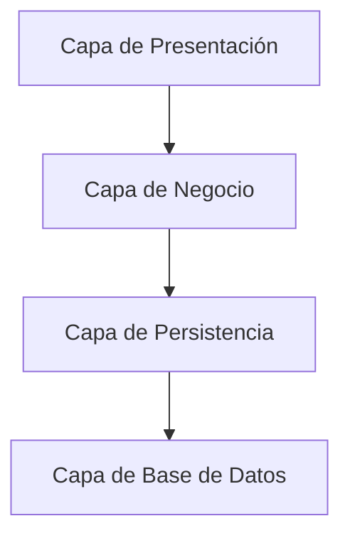
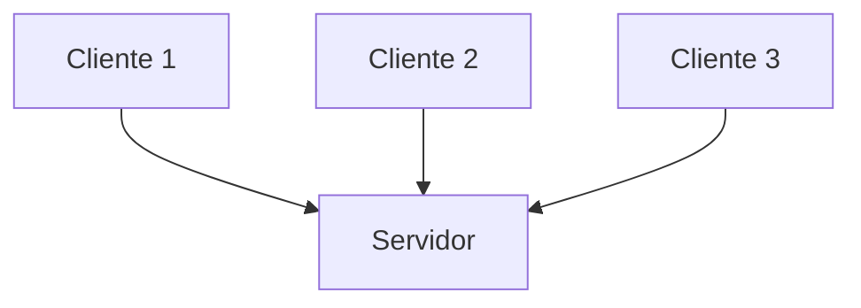
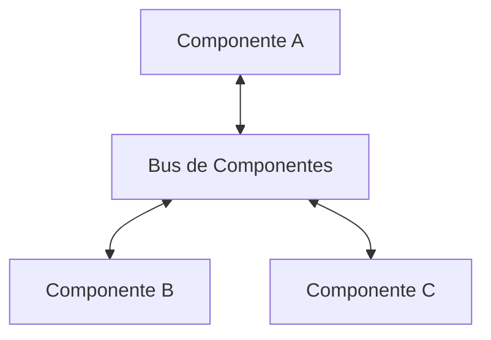
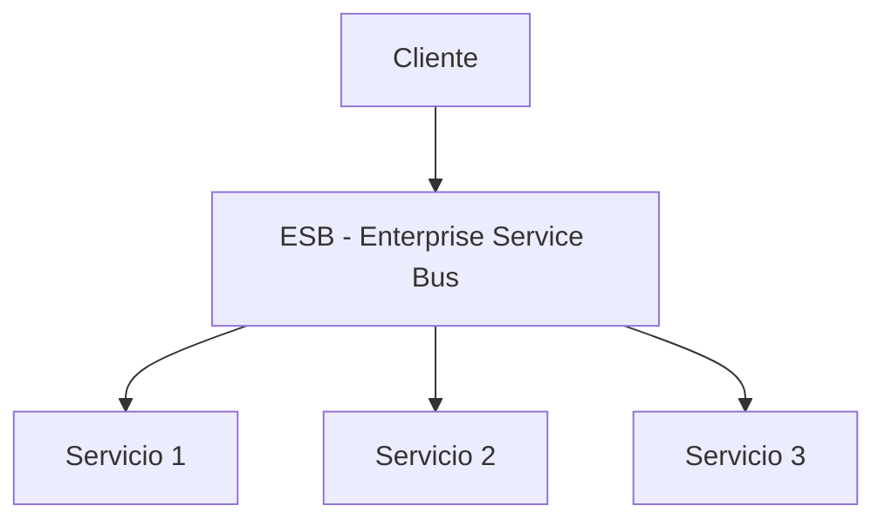
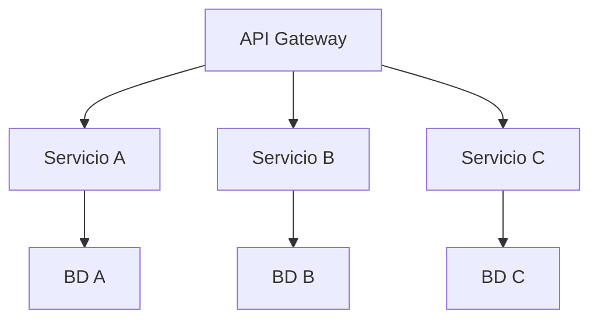
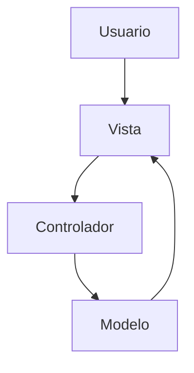
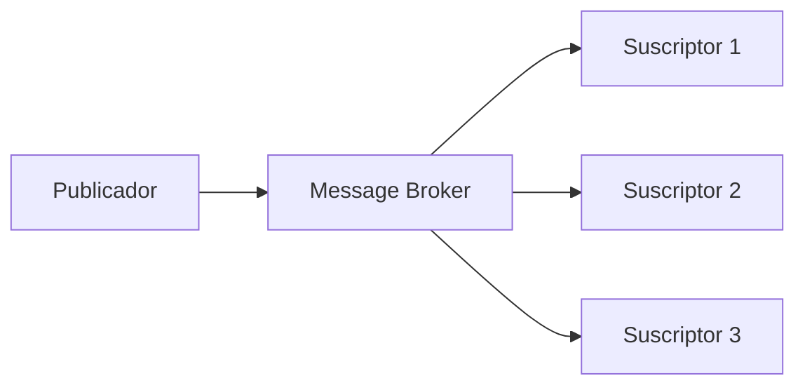

# Ingeniería de Software - Arquitectura de software

## 5.6 Caracterización y uso de patrones arquitectónicos.

---

Los patrones arquitectónicos son esquemas organizativos fundamentales que proporcionan soluciones reutilizables a problemas comunes de diseño de software. Según Buschmann et al. (1996), "un patrón arquitectónico expresa un esquema de organización fundamental para sistemas software, que consiste en un conjunto de subsistemas, sus responsabilidades y relaciones".

Los patrones arquitectónicos difieren de los patrones de diseño en que operan a un nivel de abstracción más alto, definiendo la estructura global y las propiedades de alto nivel de un sistema.

### Fundamentos de los Patrones Arquitectónicos

#### Definición y Características

**Patrón Arquitectónico:** Es una solución reutilizable a un problema recurrente en la arquitectura de software dentro de un contexto determinado.

**Elementos clave de un patrón:**

- **Nombre:** Identificador descriptivo
- **Problema:** Situación donde aplicar el patrón
- **Solución:** Esquema arquitectónico que resuelve el problema
- **Consecuencias:** Ventajas, desventajas y trade-offs

**Fórmula de valor de patrón:**
$$ V\_p = \frac{B\_{reuso} + B\_{calidad} + B\_{\text{comunicación}}}{C\_{\text{implementación}} + C\_{complejidad}} $$

Donde:

- $V_p$ es el valor del patrón
- $B_{reuso}$ es el beneficio por reuso
- $B_{calidad}$ es el beneficio por mejora de calidad
- $B_{\text{comunicación}}$ es el beneficio por mejora en comunicación
- $C_{\text{implementación}}$ es el costo de implementación
- $C_{complejidad}$ es el costo por complejidad añadida

### Clasificación de Patrones Arquitectónicos

#### Patrones Estructurales Fundamentales

##### Arquitectura en Capas (Layered Architecture)



**Ventajas:**

- Separación de responsabilidades
- Facilidad de mantenimiento
- Reusabilidad de capas

**Desventajas:**

- Posible degradación del rendimiento
- Dificultad para escalar horizontalmente

##### Arquitectura de Tuberías y Filtros (Pipes and Filters)


**Aplicaciones:**

- Procesamiento de datos
- Transformación de flujos
- Compiladores e interpretes

#### Patrones de Organización de Componentes

##### Arquitectura Cliente-Servidor



**Variantes:**

- Two-tier: Cliente + Servidor
- Three-tier: Presentación + Lógica + Datos
- N-tier: Múltiples capas especializadas

##### Arquitectura Basada en Componentes



**Características:**

- Alta cohesión dentro de componentes
- Bajo acoplamiento entre componentes
- Interfaces bien definidas

#### Patrones de Sistemas Distribuidos

##### Arquitectura Orientada a Servicios (SOA)



**Principios SOA:**

- Contract-first design
- Loose coupling
- Service abstraction
- Reusability
- Autonomy
- Discoverability
- Composability

##### Arquitectura de Microservicios



**Características clave:**

- Deployabilidad independiente
- Alineamiento organizacional
- Tecnologías heterogéneas
- Resiliencia y tolerancia a fallos

### Patrones Especializados

#### Patrón Modelo-Vista-Controlador (MVC)



**Flujo de datos:**

1. Usuario interactúa con la Vista
2. Vista notifica al Controlador
3. Controlador actualiza el Modelo
4. Modelo notifica cambios a la Vista
5. Vista se actualiza

#### Patrón Publicador-Suscriptor (Pub-Sub)



**Ventajas:**

- Desacoplamiento temporal
- Escalabilidad
- Flexibilidad

### Evaluación y Selección de Patrones

#### Matriz de Evaluación de Patrones

| Patrón           | Complejidad | Escalabilidad | Mantenibilidad | Rendimiento | Madurez |
| ---------------- | ----------- | ------------- | -------------- | ----------- | ------- |
| Capas            | Baja        | Media         | Alta           | Media       | Alta    |
| Cliente-Servidor | Media       | Alta          | Media          | Alta        | Alta    |
| Microservicios   | Alta        | Alta          | Alta           | Media       | Media   |
| SOA              | Alta        | Alta          | Alta           | Media       | Alta    |
| MVC              | Baja        | Media         | Alta           | Alta        | Alta    |

#### Fórmula de Adecuación de Patrón

$$ A_p = \sum_{i=1}^{n} (W_i \times S_i) $$

Donde:

- $A_p$ es la adecuación del patrón
- $W_i$ es el peso del criterio i
- $S_i$ es la puntuación del patrón para el criterio i
- $n$ es el número de criterios

### Ejemplos de Implementación

#### Ejemplo: Patrón MVC en Spring Boot

```java
// Modelo
@Entity
public class User {
    @Id
    @GeneratedValue(strategy = GenerationType.IDENTITY)
    private Long id;
    private String name;
    private String email;

    // Getters y setters
}

// Vista (Thymeleaf)
/*
<!DOCTYPE html>
<html xmlns:th="http://www.thymeleaf.org">
<body>
    <h1>User Details</h1>
    <p th:text="${user.name}">Name</p>
    <p th:text="${user.email}">Email</p>
</body>
</html>
*/

// Controlador
@Controller
public class UserController {
    @Autowired
    private UserService userService;

    @GetMapping("/user/{id}")
    public String getUser(@PathVariable Long id, Model model) {
        User user = userService.findById(id);
        model.addAttribute("user", user);
        return "user-details";
    }
}
```

#### Ejemplo: Microservicio con Spring Cloud

```java
// Servicio de Usuario
@SpringBootApplication
@EnableEurekaClient
public class UserServiceApplication {
    public static void main(String[] args) {
        SpringApplication.run(UserServiceApplication.class, args);
    }
}

@RestController
@RequestMapping("/users")
public class UserController {
    @Autowired
    private UserRepository userRepository;

    @GetMapping("/{id}")
    public ResponseEntity<User> getUser(@PathVariable Long id) {
        return userRepository.findById(id)
                .map(ResponseEntity::ok)
                .orElse(ResponseEntity.notFound().build());
    }

    @PostMapping
    public User createUser(@RequestBody User user) {
        return userRepository.save(user);
    }
}

// Configuración de API Gateway
@Configuration
public class GatewayConfig {
    @Bean
    public RouteLocator customRouteLocator(RouteLocatorBuilder builder) {
        return builder.routes()
                .route("user_route", r -> r.path("/api/users/**")
                        .uri("lb://user-service"))
                .build();
    }
}
```

### Ejercicios Propuestos

#### Ejercicio 1: Análisis de Patrones

Para cada escenario, identifica el patrón arquitectónico más adecuado:

1. Sistema de procesamiento de transacciones bancarias
2. Plataforma de streaming de video
3. Aplicación móvil de redes sociales
4. Sistema de control industrial en tiempo real
5. Plataforma de e-commerce de gran escala

Justifica tu elección considerando:

- Requisitos no funcionales
- Escalabilidad esperada
- Complejidad del dominio
- Equipo de desarrollo

#### Ejercicio 2: Diseño con Múltiples Patrones

Diseña una arquitectura para un sistema de hospital que combine:

1. Microservicios para dominios independientes
2. Patrón CQRS para el módulo de citas
3. Event Sourcing para el historial médico
4. API Gateway para unificación de accesos

Incluye diagramas de componentes y flujos de datos.

#### Ejercicio 3: Evaluación de Trade-offs

Para un sistema de reservas de vuelos, evalúa:

1. Arquitectura monolítica vs. microservicios
2. Base de datos relacional vs. NoSQL
3. Comunicación síncrona vs. asíncrona

Utiliza la fórmula de adecuación de patrón con los siguientes pesos:

- Escalabilidad: 0.3
- Mantenibilidad: 0.25
- Rendimiento: 0.2
- Seguridad: 0.15
- Coste: 0.1

#### Ejercicio 4: Migración de Patrones

Propón un plan de migración para:

1. De aplicación monolítica a microservicios
2. De SOA a arquitectura basada en eventos
3. De MVC tradicional a MVC con前端框架 moderno

Considera:

- Estrategia de migración (big bang vs. incremental)
- Gestión de datos durante la transición
- Pruebas y validación
- Rollback strategy

#### Ejercicio 5: Patrones Emergentes

Investiga y describe:

1. Patrón Serverless y sus aplicaciones
2. Arquitectura basada en eventos (Event-Driven)
3. Pattern Mesh para microservicios
4. Sidecar pattern en service mesh

Para cada patrón, proporciona:

- Definición y características
- Casos de uso apropiados
- Ventajas y desventajas
- Ejemplo de implementación

### Mejores Prácticas en la Aplicación de Patrones

#### Principios de Implementación

1. **Conoce el problema antes que la solución:** No forces patrones donde no son necesarios
2. **Considera el contexto organizacional:** Los patrones deben alinearse con las capacidades del equipo
3. **Evalúa los trade-offs:** Cada patrón tiene ventajas y desventajas
4. **Planifica la evolución:** Los patrones deben permitir el crecimiento del sistema
5. **Documenta las decisiones:** Registra el rationale detrás de cada elección arquitectónica

#### Anti-patrones Comunes

1. **Architecture by implication:** No documentar decisiones arquitectónicas
2. **Design by committee:** Demasiados stakeholders sin visión unificada
3. **Vendor lock-in:** Dependencia excesiva de tecnologías específicas
4. **Analysis paralysis:** Exceso de análisis sin progreso en implementación
5. **Golden hammer:** Usar el mismo patrón para todos los problemas

### Referencias

#### Bibliografía Básica

1. Sommerville, Ian. (2010). "Software Engineering" (9th edition). Addison Wesley. (Capítulo 6: Architectural design)
2. Pfleeger, S. L., & Atlee, J. M. (2010). "Software Engineering: Theory and Practice" (4th Edition). Prentice Hall. (Capítulo 6: Architecture)

#### Bibliografía Complementaria

3. Gamma, E., et al. (1994). "Design Patterns: Elements of Reusable Object-Oriented Software"
4. Buschmann, F., et al. (1996). "Pattern-Oriented Software Architecture, Volume 1: A System of Patterns"
5. Fowler, M. (2002). "Patterns of Enterprise Application Architecture"
6. Richardson, C. (2018). "Microservices Patterns"

### Conclusión

Los patrones arquitectónicos proporcionan un conjunto invaluable de soluciones probadas para problemas comunes de diseño de software. La comprensión y aplicación adecuada de estos patrones es esencial para crear sistemas software que sean escalables, mantenibles y adaptables a los cambios futuros.

La selección del patrón adecuado requiere un análisis cuidadoso de los requisitos específicos del sistema, las restricciones técnicas y organizacionales, y los trade-offs inherentes a cada aproximación arquitectónica. No existe un patrón "mejor" universalmente, sino patrones más adecuados para contextos específicos.

El estudio de patrones arquitectónicos es un proceso continuo que debe combinar el conocimiento teórico con la experiencia práctica. Los arquitectos de software efectivos no solo conocen múltiples patrones, sino que también desarrollan la intuición necesaria para aplicarlos en las situaciones apropiadas y adaptarlos a las necesidades específicas de cada proyecto.
