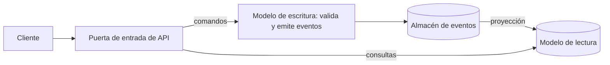

# Ingeniería de Software - Arquitectura de software

## 5.6 Caracterización y uso de patrones arquitectónicos.

---

Un **patrón arquitectónico**, o estilo arquitectónico, es una solución probada a un problema recurrente de organización de un sistema completo: describe los tipos de componentes, los tipos de conectores entre ellos y las restricciones sobre cómo pueden combinarse. Es el equivalente, a escala del sistema, de los patrones de diseño del tema 2.4. Shaw y Garlan los catalogaron en 1996, y Buschmann y otros en la serie *Pattern-Oriented Software Architecture*. Este tema caracteriza los patrones principales por las características sistémicas que favorecen, presenta los patrones especializados más usados hoy, como CQRS y la fuente de eventos, y un método para elegir entre alternativas con criterios explícitos y análisis de sensibilidad.

### Caracterización

Un patrón se describe por su **contexto**, el **problema** que resuelve, su **solución** en componentes y conectores, y sus **consecuencias**: las características sistémicas que favorece y las que perjudica. Esto último es lo que permite elegir.

| Patrón                       | Componentes y conectores                              | Favorece                                  | Perjudica                                  |
| ---------------------------- | ----------------------------------------------------- | ----------------------------------------- | ------------------------------------------ |
| Capas                        | Capas con llamadas hacia abajo                        | Modificabilidad, portabilidad, pruebas    | Rendimiento por las capas intermedias      |
| Cliente-servidor             | Clientes y servidores con peticiones y respuestas     | Centralización de datos y control         | El servidor es punto único de falla        |
| Modelo-vista-controlador     | Modelo, vistas y controladores con notificaciones     | Varias vistas de los mismos datos         | Complejidad en interfaces simples          |
| Tuberías y filtros           | Filtros conectados por flujos de datos                | Reutilización, paralelismo                | Interactividad, manejo de errores          |
| Publicador-suscriptor        | Productores, consumidores y un intermediario          | Desacoplamiento, extensibilidad           | Trazabilidad del flujo, consistencia       |
| Microservicios               | Servicios independientes con API o mensajes           | Escalamiento y despliegue independientes  | Operación, consistencia, latencia          |
| Microkernel o complementos   | Núcleo mínimo y complementos                          | Extensibilidad, adaptabilidad             | Diseño de la interfaz de complementos      |
| Repositorio o pizarra        | Almacén central y procesos que lo leen y modifican    | Integración por datos compartidos         | Acoplamiento al esquema compartido         |

Los patrones se **combinan**: un sistema de microservicios puede tener cada servicio en capas, comunicarse por publicador-suscriptor y exponer una puerta de entrada única.

### Patrones especializados

- **Puerta de entrada de API** (*API gateway*): un punto de entrada único para los clientes, que enruta, autentica, limita la tasa y agrega respuestas de varios servicios. Su variante *backend for frontend* tiene una puerta por tipo de cliente.
- **CQRS** (*command query responsibility segregation*, Young): separa el modelo que procesa los **comandos**, que validan y modifican el estado, del que responde las **consultas**, que se mantiene como una o varias **proyecciones** optimizadas para leer. Permite escalar y optimizar la lectura y la escritura por separado, a cambio de consistencia eventual entre ambas y más complejidad. Conviene cuando las lecturas y las escrituras tienen formas o cargas muy distintas.
- **Fuente de eventos** (*event sourcing*): el estado no se guarda directamente; se guarda la secuencia de **eventos** que lo produjeron, en un almacén donde solo se agrega, y el estado actual se obtiene reproduciéndolos. Da un historial completo y auditable, permite reconstruir el estado en cualquier momento pasado y construir nuevas proyecciones a posteriori; a cambio, el esquema de los eventos debe evolucionar con cuidado, y las consultas requieren proyecciones. Suele combinarse con CQRS.



### Elección con criterios explícitos

Para elegir entre alternativas, se definen los criterios a partir de las características sistémicas prioritarias, con un peso $w_i$ para cada uno que sume 1; se califica cada alternativa en cada criterio, con $s_i;$ y se calcula su adecuación,

$$A = \sum_{i} w_i\, s_i.$$

El número no decide por sí solo: los pesos y las calificaciones son juicios, y lo valioso del método es hacerlos **explícitos** y discutibles. Por eso debe acompañarse de un **análisis de sensibilidad**: cuánto tendría que cambiar un peso para que cambie la decisión. Si un cambio pequeño la invierte, las alternativas son prácticamente equivalentes en esos criterios, y la decisión debe tomarse por otros factores, como la experiencia del equipo. El método ATAM del SEI formaliza esta evaluación con escenarios de atributos de calidad y la identificación de **puntos de sensibilidad** y de **compromiso**.

### Implementación en Python

El programa resuelve el ejercicio 3 calculando la adecuación de las tres decisiones de un sistema de reservas de vuelos con los pesos del enunciado y calificaciones supuestas, y el peso de la escalabilidad con el que cada decisión empata. Para el ejercicio 2 implementa el historial médico con fuente de eventos, reconstruyendo el estado actual y el de un momento pasado, y la agenda de citas con CQRS, con un modelo de escritura que valida los comandos y una proyección de lectura.

```python
from collections import defaultdict
from itertools import product

# ---------- Ejercicio 3: adecuación ponderada y análisis de sensibilidad ----------
pesos = {"escalabilidad": 0.30, "mantenibilidad": 0.25, "rendimiento": 0.20, "seguridad": 0.15, "costo": 0.10}
decisiones = {   # puntuaciones de 1 a 5, supuestas para un sistema de reservas de vuelos de tamaño medio
    "arquitectura": {"monolito modular": {"escalabilidad": 3, "mantenibilidad": 4, "rendimiento": 5, "seguridad": 4, "costo": 5},
                     "microservicios":   {"escalabilidad": 5, "mantenibilidad": 3, "rendimiento": 3, "seguridad": 3, "costo": 2}},
    "datos":        {"relacional": {"escalabilidad": 3, "mantenibilidad": 4, "rendimiento": 4, "seguridad": 5, "costo": 4},
                     "NoSQL":      {"escalabilidad": 5, "mantenibilidad": 3, "rendimiento": 4, "seguridad": 3, "costo": 4}},
    "comunicación": {"síncrona":  {"escalabilidad": 2, "mantenibilidad": 4, "rendimiento": 3, "seguridad": 4, "costo": 4},
                     "asíncrona": {"escalabilidad": 5, "mantenibilidad": 3, "rendimiento": 4, "seguridad": 4, "costo": 3}},
}
def adecuacion(p, w): return sum(w[c] * p[c] for c in w)
for decision, opciones in decisiones.items():
    a = {o: adecuacion(p, pesos) for o, p in opciones.items()}
    print(f"ejercicio 3: {decision:13}", " | ".join(f"{o}: {v:.2f}" for o, v in a.items()), "→", max(a, key=a.get))
# sensibilidad: ¿qué peso de escalabilidad hace cambiar cada decisión? (los demás se reescalan en proporción)
def con_peso(c, x):
    resto = 1 - pesos[c]; return {k: (x if k == c else v * (1 - x) / resto) for k, v in pesos.items()}
for decision, opciones in decisiones.items():
    (o1, p1), (o2, p2) = opciones.items()
    f = lambda x: adecuacion(p1, con_peso("escalabilidad", x)) - adecuacion(p2, con_peso("escalabilidad", x))   # lineal en x
    x_eq = f(0) / (f(0) - f(1)) if f(0) != f(1) else None
    print(f"   sensibilidad de '{decision}': empate cuando el peso de la escalabilidad es",
          f"{x_eq:.3f} (actual {pesos['escalabilidad']})" if x_eq is not None and 0 <= x_eq <= 1 else "ninguno: la elección no depende de él")

# ---------- Ejercicio 2: historial médico con Event Sourcing y citas con CQRS ----------
eventos = []                                               # almacén de eventos: solo se agrega, nunca se modifica
def registra(tipo, paciente, **datos): eventos.append({"n": len(eventos) + 1, "tipo": tipo, "paciente": paciente, **datos})
registra("alergia_registrada", "P1", sustancia="penicilina", fecha="2025-03-02")
registra("diagnóstico", "P1", codigo="J02.9", fecha="2026-01-10")
registra("prescripción", "P1", medicamento="amoxicilina", fecha="2026-01-10")
registra("prescripción_anulada", "P1", medicamento="amoxicilina", motivo="alergia a penicilina", fecha="2026-01-10")
registra("prescripción", "P1", medicamento="azitromicina", fecha="2026-01-10")
def historial(paciente, hasta=None):                        # el estado se reconstruye reproduciendo los eventos
    h = {"alergias": set(), "diagnósticos": [], "medicamentos": set()}
    for e in eventos:
        if e["paciente"] != paciente or (hasta and e["n"] > hasta): continue
        if e["tipo"] == "alergia_registrada": h["alergias"].add(e["sustancia"])
        elif e["tipo"] == "diagnóstico": h["diagnósticos"].append(e["codigo"])
        elif e["tipo"] == "prescripción": h["medicamentos"].add(e["medicamento"])
        elif e["tipo"] == "prescripción_anulada": h["medicamentos"].discard(e["medicamento"])
    return {k: sorted(v) if isinstance(v, set) else v for k, v in h.items()}
print("ejercicio 2: historial actual de P1:", historial("P1"))
print("   historial de P1 como estaba tras el evento 3 (auditoría):", historial("P1", hasta=3))
# CQRS: los comandos validan y escriben; una proyección mantiene un modelo de lectura optimizado
citas, por_medico = {}, defaultdict(list)                   # modelo de escritura y modelo de lectura
def comando_agenda(cid, medico, hora, paciente):
    if any(c["medico"] == medico and c["hora"] == hora for c in citas.values()): return f"rechazada: {medico} ya tiene una cita a las {hora}"
    citas[cid] = {"medico": medico, "hora": hora, "paciente": paciente}
    proyecta({"tipo": "cita_agendada", "cid": cid, **citas[cid]}); return "agendada"
def proyecta(e):                                             # en un sistema real, asíncrona: el modelo de lectura llega después
    por_medico[e["medico"]].append((e["hora"], e["paciente"])); por_medico[e["medico"]].sort()
for args in (("C1", "Dra. Ruiz", "09:00", "P1"), ("C2", "Dra. Ruiz", "10:00", "P2"), ("C3", "Dra. Ruiz", "09:00", "P3"), ("C4", "Dr. Paz", "09:00", "P3")):
    print(f"   comando agenda {args}: {comando_agenda(*args)}")
print("   consulta de la agenda (modelo de lectura):", dict(por_medico))
```

Salida:

```text
ejercicio 3: arquitectura  monolito modular: 4.00 | microservicios: 3.50 → monolito modular
ejercicio 3: datos         relacional: 3.85 | NoSQL: 3.90 → NoSQL
ejercicio 3: comunicación  síncrona: 3.20 | asíncrona: 3.95 → asíncrona
   sensibilidad de 'arquitectura': empate cuando el peso de la escalabilidad es 0.440 (actual 0.3)
   sensibilidad de 'datos': empate cuando el peso de la escalabilidad es 0.282 (actual 0.3)
   sensibilidad de 'comunicación': empate cuando el peso de la escalabilidad es 0.067 (actual 0.3)
ejercicio 2: historial actual de P1: {'alergias': ['penicilina'], 'diagnósticos': ['J02.9'], 'medicamentos': ['azitromicina']}
   historial de P1 como estaba tras el evento 3 (auditoría): {'alergias': ['penicilina'], 'diagnósticos': ['J02.9'], 'medicamentos': ['amoxicilina']}
   comando agenda ('C1', 'Dra. Ruiz', '09:00', 'P1'): agendada
   comando agenda ('C2', 'Dra. Ruiz', '10:00', 'P2'): agendada
   comando agenda ('C3', 'Dra. Ruiz', '09:00', 'P3'): rechazada: Dra. Ruiz ya tiene una cita a las 09:00
   comando agenda ('C4', 'Dr. Paz', '09:00', 'P3'): agendada
   consulta de la agenda (modelo de lectura): {'Dra. Ruiz': [('09:00', 'P1'), ('10:00', 'P2')], 'Dr. Paz': [('09:00', 'P3')]}
```

### Ejercicios Propuestos

1. **Análisis.** Identifica el patrón arquitectónico más adecuado para un sistema de procesamiento de transacciones bancarias, una plataforma de video en streaming, una aplicación móvil de redes sociales, un sistema de control industrial en tiempo real y una plataforma de comercio electrónico de gran escala. Justifica la elección por los requerimientos no funcionales, la escala esperada, la complejidad del dominio y el equipo.

2. **Varios patrones.** Diseña la arquitectura de un sistema de hospital que combine microservicios para los dominios independientes, CQRS para el módulo de citas, fuente de eventos para el historial médico y una puerta de entrada de API.

3. **Compromisos.** Para un sistema de reservas de vuelos, evalúa un monolito frente a microservicios, una base de datos relacional frente a NoSQL, y la comunicación síncrona frente a la asíncrona, con la fórmula de adecuación y los pesos: escalabilidad 0.3, mantenibilidad 0.25, rendimiento 0.2, seguridad 0.15 y costo 0.1.

4. **Migración.** Propón un plan de migración de una aplicación monolítica a microservicios, de SOA a una arquitectura dirigida por eventos, y de un MVC tradicional con páginas generadas en el servidor a un MVC con un marco moderno del lado del cliente. Considera la estrategia, los datos durante la transición, las pruebas y la reversión.

5. **Patrones emergentes.** Describe el patrón sin servidor, la arquitectura dirigida por eventos, la malla de servicios y el patrón sidecar.

### Soluciones

**Ejercicio 1.**

- **Transacciones bancarias:** **capas** con un núcleo transaccional sobre una base de datos relacional, por la consistencia estricta y la auditabilidad, y **publicador-suscriptor** para los efectos posteriores, como notificaciones y antifraude. La fuente de eventos es natural para el libro mayor.
- **Video en streaming:** **microservicios** para el catálogo, los perfiles y las recomendaciones, y **tuberías y filtros** para la codificación de video en varias resoluciones; la entrega, por una red de distribución de contenidos.
- **Red social móvil:** **cliente-servidor** con una puerta de entrada por tipo de cliente, **publicador-suscriptor** para distribuir las publicaciones y **CQRS** para el feed, que se lee mucho más de lo que se escribe.
- **Control industrial en tiempo real:** **tuberías y filtros** o un ciclo de control con un **microkernel** de tiempo real; nada que agregue latencia impredecible, como un intermediario de mensajes general, en el lazo de control.
- **Comercio electrónico de gran escala:** **microservicios** alineados con los contextos del dominio, con eventos entre ellos, una puerta de entrada y CQRS para el catálogo y la búsqueda. Con un equipo pequeño, un **monolito modular** primero.

**Ejercicio 2.** La puerta de entrada de API autentica a pacientes, médicos y personal, y enruta a los servicios: Pacientes, Citas, Historial clínico, Farmacia y Facturación, cada uno con su base de datos. **Citas** usa CQRS: los comandos de agendar y cancelar validan la disponibilidad en el modelo de escritura, y una proyección mantiene la agenda de cada médico y la disponibilidad por especialidad para las consultas, que son mucho más frecuentes. **Historial clínico** usa fuente de eventos: cada alergia, diagnóstico, prescripción o anulación es un evento inmutable, de modo que el historial nunca se sobrescribe, se puede reconstruir cómo estaba en cualquier fecha, que es un requisito legal y médico, y una anulación es un evento nuevo, no un borrado. Los servicios se comunican por eventos: una prescripción emitida en el historial la consume Farmacia, que verifica las alergias en su propia proyección, y una cita atendida la consume Facturación. El programa implementa ambos módulos: el historial reproduce los eventos y muestra que la amoxicilina, prescrita y anulada por la alergia a la penicilina, aparece en el estado del evento 3 pero no en el actual; la agenda rechaza una cita en un horario ocupado y la proyección responde la consulta por médico.

**Ejercicio 3.** Con las calificaciones supuestas del programa, de 1 a 5, el **monolito modular** obtiene 4.00 frente a 3.50 de los microservicios; **NoSQL**, 3.90 frente a 3.85 de la relacional; y la comunicación **asíncrona**, 3.95 frente a 3.20 de la síncrona. El análisis de sensibilidad es más informativo que los puntajes:

- la elección del monolito es robusta: los microservicios ganarían solo si el peso de la escalabilidad subiera a 0.44;
- la de NoSQL es frágil: con un peso de la escalabilidad de 0.28 en lugar de 0.30 gana la relacional. Las dos son prácticamente equivalentes con estos criterios, y la decisión debe tomarse por otros factores; en reservas de vuelos, la consistencia del inventario de asientos, que no está entre los criterios, favorece fuertemente a la relacional;
- la asíncrona gana con casi cualquier peso, pero no para todo: la confirmación de una reserva al usuario necesita una respuesta síncrona, y lo asíncrono conviene para lo que ocurre después, como la emisión del boleto y las notificaciones.

El ejercicio muestra el límite del método: si un criterio decisivo no está en la lista, ningún cálculo lo compensa.

**Ejercicio 4.**

1. **Monolito a microservicios:** incremental con el estrangulador, descrito en el ejercicio 2 del tema 5.5; datos con sincronización temporal entre la base del monolito y la del servicio, o con captura de cambios; pruebas de contrato entre servicios y comparación de resultados entre la ruta vieja y la nueva; reversión desviando de nuevo el tráfico al monolito.
2. **SOA a eventos:** mantener los servicios y agregar la publicación de eventos de dominio junto a sus operaciones, con la bandeja de salida transaccional; migrar los consumidores uno a uno de las llamadas síncronas a las suscripciones; las pruebas verifican que cada consumidor obtenga lo mismo por ambas vías; reversión volviendo a la llamada.
3. **MVC con páginas del servidor a un marco del cliente:** el controlador del servidor se convierte en una API, y las vistas se reescriben como componentes del cliente pantalla por pantalla, conviviendo con las páginas antiguas bajo la misma navegación; los datos no cambian; pruebas de extremo a extremo de cada flujo antes y después; reversión por pantalla con interruptores de configuración.

En los tres casos, la estrategia **incremental** es preferible a la de **gran explosión**, porque cada paso se puede validar y revertir; la gran explosión solo se justifica si convivir es más caro que el riesgo, lo que es raro.

**Ejercicio 5.** Los cuatro se describieron en el tema 5.5: el patrón **sin servidor** ejecuta funciones bajo demanda, escalando desde cero, útil para cargas variables y procesamiento de eventos; la **arquitectura dirigida por eventos** comunica componentes desacoplados por eventos a través de un intermediario; la **malla de servicios** resuelve la comunicación entre microservicios, como el cifrado, los reintentos y la telemetría, fuera del código; y el **sidecar** es el patrón que la implementa: un proceso auxiliar desplegado junto a cada instancia de servicio, que comparte su ciclo de vida y su red, y que se usa también para registro, configuración o seguridad sin modificar el servicio.

### Referencias

1. Shaw, M., and Garlan, D., _Software Architecture: Perspectives on an Emerging Discipline_. Prentice Hall, 1996.
2. Buschmann, F., Meunier, R., Rohnert, H., Sommerlad, P., and Stal, M., _Pattern-Oriented Software Architecture_, volumen 1. Wiley, 1996.
3. Richards, M., and Ford, N., _Fundamentals of Software Architecture_. O'Reilly, 2020.
4. Young, G., CQRS documents, 2010. cqrs.files.wordpress.com.
5. Kazman, R., Klein, M., and Clements, P., ATAM: method for architecture evaluation. CMU/SEI-2000-TR-004, 2000.
6. Fowler, M., Event sourcing, 2005. martinfowler.com.
