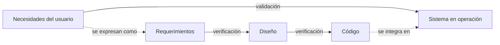

# Ingeniería de Software - Validación y verificación

## 6.1 Diferencias entre validación y verificación.

---

**Verificación** y **validación** (V&V) son las actividades que establecen si un software es bueno, pero con dos referencias distintas. Boehm las distinguió en 1979 con dos preguntas que se volvieron clásicas: la verificación pregunta "¿estamos construyendo el producto correctamente?", es decir, si cumple su especificación; la validación pregunta "¿estamos construyendo el producto correcto?", es decir, si satisface las necesidades reales de sus usuarios. Un sistema puede pasar toda la verificación y fracasar en la validación, si la especificación estaba equivocada, y viceversa. Este tema precisa ambas nociones, sus técnicas, cómo se planean juntas y cómo se mide la calidad de las propias pruebas.

### Definiciones

El estándar IEEE 1012 las define así:

- **Verificación:** el proceso de evaluar si los productos de una actividad de desarrollo cumplen los requisitos y condiciones impuestos al inicio de esa actividad. Compara un producto con su especificación: el código con el diseño, el diseño con los requerimientos. Puede hacerse sin usuarios.
- **Validación:** el proceso de evaluar si el sistema satisface su uso previsto y las necesidades de los usuarios, en su entorno de operación. Compara el producto con la realidad; requiere a los usuarios o a sus representantes.

| Aspecto            | Verificación                                     | Validación                                          |
| ------------------ | ------------------------------------------------ | --------------------------------------------------- |
| Pregunta           | ¿Cumple la especificación?                       | ¿Resuelve el problema del usuario?                  |
| Referencia         | Requerimientos, diseño, estándares               | Necesidades, uso real, objetivos de negocio         |
| Quién              | El equipo, revisores, herramientas               | Usuarios, clientes, expertos del dominio            |
| Técnicas           | Revisiones, análisis estático, pruebas unitarias y de integración, verificación formal | Prototipos, demostraciones, pruebas de aceptación y de usabilidad, pruebas beta |
| Detecta            | Errores de implementación                        | Errores de requerimientos                           |

### Técnicas

Las técnicas se dividen en **estáticas**, que examinan un artefacto sin ejecutarlo, y **dinámicas**, que lo ejecutan:

- **Estáticas:** inspecciones y revisiones de requerimientos, diseño y código, como las inspecciones formales de Fagan (1976), que encuentran entre el 60 y el 90 % de los defectos antes de las pruebas en los estudios de la época; análisis estático con herramientas, como linters, verificadores de tipos y detectores de vulnerabilidades; verificación formal.
- **Dinámicas:** pruebas en todos los niveles (tema 6.2) y, para la validación, pruebas con usuarios.

Dijkstra advirtió que las pruebas pueden mostrar la presencia de errores, nunca su ausencia: una prueba que pasa solo dice que el sistema funciona para esa entrada. Por eso la calidad de las propias pruebas se mide. La **prueba de mutación** introduce pequeños cambios en el código, los **mutantes**, como cambiar `>` por `>=` o una constante, y cuenta cuántos detectan las pruebas: un mutante que **sobrevive** revela un comportamiento que ninguna prueba comprueba.



### Planeación

Un **plan de V&V** decide qué actividades se hacen en cada fase, con qué criterios de entrada y de salida, quién las hace y qué evidencia producen. En el modelo en V (tema 1.4), cada nivel de especificación tiene su nivel de prueba. Para sistemas críticos, IEEE 1012 asigna un **nivel de integridad** a cada componente según las consecuencias de su falla, y el nivel determina la intensidad de la V&V, incluida la verificación **independiente**, hecha por un equipo distinto del que desarrolló.

### Implementación en Python

El programa ejecuta las pruebas unitarias del ejemplo de descuentos de este tema y mide su calidad con cinco mutantes de la función: las pruebas pasan, pero un mutante en la frontera de 200 sobrevive, y una prueba adicional lo mata. Después muestra un problema que las pruebas del ejemplo no ven: el uso de punto flotante para dinero. Al final clasifica las actividades del ejercicio 1.

```python
import io, unittest
from decimal import Decimal

# ---------- La función y las pruebas del texto, ejecutadas tal cual ----------
def calcular_descuento(monto_compra, es_miembro):
    """Miembros: 15 % de descuento en compras > 100. No miembros: 5 % en compras > 200."""
    if es_miembro and monto_compra > 100: return monto_compra * 0.15
    elif not es_miembro and monto_compra > 200: return monto_compra * 0.05
    return 0
class TestDescuentos(unittest.TestCase):
    f = staticmethod(calcular_descuento)
    def test_miembro_con_descuento(self): self.assertEqual(self.f(150, True), 22.5)
    def test_no_miembro_sin_descuento(self): self.assertEqual(self.f(150, False), 0)
    def test_valores_limite(self):
        self.assertEqual(self.f(100, True), 0)
        self.assertEqual(self.f(201, False), 10.05)
def corre(f):
    TestDescuentos.f = staticmethod(f)
    r = unittest.TextTestRunner(stream=io.StringIO(), verbosity=0).run(unittest.defaultTestLoader.loadTestsFromTestCase(TestDescuentos))
    return r.testsRun, len(r.failures) + len(r.errors)
print("pruebas del texto sobre la función original: (ejecutadas, fallidas) =", corre(calcular_descuento))

# ---------- ¿Qué tan buenas son esas pruebas de verificación? Prueba de mutación ----------
mutantes = {
    "> 200 cambia a >= 200":   lambda m, s: m * 0.15 if s and m > 100 else (m * 0.05 if not s and m >= 200 else 0),
    "> 100 cambia a >= 100":   lambda m, s: m * 0.15 if s and m >= 100 else (m * 0.05 if not s and m > 200 else 0),
    "0.05 cambia a 0.5":       lambda m, s: m * 0.15 if s and m > 100 else (m * 0.5 if not s and m > 200 else 0),
    "invierte es_miembro":     lambda m, s: m * 0.15 if not s and m > 100 else (m * 0.05 if s and m > 200 else 0),
    "devuelve el precio final": lambda m, s: m * 0.85 if s and m > 100 else (m * 0.95 if not s and m > 200 else 0),
}
vivos = [n for n, f in mutantes.items() if corre(f)[1] == 0]
print(f"mutantes detectados {len(mutantes) - len(vivos)} de {len(mutantes)} | sobreviven: {vivos}")
def test_frontera_no_miembro(self): self.assertEqual(self.f(200, False), 0)
TestDescuentos.test_frontera_no_miembro = test_frontera_no_miembro
vivos = [n for n, f in mutantes.items() if corre(f)[1] == 0]
print(f"con una prueba más en la frontera de 200: sobreviven {vivos or 'ninguno'}")

# ---------- Verificación no es validación: el dinero en punto flotante ----------
print("en punto flotante: 0.1 + 0.2 =", 0.1 + 0.2, "| descuento de miembro sobre 100.10:", calcular_descuento(100.10, True),
      "| con Decimal:", Decimal("100.10") * Decimal("0.15"))

# ---------- Ejercicio 1: clasificación ----------
actividades = {1: ("pruebas unitarias del cálculo de impuestos", "verificación"), 2: ("demostración del prototipo al cliente", "validación"),
               3: ("revisión del código contra el estándar", "verificación"), 4: ("pruebas de usabilidad con usuarios finales", "validación"),
               5: ("revisar que la matriz de rastreo esté completa", "verificación")}
print("ejercicio 1:", {k: v[1] for k, v in actividades.items()})
```

Salida:

```text
pruebas del texto sobre la función original: (ejecutadas, fallidas) = (3, 0)
mutantes detectados 4 de 5 | sobreviven: ['> 200 cambia a >= 200']
con una prueba más en la frontera de 200: sobreviven ninguno
en punto flotante: 0.1 + 0.2 = 0.30000000000000004 | descuento de miembro sobre 100.10: 15.014999999999999 | con Decimal: 15.0150
ejercicio 1: {1: 'verificación', 2: 'validación', 3: 'verificación', 4: 'validación', 5: 'verificación'}
```

### Ejercicios Propuestos

1. **Clasificación.** Indica si cada actividad es de verificación o de validación:

    1. ejecutar pruebas unitarias de un módulo de cálculo de impuestos;
    2. hacer una demostración del prototipo al cliente;
    3. revisar el código contra los estándares de codificación;
    4. hacer pruebas de usabilidad con usuarios finales;
    5. verificar que la matriz de rastreo de requerimientos esté completa.

2. **Plan de V&V.** Desarrolla un plan de V&V para un sistema de reservas de hotel que permita buscar por fechas, ubicación y precio, gestione reservas y pagos, y genere confirmaciones por correo, con al menos 3 actividades de verificación y 3 de validación.

### Soluciones

**Ejercicio 1.** 1, verificación; 2, validación; 3, verificación; 4, validación; 5, verificación. La 5 merece un comentario: revisar que la matriz esté completa verifica que cada requerimiento tiene diseño, código y prueba, pero no dice si los requerimientos son los correctos; es verificación de la consistencia entre artefactos. La 2 puede servir para ambas cosas: si el cliente compara el prototipo con una especificación acordada, verifica; si descubre que necesita otra cosa, valida, que es su uso más valioso.

**Ejercicio 2.**

| Actividad                                                   | Tipo          | Criterio de salida                                         |
| ----------------------------------------------------------- | ------------- | ---------------------------------------------------------- |
| Inspección de la especificación de búsqueda y reservas      | Verificación  | Sin defectos mayores abiertos                              |
| Pruebas unitarias del cálculo de tarifas y disponibilidad, con valores límite de fechas | Verificación | Todas pasan; cobertura de ramas ≥ 85 %; mutación ≥ 80 % |
| Pruebas de integración con la pasarela de pagos en su ambiente de pruebas, incluidos rechazos y tiempos límite | Verificación | Todos los escenarios de la pasarela cubiertos |
| Prueba de carga de la búsqueda                              | Verificación  | p95 < 2 s con la carga de temporada alta                   |
| Prototipo de la búsqueda probado con 5 a 8 huéspedes reales | Validación    | Encuentran y reservan una habitación sin ayuda             |
| Revisión del correo de confirmación con el área de recepción | Validación    | Contiene lo que recepción necesita para el registro        |
| Prueba piloto en un hotel durante dos semanas               | Validación    | Sin incidentes graves; satisfacción del personal ≥ 4 de 5  |

La validación con usuarios reales puede revelar requerimientos que nadie pidió, como buscar habitaciones que admitan mascotas, que ninguna verificación encontraría.

Sobre el ejemplo de descuentos de este tema: sus tres pruebas pasan, pero no comprueban la frontera de 200 para los no miembros, y el mutante que cambia `> 200` por `>= 200` sobrevive; una prueba con exactamente 200 lo detecta. Y aunque todas pasen, la función usa punto flotante para dinero, y el descuento sobre 100.10 resulta 15.014999999999999 en lugar de 15.015: las pruebas verifican lo que el autor esperaba, no lo que un contador validaría. La corrección es usar `Decimal` y una regla de redondeo explícita.

### Referencias

1. Boehm, B. W., Guidelines for verifying and validating software requirements and design specifications. _EURO IFIP_, 1979.
2. IEEE 1012-2016, _Standard for System, Software, and Hardware Verification and Validation_.
3. Fagan, M. E., Design and code inspections to reduce errors in program development. _IBM Systems Journal_ 15(3), 1976.
4. Sommerville, I., _Software Engineering_. Pearson, 2016. Capítulo 8.
5. Jia, Y., and Harman, M., An analysis and survey of the development of mutation testing. _IEEE Transactions on Software Engineering_ 37(5), 2011.
