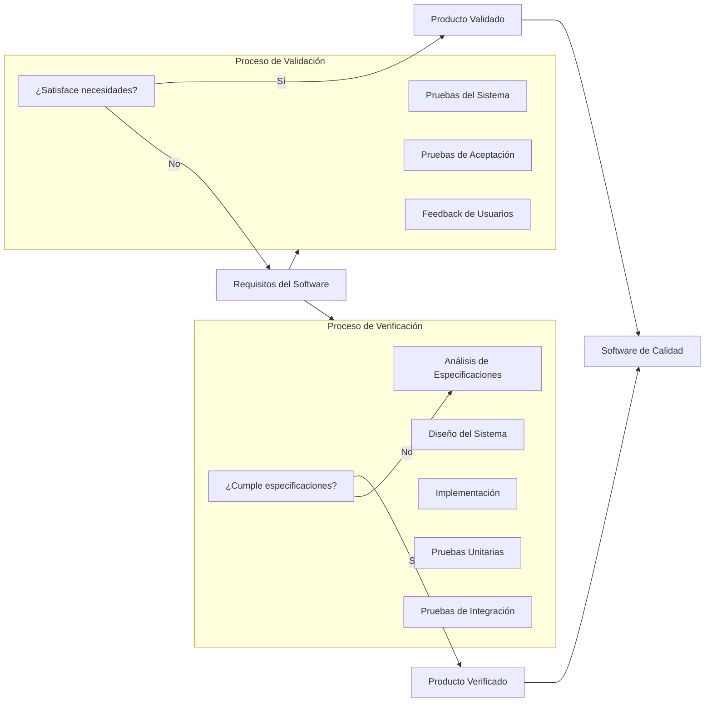

# Ingeniería de Software - Validación y verificación

## 6.1 Diferencias entre validación y verificación.

---

La Validación y Verificación (V&V) son dos actividades críticas en el proceso de desarrollo de software que aseguran la calidad del producto final. Aunque a menudo se usan indistintamente, representan conceptos distintos y complementarios.

### Definiciones Fundamentales

#### Verificación

La **verificación** se refiere al conjunto de actividades que aseguran que el software implementa correctamente una función específica. Responde a la pregunta: **"¿Estamos construyendo el producto correctamente?"**

Según Sommerville (2010), la verificación es "el proceso de comprobar que un sistema cumple con sus especificaciones y satisface los requisitos para los cuales fue diseñado".

#### Validación

La **validación** se refiere al conjunto de actividades que aseguran que el software construido cumple con las necesidades y expectativas del cliente. Responde a la pregunta: **"¿Estamos construyendo el producto correcto?"**

Pfleeger y Atlee (2010) definen la validación como "el proceso de evaluar el software durante o al final del proceso de desarrollo para determinar si satisface los requisitos del negocio y las necesidades del usuario".

### Diferencias Clave entre Validación y Verificación

| Aspecto            | Verificación                                     | Validación                                    |
| ------------------ | ------------------------------------------------ | --------------------------------------------- |
| **Propósito**      | ¿Estamos construyendo el producto correctamente? | ¿Estamos construyendo el producto correcto?   |
| **Enfoque**        | Orientado al proceso y la documentación          | Orientado al usuario y requisitos del negocio |
| **Pregunta clave** | ¿Cumple con las especificaciones?                | ¿Satisface las necesidades del usuario?       |
| **Actividades**    | Revisiones, inspecciones, pruebas unitarias      | Pruebas de aceptación, pruebas del sistema    |
| **Momento**        | Durante el desarrollo                            | Al final del desarrollo o durante entregas    |
| **Responsables**   | Desarrolladores, equipo de calidad               | Usuarios, clientes, equipo de negocio         |

### Fórmulas y Métricas Relacionadas

#### Métricas de Cobertura de Pruebas

La cobertura de código es una métrica importante en verificación:

$$ Cobertura = \frac{\text{Número de elementos ejecutados}}{\text{Número total de elementos}} \times 100\% $$

Donde "elementos" pueden ser líneas de código, branches (ramas), sentencias, etc.

#### Índice de Calidad de Software

Una fórmula simplificada para evaluar la calidad:

$$ IQS = \frac{\text{Número de defectos encontrados}}{\text{Tamaño del software (KLDC)}} \times 1000 $$

Donde KLDC representa "Miles de Líneas de Código".

### Diagrama de Procesos de V&V



### Ejemplos Prácticos

#### Ejemplo 1: Sistema de Login

**Verificación**:

- ¿El campo de contraseña encripta los datos correctamente?
- ¿La validación de credenciales sigue el algoritmo especificado?

**Validación**:

- ¿El proceso de login es intuitivo para los usuarios?
- ¿El tiempo de autenticación es aceptable para la experiencia de usuario?

#### Ejemplo 2: Carrito de Compras

**Verificación**:

- ¿El cálculo de impuestos sigue las fórmulas especificadas?
- ¿El descuento se aplica correctamente según las reglas de negocio?

**Validación**:

- ¿El flujo de compra es eficiente y agradable?
- ¿Los usuarios pueden completar compras sin confusiones?

### Técnicas y Herramientas

#### Técnicas de Verificación

1. **Revisiones e Inspecciones**: Análisis estático del código y documentación
2. **Pruebas Unitarias**: Verificación de componentes individuales
3. **Análisis Estático**: Uso de herramientas como linters y analizadores de código
4. **Pruebas de Integración**: Verificación de la interacción entre componentes

#### Técnicas de Validación

1. **Pruebas de Aceptación**: Evaluación con usuarios reales
2. **Pruebas Beta**: Liberación controlada a usuarios finales
3. **Prototipado**: Validación temprana de conceptos
4. **Pruebas de Usabilidad**: Evaluación de la experiencia de usuario

### Ejercicios Propuestos

#### Ejercicio 1: Identificación de V&V

Para cada actividad, indica si corresponde a Verificación (V) o Validación (A):

1. [ ] Ejecutar pruebas unitarias en un módulo de cálculo de impuestos
2. [ ] Realizar una demostración del prototipo al cliente
3. [ ] Revisar el código contra estándares de codificación
4. [ ] Realizar pruebas de usabilidad con usuarios finales
5. [ ] Verificar que todas las requirements traceability matrices estén completas

#### Ejercicio 2: Caso Práctico

Desarrolla un plan de V&V para un sistema de reservas de hotel que debe:

- Permitir búsqueda por fechas, ubicación y precio
- Gestionar reservas y pagos
- Generar confirmaciones por email

Identifica al menos 3 actividades de verificación y 3 de validación específicas para este sistema.

### Código de Ejemplo: Pruebas Unitarias (Verificación)

```python
# Ejemplo de prueba unitaria para verificación
import unittest

def calcular_descuento(monto_compra, es_miembro):
    """
    Calcula descuento según especificaciones:
    - Miembros: 15% descuento en compras > $100
    - No miembros: 5% descuento en compras > $200
    """
    if es_miembro and monto_compra > 100:
        return monto_compra * 0.15
    elif not es_miembro and monto_compra > 200:
        return monto_compra * 0.05
    return 0

class TestDescuentos(unittest.TestCase):

    def test_miembro_con_descuento(self):
        # Verificación: ¿Calcula correctamente el descuento para miembros?
        self.assertEqual(calcular_descuento(150, True), 22.5)

    def test_no_miembro_sin_descuento(self):
        # Verificación: ¿No aplica descuento cuando no corresponde?
        self.assertEqual(calcular_descuento(150, False), 0)

    def test_valores_limite(self):
        # Verificación: ¿Maneja correctamente los valores límite?
        self.assertEqual(calcular_descuento(100, True), 0)
        self.assertEqual(calcular_descuento(201, False), 10.05)

if __name__ == '__main__':
    unittest.main()
```

### Best Practices y Recomendaciones

1. **Integración Continua**: Implementar procesos automáticos de verificación
2. **Feedback Temprano**: Realizar validación desde las primeras etapas del proyecto
3. **Documentación**: Mantener registros de actividades de V&V
4. **Métricas**: Establecer indicadores cuantitativos de calidad
5. **Enfoque Balanceado**: Equilibrar esfuerzos entre verificación y validación

### Referencias

#### Bibliografía Básica

1. Sommerville, Ian. (2010). _Software Engineering_ (9th edition). Addison Wesley. (Capítulos 19, 20)
2. Pfleeger, S. L., & Atlee, J. M. (2010). _Software Engineering: Theory and Practice_ (4th edition). Prentice Hall. (Capítulos 8, 9)

#### Bibliografía Complementaria

3. Cockburn, A. (2004). _Crystal Clear: A Human-Powered Methodology for Small Teams_. Addison-Wesley Professional.
4. Boehm, B. W., & Turner, R. (2003). _Balancing agility and discipline: a guide for the perplexed_. Addison-Wesley.
5. Evans, E. (2003). _Domain-Driven Design: Tackling Complexity in the Heart of Software_. Addison Wesley.

### Conclusión

La distinción entre validación y verificación es fundamental para garantizar la calidad del software. Mientras la verificación se enfoca en construir el sistema correctamente (según especificaciones), la validación asegura que estamos construyendo el sistema correcto (que satisface necesidades reales). Ambas actividades son complementarias y esenciales en el proceso de desarrollo de software.
