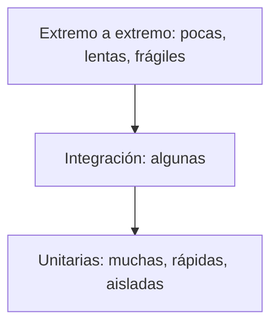

# Ingeniería de Software - Validación y verificación

## 6.2 Tipos de pruebas. Herramientas para pruebas.

---

**Probar** es ejecutar un programa con la intención de encontrar defectos, como lo definió Myers en 1979. Como las entradas posibles de cualquier programa real son incontables, probar consiste en **elegir** un conjunto pequeño de casos con la mayor probabilidad de revelar defectos, y decidir automáticamente si cada resultado es correcto. Este tema clasifica las pruebas por nivel, por objetivo y por la información que usan para diseñarlas; presenta las técnicas de diseño de casos de caja negra y de caja blanca, las métricas de cobertura y las herramientas habituales en cada nivel.

### Por nivel

- **Unitarias:** una función, clase o módulo, aislado de sus dependencias con dobles de prueba (tema 6.3). Rápidas y numerosas.
- **De integración:** la interacción entre módulos o con sistemas externos reales, como una base de datos o una API.
- **De sistema:** el sistema completo contra su especificación, funcional y no funcional.
- **De aceptación:** el sistema contra las necesidades del cliente, en su entorno; son validación (tema 6.1).

Cohn propuso la **pirámide de pruebas**: muchas unitarias, menos de integración y pocas de extremo a extremo, porque las de los niveles altos son lentas, frágiles y costosas de mantener, aunque cada una cubra más.

### Por objetivo

- **Funcionales:** el sistema hace lo que debe.
- **De regresión:** lo que funcionaba sigue funcionando después de un cambio; se automatizan y se ejecutan en cada integración (tema 6.5).
- **De desempeño:** de **carga**, con la carga esperada; de **estrés**, más allá de ella, hasta encontrar el punto de quiebre; de **resistencia**, sostenida durante horas.
- **De seguridad:** análisis de vulnerabilidades y pruebas de penetración.
- **De usabilidad** y **de accesibilidad**, con usuarios.

### Diseño de casos: caja negra

Se derivan de la **especificación**, sin mirar el código:

- **Partición de equivalencia:** el dominio de cada entrada se divide en clases cuyos elementos el programa debería tratar igual, y se prueba un representante de cada clase, válida e inválida.
- **Análisis de valores límite:** los defectos se concentran en las fronteras entre clases, como `>` en lugar de `>=`, y se prueban los valores justo en la frontera y a cada lado.
- **Tablas de decisión:** con varias condiciones que se combinan, se prueba una regla de la tabla por combinación relevante (tema 4.5).
- **Transición de estados:** cada transición válida y algunos eventos inválidos de una máquina de estados.
- **Pruebas combinatorias:** con muchos parámetros, las **pruebas por pares** cubren cada combinación de valores de cada par de parámetros con muchos menos casos que todas las combinaciones; la mayoría de los defectos de configuración se deben a la interacción de uno o dos parámetros.

### Diseño de casos: caja blanca

Se derivan del **código**, y su objetivo se expresa como **cobertura**:

- **de sentencias:** cada sentencia se ejecuta al menos una vez;
- **de ramas:** cada rama de cada decisión, verdadera y falsa;
- **de condiciones y MC/DC:** cada condición de una decisión compuesta afecta independientemente el resultado, exigida por DO-178C para el software de aviación de nivel A;
- **de caminos básicos:** $V(G)$ caminos linealmente independientes (tema 1.1).

La cobertura dice qué se ejecutó, no qué se comprobó: un 100 % de cobertura con aserciones débiles no detecta nada. La prueba de mutación mide lo segundo (tema 6.1).

### Herramientas

| Nivel o tipo        | Python                          | JavaScript                     | Java                       |
| ------------------- | ------------------------------- | ------------------------------ | -------------------------- |
| Unitarias           | pytest, unittest                | Jest, Vitest                   | JUnit                      |
| Dobles de prueba    | unittest.mock, pytest-mock      | Jest mocks                     | Mockito                    |
| Cobertura           | coverage.py                     | Istanbul, c8                   | JaCoCo                     |
| Basadas en propiedades | Hypothesis                   | fast-check                     | jqwik                      |
| Mutación            | mutmut, Cosmic Ray              | Stryker                        | PIT                        |
| Extremo a extremo   | Playwright                      | Playwright, Cypress            | Selenium                   |
| Carga               | Locust                          | k6                             | Gatling, JMeter            |



### Implementación en Python

El programa resuelve el ejercicio 1 con un validador de contraseñas que informa qué condiciones fallan, y deriva sus casos por partición de equivalencia, valores límite de la longitud y una tabla de decisión completa de 32 reglas, comprobando que el validador coincide con la tabla en todas. Para el ejercicio 2 implementa `procesar_pedido` con las reglas precisadas, con dinero en `Decimal`, y ejecuta 8 pruebas unitarias, incluidas las fronteras.

```python
import io, re, unittest
from decimal import Decimal, ROUND_HALF_UP
from itertools import product

# ---------- Ejercicio 1: validador de contraseñas y casos de prueba derivados sistemáticamente ----------
ESPECIALES = "!@#$%^&*"
def valida(pw):
    errores = []
    if len(pw) < 8: errores.append("longitud")
    if not re.search(r"[A-Z]", pw): errores.append("mayúscula")
    if not re.search(r"[a-z]", pw): errores.append("minúscula")
    if not re.search(r"\d", pw): errores.append("dígito")
    if not any(c in ESPECIALES for c in pw): errores.append("especial")
    return errores
# a) partición de equivalencia: una clase válida y una inválida por condición
particion = {"válida": "Abcdef1!", "corta (7)": "Abcde1!", "sin mayúscula": "abcdef1!", "sin minúscula": "ABCDEF1!",
             "sin dígito": "Abcdefg!", "sin especial": "Abcdefg1", "especial fuera de la lista": "Abcdef1?"}
print("ejercicio 1a, partición de equivalencia:", {k: valida(v) or "válida" for k, v in particion.items()})
# b) valores límite de la longitud
print("ejercicio 1b, valores límite:", {n: "longitud" in valida(("Aa1!" + "x" * 60)[:n]) for n in (0, 1, 7, 8, 9, 64)})
# c) tabla de decisión: 2^5 combinaciones de condiciones, una contraseña por regla
def construye(largo, may, minu, dig, esp):
    s = ("A" if may else "") + ("a" if minu else "") + ("1" if dig else "") + ("!" if esp else "")
    relleno = "b" if minu else "B" if may else "2" if dig else "@" if esp else "~"
    return s + relleno * ((8 if largo else 7) - len(s))
tabla = list(product((True, False), repeat=5))
ok = sum(valida(construye(*r)) == [] for r in tabla)
consistente = all((valida(construye(*r)) == []) == all(r) for r in tabla)
print(f"ejercicio 1c, tabla de decisión: {len(tabla)} reglas, {ok} con acción 'aceptar'; el validador coincide con la tabla en todas: {consistente}")

# ---------- Ejercicio 2: procesar_pedido, con las reglas precisadas, y sus pruebas ----------
ENVIO, UMBRAL = Decimal("150"), Decimal("50000")
def procesar_pedido(productos, cantidad, es_miembro, descuento_especial=Decimal("0")):
    """productos: precios unitarios. Supuestos: los descuentos son porcentajes sobre el subtotal y se suman;
    el envío es gratis si el total con descuentos supera 50 000; se redondea a centavos al final."""
    if cantidad <= 0: raise ValueError("la cantidad debe ser positiva")
    if not 0 <= descuento_especial <= Decimal("0.5"): raise ValueError("descuento especial fuera de rango")
    subtotal = sum(productos, Decimal("0")) * cantidad
    descuento = subtotal * ((Decimal("0.10") if es_miembro else 0) + descuento_especial)
    neto = subtotal - descuento
    envio = Decimal("0") if neto > UMBRAL else ENVIO
    return {k: v.quantize(Decimal("0.01"), ROUND_HALF_UP) for k, v in {"subtotal": subtotal, "descuento": descuento, "envio": envio, "total": neto + envio}.items()}
D = Decimal
class TestPedido(unittest.TestCase):
    def test_sin_descuentos(self): self.assertEqual(procesar_pedido([D("100")], 2, False)["total"], D("350.00"))
    def test_miembro(self): self.assertEqual(procesar_pedido([D("1000")], 1, True)["descuento"], D("100.00"))
    def test_especial_se_suma(self): self.assertEqual(procesar_pedido([D("1000")], 1, True, D("0.05"))["descuento"], D("150.00"))
    def test_envio_frontera(self):
        self.assertEqual(procesar_pedido([D("50000")], 1, False)["envio"], D("150"))        # exactamente 50 000: no supera
        self.assertEqual(procesar_pedido([D("50000.01")], 1, False)["envio"], D("0"))
    def test_umbral_despues_del_descuento(self): self.assertEqual(procesar_pedido([D("55000")], 1, True)["envio"], D("150"))   # 49 500
    def test_redondeo(self): self.assertEqual(procesar_pedido([D("33.33")], 3, True)["total"], D("239.99"))
    def test_cantidad_invalida(self):
        with self.assertRaises(ValueError): procesar_pedido([D("10")], 0, False)
    def test_descuento_invalido(self):
        with self.assertRaises(ValueError): procesar_pedido([D("10")], 1, False, D("0.9"))
r = unittest.TextTestRunner(stream=io.StringIO()).run(unittest.defaultTestLoader.loadTestsFromTestCase(TestPedido))
print(f"ejercicio 2: {r.testsRun} pruebas, {len(r.failures) + len(r.errors)} fallas | ejemplo: {procesar_pedido([D('33.33')], 3, True)}")
```

Salida:

```text
ejercicio 1a, partición de equivalencia: {'válida': 'válida', 'corta (7)': ['longitud'], 'sin mayúscula': ['mayúscula'], 'sin minúscula': ['minúscula'], 'sin dígito': ['dígito'], 'sin especial': ['especial'], 'especial fuera de la lista': ['especial']}
ejercicio 1b, valores límite: {0: True, 1: True, 7: True, 8: False, 9: False, 64: False}
ejercicio 1c, tabla de decisión: 32 reglas, 1 con acción 'aceptar'; el validador coincide con la tabla en todas: True
ejercicio 2: 8 pruebas, 0 fallas | ejemplo: {'subtotal': Decimal('99.99'), 'descuento': Decimal('10.00'), 'envio': Decimal('150.00'), 'total': Decimal('239.99')}
```

### Ejercicios Propuestos

1. **Diseño de casos.** Para una función que valida contraseñas de al menos 8 caracteres, con al menos una mayúscula, una minúscula, un número y un carácter especial de `!@#$%^&*`, diseña casos de prueba con partición de equivalencia, análisis de valores límite y tabla de decisión.

2. **Implementación.** Implementa y prueba la función:

    ```python
    def procesar_pedido(productos, cantidad, es_miembro, descuento_especial=0):
        """
        Procesa un pedido aplicando descuentos según reglas:
        - Miembros: 10% descuento
        - Descuento especial: adicional al descuento de miembro
        - Envío gratis para compras > $50,000
        """
        pass
    ```

3. **Herramientas.** Recomienda herramientas de prueba para cada nivel en un comercio electrónico con servidor en Django, interfaz en React, API REST y base de datos PostgreSQL.

### Soluciones

**Ejercicio 1.**

- **Partición de equivalencia:** una clase válida, como `Abcdef1!`, y una clase inválida por condición: demasiado corta, sin mayúscula, sin minúscula, sin dígito, sin carácter especial. Una clase inválida que se olvida con facilidad es la de los caracteres especiales **fuera** de la lista, como `?`: según la especificación, `Abcdef1?` es inválida. Cada caso inválido debe violar **una sola** condición, para saber cuál detecta el validador.
- **Valores límite** de la longitud: 7, inválida, y 8, válida, en la frontera; 0, la cadena vacía; y un valor grande, como 64, porque la especificación no da un máximo, y debería darlo.
- **Tabla de decisión:** con cinco condiciones independientes hay $2^5 = 32$ reglas, de las cuales solo una acepta. El programa genera una contraseña para cada regla y comprueba que el validador coincide con la tabla en todas. En la práctica bastan las 6 reglas de la partición, porque las condiciones no interactúan; la tabla completa se justifica cuando sí lo hacen.

Las pruebas revelan también una decisión de diseño: el validador devuelve **todas** las condiciones que fallan, no solo la primera, para que el usuario corrija todo de una vez.

**Ejercicio 2.** La especificación es ambigua, y antes de programar hay que decidir, y documentar, cuatro puntos: el descuento especial es un porcentaje, que se **suma** al de miembro sobre el subtotal, y no se aplica en cascada; el umbral de envío gratis se compara con el total **después** de los descuentos; "mayor que 50 000" excluye el 50 000 exacto; y el redondeo a centavos se hace al final, con redondeo hacia arriba en el medio. Faltan además el costo de envío, que se supone de 150, y el rango válido del descuento especial. Las pruebas del programa cubren cada regla y cada frontera: el pedido de exactamente 50 000 paga envío y el de 50 000.01 no; uno de 55 000 de un miembro, con 49 500 después del descuento, paga envío; el redondeo de $3 \cdot 33.33 = 99.99$ menos el 10 %, más envío, da 239.99. Las entradas inválidas se rechazan con excepciones. En el código original, sin `Decimal`, varias de estas pruebas fallarían por errores de punto flotante.

**Ejercicio 3.**

| Nivel                         | Herramienta                                       | Razón                                                         |
| ----------------------------- | ------------------------------------------------- | ------------------------------------------------------------- |
| Unitarias del servidor        | pytest con pytest-django                          | Fixtures, parametrización, ecosistema amplio                  |
| Unitarias del cliente         | Vitest o Jest con Testing Library                 | Prueban componentes como los usa el usuario, no su implementación |
| Integración con la base       | pytest con PostgreSQL real en un contenedor       | Detecta diferencias que SQLite ocultaría, como tipos y bloqueos |
| Contrato de la API            | Schemathesis sobre la especificación OpenAPI      | Genera casos a partir del contrato y detecta violaciones      |
| Extremo a extremo             | Playwright                                        | Varios navegadores, esperas automáticas, menos fragilidad     |
| Carga                         | Locust o k6                                       | Escenarios como código, integrables en la integración continua |
| Cobertura y mutación          | coverage.py y mutmut; Istanbul y Stryker en el cliente | Medir qué se ejecuta y qué se comprueba                  |
| Seguridad                     | Bandit, npm audit, OWASP ZAP                      | Análisis estático, dependencias y pruebas dinámicas           |

### Referencias

1. Myers, G. J., Sandler, C., and Badgett, T., _The Art of Software Testing_. Wiley, 2011.
2. Ammann, P., and Offutt, J., _Introduction to Software Testing_. Cambridge University Press, 2016.
3. Cohn, M., _Succeeding with Agile_. Addison-Wesley, 2009. Capítulo 16.
4. Kuhn, D. R., Wallace, D. R., and Gallo, A. M., Software fault interactions and implications for software testing. _IEEE Transactions on Software Engineering_ 30(6), 2004.
5. ISO/IEC/IEEE 29119-4:2021, _Software and systems engineering: Software testing, Part 4: Test techniques_.
