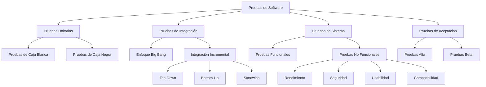

# Ingeniería de Software - Validación y verificación

## 6.2 Tipos de pruebas. Herramientas para pruebas.

---

Las pruebas de software son actividades fundamentales dentro de la verificación y validación que permiten identificar defectos, validar el cumplimiento de requisitos y asegurar la calidad del producto final. Según Sommerville (2010), "las pruebas intentan demostrar que un programa tiene fallos y no que no los tiene".

### Clasificación de los Tipos de Pruebas

#### 1. Pruebas según el Nivel de Ejecución

##### Pruebas Estáticas

Análisis del software sin ejecutar el código:

- **Revisiones de código**: Inspecciones formales e informales
- **Análisis estático**: Uso de herramientas automatizadas
- **Revisiones de requisitos y diseño**

##### Pruebas Dinámicas

Ejecución del software con entradas específicas:

- **Pruebas unitarias**: Componentes individuales
- **Pruebas de integración**: Interacción entre componentes
- **Pruebas de sistema**: Sistema completo
- **Pruebas de aceptación**: Con usuarios finales

#### 2. Pruebas según el Nivel de Abstracción



### Principales Tipos de Pruebas

#### Pruebas Unitarias (Unit Testing)

**Definición**: Pruebas de componentes individuales o unidades de código.

**Cobertura típica**:

$$ Cobertura = \frac{\text{Líneas ejecutadas}}{\text{Líneas totales}} \times 100\% $$

**Ejemplo**:

```python
# código bajo prueba
def calcular_iva(monto, porcentaje=19):
    if monto <= 0:
        raise ValueError("El monto debe ser positivo")
    return monto * (porcentaje / 100)

# prueba unitaria
import unittest

class TestCalcularIva(unittest.TestCase):
    def test_iva_calculado_correctamente(self):
        self.assertEqual(calcular_iva(1000), 190.0)

    def test_iva_con_porcentaje_personalizado(self):
        self.assertEqual(calcular_iva(1000, 10), 100.0)

    def test_monto_negativo_lanza_excepcion(self):
        with self.assertRaises(ValueError):
            calcular_iva(-100)
```

#### Pruebas de Integración (Integration Testing)

**Definición**: Verifican la interacción entre componentes integrados.

**Estrategias comunes**:

- **Big Bang**: Integrar todo simultáneamente
- **Incremental**: Integrar progresivamente
  - **Top-down**: De arriba hacia abajo
  - **Bottom-up**: De abajo hacia arriba
  - **Sandwich**: Combinación de ambas

#### Pruebas de Sistema (System Testing)

**Definición**: Pruebas del sistema completo en entorno similar al producción.

**Subtipos**:

- **Pruebas funcionales**: Verifican requisitos funcionales
- **Pruebas no funcionales**:
  - Rendimiento: $ Tiempo_{respuesta} \leq Umbral_{aceptable} $
  - Carga: $ Usuarios_{simultaneos} \times Transacciones_{segundo} $
  - Estrés: Más allá de los límites operativos
  - Usabilidad: $ \text{Satisfacción}\_{usuario} \geq Meta\_{establecida} $

#### Pruebas de Aceptación (Acceptance Testing)

**Definición**: Validación con el cliente o usuarios finales.

**Tipos**:

- **Pruebas alfa**: En entorno controlado del desarrollador
- **Pruebas beta**: En entorno real del usuario

### Técnicas de Diseño de Pruebas

#### Pruebas de Caja Negra (Black-box Testing)

**Definición**: Pruebas basadas en especificaciones sin conocimiento interno.

**Técnicas**:

- **Partición de equivalencia**:

  $$ Particiones = \{P_1, P_2, ..., P_n\} donde \forall x \in P_i, x \equiv comportamiento $$

- **Análisis de valores límite**:

  $$ Valores = \set{ \text{límite} ^ {-}, \text{límite}, \text{límite} ^ {+} } $$

- **Tablas de decisión**: Combinaciones de condiciones y acciones

#### Pruebas de Caja Blanca (White-box Testing)

**Definición**: Pruebas basadas en la estructura interna del código.

**Métricas**:

- **Cobertura de sentencias**:

  $$ C\_s = \frac{Sentencias_{ejecutadas}}{Sentencias\_{totales}} \times 100\% $$

- **Cobertura de ramas**:

  $$ C\_r = \frac{Ramas\_{ejecutadas}}{Ramas\_{totales}} \times 100\% $$

- **Cobertura de caminos**: Todos los posibles flujos de ejecución

### Herramientas para Pruebas

#### Frameworks de Pruebas Unitarias

| Herramienta | Lenguaje   | Características                     |
| ----------- | ---------- | ----------------------------------- |
| JUnit       | Java       | Anotaciones, assertions, runners    |
| pytest      | Python     | Sintaxis simple, fixtures poderosas |
| NUnit       | .NET       | Similar a JUnit para .NET           |
| Jest        | JavaScript | Zero-config, snapshot testing       |

#### Herramientas de Mocking y Stubbing

```python
# Ejemplo usando unittest.mock
from unittest.mock import Mock, patch
import requests

def obtener_datos_usuario(user_id):
    response = requests.get(f'https://api.example.com/users/{user_id}')
    return response.json()

# Prueba con mock
def test_obtener_datos_usuario():
    with patch('requests.get') as mock_get:
        mock_response = Mock()
        mock_response.json.return_value = {'id': 1, 'name': 'Juan'}
        mock_get.return_value = mock_response

        resultado = obtener_datos_usuario(1)
        assert resultado['name'] == 'Juan'
        mock_get.assert_called_once_with('https://api.example.com/users/1')
```

#### Herramientas de Pruebas de Integración y Sistema

- **Selenium**: Automatización de navegadores web
- **Postman**: Pruebas de APIs REST
- **JMeter**: Pruebas de carga y rendimiento
- **Cypress**: Pruebas end-to-end para web

#### Herramientas de Análisis Estático

- **SonarQube**: Análisis de calidad de código
- **ESLint**: Análisis estático para JavaScript
- **Pylint**: Análisis estático para Python
- **Checkstyle**: Análisis de estilo de código Java

#### Herramientas de Continuous Testing

```yaml
# Ejemplo de configuración GitHub Actions para CI
name: Continuous Testing

on: [push, pull_request]

jobs:
  test:
    runs-on: ubuntu-latest
    strategy:
      matrix:
        python-version: [3.8, 3.9, '3.10']

    steps:
      - uses: actions/checkout@v2
      - name: Set up Python ${{ matrix.python-version }}
        uses: actions/setup-python@v2
        with:
          python-version: ${{ matrix.python-version }}

      - name: Install dependencies
        run: |
          python -m pip install --upgrade pip
          pip install -r requirements.txt
          pip install pytest pytest-cov

      - name: Run tests with coverage
        run: |
          pytest --cov=./ --cov-report=xml

      - name: Upload coverage to Codecov
        uses: codecov/codecov-action@v1
```

### Ejercicios Propuestos

#### Ejercicio 1: Diseño de Casos de Prueba

Para una función que valida contraseñas con los requisitos:

- Mínimo 8 caracteres
- Al menos una mayúscula y una minúscula
- Al menos un número
- Al menos un carácter especial (!@#$%^&*)

Diseña casos de prueba usando:
a) Partición de equivalencia
b) Análisis de valores límite
c) Tabla de decisión

#### Ejercicio 2: Implementación de Pruebas

Implementa pruebas unitarias para la siguiente función:

```python
def procesar_pedido(productos, cantidad, es_miembro, descuento_especial=0):
    """
    Procesa un pedido aplicando descuentos según reglas:
    - Miembros: 10% descuento
    - Descuento especial: adicional al descuento de miembro
    - Envío gratis para compras > $50,000
    """
    # Implementar la función y luego escribir pruebas
    pass
```

#### Ejercicio 3: Selección de Herramientas

Para un proyecto e-commerce con:

- Backend en Python (Django)
- Frontend en React
- API REST
- Base de datos PostgreSQL

Recomienda un conjunto de herramientas de testing para cada nivel de prueba y justifica tu selección.

### Métricas y Reporting

#### Métricas de Calidad de Pruebas

- **Densidad de defectos**:

  $$ DD = \frac{Defectos\_{encontrados}}{\text{Tamaño}\_{KLDC}} $$

- **Efectividad de pruebas**:

  $$ E = \frac{Defectos_{pruebas}}{Defectos_{pruebas} + Defectos\_{\text{producción}}} \times 100\% $$

- **Cobertura de requisitos**:

  $$ CR = \frac{Requisitos\_{probados}}{Requisitos\_{totales}} \times 100\% $$

#### Ejemplo de Reporte de Cobertura

```bash
Name                 Stmts   Miss  Cover
----------------------------------------
main.py                150     25    83%
utils.py                89      5    94%
models.py              204     18    91%
----------------------------------------
TOTAL                  443     48    89%
```

### Best Practices y Recomendaciones

1. **Pruebas tempranas**: Iniciar testing desde las primeras etapas
2. **Automatización**: Automatizar pruebas repetitivas y críticas
3. **Pirámide de pruebas**: Mantener proporción adecuada entre tipos de prueba
4. **Datos de prueba**: Usar datos realistas pero controlados
5. **Aislamiento**: Las pruebas deben ser independientes y repetibles
6. **Continuous Integration**: Integrar pruebas en el pipeline de CI/CD

### Referencias

#### Bibliografía Básica

1. Sommerville, Ian. (2010). _Software Engineering_ (9th edition). Addison Wesley. (Capítulos 19, 23)
2. Pfleeger, S. L., & Atlee, J. M. (2010). _Software Engineering: Theory and Practice_ (4th edition). Prentice Hall. (Capítulos 8, 9)

#### Bibliografía Complementaria

3. Beck, K. (2002). _Test-Driven Development: By Example_. Addison-Wesley.
4. Fowler, M. (2018). _Refactoring: Improving the Design of Existing Code_. Addison-Wesley.
5. Meszaros, G. (2007). _xUnit Test Patterns: Refactoring Test Code_. Addison-Wesley.

### Conclusión

La selección adecuada de tipos de pruebas y herramientas es crucial para una estrategia efectiva de testing. Las pruebas deben diseñarse considerando los diferentes niveles de abstracción y complementarse con herramientas automatizadas que permitan una ejecución eficiente y reporting adecuado de la calidad del software.
