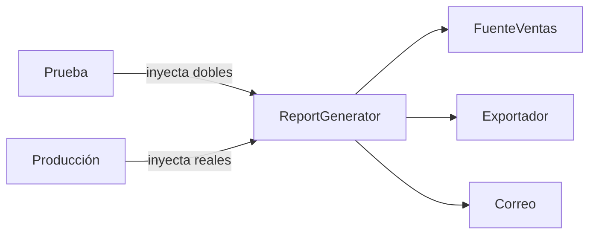

# Ingeniería de Software - Validación y verificación

## 6.3 Consideraciones de diseño para facilitar las pruebas.

---

La **comprobabilidad** (*testability*) es la facilidad con que un software permite demostrar sus defectos mediante pruebas. No es una propiedad de las pruebas, sino del **diseño**: un módulo que crea sus propias conexiones a la base de datos, lee el reloj del sistema y envía correos directamente no se puede probar sin una base de datos, sin esperar y sin enviar correos reales; uno que recibe esas dependencias se prueba en milisegundos. Este tema describe las propiedades de un diseño comprobable, la inyección de dependencias y los dobles de prueba, los patrones que la favorecen y cómo reconocer el código difícil de probar.

### Propiedades

Binder y, después, el trabajo del SEI resumen la comprobabilidad en dos capacidades:

- **Controlabilidad:** poder llevar al módulo al estado deseado y darle las entradas deseadas, incluidas las que vienen de sus dependencias, como la hora actual o la respuesta de una API.
- **Observabilidad:** poder ver sus salidas y sus efectos, incluidos los efectos sobre las dependencias, como un correo enviado.

Las favorecen el **aislamiento**, con dependencias explícitas y reemplazables; la **separación** entre la lógica y los efectos, de modo que la lógica sea una función pura y los efectos queden en una capa delgada; el **determinismo**, sin dependencia oculta del reloj, de números aleatorios o del orden de un conjunto, y un **tamaño** de módulo pequeño, con una sola responsabilidad.

### Inyección de dependencias y dobles de prueba

Con **inyección de dependencias**, un módulo recibe sus colaboradores, por el constructor o como parámetros, en lugar de crearlos. En producción se le pasan los reales; en las pruebas, **dobles de prueba**, que Meszaros clasifica en:

- **dummy:** un objeto que se pasa pero no se usa;
- **stub:** devuelve respuestas fijas, para controlar las entradas indirectas;
- **spy:** un stub que además registra cómo se le llamó;
- **mock:** se programa con las llamadas esperadas y verifica que ocurrieron, para observar las salidas indirectas;
- **fake:** una implementación funcional pero simplificada, como una base de datos en memoria o un canal de notificaciones que solo registra.

Los dobles deben usarse en las **fronteras** del sistema, como bases de datos, red, reloj o servicios externos, y no para cada colaborador interno: una prueba que simula todo verifica la implementación en lugar del comportamiento, y se rompe con cada refactorización.

### Patrones que la favorecen

- **Estrategia:** cada algoritmo se prueba por separado, y el contexto se prueba con una estrategia trivial.
- **Puertos y adaptadores** (tema 5.1): el dominio no conoce la infraestructura y se prueba sin ella.
- **Núcleo funcional, cáscara imperativa:** la lógica en funciones puras, fáciles de probar exhaustivamente, y los efectos en una capa delgada probada con pocas pruebas de integración.
- **Fábricas e interfaces** para la creación de objetos difíciles de construir.

### Señales de código difícil de probar

Hevery, en la guía de comprobabilidad de Google, señala: el constructor hace trabajo real, como conectarse a una base de datos; se usan estado global o singletons; el código consulta servicios a través de otros objetos, violando la ley de Deméter; se llama a métodos estáticos con efectos, como el reloj, y una clase hace demasiadas cosas.



### Implementación en Python

El programa resuelve los tres ejercicios con pruebas ejecutables. El generador de reportes recibe sus tres dependencias y se prueba con mocks de `unittest.mock`; el notificador se prueba con canales en memoria que registran lo enviado; y las estrategias de precio se prueban por separado, incluidas sus fronteras y una combinación de dos estrategias.

```python
import io, unittest
from dataclasses import dataclass, field
from datetime import date
from decimal import Decimal
from typing import Protocol
from unittest.mock import Mock

# ---------- Ejercicio 1: ReportGenerator refactorizado ----------
class FuenteVentas(Protocol):
    def ventas(self, desde: date, hasta: date) -> list[dict]: ...
class Exportador(Protocol):
    def exporta(self, filas: list[dict], nombre: str) -> str: ...
class Correo(Protocol):
    def envia(self, para: str, asunto: str, adjunto: str) -> None: ...
class ReportGenerator:
    """Las dependencias se inyectan; la fecha y el destinatario son parámetros, no valores ocultos."""
    def __init__(self, fuente: FuenteVentas, exportador: Exportador, correo: Correo, destinatario: str):
        self.fuente, self.exportador, self.correo, self.destinatario = fuente, exportador, correo, destinatario
    def generate_report(self, desde: date, hasta: date) -> str:
        filas = self.fuente.ventas(desde, hasta)
        if not filas: raise ValueError("no hay ventas en el periodo")
        ruta = self.exportador.exporta(filas, f"ventas_{desde:%Y%m%d}_{hasta:%Y%m%d}.xlsx")
        self.correo.envia(self.destinatario, f"Reporte de ventas {desde} a {hasta}", ruta)
        return ruta
class TestReporte(unittest.TestCase):
    def setUp(self):
        self.fuente, self.exp, self.correo = Mock(), Mock(), Mock()
        self.exp.exporta.return_value = "/tmp/r.xlsx"
        self.gen = ReportGenerator(self.fuente, self.exp, self.correo, "gerente@empresa.mx")
    def test_flujo_completo(self):
        self.fuente.ventas.return_value = [{"total": 10}]
        self.assertEqual(self.gen.generate_report(date(2026, 10, 1), date(2026, 10, 31)), "/tmp/r.xlsx")
        self.exp.exporta.assert_called_once_with([{"total": 10}], "ventas_20261001_20261031.xlsx")
        self.correo.envia.assert_called_once_with("gerente@empresa.mx", "Reporte de ventas 2026-10-01 a 2026-10-31", "/tmp/r.xlsx")
    def test_sin_ventas_no_envia(self):
        self.fuente.ventas.return_value = []
        with self.assertRaises(ValueError): self.gen.generate_report(date(2026, 10, 1), date(2026, 10, 31))
        self.correo.envia.assert_not_called()

# ---------- Ejercicio 2: notificaciones con un registro para pruebas ----------
@dataclass
class Notificacion:
    canal: str; destino: str; mensaje: str
class Canal(Protocol):
    def envia(self, n: Notificacion) -> bool: ...
@dataclass
class CanalEnMemoria:                                        # doble de prueba: registra en lugar de enviar
    falla: bool = False; enviadas: list = field(default_factory=list)
    def envia(self, n): self.enviadas.append(n); return not self.falla
class Notificador:
    def __init__(self, canales: dict[str, Canal]): self.canales, self.registro = canales, []
    def notifica(self, n: Notificacion) -> bool:
        if n.canal not in self.canales: self.registro.append(("canal desconocido", n.canal)); return False
        ok = self.canales[n.canal].envia(n); self.registro.append(("enviada" if ok else "fallida", n.canal)); return ok
class TestNotificador(unittest.TestCase):
    def test_enruta_por_canal(self):
        email, sms = CanalEnMemoria(), CanalEnMemoria()
        Notificador({"email": email, "sms": sms}).notifica(Notificacion("sms", "+52 55", "hola"))
        self.assertEqual((len(email.enviadas), len(sms.enviadas)), (0, 1))
    def test_registra_fallas_y_canales_desconocidos(self):
        n = Notificador({"push": CanalEnMemoria(falla=True)})
        self.assertFalse(n.notifica(Notificacion("push", "t1", "x"))); self.assertFalse(n.notifica(Notificacion("fax", "1", "x")))
        self.assertEqual(n.registro, [("fallida", "push"), ("canal desconocido", "fax")])

# ---------- Ejercicio 3: estrategias de precio ----------
class EstrategiaPrecio(Protocol):
    def precio(self, unitario: Decimal, cantidad: int) -> Decimal: ...
class Regular:
    def precio(self, u, n): return u * n
@dataclass
class PorVolumen:
    tramos: tuple = ((100, Decimal("0.15")), (10, Decimal("0.05")))     # (cantidad mínima, descuento), de mayor a menor
    def precio(self, u, n): return u * n * (1 - next((d for m, d in self.tramos if n >= m), Decimal("0")))
@dataclass
class Promocional:
    paga: int = 2; lleva: int = 3                            # 3 x 2
    def precio(self, u, n): return u * (n // self.lleva * self.paga + n % self.lleva)
@dataclass
class Miembro:
    base: object; descuento: Decimal = Decimal("0.10")      # decorador: se combina con cualquier otra estrategia
    def precio(self, u, n): return self.base.precio(u, n) * (1 - self.descuento)
class TestEstrategias(unittest.TestCase):
    u = Decimal("20")
    def test_regular(self): self.assertEqual(Regular().precio(self.u, 3), Decimal("60"))
    def test_volumen_fronteras(self):
        v = PorVolumen()
        self.assertEqual([v.precio(self.u, n) for n in (9, 10, 99, 100)], [Decimal("180"), Decimal("190.00"), Decimal("1881.00"), Decimal("1700.00")])
    def test_promocional(self): self.assertEqual([Promocional().precio(self.u, n) for n in (1, 3, 4, 6)], [20, 40, 60, 80])
    def test_miembro_sobre_promocion(self): self.assertEqual(Miembro(Promocional()).precio(self.u, 3), Decimal("36.00"))
for caso in (TestReporte, TestNotificador, TestEstrategias):
    r = unittest.TextTestRunner(stream=io.StringIO()).run(unittest.defaultTestLoader.loadTestsFromTestCase(caso))
    print(f"{caso.__name__}: {r.testsRun} pruebas, {len(r.failures) + len(r.errors)} fallas")
print("precio de 99 unidades con volumen:", PorVolumen().precio(Decimal("20"), 99), "| de 100:", PorVolumen().precio(Decimal("20"), 100))
```

Salida:

```text
TestReporte: 2 pruebas, 0 fallas
TestNotificador: 2 pruebas, 0 fallas
TestEstrategias: 4 pruebas, 0 fallas
precio de 99 unidades con volumen: 1881.00 | de 100: 1700.00
```

### Ejercicios Propuestos

1. **Refactorización.** Haz más fácil de probar este código:

    ```python
    class ReportGenerator:
        def generate_report(self):
            database = MySQLDatabase("localhost", "user", "pass")
            data = database.query("SELECT * FROM sales")
            excel = ExcelExporter()
            report_path = excel.export(data, "sales_report.xlsx")
            email = EmailSender()
            email.send("manager@company.com", "Sales Report", report_path)
            return report_path
    ```

2. **Interfaces.** Diseña una interfaz para un servicio de notificaciones por correo, SMS y push, con un registro para las pruebas, impleméntala y pruébala.

3. **Estrategia.** Implementa un sistema de cálculo de precios con estrategias de precio regular, descuento por volumen, precio promocional y precio para miembros, y prueba cada estrategia.

### Soluciones

**Ejercicio 1.** El código original tiene cinco problemas de comprobabilidad: crea sus tres dependencias, de modo que una prueba necesita una base MySQL, genera un archivo y envía un correo real; tiene credenciales en el código, que además es un problema de seguridad; consulta **todas** las ventas, sin periodo; usa un nombre de archivo fijo, que dos ejecuciones simultáneas sobrescribirían, y no define qué pasa si no hay datos. La versión del programa recibe la fuente de datos, el exportador y el correo como interfaces, y el destinatario como configuración; el periodo es un parámetro y forma parte del nombre del archivo; y sin ventas lanza una excepción sin enviar nada. Las dos pruebas usan mocks: verifican que se exporten las filas obtenidas con el nombre esperado, que el correo se envíe con el asunto y el adjunto correctos, y que sin ventas no se envíe. Se ejecutan sin base de datos, sin archivos y sin red.

**Ejercicio 2.** La interfaz `Canal` tiene un solo método, `envia(notificación) → bool`. El `Notificador` recibe un diccionario de canales y registra cada resultado: enviada, fallida o canal desconocido. Para las pruebas, `CanalEnMemoria` es un **fake** que guarda las notificaciones en una lista y puede configurarse para fallar. Las pruebas verifican el enrutamiento por canal y el registro de las fallas y de los canales desconocidos. Los canales reales, con el proveedor de correo, de SMS o de push, implementan la misma interfaz y se prueban aparte, con pruebas de integración contra los ambientes de prueba de cada proveedor.

**Ejercicio 3.** Cada estrategia implementa `precio(unitario, cantidad)`: `Regular` multiplica; `PorVolumen` aplica 5 % desde 10 unidades y 15 % desde 100; `Promocional` cobra 2 de cada 3; `Miembro` **envuelve** a otra estrategia y aplica 10 % sobre su resultado, lo que permite combinarla con cualquiera, como un decorador. Las pruebas cubren las fronteras de los tramos, 9, 10, 99 y 100, y los múltiplos de la promoción. Y revelan un problema de la regla de negocio, no del código: 99 unidades cuestan 1 881 y 100 cuestan 1 700, de modo que a un cliente le conviene comprar una unidad más. Es la clase de hallazgo que hace una buena prueba de fronteras, y la decisión de corregirlo, por ejemplo con descuentos marginales por tramo como en los impuestos, es del negocio.

### Referencias

1. Meszaros, G., _xUnit Test Patterns: Refactoring Test Code_. Addison-Wesley, 2007.
2. Binder, R. V., Design for testability in object-oriented systems. _Communications of the ACM_ 37(9), 1994.
3. Feathers, M., _Working Effectively with Legacy Code_. Prentice Hall, 2004.
4. Hevery, M., _Guide: Writing Testable Code_. Google, 2008.
5. Freeman, S., and Pryce, N., _Growing Object-Oriented Software, Guided by Tests_. Addison-Wesley, 2009.
