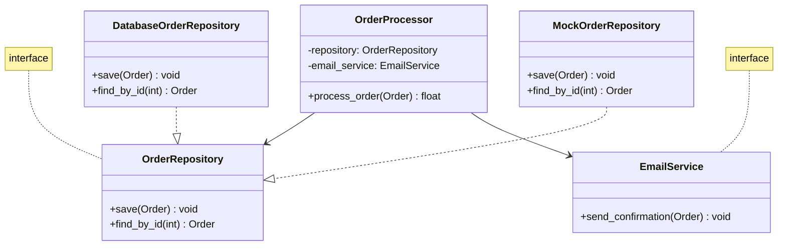
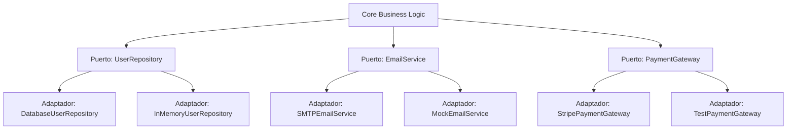

# Ingeniería de Software - Validación y verificación

## 6.3 Consideraciones de diseño para facilitar las pruebas.

---

El diseño del software juega un papel crucial en la facilidad de testing. Según Sommerville (2010), "un software bien diseñado no solo es más fácil de mantener, sino también más fácil de probar". Las decisiones de diseño tempranas impactan directamente en la testabilidad del sistema.

### Principios de Diseño para Mejorar la Testabilidad

#### 1. Acoplamiento Débil y Cohesión Fuerte

**Definición**: Diseñar componentes con interfaces bien definidas y responsabilidades únicas.

**Fórmula de acoplamiento**:

$$ Acoplamiento = \frac{\text{Dependencias externas}}{\text{Total de componentes}} $$

**Ejemplo**:

```python
# Diseño con alto acoplamiento (difícil de testear)
class OrderProcessor:
    def __init__(self):
        self.db = Database()  # Acoplamiento directo
        self.email = EmailService()

    def process_order(self, order):
        # Lógica mezclada con infraestructura
        self.db.save(order)
        self.email.send_confirmation(order)
        return order.total

# Diseño con bajo acoplamiento (fácil de testear)
class OrderProcessor:
    def __init__(self, db_repository, email_service):
        self.db_repository = db_repository  # Dependencias inyectadas
        self.email_service = email_service

    def process_order(self, order):
        total = self.calculate_total(order.items)
        self.db_repository.save(order)
        self.email_service.send_confirmation(order)
        return total

    def calculate_total(self, items):
        return sum(item.price * item.quantity for item in items)
```

#### 2. Principio de Inversión de Dependencias (DIP)

**Definición**: Depender de abstracciones, no de implementaciones concretas.



#### 3. Patrón Strategy para Algoritmos Testeables

**Ejemplo**:

```python
from abc import ABC, abstractmethod

class TaxCalculator(ABC):
    @abstractmethod
    def calculate_tax(self, amount: float) -> float:
        pass

class VATCalculator(TaxCalculator):
    def __init__(self, vat_rate: float = 0.19):
        self.vat_rate = vat_rate

    def calculate_tax(self, amount: float) -> float:
        if amount <= 0:
            raise ValueError("Amount must be positive")
        return amount * self.vat_rate

class IncomeTaxCalculator(TaxCalculator):
    def calculate_tax(self, amount: float) -> float:
        # Lógica compleja de impuesto a la renta
        brackets = [(0, 1000, 0.0), (1001, 5000, 0.1), (5001, float('inf'), 0.2)]
        tax = 0
        for lower, upper, rate in brackets:
            if amount > lower:
                taxable = min(amount, upper) - lower
                tax += taxable * rate
        return tax

# Fácil de testear cada estrategia por separado
def test_vat_calculator():
    calculator = VATCalculator(0.19)
    assert calculator.calculate_tax(1000) == 190.0

def test_income_tax_calculator():
    calculator = IncomeTaxCalculator()
    assert calculator.calculate_tax(3000) == 200.0  # (1000*0 + 2000*0.1)
```

### Técnicas Específicas de Diseño para Testing

#### 1. Dependency Injection

**Definición**: Inyectar dependencias en lugar de crearlas internamente.

**Ejemplo**:

```python
class UserService:
    def __init__(self, user_repository, email_service, logger):
        self.user_repository = user_repository
        self.email_service = email_service
        self.logger = logger

    def register_user(self, user_data):
        try:
            user = self.user_repository.create(user_data)
            self.email_service.send_welcome_email(user.email)
            self.logger.info(f"User {user.id} registered successfully")
            return user
        except Exception as e:
            self.logger.error(f"Registration failed: {str(e)}")
            raise

# Testing con mocks
def test_user_registration():
    mock_repo = Mock()
    mock_email = Mock()
    mock_logger = Mock()

    service = UserService(mock_repo, mock_email, mock_logger)
    user_data = {"email": "test@example.com", "name": "Test User"}

    service.register_user(user_data)

    mock_repo.create.assert_called_once_with(user_data)
    mock_email.send_welcome_email.assert_called_once()
```

#### 2. Control de Dependencias Externas

**Patrón Adapter para recursos externos**:

```python
class DatabaseAdapter:
    def __init__(self, connection_string):
        self.connection_string = connection_string

    def execute_query(self, query, params=None):
        # Lógica real de base de datos
        pass

class MockDatabaseAdapter:
    def __init__(self):
        self.queries = []

    def execute_query(self, query, params=None):
        self.queries.append((query, params))
        return {"rows": [], "count": 0}

# Testeable con mock
def test_service_with_database():
    mock_db = MockDatabaseAdapter()
    service = BusinessService(mock_db)

    service.process_business_logic()

    assert len(mock_db.queries) > 0
```

#### 3. Diseño por Contratos (Design by Contract)

**Definición**: Especificar precondiciones, postcondiciones e invariantes.

**Fórmula de corrección**:

$$ \text{Correctitud} = \text{Precondición} \Rightarrow \text{Postcondición} $$

**Ejemplo**:

```python
def transfer_funds(source_account, target_account, amount):
    """
    Precondición: amount > 0 and source_account.balance >= amount
    Postcondición: source_account.balance == old_balance - amount
                   and target_account.balance == old_balance + amount
    """
    assert amount > 0, "Amount must be positive"
    assert source_account.balance >= amount, "Insufficient funds"

    old_source_balance = source_account.balance
    old_target_balance = target_account.balance

    source_account.balance -= amount
    target_account.balance += amount

    # Verificación de postcondición en testing
    assert source_account.balance == old_source_balance - amount
    assert target_account.balance == old_target_balance + amount
```

### Arquitecturas que Facilitan el Testing

#### Arquitectura Hexagonal (Puertos y Adaptadores)



#### Clean Architecture para Testabilidad

**Capas**:

1. **Entities**: Reglas de negocio centrales
2. **Use Cases**: Lógica de aplicación
3. **Interface Adapters**: Adaptadores para frameworks externos
4. **Frameworks & Drivers**: Infraestructura externa

**Ejemplo**:

```python
# Entity (Core Business Rule)
class Product:
    def __init__(self, id: int, name: str, price: float):
        self.id = id
        self.name = name
        self.price = price

    def apply_discount(self, percentage: float) -> None:
        if not 0 <= percentage <= 100:
            raise ValueError("Discount percentage must be between 0 and 100")
        self.price *= (1 - percentage / 100)

# Use Case (Application Logic)
class CreateProductUseCase:
    def __init__(self, product_repository):
        self.product_repository = product_repository

    def execute(self, name: str, price: float) -> Product:
        product = Product(id=None, name=name, price=price)
        return self.product_repository.save(product)

# Interface (Abstraction for testing)
class ProductRepository:
    def save(self, product: Product) -> Product:
        pass

# Test
def test_create_product_use_case():
    mock_repo = Mock(spec=ProductRepository)
    use_case = CreateProductUseCase(mock_repo)

    product = use_case.execute("Test Product", 100.0)

    assert product.name == "Test Product"
    assert product.price == 100.0
    mock_repo.save.assert_called_once()
```

### Patrones de Diseño para Testabilidad

#### 1. Factory Pattern para Creación Compleja

```python
class PaymentProcessorFactory:
    @staticmethod
    def create_processor(payment_type: str, config: dict):
        if payment_type == "credit_card":
            return CreditCardProcessor(config)
        elif payment_type == "paypal":
            return PayPalProcessor(config)
        elif payment_type == "bank_transfer":
            return BankTransferProcessor(config)
        else:
            raise ValueError(f"Unknown payment type: {payment_type}")

# Test con factory
def test_payment_processor_factory():
    config = {"api_key": "test_key", "environment": "sandbox"}

    processor = PaymentProcessorFactory.create_processor("credit_card", config)
    assert isinstance(processor, CreditCardProcessor)

    processor = PaymentProcessorFactory.create_processor("paypal", config)
    assert isinstance(processor, PayPalProcessor)
```

#### 2. Builder Pattern para Objetos Complejos

```python
class UserBuilder:
    def __init__(self):
        self.user_data = {
            "name": "default",
            "email": "default@example.com",
            "age": 30,
            "is_active": True
        }

    def with_name(self, name):
        self.user_data["name"] = name
        return self

    def with_email(self, email):
        self.user_data["email"] = email
        return self

    def with_age(self, age):
        self.user_data["age"] = age
        return self

    def build(self):
        return User(**self.user_data)

# Tests legibles con builder
def test_user_validation():
    user = UserBuilder().with_email("invalid-email").build()
    with pytest.raises(ValidationError):
        validate_user(user)

    valid_user = UserBuilder().with_email("valid@example.com").build()
    assert validate_user(valid_user) is True
```

### Ejercicios Propuestos

#### Ejercicio 1: Refactorización para Testabilidad

Dado el siguiente código, refactorízalo para hacerlo más testeable:

```python
class ReportGenerator:
    def generate_report(self):
        database = MySQLDatabase("localhost", "user", "pass")
        data = database.query("SELECT * FROM sales")
        excel = ExcelExporter()
        report_path = excel.export(data, "sales_report.xlsx")
        email = EmailSender()
        email.send("manager@company.com", "Sales Report", report_path)
        return report_path
```

#### Ejercicio 2: Diseño de Interfaces Testeables

Diseña una interfaz para un servicio de notificaciones que debe soportar:

- Email notifications
- SMS notifications
- Push notifications
- Logging para testing

Implementa la interfaz y crea tests para verificar el comportamiento.

#### Ejercicio 3: Patrón Strategy para Cálculos

Implementa un sistema de cálculo de precios con diferentes estrategias:

- Precio regular
- Descuento por volumen
- Precio promocional
- Precio para miembros

Diseña el sistema usando el patrón Strategy y escribe tests para cada estrategia.

### Métricas de Testabilidad

#### Índice de Testabilidad (T)

$$ T = \frac{\text{Número de componentes testeables}}{\text{Total de componentes}} \times 100\% $$

#### Complejidad Ciclomática y Testabilidad

$$ V(G) = E - N + 2P $$

Donde:

- $V(G)$ = Complejidad ciclomática
- $E$ = Número de aristas en el grafo de flujo
- $N$ = Número de nodos en el grafo de flujo
- $P$ = Número de componentes conexos

**Recomendación**: Mantener $V(G) \leq 10$ por método para buena testabilidad.

### Herramientas de Análisis de Testabilidad

#### Análisis Estático con SonarQube

```bash
# Métricas automáticas de testabilidad
sonar-scanner \
  -Dsonar.projectKey=my-project \
  -Dsonar.sources=. \
  -Dsonar.tests=./tests \
  -Dsonar.python.coverage.reportPaths=coverage.xml
```

#### Cobertura de Código

$$ Cobertura = \frac{\text{Líneas ejecutadas}}{\text{Líneas ejecutables}} \times 100\% $$

### Referencias

#### Bibliografía Básica

1. Sommerville, Ian. (2010). _Software Engineering_ (9th edition). Addison Wesley. (Capítulo 19)
2. Pfleeger, S. L., & Atlee, J. M. (2010). _Software Engineering: Theory and Practice_ (4th edition). Prentice Hall. (Capítulo 8)

#### Bibliografía Complementaria

3. Martin, R. C. (2017). _Clean Architecture: A Craftsman's Guide to Software Structure and Design_. Prentice Hall.
4. Evans, E. (2003). _Domain-Driven Design: Tackling Complexity in the Heart of Software_. Addison-Wesley.
5. Fowler, M. (2002). _Patterns of Enterprise Application Architecture_. Addison-Wesley.

### Conclusión

El diseño para testabilidad no es un afterthought, sino una consideración fundamental desde las primeras etapas del desarrollo. Principios como bajo acoplamiento, alta cohesión, inversión de dependencias y patrones de diseño adecuados crean software que no solo es más mantenible, sino también significativamente más fácil de probar. La inversión en diseño testeable reduce los costos de testing a largo plazo y mejora la calidad general del software.
