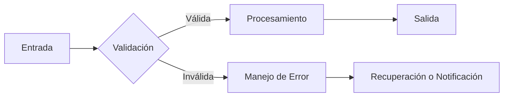
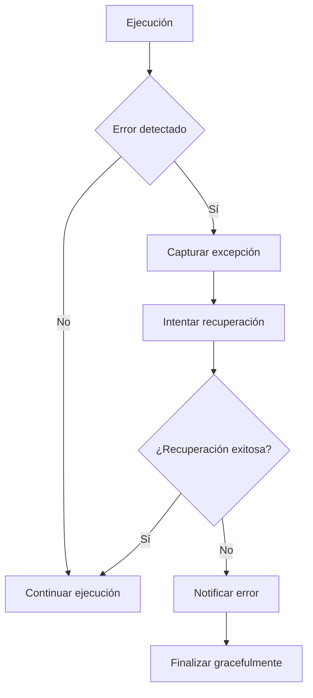

# Ingeniería de Software - Validación y verificación

## 6.4 Manejo de errores.

---

El manejo de errores es un aspecto crítico de la validación y verificación que asegura la robustez y confiabilidad del software. Según Sommerville (2010), "un sistema bien diseñado debe anticipar condiciones excepcionales y manejarlas de manera controlada". El manejo adecuado de errores previene fallos catastróficos y mejora la experiencia del usuario.

### Definiciones Fundamentales

#### Error (Error)

**Definición**: Un error humano en la concepción, diseño o implementación del software que genera un defecto.

#### Defecto (Fault/Bug)

**Definición**: Una manifestación concreta de un error en el código que puede causar un fallo.

#### Fallo (Failure)

**Definición**: La ocurrencia observable de un comportamiento incorrecto del sistema cuando se ejecuta bajo condiciones específicas.

$$ \text{Error} \rightarrow \text{Defecto} \rightarrow \text{Fallo} $$

#### Tasa de Fallos (Failure Rate)

$$ \lambda(t) = \frac{\text{Número de fallos}}{\text{Tiempo de operación}} $$

### Estrategias de Manejo de Errores

#### 1. Defensiva (Prevención)



#### 2. Reactiva (Detección y Recuperación)



### Técnicas de Manejo de Errores

#### Validación de Entradas

**Definición**: Verificar que los datos de entrada cumplen con los criterios esperados antes de su procesamiento.

**Ejemplo**:

```python
def validar_edad(edad):
    """
    Valida que la edad sea un número entero entre 0 y 120
    """
    if not isinstance(edad, int):
        raise TypeError("La edad debe ser un número entero")
    if edad < 0:
        raise ValueError("La edad no puede ser negativa")
    if edad > 120:
        raise ValueError("La edad no puede ser mayor a 120 años")
    return True

# Uso de la validación
try:
    edad_usuario = int(input("Ingrese su edad: "))
    validar_edad(edad_usuario)
    print("Edad válida")
except (TypeError, ValueError) as e:
    print(f"Error: {e}")
```

#### Manejo de Excepciones

**Definición**: Mecanismo estructurado para capturar y manejar condiciones excepcionales.

**Jerarquía de excepciones**:

```python
try:
    # Código que puede generar excepciones
    resultado = proceso_riesgoso()
except ValueError as ve:
    # Manejo específico de ValueError
    print(f"Error de valor: {ve}")
except IOError as ioe:
    # Manejo específico de IOError
    print(f"Error de E/S: {ioe}")
except Exception as e:
    # Manejo genérico de otras excepciones
    print(f"Error inesperado: {e}")
else:
    # Ejecuta si no hubo excepciones
    print(f"Resultado: {resultado}")
finally:
    # Siempre se ejecuta
    print("Limpieza de recursos")
```

#### Aserciones (Assertions)

**Definición**: Verificaciones programáticas que aseguran condiciones específicas durante la ejecución.

**Fórmula de verificación**:

$$ \text{Assert}(\text{condición, mensaje}) = \begin{cases} \text{Continúa} & \text{si } \text{condición} = \text{verdadero} \\\ \text{Lanza AssertionError} & \text{si } \text{condición} = \text{falso} \end{cases} $$

**Ejemplo**:

```python
def dividir(a, b):
    """
    Divide a entre b con validaciones
    """
    assert isinstance(a, (int, float)), "a debe ser numérico"
    assert isinstance(b, (int, float)), "b debe ser numérico"
    assert b != 0, "No se puede dividir por cero"

    return a / b

# Las aserciones se deshabilitan con optimizaciones (-O)
# Para producción, usar validaciones explícitas
```

#### Patrones de Diseño para Manejo de Errores

##### 1. Patrón Strategy para Manejo de Errores

```python
from abc import ABC, abstractmethod

class ErrorHandler(ABC):
    @abstractmethod
    def handle(self, error: Exception, context: dict = None):
        pass

class LoggingHandler(ErrorHandler):
    def handle(self, error: Exception, context: dict = None):
        print(f"ERROR: {error}. Contexto: {context}")

class RetryHandler(ErrorHandler):
    def __init__(self, max_retries: int = 3):
        self.max_retries = max_retries

    def handle(self, error: Exception, context: dict = None):
        if context and context.get('retry_count', 0) < self.max_retries:
            print(f"Reintentando... Intento {context['retry_count'] + 1}")
            return True  # Indicar reintento
        return False  # No reintentar

class NotificationHandler(ErrorHandler):
    def handle(self, error: Exception, context: dict = None):
        # Enviar notificación por email, Slack, etc.
        print(f"NOTIFICACIÓN: Error crítico: {error}")

# Uso del patrón
class ProcesadorConManejoErrores:
    def __init__(self, error_handlers: list):
        self.error_handlers = error_handlers

    def procesar(self, datos):
        for intento in range(3):
            try:
                return self._procesar_datos(datos)
            except Exception as e:
                contexto = {'intento': intento, 'datos': datos}
                for handler in self.error_handlers:
                    if handler.handle(e, contexto):
                        break  # Un manejador decidió manejar el error
                else:
                    raise  # Re-lanzar si ningún manejador lo maneja
```

##### 2. Circuit Breaker Pattern

```python
class CircuitBreaker:
    def __init__(self, failure_threshold=5, reset_timeout=60):
        self.failure_threshold = failure_threshold
        self.reset_timeout = reset_timeout
        self.failure_count = 0
        self.last_failure_time = None
        self.state = "CLOSED"  # OPEN, HALF-OPEN, CLOSED

    def execute(self, operation, *args, **kwargs):
        if self.state == "OPEN":
            if self._should_try_reset():
                self.state = "HALF-OPEN"
            else:
                raise CircuitBreakerOpenError("Circuito abierto")

        try:
            result = operation(*args, **kwargs)
            if self.state == "HALF-OPEN":
                self._reset()
            return result
        except Exception as e:
            self._record_failure()
            raise

    def _should_try_reset(self):
        if self.last_failure_time:
            elapsed = time.time() - self.last_failure_time
            return elapsed > self.reset_timeout
        return False

    def _record_failure(self):
        self.failure_count += 1
        self.last_failure_time = time.time()
        if self.failure_count >= self.failure_threshold:
            self.state = "OPEN"

    def _reset(self):
        self.failure_count = 0
        self.last_failure_time = None
        self.state = "CLOSED"
```

### Manejo de Errores en Diferentes Arquitecturas

#### 1. Aplicaciones Monolíticas

```python
# Middleware de manejo de errores centralizado
@app.errorhandler(404)
def pagina_no_encontrada(error):
    return render_template('404.html'), 404

@app.errorhandler(500)
def error_servidor(error):
    logger.error(f"Error del servidor: {error}")
    return render_template('500.html'), 500

@app.errorhandler(Exception)
def manejo_general_error(error):
    logger.exception("Error no manejado")
    return render_template('error.html', error=error), 500
```

#### 2. Microservicios

```python
# Patrón API Gateway para manejo centralizado de errores
@app.route('/api/<service>/<path:path>', methods=['GET', 'POST', 'PUT', 'DELETE'])
def proxy_service(service, path):
    try:
        service_url = f"http://{service}-service/{path}"
        response = requests.request(
            method=request.method,
            url=service_url,
            headers=dict(request.headers),
            data=request.get_data(),
            cookies=request.cookies,
            allow_redirects=False
        )
        return response.content, response.status_code, response.headers.items()
    except requests.exceptions.ConnectionError:
        return jsonify({"error": f"Servicio {service} no disponible"}), 503
    except Exception as e:
        logger.error(f"Error en gateway: {e}")
        return jsonify({"error": "Error interno del servidor"}), 500
```

#### 3. Programación Asíncrona

```python
async def procesar_tarea_con_reintentos(tarea, max_reintentos=3):
    reintentos = 0
    while reintentos <= max_reintentos:
        try:
            resultado = await tarea.ejecutar()
            return resultado
        except Exception as e:
            reintentos += 1
            if reintentos > max_reintentos:
                logger.error(f"Tarea fallida después de {max_reintentos} reintentos: {e}")
                raise
            await asyncio.sleep(2 ** reintentos)  # Backoff exponencial
            logger.warning(f"Reintento {reintentos} para tarea {tarea.id}")
```

### Métricas y Monitoreo de Errores

#### Métricas Clave

1. **Tasa de Error**:

   $$ \text{Error Rate} = \frac{\text{Número de errores}}{\text{Número de requests}} \times 100\% $$

2. **MTTF (Mean Time To Failure)**:

   $$ \text{MTTF} = \frac{\sum \text{Tiempo entre fallos}}{\text{Número de fallos}} $$

3. **MTTR (Mean Time To Recovery)**:

   $$ \text{MTTR} = \frac{\sum \text{Tiempo de recuperación}}{\text{Número de incidentes}} $$

#### Dashboard de Monitoreo

```python
class ErrorMetricsDashboard:
    def __init__(self):
        self.error_counts = defaultdict(int)
        self.error_timestamps = []
        self.recovery_times = []

    def record_error(self, error_type, timestamp=None):
        self.error_counts[error_type] += 1
        self.error_timestamps.append(timestamp or time.time())

    def record_recovery(self, recovery_time):
        self.recovery_times.append(recovery_time)

    def calculate_mttf(self):
        if len(self.error_timestamps) < 2:
            return 0
        intervals = [self.error_timestamps[i] - self.error_timestamps[i-1]
                    for i in range(1, len(self.error_timestamps))]
        return sum(intervals) / len(intervals) if intervals else 0

    def calculate_mttr(self):
        return sum(self.recovery_times) / len(self.recovery_times) if self.recovery_times else 0

    def error_rate(self, total_requests):
        total_errors = sum(self.error_counts.values())
        return (total_errors / total_requests) * 100 if total_requests else 0
```

### Ejercicios Propuestos

#### Ejercicio 1: Sistema de Validación de Datos

Implementa un sistema de validación para un formulario de registro que incluya:

- Validación de email
- Validación de contraseña (mínimo 8 caracteres, mayúsculas, minúsculas, números)
- Validación de edad (18+ años)
- Manejo adecuado de errores con mensajes descriptivos

#### Ejercicio 2: Patrón Circuit Breaker

Implementa el patrón Circuit Breaker para una llamada a API externa que:

- Se abre después de 5 fallos consecutivos
- Permite reintentos después de 60 segundos
- Vuelve a cerrarse después de 3 éxitos consecutivos

#### Ejercicio 3: Sistema de Logging y Monitoreo

Crea un sistema centralizado de logging que:

- Clasifique errores por criticidad
- Genere métricas de tasa de error y tiempos de recuperación
- Envíe alertas para errores críticos
- Mantenga un historial de incidentes

### Best Practices

#### 1. Logging Efectivo

```python
import logging
import json

class StructuredLogger:
    def __init__(self, name):
        self.logger = logging.getLogger(name)

    def error_with_context(self, message, **context):
        log_data = {
            "message": message,
            "timestamp": time.time(),
            "context": context,
            "level": "ERROR"
        }
        self.logger.error(json.dumps(log_data))

    def warning_with_context(self, message, **context):
        log_data = {
            "message": message,
            "timestamp": time.time(),
            "context": context,
            "level": "WARNING"
        }
        self.logger.warning(json.dumps(log_data))

# Uso
logger = StructuredLogger("mi_aplicacion")
try:
    operacion_riesgosa()
except Exception as e:
    logger.error_with_context(
        "Fallo en operación riesgosa",
        operacion="operacion_riesgosa",
        error=str(e),
        usuario_id=123
    )
```

#### 2. Errores Específicos y Informativos

```python
class MiAplicacionError(Exception):
    """Base exception for the application"""
    pass

class ValidationError(MiAplicacionError):
    def __init__(self, field, message, value=None):
        self.field = field
        self.message = message
        self.value = value
        super().__init__(f"{field}: {message} (valor: {value})")

class DatabaseError(MiAplicacionError):
    pass

class ExternalServiceError(MiAplicacionError):
    def __init__(self, service, operation, original_error=None):
        self.service = service
        self.operation = operation
        self.original_error = original_error
        super().__init__(f"Error calling {service}.{operation}: {original_error}")
```

#### 3. Pruebas de Manejo de Errores

```python
import pytest
from unittest.mock import Mock, patch

def test_validation_error_handling():
    with pytest.raises(ValidationError) as exc_info:
        validar_edad(-5)
    assert "no puede ser negativa" in str(exc_info.value)

def test_circuit_breaker_opens_after_threshold():
    breaker = CircuitBreaker(failure_threshold=3)
    failing_operation = Mock(side_effect=Exception("Falló"))

    for _ in range(3):
        with pytest.raises(Exception):
            breaker.execute(failing_operation)

    # Debe estar abierto después de 3 fallos
    assert breaker.state == "OPEN"
    with pytest.raises(CircuitBreakerOpenError):
        breaker.execute(failing_operation)
```

### Referencias

#### Bibliografía Básica

1. Sommerville, Ian. (2010). _Software Engineering_ (9th edition). Addison Wesley. (Capítulos 19, 20)
2. Pfleeger, S. L., & Atlee, J. M. (2010). _Software Engineering: Theory and Practice_ (4th edition). Prentice Hall. (Capítulos 8, 9)

#### Bibliografía Complementaria

3. Nygard, M. (2018). _Release It! Design and Deploy Production-Ready Software_. Pragmatic Bookshelf.
4. Kleppmann, M. (2017). _Designing Data-Intensive Applications_. O'Reilly Media.
5. Microsoft Patterns & Practices Team. (2007). _Enterprise Integration Patterns_.

### Conclusión

El manejo adecuado de errores es esencial para construir software robusto y confiable. Un sistema bien diseñado anticipa fallos potenciales, los maneja gracefulmente, proporciona información útil para debugging y se recupera automáticamente cuando es posible. La inversión en estrategias efectivas de manejo de errores reduce el tiempo de inactividad, mejora la experiencia del usuario y facilita el mantenimiento del sistema.
