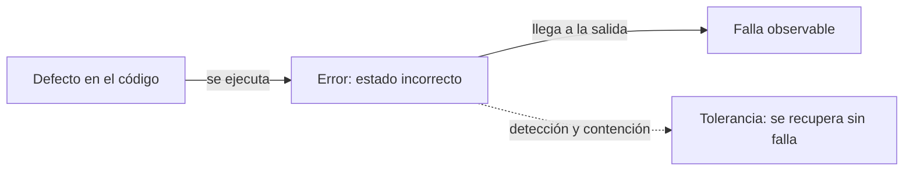

# Ingeniería de Software - Validación y verificación

## 6.4 Manejo de errores.

---

Todo sistema real encuentra errores: entradas inválidas, servicios que no responden, discos llenos, defectos propios. La diferencia entre un sistema robusto y uno frágil no es que el primero no tenga errores, sino que los **detecta** pronto, los **contiene** para que no se propaguen, los **comunica** con claridad a quien puede actuar y se **recupera** cuando es posible. Este tema relaciona el manejo de errores con la verificación y la validación: distingue los tipos de errores y su tratamiento, presenta los principios de diseño, la validación de entradas, los patrones de recuperación y la observabilidad que permite medir y mejorar la confiabilidad.

### Terminología

La norma IEEE 1044 y la tradición de la confiabilidad distinguen tres conceptos encadenados: un **defecto** (*fault*) es una imperfección en el código o el diseño; cuando se ejecuta, puede producir un **error**, un estado interno incorrecto; y si el error llega a la salida, es una **falla** (*failure*), una desviación observable del servicio. La **tolerancia a fallas** busca que los errores no se conviertan en fallas.

### Clases de errores y su tratamiento

- **Errores del usuario o de las entradas:** datos inválidos. Son esperables y se manejan **validando** en la frontera del sistema y respondiendo con mensajes que digan qué corregir, sin excepciones que lleguen al usuario.
- **Errores transitorios del entorno:** un servicio que no responde, un tiempo de espera, un bloqueo. Se manejan con **reintentos** con retroceso, **interruptores de circuito** y **respaldos** (tema 5.5).
- **Errores permanentes del entorno:** un disco lleno, una credencial revocada. No se resuelven reintentando; se informan y se escalan.
- **Defectos del programa:** una precondición violada, un estado imposible. No deben ocultarse: el programa debe **fallar rápido**, registrar el contexto y, en un servidor, abortar solo la petición afectada.

### Principios

- **Fallar rápido:** detectar el error lo más cerca posible de su origen, con aserciones y validación de precondiciones, en lugar de dejar que un dato inválido viaje y cause una falla lejos de su causa.
- **No silenciar:** un `except: pass` convierte una falla visible en un dato corrupto invisible.
- **Manejar en el nivel que puede decidir:** el código que lee un archivo no sabe si su ausencia es grave; quien lo llama sí.
- **Mensajes accionables:** para el usuario, qué pasó y qué hacer, sin detalles internos; para el operador, el contexto completo en el registro.
- **Acumular los errores de validación:** informar todos los campos inválidos a la vez, no uno por intento.
- **Contención:** los mamparos y los límites de recursos evitan que la falla de una parte consuma el sistema completo.

### Observabilidad

Para mejorar la confiabilidad hay que medirla. Un sistema observable produce **registros** estructurados, con nivel de severidad, marca de tiempo y contexto; **métricas**, como la tasa de errores por operación y la latencia, y **trazas** distribuidas que siguen una petición a través de los servicios. Sobre las métricas se definen **objetivos de nivel de servicio** (SLO), como "99.9 % de los pagos exitosos en 30 días", y alertas cuando el consumo del **presupuesto de errores**, el 0.1 % restante, se acelera. Cada incidente se registra con su inicio y su recuperación, para calcular el MTTR, y se analiza en una revisión posterior **sin culpables**, enfocada en las causas sistémicas.



### Implementación en Python

El programa resuelve los tres ejercicios. Valida un formulario de registro acumulando todos los errores con mensajes accionables, incluida la edad exacta con fechas de nacimiento límite; implementa un interruptor de circuito que se abre tras 5 fallas, espera 60 segundos y se cierra tras 3 éxitos consecutivos, con un reloj simulado; y construye un manejador del módulo `logging` de Python que clasifica los registros por severidad, calcula la tasa de errores y el MTTR, emite alertas para los críticos y guarda el historial de incidentes.

```python
import logging, re
from collections import Counter
from datetime import date

# ---------- Ejercicio 1: validación que acumula todos los errores ----------
class ErrorValidacion(Exception):
    def __init__(self, errores): super().__init__(f"{len(errores)} errores"); self.errores = errores
def edad(nacimiento, hoy):
    return hoy.year - nacimiento.year - ((hoy.month, hoy.day) < (nacimiento.month, nacimiento.day))
def valida_registro(datos, hoy=date(2026, 11, 4)):
    errores = {}
    email = datos.get("email", "").strip()
    if not email: errores["email"] = "es obligatorio"
    elif not re.fullmatch(r"[^@\s]+@[^@\s]+\.[A-Za-z]{2,}", email): errores["email"] = "no tiene el formato nombre@dominio.ext"
    pw = datos.get("password", "")
    faltan = [n for n, ok in (("8 caracteres", len(pw) >= 8), ("una mayúscula", re.search("[A-Z]", pw)),
                              ("una minúscula", re.search("[a-z]", pw)), ("un número", re.search(r"\d", pw))) if not ok]
    if faltan: errores["password"] = "le falta: " + ", ".join(faltan)
    try:
        nac = date.fromisoformat(datos.get("nacimiento", ""))
        if nac > hoy: errores["nacimiento"] = "no puede estar en el futuro"
        elif edad(nac, hoy) < 18: errores["nacimiento"] = f"debes tener 18 años; tienes {edad(nac, hoy)}"
    except ValueError: errores["nacimiento"] = "usa el formato AAAA-MM-DD"
    if errores: raise ErrorValidacion(errores)
    return {"email": email.lower(), "nacimiento": nac}
for datos in ({"email": "ana@ejemplo.mx", "password": "Segura123", "nacimiento": "2000-02-29"},
              {"email": "ana@", "password": "corta", "nacimiento": "2008-11-05"},
              {"email": "", "password": "SoloLetrasLargas", "nacimiento": "04/11/2000"},
              {"email": "luis@x.mx", "password": "Segura123", "nacimiento": "2008-11-04"}):
    try: print("ejercicio 1: válido", valida_registro(datos)["email"])
    except ErrorValidacion as e: print("ejercicio 1:", e.errores)

# ---------- Ejercicio 2: circuit breaker con cierre tras 3 éxitos ----------
class Reloj: t = 0.0
class Circuito:
    def __init__(self, fallas=5, espera=60, exitos=3):
        self.lim_f, self.espera, self.lim_e = fallas, espera, exitos
        self.estado, self.f, self.e, self.desde, self.historia = "cerrado", 0, 0, 0.0, []
    def _a(self, s): self.historia.append((Reloj.t, s)); self.estado, self.f, self.e, self.desde = s, 0, 0, Reloj.t
    def llama(self, f):
        if self.estado == "abierto":
            if Reloj.t - self.desde < self.espera: raise RuntimeError("circuito abierto")
            self._a("semiabierto")
        try: r = f()
        except Exception:
            self.f += 1; self.e = 0
            if self.estado == "semiabierto" or self.f >= self.lim_f: self._a("abierto")
            raise
        self.f = 0
        if self.estado == "semiabierto":
            self.e += 1
            if self.e >= self.lim_e: self._a("cerrado")
        return r
caido = lambda: (_ for _ in ()).throw(ConnectionError("sin respuesta"))
def api():
    if 10 <= Reloj.t < 100: caido()
    return "ok"
c = Circuito()
for t in range(0, 200, 5):
    Reloj.t = t
    try: c.llama(api)
    except Exception: pass
print("ejercicio 2: transiciones (segundo, estado):", c.historia)

# ---------- Ejercicio 3: registro centralizado con métricas y alertas ----------
class Monitor(logging.Handler):
    def __init__(self):
        super().__init__(); self.registros, self.alertas, self.incidentes, self.abierto = [], [], [], None
    def emit(self, r):
        self.registros.append((Reloj.t, r.levelname, r.getMessage()))
        if r.levelno >= logging.CRITICAL: self.alertas.append(f"{Reloj.t:.0f}s ALERTA: {r.getMessage()}")
        if r.levelno >= logging.ERROR and self.abierto is None: self.abierto = Reloj.t
        if getattr(r, "recuperado", False) and self.abierto is not None:
            self.incidentes.append((self.abierto, Reloj.t)); self.abierto = None
    def metricas(self):
        n = len(self.registros); errores = sum(1 for _, lv, _ in self.registros if lv in ("ERROR", "CRITICAL"))
        mttr = sum(b - a for a, b in self.incidentes) / len(self.incidentes) if self.incidentes else None
        return {"registros": n, "por nivel": dict(Counter(lv for _, lv, _ in self.registros)), "tasa de error": round(errores / n, 3),
                "incidentes": len(self.incidentes), "MTTR (s)": mttr}
log = logging.getLogger("pagos"); log.setLevel(logging.INFO); log.propagate = False
mon = Monitor(); log.addHandler(mon)
eventos = [(0, "info", "inicio"), (5, "info", "pago 1 ok"), (8, "error", "pasarela no responde"), (9, "error", "pasarela no responde"),
           (12, "critical", "tasa de error alta en pagos"), (40, "info", "pasarela recuperada"), (50, "info", "pago 2 ok"),
           (70, "warning", "latencia alta"), (80, "error", "base de datos: tiempo de espera"), (95, "info", "base de datos recuperada")]
for t, nivel, msg in eventos:
    Reloj.t = t; getattr(log, nivel)(msg, extra={"recuperado": "recuperad" in msg})
print("ejercicio 3:", mon.metricas()); print("   alertas:", mon.alertas, "| historial de incidentes (inicio, fin):", mon.incidentes)
```

Salida:

```text
ejercicio 1: válido ana@ejemplo.mx
ejercicio 1: {'email': 'no tiene el formato nombre@dominio.ext', 'password': 'le falta: 8 caracteres, una mayúscula, un número', 'nacimiento': 'debes tener 18 años; tienes 17'}
ejercicio 1: {'email': 'es obligatorio', 'password': 'le falta: un número', 'nacimiento': 'usa el formato AAAA-MM-DD'}
ejercicio 1: válido luis@x.mx
ejercicio 2: transiciones (segundo, estado): [(30, 'abierto'), (90, 'semiabierto'), (90, 'abierto'), (150, 'semiabierto'), (160, 'cerrado')]
ejercicio 3: {'registros': 10, 'por nivel': {'INFO': 5, 'ERROR': 3, 'CRITICAL': 1, 'WARNING': 1}, 'tasa de error': 0.4, 'incidentes': 2, 'MTTR (s)': 23.5}
   alertas: ['12s ALERTA: tasa de error alta en pagos'] | historial de incidentes (inicio, fin): [(8, 40), (80, 95)]
```

### Ejercicios Propuestos

1. **Validación.** Implementa la validación de un formulario de registro con correo, contraseña de al menos 8 caracteres con mayúsculas, minúsculas y números, y edad de al menos 18 años, con mensajes descriptivos.

2. **Interruptor de circuito.** Implementa un interruptor de circuito que se abra después de 5 fallas consecutivas, permita reintentar después de 60 segundos y se cierre después de 3 éxitos consecutivos.

3. **Registro y monitoreo.** Crea un sistema centralizado de registro que clasifique los errores por criticidad, genere métricas de tasa de error y tiempo de recuperación, envíe alertas de los errores críticos y mantenga un historial de incidentes.

### Soluciones

**Ejercicio 1.** El validador revisa todos los campos y lanza una sola excepción con un diccionario de errores por campo, para que la interfaz los muestre junto a cada uno. La contraseña informa **todas** las condiciones que faltan. La edad se calcula con la fecha de nacimiento, no con la diferencia de años, porque quien nace el 5 de noviembre de 2008 tiene 17 años el 4 de noviembre de 2026; el programa prueba ese caso y el de quien cumple 18 exactamente ese día, que es válido, y una fecha del 29 de febrero. Una fecha mal escrita se reporta como un error de formato en lugar de dejar escapar el `ValueError` interno. Dos decisiones adicionales: la fecha de "hoy" es un parámetro, para que las pruebas sean deterministas, y el validador de correo es deliberadamente permisivo, porque la única verificación real de una dirección es enviarle un mensaje de confirmación.

**Ejercicio 2.** La diferencia con el interruptor del tema 5.5 está en el estado semiabierto: en lugar de cerrarse con un solo éxito, cuenta los éxitos consecutivos y se cierra al tercero; una sola falla lo devuelve a abierto. En la simulación, con una llamada cada 5 segundos y una API caída entre los segundos 10 y 100, el circuito se abre en el segundo 30, tras 5 fallas; en el 90, al cumplirse los 60 segundos, prueba y vuelve a abrirse porque la API sigue caída; en el 150 vuelve a probar, y tras los éxitos de los segundos 150, 155 y 160 se cierra. Exigir varios éxitos evita cerrar el circuito con un servicio que responde de forma intermitente.

**Ejercicio 3.** El sistema se construye sobre el módulo `logging` estándar, con un manejador propio que se agrega al registrador: así cualquier código que ya registre con `logging` queda monitoreado sin cambios. El manejador clasifica por nivel, de `INFO` a `CRITICAL`; calcula la tasa de errores, 0.4 en la secuencia del programa; envía una alerta por cada registro crítico, en el programa a una lista y en producción a un servicio de guardias; y abre un **incidente** con el primer error y lo cierra con el evento de recuperación, para calcular el MTTR, 23.5 segundos en promedio para los dos incidentes. En un sistema real, el registro se envía en formato estructurado, como JSON, a una plataforma centralizada, como la pila de Elasticsearch o Grafana Loki, y las métricas y alertas se calculan allí; el diseño del manejador es el mismo a pequeña escala.

### Referencias

1. Avižienis, A., Laprie, J.-C., Randell, B., and Landwehr, C., Basic concepts and taxonomy of dependable and secure computing. _IEEE Transactions on Dependable and Secure Computing_ 1(1), 2004.
2. Nygard, M. T., _Release It!_. Pragmatic Bookshelf, 2018.
3. Beyer, B., Jones, C., Petoff, J., and Murphy, N. R. (eds.), _Site Reliability Engineering_. O'Reilly, 2016.
4. Shore, J., Fail fast. _IEEE Software_ 21(5), 2004.
5. IEEE 1044-2009, _Standard Classification for Software Anomalies_.
