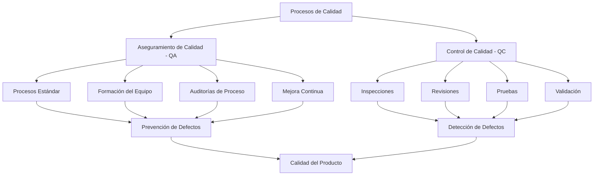
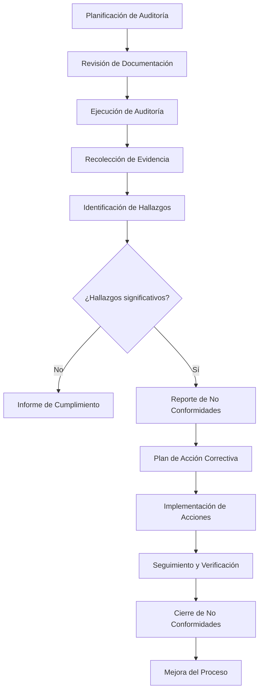

# Ingeniería de Software - Validación y verificación

## 6.6 Procesos de validación y aseguramiento de la calidad.

---

Los procesos de validación y aseguramiento de la calidad son componentes críticos en la ingeniería de software que garantizan que el producto final cumple con los requisitos especificados y las expectativas del cliente. Según Sommerville (2010), "El aseguramiento de la calidad se centra en los procesos utilizados para crear el software, mientras que la validación se centra en el producto resultante".

### Definiciones Fundamentales

#### Aseguramiento de la Calidad (QA)

**Definición**: Conjunto de actividades sistemáticas implementadas en el proceso de desarrollo para garantizar que los productos cumplan con los requisitos de calidad establecidos.

$$ \text{QA Effectiveness} = \frac{\text{Defectos prevenidos}}{\text{Defectos totales}} \times 100\% $$

#### Validación

**Definición**: Proceso de evaluación del software durante o al final del desarrollo para determinar si satisface los requisitos del negocio y las necesidades del usuario.

$$ \text{Validation Coverage} = \frac{\text{Requisitos validados}}{\text{Requisitos totales}} \times 100\% $$

#### Verificación

**Definición**: Proceso de evaluación para determinar si los productos de una fase dada satisfacen las condiciones impuestas al inicio de esa fase.

$$ \text{Verification Efficiency} = \frac{\text{Artefactos verificados}}{\text{Artefactos totales}} \times 100\% $$

### Marco de Trabajo para QA y Validación



### Procesos Clave de Aseguramiento de Calidad

#### 1. Planificación de la Calidad

**Definición**: proceso de identificación de los estándares de calidad relevantes y determinar cómo satisfacerlos.

**Componentes**:

- Estándares de calidad aplicables
- Métricas y criterios de aceptación
- Procesos de auditoría
- Responsabilidades del equipo

#### 2. Garantía de Calidad del Proceso

**Ejemplo de plan de calidad**:

```python
class QualityPlan:
    def __init__(self, project_scope, quality_standards):
        self.scope = project_scope
        self.standards = quality_standards
        self.metrics = {}
        self.audit_schedule = []
        self.responsibilities = {}

    def add_quality_metric(self, metric_name, target_value, tolerance):
        self.metrics[metric_name] = {
            'target': target_value,
            'tolerance': tolerance,
            'actual': None,
            'status': 'Not Measured'
        }

    def record_measurement(self, metric_name, actual_value):
        if metric_name in self.metrics:
            self.metrics[metric_name]['actual'] = actual_value
            target = self.metrics[metric_name]['target']
            tolerance = self.metrics[metric_name]['tolerance']

            if abs(actual_value - target) <= tolerance:
                self.metrics[metric_name]['status'] = 'Met'
            else:
                self.metrics[metric_name]['status'] = 'Not Met'

    def generate_quality_report(self):
        report = {
            'summary': {
                'total_metrics': len(self.metrics),
                'met_metrics': sum(1 for m in self.metrics.values() if m['status'] == 'Met'),
                'not_met_metrics': sum(1 for m in self.metrics.values() if m['status'] == 'Not Met')
            },
            'details': self.metrics
        }
        return report

# Uso del plan de calidad
project_plan = QualityPlan("E-commerce Platform", ["ISO-9001", "IEEE-730"])
project_plan.add_quality_metric("Test Coverage", 90, 5)
project_plan.add_quality_metric("Defect Density", 0.1, 0.05)
project_plan.add_quality_metric("Code Duplication", 5, 2)

project_plan.record_measurement("Test Coverage", 92)
project_plan.record_measurement("Defect Density", 0.08)
project_plan.record_measurement("Code Duplication", 4)

print(project_plan.generate_quality_report())
```

### Procesos de Validación

#### 1. Revisiones e Inspecciones

**Definición**: Examen formal de los productos de trabajo del software por individuos diferentes a los autores.

**Tipos**:

- **Revisiones informales**: Walkthroughs y revisiones técnicas
- **Inspecciones formales**: Procesos estructurados con roles definidos

#### 2. Procesos de Prueba

**Estrategias de prueba**:

- Pruebas unitarias
- Pruebas de integración
- Pruebas de sistema
- Pruebas de aceptación

#### 3. Validación con Usuarios

**Técnicas**:

- Pruebas de aceptación por usuarios (UAT)
- Prototipado y feedback
- Pruebas beta y pilotos

### Métricas de Calidad del Software

#### Métricas de Producto

$$ \text{Defect Density} = \frac{\text{Número de defectos}}{\text{Tamaño del software (KLDC)}} $$

$$ \text{Test Coverage} = \frac{\text{Líneas cubiertas por pruebas}}{\text{Líneas totales de código}} \times 100\% $$

$$ \text{Mean Time To Failure (MTTF)} = \frac{\sum \text{Tiempo entre fallos}}{\text{Número de fallos}} $$

#### Métricas de Proceso

$$ \text{Defect Removal Efficiency (DRE)} = \frac{\text{Defectos encontrados durante desarrollo}}{\text{Defectos totales}} \times 100\% $$

$$ \text{Review Efficiency} = \frac{\text{Defectos encontrados en revisiones}}{\text{Defectos totales encontrados}} \times 100\% $$

### Implementación de Sistemas de Calidad

#### Sistema de Gestión de Calidad

```python
class QualityManagementSystem:
    def __init__(self, organization_name, applicable_standards):
        self.organization = organization_name
        self.standards = applicable_standards
        self.processes = {}
        self.quality_records = []
        self.non_conformities = []

    def define_process(self, process_name, description, inputs, outputs, metrics):
        self.processes[process_name] = {
            'description': description,
            'inputs': inputs,
            'outputs': outputs,
            'metrics': metrics,
            'improvements': []
        }

    def record_quality_measurement(self, process_name, metric_name, value, timestamp):
        record = {
            'process': process_name,
            'metric': metric_name,
            'value': value,
            'timestamp': timestamp,
            'status': self._evaluate_metric(process_name, metric_name, value)
        }
        self.quality_records.append(record)
        return record

    def _evaluate_metric(self, process_name, metric_name, value):
        process = self.processes.get(process_name)
        if process and metric_name in process['metrics']:
            target = process['metrics'][metric_name]['target']
            tolerance = process['metrics'][metric_name]['tolerance']
            if abs(value - target) <= tolerance:
                return 'Within Limits'
        return 'Out of Limits'

    def record_non_conformity(self, process_name, description, severity, corrective_action):
        nc = {
            'id': len(self.non_conformities) + 1,
            'process': process_name,
            'description': description,
            'severity': severity,
            'corrective_action': corrective_action,
            'status': 'Open',
            'created_date': datetime.now(),
            'closed_date': None
        }
        self.non_conformities.append(nc)
        return nc

    def generate_quality_report(self, start_date, end_date):
        filtered_records = [r for r in self.quality_records
                          if start_date <= r['timestamp'] <= end_date]

        report = {
            'period': {'start': start_date, 'end': end_date},
            'total_measurements': len(filtered_records),
            'within_limits': sum(1 for r in filtered_records if r['status'] == 'Within Limits'),
            'out_of_limits': sum(1 for r in filtered_records if r['status'] == 'Out of Limits'),
            'non_conformities': [nc for nc in self.non_conformities
                               if nc['created_date'] <= end_date and
                               (nc['closed_date'] is None or nc['closed_date'] >= start_date)]
        }

        report['compliance_rate'] = (report['within_limits'] / report['total_measurements'] * 100
                                    if report['total_measurements'] > 0 else 0)

        return report

# Ejemplo de uso
qms = QualityManagementSystem("TechCorp", ["ISO-9001", "CMMI Level 3"])
qms.define_process(
    "Code Review",
    "Formal review of source code by peers",
    ["Source Code", "Coding Standards"],
    ["Reviewed Code", "Defect Report"],
    {"review_coverage": {"target": 100, "tolerance": 5},
     "defects_found": {"target": 10, "tolerance": 3}}
)
```

### Proceso de Auditoría de Calidad



### Ejercicios Propuestos

#### Ejercicio 1: Diseño de Plan de Calidad

Desarrolla un plan de calidad completo para un sistema de comercio electrónico que incluya:

- Métricas de calidad del producto
- Procesos de aseguramiento de calidad
- Estrategias de validación
- Plan de auditorías

#### Ejercicio 2: Análisis de Métricas

Dados los siguientes datos de un proyecto:

- Tamaño del software: 50 KLDC
- Defectos encontrados en desarrollo: 120
- Defectos encontrados en producción: 30
- Cobertura de pruebas: 85%
- Tiempo total de pruebas: 200 horas

Calcula:

1. Densidad de defectos
2. Eficiencia en remoción de defectos (DRE)
3. Evalúa si la cobertura de pruebas es adecuada

#### Ejercicio 3: Sistema de Gestión de No Conformidades

Implementa un sistema para gestionar no conformidades que permita:

- Registrar no conformidades
- Asignar acciones correctivas
- Realizar seguimiento
- Generar reportes de efectividad

### Técnicas de Mejora Continua

#### Ciclo PDCA (Plan-Do-Check-Act)

**Implementación**:

```python
class PDCACycle:
    def __init__(self, process_name):
        self.process_name = process_name
        self.cycles = []

    def plan(self, objectives, metrics, target_values):
        cycle = {
            'phase': 'Plan',
            'objectives': objectives,
            'metrics': metrics,
            'targets': target_values,
            'start_date': datetime.now(),
            'status': 'In Progress'
        }
        self.cycles.append(cycle)

    def do(self, implementation_details):
        current_cycle = self._get_current_cycle()
        current_cycle['implementation'] = implementation_details
        current_cycle['do_date'] = datetime.now()

    def check(self, actual_results):
        current_cycle = self._get_current_cycle()
        current_cycle['actual_results'] = actual_results
        current_cycle['check_date'] = datetime.now()

        # Análisis de variación
        variations = {}
        for metric, target in current_cycle['targets'].items():
            if metric in actual_results:
                variations[metric] = actual_results[metric] - target

        current_cycle['variations'] = variations
        current_cycle['analysis'] = self._analyze_variations(variations)

    def act(self, corrective_actions, lessons_learned):
        current_cycle = self._get_current_cycle()
        current_cycle['corrective_actions'] = corrective_actions
        current_cycle['lessons_learned'] = lessons_learned
        current_cycle['act_date'] = datetime.now()
        current_cycle['status'] = 'Completed'

    def _get_current_cycle(self):
        return self.cycles[-1] if self.cycles else None

    def _analyze_variations(self, variations):
        analysis = {}
        for metric, variation in variations.items():
            if abs(variation) <= self._get_tolerance(metric):
                analysis[metric] = 'Within Acceptable Limits'
            else:
                analysis[metric] = 'Needs Corrective Action'
        return analysis

    def get_improvement_history(self):
        return self.cycles
```

### Referencias

#### Bibliografía Básica

1. Sommerville, Ian. (2010). _Software Engineering_ (9th edition). Addison Wesley. (Capítulos 19, 24, 27)
2. Pfleeger, S. L., & Atlee, J. M. (2010). _Software Engineering: Theory and Practice_ (4th edition). Prentice Hall. (Capítulos 8, 9, 10)

#### Bibliografía Complementaria

3. ISO 9001:2015 - Quality management systems
4. CMMI Institute. (2018). _CMMI for Development, Version 2.0_
5. IEEE Std 730-2014 - IEEE Standard for Software Quality Assurance Processes

### Conclusión

Los procesos de validación y aseguramiento de la calidad son esenciales para entregar software que cumpla con los requisitos y expectativas de los stakeholders. Un enfoque sistemático que combine QA preventivo con QC de detección, apoyado por métricas objetivas y mejora continua, permite a las organizaciones desarrollar productos de alta calidad de manera consistente. La implementación efectiva de estos procesos requiere compromiso organizacional, definición clara de estándares y una cultura de calidad permeada en todos los niveles del equipo de desarrollo.
