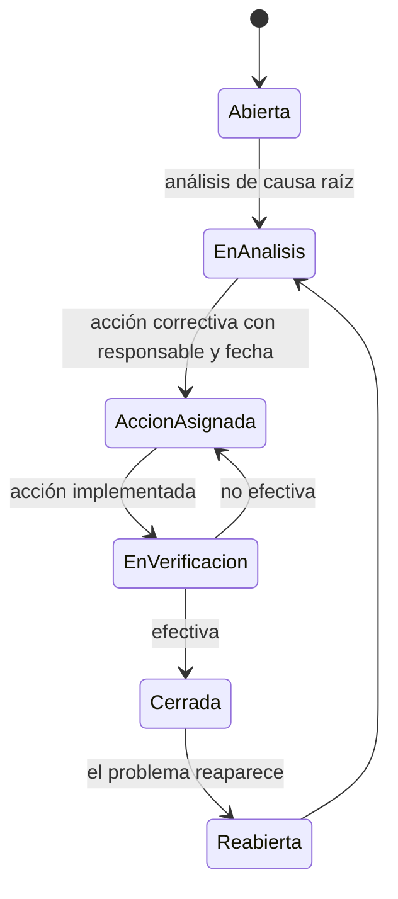

# Ingeniería de Software - Validación y verificación

## 6.6 Procesos de validación y aseguramiento de la calidad.

---

La calidad de un software no se logra probándolo al final: se construye con un proceso que la previene, la mide y la mejora. El **aseguramiento de la calidad** (QA) es el conjunto de actividades planeadas que dan confianza de que el producto y el proceso cumplen sus requisitos de calidad; el **control de calidad** (QC) son las actividades que inspeccionan el producto para encontrar defectos, como las pruebas y las revisiones. Este tema presenta los modelos de calidad del producto y del proceso, el plan de calidad, las métricas que permiten gestionarla, las auditorías, la gestión de no conformidades y la mejora continua.

### Calidad del producto y del proceso

- **Del producto:** se especifica con un modelo como ISO/IEC 25010, con sus características (temas 1.1 y 5.2), cada una con métricas y umbrales.
- **Del proceso:** se evalúa con modelos de madurez como **CMMI**, en cinco niveles, de inicial, con procesos impredecibles, a en optimización, con mejora continua basada en datos; y con sistemas de gestión como **ISO 9001**, aplicado al software con la guía ISO/IEC/IEEE 90003.

La premisa de la gestión de la calidad, heredada de Deming y de la manufactura, es que la calidad del producto depende de la calidad del proceso que lo produce.

### Plan de calidad

Un plan de calidad, según IEEE 730, define para un proyecto:

- los **objetivos** de calidad medibles del producto;
- los **estándares** que se siguen, de codificación, de documentación y de pruebas;
- las **actividades** de QA y QC en cada fase: revisiones, inspecciones, análisis estático, niveles de prueba, auditorías;
- las **métricas**, sus umbrales y cómo se reportan;
- la **gestión de problemas**: cómo se registran, priorizan y resuelven los defectos y las no conformidades;
- los **roles** y su independencia: quién verifica a quién.

### Métricas

- **Densidad de defectos:** defectos por KLOC o por punto de función. La densidad **entregada**, los encontrados en producción, es la que siente el usuario.
- **Eficiencia de eliminación de defectos** (DRE, tema 1.5): la fracción de los defectos que se eliminan antes de la entrega. Capers Jones la propone como la métrica de calidad más importante; sus datos dan un promedio de alrededor de 85 % en Estados Unidos, con los mejores proyectos por encima de 95 %, y muestran que solo se llega allí combinando inspecciones, análisis estático y pruebas, porque cada técnica por separado elimina entre 30 y 60 % de los defectos.
- **Cobertura** de requerimientos y de código (tema 6.2), y puntaje de mutación.
- **Defectos por fase de origen y de detección:** muestran dónde se introducen los defectos y cuánto tardan en encontrarse.
- **Tiempo medio de corrección** y **tasa de reapertura**.

### Auditorías y no conformidades

Una **auditoría** es una revisión independiente que verifica que el proyecto sigue los procesos y estándares acordados. Lo que no los cumple es una **no conformidad**, que se gestiona con un ciclo: registro; **análisis de causa raíz**, con técnicas como los cinco porqués o el diagrama de Ishikawa; **acción correctiva**, que elimina la causa, no solo el síntoma, con un responsable y una fecha límite; **verificación de la efectividad**, que la no conformidad no se repita, y cierre. Una no conformidad que reaparece después de cerrada indica que la acción atacó un síntoma.

### Mejora continua

El ciclo **PDCA** de Shewhart y Deming, planear, hacer, verificar y actuar, estructura la mejora: se planea un cambio con una meta medible, se aplica a pequeña escala, se compara el resultado con la meta y se adopta, se ajusta o se descarta. Las **retrospectivas** ágiles son un ciclo PDCA por iteración.



### Implementación en Python

El programa resuelve el ejercicio 2 con las métricas del enunciado, comparadas con los niveles de referencia de DRE. Para el ejercicio 3 implementa el registro de no conformidades con el ciclo del diagrama, que rechaza las transiciones inválidas y exige la acción correctiva, y genera un informe con los estados, las causas, el tiempo hasta el cierre, la efectividad y las vencidas.

```python
from collections import Counter
from dataclasses import dataclass, field
from datetime import date

# ---------- Ejercicio 2: métricas de calidad ----------
kloc, dev, prod, cobertura, horas = 50, 120, 30, 0.85, 200
print(f"ejercicio 2: densidad total {(dev + prod) / kloc:.1f} defectos/KLOC | entregada {prod / kloc:.1f} defectos/KLOC")
print(f"   DRE = {dev}/({dev} + {prod}) = {dev / (dev + prod):.0%} | defectos encontrados por hora de prueba {dev / horas:.2f}")
for referencia, dre in (("cercana al promedio según Jones", 0.85), ("organizaciones de alto desempeño", 0.95)):
    print(f"   con DRE de {dre:.0%} ({referencia}), quedarían {(dev + prod) * (1 - dre):.1f} defectos en producción en lugar de {prod}")

# ---------- Ejercicio 3: gestión de no conformidades ----------
FLUJO = {"abierta": ["en análisis"], "en análisis": ["acción asignada"], "acción asignada": ["en verificación"],
         "en verificación": ["cerrada", "acción asignada"], "cerrada": ["reabierta"], "reabierta": ["en análisis"]}
@dataclass
class NoConformidad:
    id: str; descripcion: str; area: str; severidad: str; detectada: date
    estado: str = "abierta"; causa: str = ""; accion: str = ""; responsable: str = ""; limite: date | None = None
    historial: list = field(default_factory=list)
    def avanza(self, nuevo, hoy, **datos):
        if nuevo not in FLUJO[self.estado]: raise ValueError(f"{self.id}: de '{self.estado}' no se puede pasar a '{nuevo}'")
        if nuevo == "acción asignada" and not (datos.get("accion") or self.accion) : raise ValueError(f"{self.id}: falta la acción correctiva")
        if nuevo == "en análisis" or nuevo == "acción asignada":
            for k, v in datos.items(): setattr(self, k, v)
        self.historial.append((hoy, self.estado, nuevo)); self.estado = nuevo
        return self
class Registro:
    def __init__(self): self.ncs = {}
    def registra(self, nc): self.ncs[nc.id] = nc; return nc
    def reporte(self, hoy):
        cerradas = [n for n in self.ncs.values() if n.estado == "cerrada"]
        reabiertas = [n for n in self.ncs.values() if any(d == "reabierta" for _, _, d in n.historial)]
        alguna = [n for n in self.ncs.values() if any(d == "cerrada" for _, _, d in n.historial)]
        dias = [(next(f for f, _, d in reversed(n.historial) if d == "cerrada") - n.detectada).days for n in cerradas]
        vencidas = [n.id for n in self.ncs.values() if n.limite and n.limite < hoy and n.estado != "cerrada"]
        return {"total": len(self.ncs), "por estado": dict(Counter(n.estado for n in self.ncs.values())),
                "por causa": dict(Counter(n.causa for n in self.ncs.values() if n.causa)),
                "días medios hasta el cierre": sum(dias) / len(dias) if dias else None,
                "efectividad (cerradas alguna vez sin reapertura)": f"{sum(1 for n in alguna if n not in reabiertas)}/{len(alguna)}",
                "vencidas": vencidas}
r = Registro()
a = r.registra(NoConformidad("NC-1", "pruebas de regresión omitidas en una entrega", "QA", "mayor", date(2026, 9, 1)))
a.avanza("en análisis", date(2026, 9, 2), causa="proceso").avanza("acción asignada", date(2026, 9, 4), accion="regresión obligatoria en el pipeline",
         responsable="Luis", limite=date(2026, 9, 30)).avanza("en verificación", date(2026, 9, 20)).avanza("cerrada", date(2026, 9, 25))
b = r.registra(NoConformidad("NC-2", "requerimiento sin criterio de aceptación", "Análisis", "menor", date(2026, 9, 10)))
b.avanza("en análisis", date(2026, 9, 11), causa="capacitación").avanza("acción asignada", date(2026, 9, 12), accion="plantilla con criterio obligatorio",
         responsable="Ana", limite=date(2026, 10, 15)).avanza("en verificación", date(2026, 10, 1)).avanza("cerrada", date(2026, 10, 3))
b.avanza("reabierta", date(2026, 10, 20)).avanza("en análisis", date(2026, 10, 21), causa="herramienta")
c = r.registra(NoConformidad("NC-3", "auditoría: sin revisión de código en 3 PR", "Desarrollo", "mayor", date(2026, 10, 5)))
c.avanza("en análisis", date(2026, 10, 6), causa="proceso").avanza("acción asignada", date(2026, 10, 7), accion="regla de protección de rama",
         responsable="Eva", limite=date(2026, 10, 31))
try: c.avanza("cerrada", date(2026, 11, 1))
except ValueError as e: print("ejercicio 3:", e)
for k, v in r.reporte(date(2026, 11, 4)).items(): print(f"   {k}: {v}")
```

Salida:

```text
ejercicio 2: densidad total 3.0 defectos/KLOC | entregada 0.6 defectos/KLOC
   DRE = 120/(120 + 30) = 80% | defectos encontrados por hora de prueba 0.60
   con DRE de 85% (cercana al promedio según Jones), quedarían 22.5 defectos en producción en lugar de 30
   con DRE de 95% (organizaciones de alto desempeño), quedarían 7.5 defectos en producción en lugar de 30
ejercicio 3: NC-3: de 'acción asignada' no se puede pasar a 'cerrada'
   total: 3
   por estado: {'cerrada': 1, 'en análisis': 1, 'acción asignada': 1}
   por causa: {'proceso': 2, 'herramienta': 1}
   días medios hasta el cierre: 24.0
   efectividad (cerradas alguna vez sin reapertura): 1/2
   vencidas: ['NC-2', 'NC-3']
```

### Ejercicios Propuestos

1. **Plan de calidad.** Desarrolla un plan de calidad para un sistema de comercio electrónico, con métricas de calidad del producto, procesos de aseguramiento, estrategias de validación y un plan de auditorías.

2. **Métricas.** Un software de 50 KLOC tuvo 120 defectos encontrados en desarrollo y 30 en producción, con una cobertura de pruebas de 85 % y 200 horas de pruebas. Calcula la densidad de defectos y la eficiencia de eliminación de defectos, y evalúa si la cobertura es adecuada.

3. **No conformidades.** Implementa un sistema para registrar no conformidades, asignar acciones correctivas, darles seguimiento y generar informes de efectividad.

### Soluciones

**Ejercicio 1.**

- **Métricas del producto:** disponibilidad mensual ≥ 99.9 %; percentil 95 del tiempo de carga de las páginas de producto < 2 s; cero vulnerabilidades críticas o altas abiertas; densidad de defectos entregada < 0.5 por KLOC; tasa de abandono del pago atribuible a errores < 1 %.
- **Aseguramiento:** revisión de código obligatoria en cada cambio; análisis estático y de dependencias en la integración continua; definición de terminado con pruebas automatizadas; inspección de los requerimientos de pago y de privacidad.
- **Validación:** pruebas de usabilidad del flujo de compra con 5 a 8 usuarios por versión mayor; pruebas A/B de los cambios en el pago; lanzamientos graduales a un porcentaje de usuarios con monitoreo de métricas de negocio.
- **Auditorías:** trimestral de procesos, que verifica en una muestra de cambios que tuvieran revisión, pruebas y aprobación; anual de seguridad y de cumplimiento de PCI DSS, por un tercero, y revisión de cada incidente grave.

**Ejercicio 2.** La densidad total es $(120 + 30) / 50 = 3$ defectos por KLOC, y la entregada $30 / 50 = 0.6.$ La DRE es $120 / 150 = 80\,\%,$ por debajo del promedio de alrededor de 85 % de los datos de Jones y lejos del 95 % de los mejores: uno de cada cinco defectos llegó a producción. Con 95 %, habrían llegado 7.5 en lugar de 30. Las pruebas encontraron 0.6 defectos por hora. Sobre la cobertura: 85 % es una cifra razonable como **piso**, pero no se puede evaluar sola. Que con 85 % de cobertura escape el 20 % de los defectos indica que el problema no es cuánto código se ejecuta, sino qué tan bien se comprueba y qué otras técnicas faltan: conviene medir la mutación (tema 6.1), analizar en qué fase se originaron los 30 defectos de producción y agregar inspecciones de requerimientos y diseño si la mayoría vienen de ahí.

**Ejercicio 3.** Es el programa. Cada no conformidad tiene un estado del ciclo, y la clase rechaza las transiciones que el ciclo no permite, como cerrar una no conformidad cuya acción no se ha verificado, y exige una acción correctiva para asignarla. El informe muestra los estados y las causas, el tiempo medio hasta el cierre, 24 días; las **vencidas**, cuya fecha límite pasó sin cerrarse, y la **efectividad**, la fracción de las cerradas alguna vez que no se reabrieron: 1 de 2, porque NC-2 reapareció y su nuevo análisis identificó una causa distinta, la herramienta y no la capacitación. Esa reapertura es la señal más útil del informe: la primera acción atacó un síntoma. Que 2 de las 3 no conformidades tengan como causa el proceso sugiere también una acción a nivel de la organización, no solo del proyecto.

### Referencias

1. IEEE 730-2014, _Standard for Software Quality Assurance Processes_.
2. Jones, C., and Bonsignour, O., _The Economics of Software Quality_. Addison-Wesley, 2011.
3. CMMI Institute, _CMMI Model V2.0_, 2018.
4. ISO/IEC/IEEE 90003:2018, _Software engineering: Guidelines for the application of ISO 9001:2015 to computer software_.
5. Deming, W. E., _Out of the Crisis_. MIT Press, 1986.
