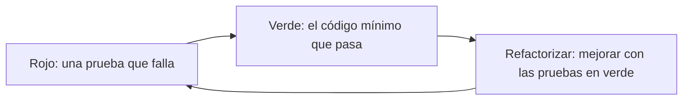

# Ingeniería de Software - Validación y verificación

## 6.7 Desarrollo guiado por pruebas.

---

El **desarrollo guiado por pruebas** (TDD, *test-driven development*) invierte el orden habitual: primero se escribe una prueba que falla, después el código mínimo que la hace pasar, y después se mejora el diseño sin cambiar el comportamiento. Kent Beck lo formuló como práctica de la programación extrema y lo describió en su libro de 2002. Aunque su nombre habla de pruebas, su objetivo principal es el **diseño**: escribir primero cómo se usará el código lleva a interfaces simples, dependencias explícitas y módulos pequeños, y deja como subproducto una batería de pruebas de regresión. Este tema presenta el ciclo, sus reglas, sus variantes, la evidencia empírica sobre sus efectos y su aplicación al código heredado.

### El ciclo

1. **Rojo:** escribir una prueba pequeña para el siguiente comportamiento, y verla fallar. Que falle es importante: confirma que la prueba sí comprueba algo.
2. **Verde:** escribir el código **mínimo** para que pase, aunque sea ingenuo.
3. **Refactorizar:** mejorar la estructura del código y de las pruebas, eliminando duplicación, con todas las pruebas en verde.

Cada vuelta dura minutos. Las **tres leyes** de Martin lo hacen estricto: no escribir código de producción salvo para hacer pasar una prueba que falla; no escribir más prueba de la necesaria para fallar; no escribir más código del necesario para pasar. Beck describe tres formas de llegar al verde: **fingirlo**, devolviendo una constante; **triangular**, agregando un segundo ejemplo que obliga a generalizar, y la **implementación obvia**, cuando es evidente.

### Variantes

- **Escuela de Chicago o clásica:** se prueba el comportamiento observable, con objetos reales siempre que se pueda, y el diseño emerge de la refactorización.
- **Escuela de Londres o de simulaciones:** se diseña de afuera hacia adentro, empezando por la prueba de aceptación y descubriendo los colaboradores con mocks, como en el libro de Freeman y Pryce.
- **ATDD y BDD:** las pruebas de aceptación, escritas con el cliente en lenguaje del dominio, guían el desarrollo de cada historia (tema 4.5), y el TDD unitario guía su implementación.

### Evidencia

Los estudios empíricos dan resultados mixtos. Un estudio en IBM y Microsoft de Nagappan y otros (2008) encontró una densidad de defectos entre 40 y 90 % menor en los equipos que usaban TDD, con un tiempo de desarrollo inicial entre 15 y 35 % mayor. Otros estudios controlados, como el de Fucci y otros (2017), encontraron que el efecto en la calidad y la productividad se explica más por trabajar en ciclos cortos y uniformes que por escribir la prueba primero. Lo consistente es que TDD produce más pruebas y una cobertura mayor, y que sus beneficios dependen de la disciplina del equipo.

### Código heredado

Feathers define el **código heredado** como código sin pruebas. Antes de cambiarlo, se escriben **pruebas de caracterización**, que documentan lo que el código **hace**, no lo que debería hacer: se ejecuta con entradas variadas y se fijan las salidas observadas. Con ellas como red de seguridad se refactoriza, y cualquier diferencia es una señal. Para el código difícil de probar, Feathers cataloga técnicas para romper dependencias, como extraer una interfaz o introducir un parámetro.



### Implementación en Python

El programa contiene el resultado de los tres ejercicios con sus pruebas, que se ejecutan al final. Las pruebas de la calculadora están numeradas en el orden en que se escribieron, cada una antes del código que la satisface. Para el código heredado, las pruebas de caracterización incluyen 2 000 listas aleatorias que comparan la versión refactorizada con la original. El servicio de tareas se desarrolló prueba por prueba, incluidas las validaciones.

```python
import io, random, re, unittest

# ---------- Ejercicio 1: StringCalculator, con las pruebas en el orden en que se escribieron ----------
class StringCalculator:
    def add(self, texto: str) -> int:
        if not texto: return 0
        delims = [",", "\n"]
        if texto.startswith("//"):
            cabecera, texto = texto[2:].split("\n", 1)
            delims += re.findall(r"\[(.+?)\]", cabecera) or [cabecera]          # //;  o  //[***][%%]
        numeros = [int(x) for x in re.split("|".join(map(re.escape, delims)), texto)]
        negativos = [n for n in numeros if n < 0]
        if negativos: raise ValueError(f"negativos no permitidos: {negativos}")
        return sum(n for n in numeros if n <= 1000)
class TestStringCalculator(unittest.TestCase):          # cada prueba se escribió fallando, antes del código que la satisface
    c = StringCalculator()
    def test_01_vacia(self): self.assertEqual(self.c.add(""), 0)
    def test_02_un_numero(self): self.assertEqual(self.c.add("7"), 7)
    def test_03_dos_numeros(self): self.assertEqual(self.c.add("1,2"), 3)
    def test_04_muchos(self): self.assertEqual(self.c.add("1,2,3,4,5"), 15)
    def test_05_salto_de_linea(self): self.assertEqual(self.c.add("1\n2,3"), 6)
    def test_06_delimitador_propio(self): self.assertEqual(self.c.add("//;\n1;2"), 3)
    def test_07_negativos(self):
        with self.assertRaisesRegex(ValueError, r"\[-1, -3\]"): self.c.add("-1,2,-3")
    def test_08_mayores_a_1000(self): self.assertEqual(self.c.add("2,1000,1001"), 1002)
    def test_09_delimitador_largo(self): self.assertEqual(self.c.add("//[***]\n1***2***3"), 6)
    def test_10_varios_delimitadores(self): self.assertEqual(self.c.add("//[*][%%]\n1*2%%3"), 6)

# ---------- Ejercicio 2: pruebas de caracterización antes de refactorizar ----------
def process_data(data):                                   # código heredado, sin tocar
    result = []
    for item in data:
        if item > 0:
            if item % 2 == 0: result.append(item * 2)
            else: result.append(item + 10)
        else: result.append(0)
    return result
def transforma(x): return 0 if x <= 0 else x * 2 if x % 2 == 0 else x + 10
def process_data_nuevo(data): return [transforma(x) for x in data]
class TestCaracterizacion(unittest.TestCase):
    def test_casos_puntuales(self):                        # documentan lo que el código hace hoy, sea o no lo deseado
        self.assertEqual(process_data([]), [])
        self.assertEqual(process_data([-3, 0, 1, 2, 7, 8]), [0, 0, 11, 4, 17, 16])
        self.assertEqual(process_data([2.0, 2.5]), [4.0, 12.5])  # ¡acepta flotantes!
    def test_equivalencia_aleatoria(self):
        rng = random.Random(3)
        for _ in range(2000):
            datos = [rng.randint(-50, 50) for _ in range(rng.randint(0, 20))]
            self.assertEqual(process_data_nuevo(datos), process_data(datos))
    def test_nuevo_con_flotantes(self): self.assertEqual(process_data_nuevo([2.0, 2.5]), process_data([2.0, 2.5]))

# ---------- Ejercicio 3: servicio de tareas, guiado por pruebas ----------
class ErrorValidacion(ValueError): pass
class Tareas:
    PRIORIDADES = ("baja", "media", "alta")
    def __init__(self): self.datos, self.sig = {}, 1
    def crea(self, titulo, prioridad="media"):
        if not isinstance(titulo, str) or not titulo.strip(): raise ErrorValidacion("el título es obligatorio")
        if prioridad not in self.PRIORIDADES: raise ErrorValidacion(f"prioridad inválida: {prioridad}")
        t = {"id": self.sig, "titulo": titulo.strip(), "prioridad": prioridad, "completada": False}
        self.datos[self.sig] = t; self.sig += 1; return dict(t)
    def lee(self, i):
        if i not in self.datos: raise KeyError(i)
        return dict(self.datos[i])
    def actualiza(self, i, **cambios):
        t = self.lee(i); permitidos = {"titulo", "prioridad", "completada"}
        if set(cambios) - permitidos: raise ErrorValidacion(f"campos no editables: {sorted(set(cambios) - permitidos)}")
        nuevo = t | cambios
        if nuevo["prioridad"] not in self.PRIORIDADES: raise ErrorValidacion("prioridad inválida")
        self.datos[i] = nuevo; return dict(nuevo)
    def completa(self, i): return self.actualiza(i, completada=True)
    def elimina(self, i): self.lee(i); del self.datos[i]
    def filtra(self, completada=None, prioridad=None):
        return [dict(t) for t in self.datos.values() if (completada is None or t["completada"] == completada) and (prioridad is None or t["prioridad"] == prioridad)]
class TestTareas(unittest.TestCase):
    def setUp(self): self.s = Tareas()
    def test_crea_y_lee(self): t = self.s.crea("  Comprar pan "); self.assertEqual(self.s.lee(t["id"])["titulo"], "Comprar pan")
    def test_titulo_vacio(self):
        with self.assertRaises(ErrorValidacion): self.s.crea("   ")
    def test_prioridad_invalida(self):
        with self.assertRaises(ErrorValidacion): self.s.crea("x", "urgente")
    def test_completa_y_filtra(self):
        a, b = self.s.crea("a", "alta"), self.s.crea("b"); self.s.completa(a["id"])
        self.assertEqual([t["titulo"] for t in self.s.filtra(completada=False)], ["b"])
        self.assertEqual([t["titulo"] for t in self.s.filtra(prioridad="alta", completada=True)], ["a"])
    def test_no_edita_id(self):
        t = self.s.crea("a")
        with self.assertRaises(ErrorValidacion): self.s.actualiza(t["id"], id=99)
    def test_elimina_inexistente(self):
        with self.assertRaises(KeyError): self.s.elimina(42)
    def test_lectura_no_expone_estado_interno(self):
        t = self.s.crea("a"); copia = self.s.lee(t["id"]); copia["titulo"] = "otro"
        self.assertEqual(self.s.lee(t["id"])["titulo"], "a")
for caso in (TestStringCalculator, TestCaracterizacion, TestTareas):
    r = unittest.TextTestRunner(stream=io.StringIO()).run(unittest.defaultTestLoader.loadTestsFromTestCase(caso))
    print(f"{caso.__name__}: {r.testsRun} pruebas, {len(r.failures) + len(r.errors)} fallas")
```

Salida:

```text
TestStringCalculator: 10 pruebas, 0 fallas
TestCaracterizacion: 3 pruebas, 0 fallas
TestTareas: 7 pruebas, 0 fallas
```

### Ejercicios Propuestos

1. **TDD.** Desarrolla con TDD una clase `StringCalculator` con un método `add` que reciba una cadena de números separados por comas y devuelva su suma, con soporte para otros delimitadores, que ignore los números mayores que 1000 y que lance una excepción con los números negativos.

2. **Refactorización.** Escribe primero las pruebas de este código heredado y luego refactorízalo:

    ```python
    def process_data(data):
        result = []
        for item in data:
            if item > 0:
                if item % 2 == 0:
                    result.append(item * 2)
                else:
                    result.append(item + 10)
            else:
                result.append(0)
        return result
    ```

3. **Servicio de tareas.** Implementa con TDD un servicio de gestión de tareas que permita crear, leer, actualizar y eliminar tareas, marcarlas como completadas, filtrarlas por estado y prioridad, y validar los datos de entrada.

### Soluciones

**Ejercicio 1.** Es la kata de Roy Osherove. La secuencia de pruebas del programa es la secuencia de pasos: la cadena vacía, que se resuelve fingiendo con `return 0`; un número; dos números, que obligan a separar por comas; muchos, que ya pasan sin cambios; el salto de línea como delimitador; el delimitador propio con `//;`; los negativos, con un mensaje que los lista **todos**; los mayores que 1000, y los delimitadores de varios caracteres y múltiples, con la sintaxis `//[***][%%]`. Dos pruebas, la de muchos números y la del límite de 1000, pasaron al escribirse o casi: en TDD eso indica que la generalización anterior ya las cubría, y se conservan como documentación. El uso de `re.escape` apareció por la prueba 9: sin él, `***` se interpreta como una expresión regular inválida.

**Ejercicio 2.** Primero las pruebas de caracterización: casos puntuales, incluida la lista vacía, los negativos y el cero, y una comparación con 2 000 listas aleatorias. Escribirlas reveló un comportamiento no documentado: la función acepta flotantes, y para 2.5 devuelve 12.5 porque $2.5 \bmod 2 = 0.5$ no es cero. Puede ser un defecto, pero una prueba de caracterización lo fija tal como es, y cambiarlo es una decisión aparte. La refactorización extrae la regla a una función `transforma` y usa una comprensión de listas; las pruebas pasan, incluida la de los flotantes. El nombre `process_data` merece cambiarse por uno que diga qué hace, una vez que se averigüe para qué sirve esa regla.

**Ejercicio 3.** Las pruebas del servicio, en el orden en que guiaron el código: crear y leer, con el título sin espacios sobrantes; rechazar un título vacío y una prioridad inválida; completar y filtrar por estado y prioridad combinados; no permitir editar el identificador; error al eliminar una tarea inexistente, y que la lectura devuelva una **copia**, para que el llamador no pueda modificar el estado interno, una prueba que protege contra un defecto frecuente en servicios que devuelven sus estructuras internas. El servicio es la capa de dominio; la capa REST se agrega encima con el mismo método, empezando por pruebas de cada ruta que comprueben los códigos de estado, como 201 al crear, 404 para una tarea inexistente y 422 para datos inválidos, como en la API del tema 2.3.

### Referencias

1. Beck, K., _Test-Driven Development: By Example_. Addison-Wesley, 2002.
2. Feathers, M., _Working Effectively with Legacy Code_. Prentice Hall, 2004.
3. Freeman, S., and Pryce, N., _Growing Object-Oriented Software, Guided by Tests_. Addison-Wesley, 2009.
4. Nagappan, N., Maximilien, E. M., Bhat, T., and Williams, L., Realizing quality improvement through test driven development. _Empirical Software Engineering_ 13(3), 2008.
5. Fucci, D., et al., A dissection of the test-driven development process. _IEEE Transactions on Software Engineering_ 43(7), 2017.
