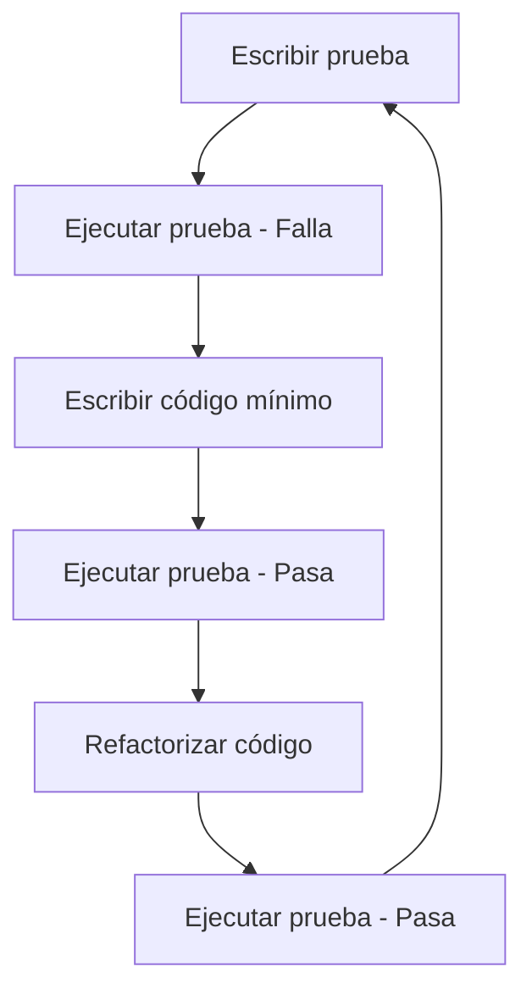

# Ingeniería de Software - Validación y verificación

## 6.7 Desarrollo guiado por pruebas.

---

El Desarrollo Guiado por Pruebas (Test-Driven Development - TDD) es una práctica de ingeniería de software que enfatiza la escritura de pruebas antes del código de producción. Según Beck (2003), "TDD es una práctica de programación que consiste en escribir primero las pruebas, luego escribir el código que hace que las pruebas pasen, y finalmente refactorizar el código".

### Definición y Principios Fundamentales

#### Desarrollo Guiado por Pruebas (TDD)

**Definición**: Metodología de desarrollo que sigue un ciclo repetitivo de tres fases:

1. **Red**: Escribir una prueba que falle
2. **Green**: Escribir el código mínimo para pasar la prueba
3. **Refactor**: Mejorar el código manteniendo las pruebas pasando

$$ \text{TDD Cycle Efficiency} = \frac{\text{Time}\_{\text{productive coding}}}{\text{Time}\_{\text{total cycle}}} \times 100\% $$

#### Principios del TDD

1. **Escribir pruebas primero**: Las pruebas definen el comportamiento deseado
2. **Código mínimo**: Solo escribir código necesario para pasar las pruebas
3. **Refactorización constante**: Mejorar el diseño sin cambiar el comportamiento
4. **Pruebas automatizadas**: Todas las pruebas deben ejecutarse automáticamente

### Ciclo de TDD



### Beneficios del TDD

#### Métricas de Calidad

$$ \text{Test Coverage} = \frac{\text{Líneas cubiertas por pruebas}}{\text{Líneas totales de código}} \times 100\% $$

$$ \text{Defect Detection Percentage} = \frac{\text{Defectos encontrados en pruebas}}{\text{Defectos totales}} \times 100\% $$

$$ \text{Code Quality Index} = \frac{\text{Pruebas pasando}}{\text{Pruebas totales}} \times \text{Test Coverage} $$

### Implementación de TDD

#### Ejemplo Práctico: Calculadora Simple

##### Fase 1: Escribir prueba que falle

```python
# test_calculator.py
import pytest
from calculator import Calculator

def test_add_two_numbers():
    calc = Calculator()
    result = calc.add(2, 3)
    assert result == 5

def test_add_negative_numbers():
    calc = Calculator()
    result = calc.add(-1, -1)
    assert result == -2
```

##### Fase 2: Escribir código mínimo para pasar la prueba

```python
# calculator.py
class Calculator:
    def add(self, a, b):
        return a + b
```

##### Fase 3: Refactorizar (si es necesario)

```python
# calculator.py refactorizado
class Calculator:
    def add(self, a, b):
        # Implementación simple, no necesita refactorización aún
        return a + b
```

##### Ampliación con nueva funcionalidad

```python
# test_calculator.py - Nuevas pruebas
def test_subtract_numbers():
    calc = Calculator()
    result = calc.subtract(5, 3)
    assert result == 2

def test_multiply_numbers():
    calc = Calculator()
    result = calc.multiply(4, 3)
    assert result == 12

def test_divide_numbers():
    calc = Calculator()
    result = calc.divide(10, 2)
    assert result == 5

def test_divide_by_zero():
    calc = Calculator()
    with pytest.raises(ValueError):
        calc.divide(10, 0)
```

```python
# calculator.py - Implementación extendida
class Calculator:
    def add(self, a, b):
        return a + b

    def subtract(self, a, b):
        return a - b

    def multiply(self, a, b):
        return a * b

    def divide(self, a, b):
        if b == 0:
            raise ValueError("Cannot divide by zero")
        return a / b
```

### Patrones y Técnicas de TDD

#### 1. Patrón Arrange-Act-Assert

**Estructura para organizar pruebas**:

```python
def test_feature():
    # Arrange: Preparar el contexto
    calculator = Calculator()

    # Act: Ejecutar la operación
    result = calculator.add(2, 3)

    # Assert: Verificar el resultado
    assert result == 5
```

#### 2. Pruebas Parametrizadas

```python
import pytest

@pytest.mark.parametrize("a,b,expected", [
    (1, 1, 2),
    (2, 3, 5),
    (-1, 1, 0),
    (0, 0, 0),
    (100, 200, 300)
])
def test_add_various_numbers(a, b, expected):
    calc = Calculator()
    result = calc.add(a, b)
    assert result == expected
```

#### 3. Dobles de Prueba (Mocks y Stubs)

```python
from unittest.mock import Mock, patch

def test_user_creation_with_mock():
    # Arrange
    mock_db = Mock()
    user_service = UserService(mock_db)

    # Act
    user_service.create_user("john@example.com", "password123")

    # Assert
    mock_db.save.assert_called_once()
    saved_user = mock_db.save.call_args[0][0]
    assert saved_user.email == "john@example.com"
```

### TDD en Diferentes Niveles

#### 1. TDD de Unidad

```python
# Pruebas unitarias para una función específica
def test_password_validation():
    assert validate_password("StrongPass123!") == True
    assert validate_password("weak") == False
    assert validate_password("no uppercase 123!") == False
```

#### 2. TDD de Integración

```python
# Pruebas de integración entre componentes
def test_user_registration_integration():
    db = RealDatabase()
    email_service = RealEmailService()
    user_manager = UserManager(db, email_service)

    user = user_manager.register("test@example.com", "password")

    assert user is not None
    assert db.user_exists(user.id)
    assert email_service.sent_welcome_email(user.email)
```

#### 3. TDD de Aceptación

```python
# Pruebas que validan requisitos de negocio
def test_ecommerce_checkout_acceptance():
    cart = create_cart_with_items()
    user = create_test_user()
    payment = create_payment_method()

    order = checkout(cart, user, payment)

    assert order.status == "completed"
    assert order.total == cart.total
    assert inventory_reduced(order.items)
```

### Framework de TDD Completo

```python
# Ejemplo de framework de pruebas para un sistema de blog
class TestBlogSystem:
    def setUp(self):
        self.db = InMemoryDatabase()
        self.blog_service = BlogService(self.db)
        self.user = self.blog_service.create_user("author@blog.com", "author123")

    def test_create_blog_post(self):
        post = self.blog_service.create_post(
            self.user.id,
            "TDD Best Practices",
            "Content about TDD..."
        )
        assert post.id is not None
        assert post.title == "TDD Best Practices"
        assert post.author_id == self.user.id

    def test_publish_blog_post(self):
        post = self.blog_service.create_post(
            self.user.id,
            "Test Post",
            "Content"
        )
        published_post = self.blog_service.publish_post(post.id)
        assert published_post.status == "published"
        assert published_post.publish_date is not None

    def test_comment_on_post(self):
        post = self.blog_service.create_post(
            self.user.id,
            "Test Post",
            "Content"
        )
        comment = self.blog_service.add_comment(
            post.id,
            "reader@email.com",
            "Great post!"
        )
        assert comment.post_id == post.id
        assert comment.content == "Great post!"
```

### Métricas y Dashboard de TDD

```python
class TDDAnalytics:
    def __init__(self):
        self.test_runs = []
        self.code_changes = []

    def record_test_run(self, tests_passed, tests_failed, coverage):
        self.test_runs.append({
            'timestamp': datetime.now(),
            'passed': tests_passed,
            'failed': tests_failed,
            'coverage': coverage,
            'success_rate': tests_passed / (tests_passed + tests_failed) * 100
        })

    def record_code_change(self, lines_added, lines_removed, complexity_change):
        self.code_changes.append({
            'timestamp': datetime.now(),
            'lines_added': lines_added,
            'lines_removed': lines_removed,
            'complexity_change': complexity_change
        })

    def calculate_metrics(self):
        total_tests = sum(r['passed'] + r['failed'] for r in self.test_runs)
        avg_coverage = sum(r['coverage'] for r in self.test_runs) / len(self.test_runs) if self.test_runs else 0
        avg_success_rate = sum(r['success_rate'] for r in self.test_runs) / len(self.test_runs) if self.test_runs else 0

        return {
            'total_test_runs': len(self.test_runs),
            'total_tests_executed': total_tests,
            'average_coverage': avg_coverage,
            'average_success_rate': avg_success_rate,
            'code_churn': sum(c['lines_added'] + c['lines_removed'] for c in self.code_changes)
        }

    def generate_report(self):
        metrics = self.calculate_metrics()
        return f"""
        TDD Metrics Report
        ==================
        Total Test Runs: {metrics['total_test_runs']}
        Total Tests Executed: {metrics['total_tests_executed']}
        Average Test Coverage: {metrics['average_coverage']:.2f}%
        Average Success Rate: {metrics['average_success_rate']:.2f}%
        Code Churn: {metrics['code_churn']} lines
        """
```

### Ejercicios Propuestos

#### Ejercicio 1: Implementación con TDD

Desarrolla una clase `StringCalculator` usando TDD que cumpla con:

1. Método `add` que recibe string de números separados por coma
2. Devuelve la suma de los números
3. Soporte para diferentes delimitadores
4. Ignorar números mayores a 1000
5. Lanzar excepción para números negativos

#### Ejercicio 2: Refactorización con TDD

Dado el siguiente código legacy, escribe pruebas primero y luego refactoriza:

```python
# legacy_code.py
def process_data(data):
    result = []
    for item in data:
        if item > 0:
            if item % 2 == 0:
                result.append(item * 2)
            else:
                result.append(item + 10)
        else:
            result.append(0)
    return result
```

#### Ejercicio 3: TDD para API REST

Implementa usando TDD un servicio REST para gestión de tareas:

- Crear, leer, actualizar y eliminar tareas
- Marcar tareas como completadas
- Filtrar tareas por estado y prioridad
- Validaciones de datos de entrada

### Best Practices de TDD

#### 1. Nomenclatura de Pruebas

```python
# Buenas prácticas de nombres de pruebas
def test_should_return_sum_when_adding_two_numbers():
    pass

def test_should_throw_exception_when_dividing_by_zero():
    pass

def test_given_negative_balance_when_withdrawing_then_throw_insufficient_funds():
    pass
```

#### 2. Mantener pruebas rápidas y aisladas

```python
# Configuración para pruebas rápidas
@pytest.fixture
def fast_database():
    return InMemoryDatabase()

def test_fast_operation(fast_database):
    # Prueba que ejecuta rápidamente
    result = fast_operation(fast_database)
    assert result is not None
```

#### 3. Pruebas determinísticas

```python
# Evitar pruebas que dependan de estado externo
def test_deterministic_behavior():
    # Usar valores fijos en lugar de aleatorios
    result = process_fixed_data()
    expected = expected_fixed_result()
    assert result == expected
```

### Referencias

#### Bibliografía Básica

1. Sommerville, Ian. (2010). _Software Engineering_ (9th edition). Addison Wesley. (Capítulo 19)
2. Pfleeger, S. L., & Atlee, J. M. (2010). _Software Engineering: Theory and Practice_ (4th edition). Prentice Hall. (Capítulo 8)

#### Bibliografía Complementaria

3. Beck, K. (2003). _Test-Driven Development: By Example_. Addison-Wesley.
4. Martin, R. C. (2009). _Clean Code: A Handbook of Agile Software Craftsmanship_. Prentice Hall.
5. Freeman, S., & Pryce, N. (2009). _Growing Object-Oriented Software, Guided by Tests_. Addison-Wesley.

### Conclusión

El Desarrollo Guiado por Pruebas es una práctica poderosa que transforma el proceso de desarrollo al enfocarse en la calidad desde el inicio. TDD no solo produce software más confiable y mantenible, sino que también mejora el diseño del código y facilita la refactorización. La adopción de TDD requiere disciplina inicial, pero los beneficios en reducción de defectos, mejor documentación y mayor confianza del equipo justifican ampliamente la inversión.
