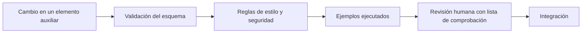

# Ingeniería de Software - Validación y verificación

## 6.8 Validación de elementos auxiliares (non-code).

---

Un sistema no es solo su código. Lo acompañan especificaciones de API, documentos de arquitectura, manuales, planes de prueba, archivos de configuración, definiciones de infraestructura, esquemas de bases de datos, scripts de despliegue y traducciones. Muchas fallas graves en producción no vienen del código sino de estos **elementos auxiliares**: una configuración equivocada, un Dockerfile que filtra un secreto, una documentación que describe una versión anterior. Este tema presenta cómo se verifican y validan, desde la validación automática contra un esquema hasta las listas de comprobación y las métricas de legibilidad, y la práctica de tratarlos como código.

### Tipos y técnicas

| Elemento                              | Verificación automática                                  | Revisión humana                         |
| ------------------------------------- | -------------------------------------------------------- | --------------------------------------- |
| Especificaciones de API               | Validación contra el esquema de OpenAPI; reglas de estilo con Spectral; pruebas de contrato | Diseño y consistencia con otras API |
| Configuración e infraestructura como código | Esquemas, linters como hadolint o tflint; análisis de seguridad como Checkov | Revisión de cambios en producción |
| Documentación técnica                 | Enlaces rotos, ejemplos de código ejecutados, ortografía, legibilidad | Exactitud, completitud, utilidad |
| Esquemas y migraciones de bases de datos | Aplicar la migración en una base de prueba y revertirla | Impacto en datos existentes |
| Diagramas                             | Generarlos desde texto o desde el sistema, para que no diverjan | Claridad |

### Tratar como código

La práctica más eficaz es tratar los elementos auxiliares **como código**: guardarlos en el control de versiones junto al código que describen, revisarlos en las mismas solicitudes de cambio, y **verificarlos en la integración continua**. La documentación se escribe en formatos de texto, como Markdown o AsciiDoc, y se genera; los ejemplos de la documentación se ejecutan como pruebas, como hace `doctest` en Python, de modo que un ejemplo que deja de funcionar rompe la compilación. Lo que se genera, como la documentación de una API a partir de su especificación, o la especificación a partir del código, no puede quedar desactualizado.

### Validación de especificaciones

Hay dos niveles: la **validez**, que el documento cumpla el esquema del estándar, y la **calidad**, que siga buenas prácticas. Un documento OpenAPI puede ser perfectamente válido y, aun así, no servir: sin esquemas de las respuestas, sin errores documentados, sin seguridad. Las reglas de calidad se expresan como reglas de un linter, y cada organización agrega las suyas, como las convenciones de nombres del tema 2.2.

### Documentación

La calidad de la documentación tiene varias dimensiones:

- **Completitud:** contra una lista de comprobación de secciones necesarias para su tipo de documento y sus lectores.
- **Exactitud:** que corresponda a la versión actual del sistema; se verifica mejor ejecutando los ejemplos.
- **Consistencia terminológica:** un concepto, un nombre. Si un documento dice "pedido", "orden" y "orden de compra" para lo mismo, el lector supone que son tres cosas.
- **Legibilidad:** las fórmulas de legibilidad estiman la dificultad por la longitud de las oraciones y de las palabras. Para el español, la de **Fernández Huerta** (1959) adapta la de Flesch:

$$L = 206.84 - 0.60\,P - 1.02\,F,$$

  con $P$ las sílabas por cada 100 palabras y $F$ las palabras por oración. La publicación original definía $F$ como oraciones por cada 100 palabras, lo que invierte su efecto; Law (2011) mostró que debe usarse palabras por oración, como en la fórmula de Flesch. Valores de 70 o más indican un texto fácil, y menos de 30, muy difícil. Son indicadores aproximados: no miden la claridad de las ideas, solo dos rasgos de la superficie del texto.

### Listas de comprobación

Para lo que no se puede automatizar, una **lista de comprobación** asegura que la revisión cubra lo importante. Una buena lista es corta, específica del tipo de artefacto, con elementos verificables, no "¿está claro?" sino "¿cada paso del procedimiento indica el resultado esperado?", y se actualiza con los defectos que se escaparon.



### Implementación en Python

El programa resuelve el ejercicio 1 validando la especificación del enunciado con un validador de OpenAPI, comparándola con un documento realmente inválido, y aplicándole reglas de estilo. Para el ejercicio 2 implementa el conteo de sílabas en español y la fórmula de Fernández Huerta, y la aplica a dos textos, además de detectar variantes terminológicas. Para el ejercicio 3 verifica automáticamente un Dockerfile contra la parte automatizable de su lista de comprobación.

```python
import re
import yaml
from openapi_spec_validator import validate
from openapi_spec_validator.validation.exceptions import OpenAPIValidationError

# ---------- Ejercicio 1: la especificación OpenAPI del enunciado, con un validador y con reglas de estilo ----------
base = yaml.safe_load("""
openapi: 3.0.0
info:
  title: Sample API
  version: 1.0.0
paths:
  /users:
    get:
      summary: Get users
      responses:
        '200':
          description: OK
""")
validate(base); print("ejercicio 1: el validador de la especificación OpenAPI 3.0 acepta el documento: no le falta nada obligatorio")
rota = yaml.safe_load("openapi: 3.0.0\ninfo: {title: X}\npaths:\n  users:\n    get: {responses: {}}\n")
try: validate(rota)
except OpenAPIValidationError as e: print("   en cambio, un documento sin info.version y con la ruta sin '/' se rechaza:", e.message[:70])
def estilo(doc):
    avisos = []
    if "servers" not in doc: avisos.append("sin servers")
    if "components" not in doc: avisos.append("sin components/schemas")
    for ruta, ops in doc["paths"].items():
        for metodo, op in ops.items():
            nom = f"{metodo.upper()} {ruta}"
            if "operationId" not in op: avisos.append(f"{nom}: sin operationId")
            if not any(c.startswith(("4", "5")) for c in op["responses"]): avisos.append(f"{nom}: sin respuestas de error")
            for c, r in op["responses"].items():
                if c.startswith("2") and "content" not in r: avisos.append(f"{nom} {c}: sin esquema de contenido")
            if metodo == "get" and ruta.endswith("s") and not any(p.get("name") in ("limit", "cursor", "page") for p in op.get("parameters", [])):
                avisos.append(f"{nom}: colección sin paginación")
    if "security" not in doc and "securitySchemes" not in doc.get("components", {}): avisos.append("sin esquema de seguridad")
    return avisos
print("   reglas de estilo:", estilo(base))

# ---------- Ejercicio 2: legibilidad en español (Fernández Huerta) ----------
def silabas(palabra):
    p = palabra.lower()
    p = re.sub(r"[^a-záéíóúüñ]", "", p)
    if not p: return 0
    # núcleos vocálicos: un diptongo (débil+fuerte o dos débiles, sin tilde en la débil) cuenta como uno
    nucleos = re.findall(r"[iuü][aeoáéó]|[aeoáéó][iu]|[iu][iu]|[aeiouáéíóúü]", p)
    return max(1, len(nucleos))
def fernandez_huerta(texto):
    oraciones = [o for o in re.split(r"[.!?;:]+", texto) if o.strip()]
    palabras = re.findall(r"[A-Za-zÁÉÍÓÚÜÑáéíóúüñ]+", texto)
    p = 100 * sum(map(silabas, palabras)) / len(palabras)        # sílabas por 100 palabras
    f = len(palabras) / len(oraciones)                            # palabras por oración (corrección de Law, 2011)
    return 206.84 - 0.60 * p - 1.02 * f, len(palabras), len(oraciones)
print("   sílabas:", {w: silabas(w) for w in ("arquitectura", "servicio", "aéreo", "configuración", "ciudad", "país", "despliegue")})
textos = {
    "claro": "El servicio guarda los pedidos. Cada pedido tiene un número. Si el pago falla, el pedido no se guarda.",
    "denso": "La implementación de la arquitectura de microservicios considerada requiere la orquestación coordinada de componentes "
             "heterogéneos, cuya interoperabilidad depende de especificaciones contractuales formalmente versionadas y de mecanismos "
             "de observabilidad distribuida suficientemente granulares.",
}
for nombre, t in textos.items():
    l, n, o = fernandez_huerta(t)
    nivel = "muy fácil" if l >= 90 else "fácil" if l >= 70 else "normal" if l >= 60 else "difícil" if l >= 30 else "muy difícil"
    print(f"ejercicio 2: texto {nombre}: {n} palabras, {o} {'oración' if o == 1 else 'oraciones'} → lecturabilidad {l:.1f} ({nivel})")
terminos = ["pedido", "orden", "Pedido", "pedidos", "orden de compra"]
print("   consistencia terminológica: variantes para el mismo concepto en el documento:", sorted({t.lower().rstrip("s") for t in terminos}))

# ---------- Ejercicio 3: verificación automática de un Dockerfile contra una lista de comprobación ----------
REGLAS = [(r"^FROM\s+\S+:latest|^FROM\s+[^:\s@]+\s*$", "imagen base sin versión fija"),
          (r"^COPY \. \.\s*\n(?:.*\n)*?RUN npm (install|ci)", "copia todo antes de instalar dependencias: rompe la caché"),
          (r"npm install", "usa npm install en lugar de npm ci"),
          (r"^(?!.*^USER )", "se ejecuta como root (falta USER)"),
          (r"(PASSWORD|SECRET|TOKEN)=\S+", "secreto en la imagen")]
def revisa(df):
    hallazgos = []
    for patron, msg in REGLAS:
        if patron.startswith("^(?!"): bad = not re.search(r"^USER ", df, re.M)
        else: bad = bool(re.search(patron, df, re.M))
        if bad: hallazgos.append(msg)
    return hallazgos
original = "FROM node:latest\nWORKDIR /app\nCOPY . .\nRUN npm install\nENV API_TOKEN=abc123\nCMD [\"npm\", \"start\"]\n"
corregido = "FROM node:22.11-alpine\nWORKDIR /app\nCOPY package*.json ./\nRUN npm ci --omit=dev\nCOPY . .\nUSER node\nCMD [\"node\", \"server.js\"]\n"
print("ejercicio 3: Dockerfile original:", revisa(original)); print("   corregido:", revisa(corregido) or "sin hallazgos")
```

Salida:

```text
ejercicio 1: el validador de la especificación OpenAPI 3.0 acepta el documento: no le falta nada obligatorio
   en cambio, un documento sin info.version y con la ruta sin '/' se rechaza: 'version' is a required property
   reglas de estilo: ['sin servers', 'sin components/schemas', 'GET /users: sin operationId', 'GET /users: sin respuestas de error', 'GET /users 200: sin esquema de contenido', 'GET /users: colección sin paginación', 'sin esquema de seguridad']
   sílabas: {'arquitectura': 5, 'servicio': 3, 'aéreo': 4, 'configuración': 5, 'ciudad': 2, 'país': 2, 'despliegue': 3}
ejercicio 2: texto claro: 19 palabras, 3 oraciones → lecturabilidad 89.9 (fácil)
ejercicio 2: texto denso: 31 palabras, 1 oración → lecturabilidad -35.7 (muy difícil)
   consistencia terminológica: variantes para el mismo concepto en el documento: ['orden', 'orden de compra', 'pedido']
ejercicio 3: Dockerfile original: ['imagen base sin versión fija', 'copia todo antes de instalar dependencias: rompe la caché', 'usa npm install en lugar de npm ci', 'se ejecuta como root (falta USER)', 'secreto en la imagen']
   corregido: sin hallazgos
```

### Ejercicios Propuestos

1. **OpenAPI.** Para esta especificación, identifica los elementos obligatorios que faltan, los errores de formato y estructura, y las mejoras para hacerla más completa:

    ```yaml
    openapi: 3.0.0
    info:
      title: Sample API
      version: 1.0.0
    paths:
      /users:
        get:
          summary: Get users
          responses:
            '200':
              description: OK
    ```

2. **Documentación.** Analiza un documento técnico y calcula su índice de legibilidad, su porcentaje de completitud contra una lista de comprobación, su consistencia terminológica y la calidad de sus diagramas.

3. **Listas de comprobación.** Desarrolla listas de comprobación para la documentación de arquitectura, el manual de usuario de una aplicación móvil, un plan de pruebas de integración y los scripts de despliegue en Docker.

### Soluciones

**Ejercicio 1.** La respuesta sorprende: **no falta ningún elemento obligatorio** ni hay errores de formato. La especificación de OpenAPI 3.0 exige `openapi`, `info` con `title` y `version`, `paths`, y en cada operación `responses` con al menos una respuesta y su `description`; todo está. El validador la acepta, y rechaza en cambio un documento sin versión. Lo que tiene son problemas de **calidad**, que las reglas de estilo del programa encuentran:

- sin `servers`, no se sabe dónde está la API;
- sin `operationId`, los generadores de clientes inventan nombres;
- la respuesta 200 no describe su contenido: no se sabe qué devuelve;
- no documenta errores, como 401 o 500;
- es una colección sin paginación;
- no declara seguridad.

La versión mejorada agrega un servidor, `operationId: listaUsuarios`, parámetros `limit` y `cursor`, un esquema `Usuario` en `components` y la respuesta como lista de usuarios, las respuestas de error con detalles de problema y un esquema de seguridad, como en el ejercicio 3 del tema 5.5. Conviene además pasar a OpenAPI 3.1, compatible con JSON Schema.

**Ejercicio 2.** El programa aplica la fórmula a dos textos: uno con oraciones cortas y palabras comunes obtiene 89.9, fácil, y uno de una sola oración de 31 palabras técnicas obtiene −35.7, por debajo de la escala, muy difícil. El valor negativo muestra el límite de la fórmula: fue calibrada para textos generales, y en documentación técnica conviene usarla para comparar versiones de un mismo documento, no como una calificación absoluta. Para la **completitud**, se cuenta la fracción de las secciones de la lista de comprobación presentes, como en el ejercicio 5 del tema 5.3. Para la **consistencia terminológica**, se mantiene un glosario y se buscan las variantes: en el ejemplo, "pedido", "orden" y "orden de compra" nombran lo mismo, y el documento debe elegir una. La **calidad de los diagramas** se evalúa con una lista: cada diagrama tiene título y leyenda, usa la notación de forma consistente, se refiere en el texto, y corresponde al sistema actual, lo que solo se garantiza si se genera desde texto versionado o desde el propio sistema.

**Ejercicio 3.**

- **Documentación de arquitectura:** contexto y objetivos; interesados y sus preocupaciones; vistas necesarias, con su notación explicada; decisiones con sus razones y alternativas; atributos de calidad con escenarios medibles; riesgos y deuda técnica conocidos; fecha y versión del sistema que describe.
- **Manual de usuario móvil:** cada tarea frecuente con pasos numerados y el resultado esperado de cada uno; capturas de la versión actual; requisitos del dispositivo; mensajes de error comunes y su solución; accesibilidad; cómo obtener ayuda.
- **Plan de pruebas de integración:** alcance y componentes integrados; orden de integración; ambiente y datos de prueba; dobles de los sistemas externos; criterios de entrada y de salida; casos de error y de tiempo límite de cada interfaz; responsables.
- **Despliegue con Docker:** imagen base con versión fija y ligera; dependencias instaladas antes de copiar el código, para aprovechar la caché; instalación reproducible, con `npm ci` o equivalente; construcción en etapas; usuario sin privilegios; sin secretos en la imagen; verificación de salud; etiquetas con la versión.

La parte automatizable de la última lista es la que verifica el programa: el Dockerfile original incumple cinco reglas, incluido un token en una variable de entorno que queda en la imagen y es visible para cualquiera que la descargue; el corregido, ninguna. Herramientas como hadolint aplican decenas de reglas como estas en la integración continua.

### Referencias

1. OpenAPI Initiative, _OpenAPI Specification_, versiones 3.0.3 y 3.1.0.
2. Fernández Huerta, J., Medidas sencillas de lecturabilidad. _Consigna_ 214, 1959.
3. Law, G., Error in the Fernandez Huerta readability formula. _LINGUIST List_ 22.2332, 2011.
4. Gentle, A., _Docs Like Code_. Lulu, 2017.
5. Gawande, A., _The Checklist Manifesto_. Metropolitan Books, 2009.
