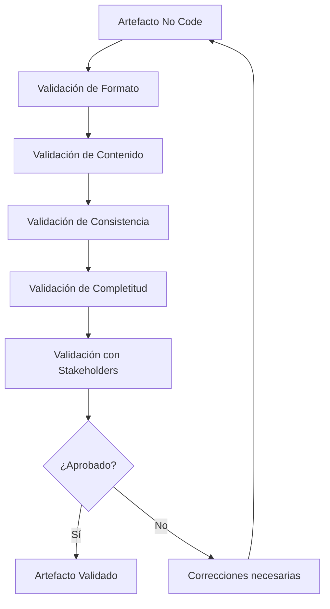

# Ingeniería de Software - Validación y verificación

## 6.8 Validación de elementos auxiliares (non-code).

---

La validación de elementos no code es un aspecto crítico en la ingeniería de software que asegura la calidad de todos los artefactos del proyecto, no solo del código fuente. Según Sommerville (2010), "La validación de documentación, requisitos y diseños es tan importante como la validación del código, ya que los defectos en estos elementos pueden propagarse al producto final".

### Definiciones Fundamentales

#### Elementos Auxiliares No Code

**Definición**: Artefactos de software que no son código fuente pero son esenciales para el desarrollo, mantenimiento y operación del sistema.

$$ \text{Calidad Artefacto} = \frac{\text{Atributos cumplidos}}{\text{Atributos totales}} \times 100\% $$

#### Validación de Elementos No Code

**Definición**: Proceso de evaluación para asegurar que los artefactos no code cumplen con los estándares de calidad, son consistentes y apropiados para su propósito.

### Tipos de Elementos Auxiliares No Code

#### 1. Documentación de Requisitos

- Especificaciones de requisitos
- Casos de uso
- Historias de usuario
- Diagramas de casos de uso

#### 2. Documentación de Diseño

- Diagramas UML
- Especificaciones de arquitectura
- Diseños de base de datos
- Diagramas de flujo

#### 3. Documentación de Usuario

- Manuales de usuario
- Guías de instalación
- Documentación de API
- Help systems

#### 4. Artefactos de Configuración

- Scripts de despliegue
- Archivos de configuración
- Dockerfiles
- Kubernetes manifests

#### 5. Elementos de Prueba

- Planes de prueba
- Casos de prueba
- Datos de prueba
- Scripts de prueba

### Proceso de Validación de Elementos No Code



### Técnicas de Validación

#### 1. Revisiones Formales

**Definición**: Proceso estructurado de examen de artefactos por pares.

**Checklist para revisiones**:

```python
class ReviewChecklist:
    def __init__(self, artifact_type):
        self.artifact_type = artifact_type
        self.checklist_items = []
        self.feedback = []

    def add_checklist_item(self, item, weight):
        self.checklist_items.append({
            'item': item,
            'weight': weight,
            'verified': False,
            'comments': ''
        })

    def conduct_review(self, artifact):
        total_score = 0
        max_score = sum(item['weight'] for item in self.checklist_items)

        for item in self.checklist_items:
            # Simulación de verificación
            verified = self._verify_item(item['item'], artifact)
            item['verified'] = verified
            if verified:
                total_score += item['weight']

        quality_score = (total_score / max_score) * 100
        return {
            'score': quality_score,
            'details': self.checklist_items,
            'status': 'PASS' if quality_score >= 80 else 'FAIL'
        }

    def _verify_item(self, item, artifact):
        # Lógica de verificación específica por tipo de artefacto
        return random.choice([True, False])  # Simulación

# Ejemplo de uso para requisitos
req_checklist = ReviewChecklist("requirements")
req_checklist.add_checklist_item("Requisito claro y no ambiguo", 20)
req_checklist.add_checklist_item("Prioridad definida", 15)
req_checklist.add_checklist_item("Criterios de aceptación definidos", 25)
req_checklist.add_checklist_item("Consistente con otros requisitos", 20)
req_checklist.add_checklist_item("Trazabilidad establecida", 20)

result = req_checklist.conduct_review(requirement_document)
print(f"Calidad del documento: {result['score']:.2f}%")
```

#### 2. Validación de Consistencia

**Fórmula de consistencia**:

$$ \text{Consistencia} = \frac{\text{Elementos consistentes}}{\text{Elementos totales}} \times 100\% $$

#### 3. Validación de Completitud

**Checklist de completitud**:

```python
def validate_completeness(artifact, required_sections):
    completeness_score = 0
    missing_sections = []

    for section, weight in required_sections.items():
        if hasattr(artifact, section) and getattr(artifact, section):
            completeness_score += weight
        else:
            missing_sections.append(section)

    total_weight = sum(required_sections.values())
    completeness_percentage = (completeness_score / total_weight) * 100

    return {
        'completeness': completeness_percentage,
        'missing_sections': missing_sections,
        'status': 'COMPLETE' if completeness_percentage >= 90 else 'INCOMPLETE'
    }

# Ejemplo para documentación de diseño
design_sections = {
    'introduction': 10,
    'architecture_overview': 20,
    'component_diagrams': 25,
    'data_design': 20,
    'interface_design': 15,
    'deployment_diagrams': 10
}
```

### Herramientas de Validación Automática

#### 1. Validación de Documentación

```python
class DocumentationValidator:
    def __init__(self):
        self.rules = {
            'markdown': self._validate_markdown,
            'openapi': self._validate_openapi,
            'xml': self._validate_xml
        }

    def validate(self, content, format_type):
        if format_type in self.rules:
            return self.rules[format_type](content)
        return {'valid': False, 'errors': ['Formato no soportado']}

    def _validate_markdown(self, content):
        errors = []
        # Validar encabezados
        if not re.search(r'^# ', content, re.MULTILINE):
            errors.append('Falta encabezado principal')

        # Validar links rotos
        links = re.findall(r'\[.*?\]\((.*?)\)', content)
        for link in links:
            if not self._check_link(link):
                errors.append(f'Link posiblemente roto: {link}')

        return {'valid': len(errors) == 0, 'errors': errors}

    def _validate_openapi(self, content):
        try:
            spec = yaml.safe_load(content)
            # Validaciones básicas de OpenAPI
            errors = []
            if 'openapi' not in spec:
                errors.append('Versión OpenAPI no especificada')
            if 'info' not in spec:
                errors.append('Sección info faltante')
            if 'paths' not in spec:
                errors.append('Sección paths faltante')

            return {'valid': len(errors) == 0, 'errors': errors}
        except yaml.YAMLError as e:
            return {'valid': False, 'errors': [f'Error YAML: {str(e)}']}

    def _check_link(self, link):
        # Simulación de verificación de links
        return not link.startswith('http') or random.random() > 0.2
```

#### 2. Validación de Configuraciones

```python
class ConfigValidator:
    def validate_yaml(self, yaml_content):
        try:
            data = yaml.safe_load(yaml_content)
            return {'valid': True, 'data': data}
        except yaml.YAMLError as e:
            return {'valid': False, 'error': str(e)}

    def validate_json(self, json_content):
        try:
            data = json.loads(json_content)
            return {'valid': True, 'data': data}
        except json.JSONDecodeError as e:
            return {'valid': False, 'error': str(e)}

    def validate_env_file(self, env_content):
        errors = []
        lines = env_content.split('\n')
        for i, line in enumerate(lines, 1):
            line = line.strip()
            if line and not line.startswith('#'):
                if '=' not in line:
                    errors.append(f'Línea {i}: Formato incorrecto')
                else:
                    key, value = line.split('=', 1)
                    if not key.strip():
                        errors.append(f'Línea {i}: Key vacío')

        return {'valid': len(errors) == 0, 'errors': errors}
```

### Métricas de Calidad para Elementos No Code

#### 1. Índice de Calidad de Documentación

$$ \text{DQI} = w_1 \times C + w_2 \times A + w_3 \times M + w_4 \times R $$

Donde:

- $C$ = Completitud (0-1)
- $A$ = Exactitud (0-1)
- $M$ = Mantenibilidad (0-1)
- $R$ = Relevancia (0-1)
- $w_i$ = Peso de cada factor

#### 2. Métricas Específicas

```python
class DocumentationMetrics:
    def calculate_readability(self, text):
        """Calcula índice de legibilidad Flesch"""
        sentences = len(re.findall(r'[.!?]+', text))
        words = len(text.split())
        syllables = self._count_syllables(text)

        if words == 0 or sentences == 0:
            return 0

        return 206.835 - 1.015 * (words / sentences) - 84.6 * (syllables / words)

    def calculate_completeness(self, document, required_elements):
        present_elements = sum(1 for elem in required_elements if elem in document)
        return (present_elements / len(required_elements)) * 100

    def _count_syllables(self, text):
        # Implementación simplificada
        words = text.lower().split()
        syllable_count = 0
        for word in words:
            syllable_count += max(1, len(re.findall(r'[aeiouy]+', word)))
        return syllable_count
```

### Ejercicios Propuestos

#### Ejercicio 1: Validación de Especificación OpenAPI

Dada la siguiente especificación OpenAPI incompleta:

```yaml
openapi: 3.0.0
info:
  title: Sample API
  version: 1.0.0
paths:
  /users:
    get:
      summary: Get users
      responses:
        '200':
          description: OK
```

Identifica:

1. Elementos faltantes requeridos por el estándar OpenAPI
2. Errores de formato y estructura
3. Mejoras para hacerla más completa

#### Ejercicio 2: Análisis de Documentación

Analiza un documento técnico existente y calcula:

1. Índice de legibilidad Flesch
2. Porcentaje de completitud contra checklist estándar
3. Consistencia terminológica
4. Calidad de diagramas y ilustraciones

#### Ejercicio 3: Creación de Checklist

Desarrolla checklists de validación para:

1. Documentación de arquitectura de software
2. Manual de usuario para aplicación móvil
3. Plan de pruebas de integración
4. Scripts de despliegue en Docker

### Caso de Estudio: Validación de Documentación Técnica

```python
class TechnicalDocumentValidator:
    def __init__(self):
        self.required_sections = {
            'introduction': 10,
            'architecture': 25,
            'components': 20,
            'interfaces': 15,
            'deployment': 15,
            'troubleshooting': 10,
            'appendix': 5
        }

    def validate_document(self, document_path):
        results = {
            'completeness': self._check_completeness(document_path),
            'readability': self._check_readability(document_path),
            'consistency': self._check_consistency(document_path),
            'accuracy': self._check_accuracy(document_path)
        }

        overall_score = (
            results['completeness']['score'] * 0.3 +
            results['readability']['score'] * 0.2 +
            results['consistency']['score'] * 0.25 +
            results['accuracy']['score'] * 0.25
        )

        results['overall_score'] = overall_score
        results['status'] = 'APPROVED' if overall_score >= 80 else 'REVISION_NEEDED'

        return results

    def _check_completeness(self, document_path):
        # Implementar verificación de secciones requeridas
        return {'score': 85, 'missing_sections': ['appendix']}

    def _check_readability(self, document_path):
        # Calcular legibilidad
        return {'score': 78, 'grade_level': 'College'}

    def _check_consistency(self, document_path):
        # Verificar consistencia terminológica
        return {'score': 92, 'inconsistencies': []}

    def _check_accuracy(self, document_path):
        # Validar precisión técnica
        return {'score': 88, 'technical_errors': 2}
```

### Best Practices para Validación de Elementos No Code

#### 1. Establecer Estándares Claros

```python
class DocumentationStandards:
    def __init__(self):
        self.standards = {
            'api_docs': {
                'required_sections': ['overview', 'authentication', 'endpoints', 'examples'],
                'format': 'openapi',
                'version': '3.0.0',
                'validation_rules': self._api_validation_rules
            },
            'user_guides': {
                'readability_min': 60,
                'required_sections': ['getting_started', 'features', 'troubleshooting'],
                'screenshot_requirements': True
            }
        }

    def _api_validation_rules(self, doc):
        rules = [
            self._check_openapi_version,
            self._validate_paths_exist,
            self._check_response_definitions
        ]
        return [rule(doc) for rule in rules]
```

#### 2. Automatización de Validaciones

```python
class AutomatedValidator:
    def __init__(self):
        self.validators = {
            'yaml': YAMLValidator(),
            'json': JSONValidator(),
            'markdown': MarkdownValidator(),
            'openapi': OpenAPIValidator()
        }

    def validate_repository(self, repo_path):
        results = {}
        for root, dirs, files in os.walk(repo_path):
            for file in files:
                file_path = os.path.join(root, file)
                file_type = self._detect_file_type(file)
                if file_type in self.validators:
                    with open(file_path, 'r', encoding='utf-8') as f:
                        content = f.read()
                    results[file_path] = self.validators[file_type].validate(content)

        return results

    def _detect_file_type(self, filename):
        ext = os.path.splitext(filename)[1].lower()
        mapping = {
            '.yml': 'yaml',
            '.yaml': 'yaml',
            '.json': 'json',
            '.md': 'markdown',
            '.openapi': 'openapi'
        }
        return mapping.get(ext, 'unknown')
```

### Referencias

#### Bibliografía Básica

1. Sommerville, Ian. (2010). _Software Engineering_ (9th edition). Addison Wesley. (Capítulos 19, 20)
2. Pfleeger, S. L., & Atlee, J. M. (2010). _Software Engineering: Theory and Practice_ (4th edition). Prentice Hall. (Capítulos 8, 9)

#### Bibliografía Complementaria

3. IEEE Std 1063-2001 - IEEE Standard for Software User Documentation
4. ISO/IEC/IEEE 26515:2018 - Systems and software engineering -- Developing information for users
5. Microsoft Writing Style Guide

### Conclusión

La validación de elementos auxiliares no code es esencial para garantizar la calidad general del software. Estos artefactos, aunque no son código ejecutable, son críticos para el desarrollo, mantenimiento y uso efectivo del sistema. La implementación de procesos sistemáticos de validación, combinando revisiones manuales con herramientas automatizadas, asegura que toda la documentación y configuración cumpla con los estándares de calidad requeridos. La inversión en validación de elementos no code reduce riesgos, mejora la mantenibilidad y asegura una mejor experiencia para desarrolladores y usuarios finales.
