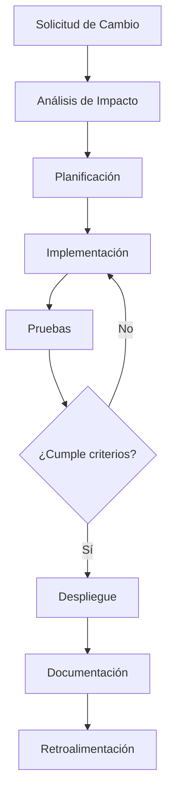

# Ingeniería de Software - Evolución de los sistemas de software

## 7.1 Conceptos y principios de mantenibilidad.

---

La mantenibilidad es un atributo de calidad esencial del software que determina la facilidad con la que un sistema puede ser modificado para corregir defectos, mejorar el rendimiento u otros atributos, o adaptarse a un entorno cambiante. Según Sommerville (2010), la evolución del software es inevitable debido a los cambiantes requisitos empresariales y entornos operativos.

### Definición de Mantenibilidad

La **mantenibilidad** se define como la facilidad con la que un producto software puede ser modificado para:

- Corregir defectos
- Mejorar el rendimiento u otros atributos
- Adaptarse a un entorno cambiante

Según la norma ISO/IEC 25010, la mantenibilidad se compone de varios subcaracterísticas:

- **Modificabilidad**: Capacidad para que el producto sea modificado sin introducir defectos
- **Analizabilidad**: Facilidad para diagnosticar deficiencias
- **Estabilidad**: Capacidad de evitar efectos inesperados por modificaciones
- **Testeabilidad**: Facilidad para validar el software modificado

### Importancia de la Mantenibilidad

Pfleeger y Atlee (2010) destacan que el mantenimiento consume entre el 60% y 80% del costo total del ciclo de vida del software. Una alta mantenibilidad reduce significativamente estos costos.

### Métricas de Mantenibilidad

#### Complejidad Ciclomática (McCabe)

Mide la complejidad estructural de un programa:

$$ V(G) = E - N + 2P $$

Donde:

- $V(G)$ = complejidad ciclomática
- $E$ = número de aristas en el grafo de flujo
- $N$ = número de nodos en el grafo de flujo
- $P$ = número de componentes conexos

#### Índice de Mantenibilidad (MI)

Microsoft desarrolló esta métrica que combina varias medidas:

$$ MI = 171 - 5.2 \times \ln(Halstead Volume) - 0.23 \times (Cyclomatic Complexity) - 16.2 \times \ln(Lines of Code) $$

#### Métricas de Halstead

Medidas de complejidad basadas en operadores y operandos:

- $n_1$ = número de operadores distintos
- $n_2$ = número de operandos distintos
- $N_1$ = número total de operadores
- $N_2$ = número total de operandos

Volumen de Halstead:

$$ V = (N_1 + N_2) \times \log_2(n_1 + n_2) $$

### Principios de Diseño para Mejorar la Mantenibilidad

#### Principios SOLID

```java
// Ejemplo de principio de responsabilidad única (SRP)
// MAL: Una clase con múltiples responsabilidades
class Employee {
    public void calculatePay() { /* ... */ }
    public void saveToDatabase() { /* ... */ }
    public void generateReport() { /* ... */ }
}

// BIEN: Separación de responsabilidades
class Employee {
    public void calculatePay() { /* ... */ }
}

class EmployeeRepository {
    public void save(Employee employee) { /* ... */ }
}

class ReportGenerator {
    public void generateEmployeeReport(Employee employee) { /* ... */ }
}
```

#### Principio DRY (Don't Repeat Yourself)

```python
# MAL: Código duplicado
def calculate_area_square(side):
    return side * side

def calculate_area_rectangle(length, width):
    return length * width

# BIEN: Eliminando duplicación
def calculate_area(shape, *dimensions):
    if shape == "square":
        return dimensions[0] * dimensions[0]
    elif shape == "rectangle":
        return dimensions[0] * dimensions[1]
```

#### Acoplamiento y Cohesión

- **Bajo acoplamiento**: Los módulos tienen dependencias mínimas entre sí
- **Alta cohesión**: Los elementos dentro de un módulo están fuertemente relacionados

### Técnicas para Mejorar la Mantenibilidad

#### Refactorización

Proceso de reestructurar código existente sin cambiar su comportamiento externo.

```javascript
// Antes de refactorizar
function processUserData(user) {
  if (user.age > 18 && user.status === 'active' && user.subscription === 'premium') {
    // lógica compleja
  }
}

// Después de refactorizar
function isEligibleForProcessing(user) {
  return user.age > 18 && user.status === 'active' && user.subscription === 'premium';
}

function processUserData(user) {
  if (isEligibleForProcessing(user)) {
    // lógica compleja
  }
}
```

#### Pruebas Automatizadas

Mantener un conjunto completo de pruebas facilita los cambios al verificar que las modificaciones no rompan funcionalidad existente.

#### Documentación Adecuada

Documentación clara y actualizada que explique:

- Arquitectura del sistema
- Decisiones de diseño importantes
- Dependencias externas
- Protocolos de comunicación

### Diagrama de Flujo del Proceso de Mantenimiento



### Ejercicios Propuestos

1. **Cálculo de Complejidad Ciclomática**: Dado el siguiente código, calcula su complejidad ciclomática:

```java
public void processOrder(Order order) {
    if (order == null) {
        throw new IllegalArgumentException("Order cannot be null");
    }

    if (order.isValid()) {
        if (order.getItems().size() > 0) {
            for (Item item : order.getItems()) {
                if (item.isAvailable()) {
                    processItem(item);
                } else {
                    handleUnavailableItem(item);
                }
            }
            applyDiscount(order);
        } else {
            throw new IllegalStateException("Order has no items");
        }
    } else {
        handleInvalidOrder(order);
    }

    saveOrder(order);
}
```

2. **Refactorización**: Identifica problemas de mantenibilidad en el siguiente código y propón una refactorización:

```python
def calculate_total(cart, user):
    total = 0
    for item in cart:
        if item['type'] == 'book':
            if user['membership'] == 'gold':
                total += item['price'] * 0.8
            elif user['membership'] == 'silver':
                total += item['price'] * 0.9
            else:
                total += item['price']
        elif item['type'] == 'electronic':
            if item['price'] > 1000:
                total += item['price'] * 0.95
            else:
                total += item['price']
        elif item['type'] == 'food':
            if item['expiry_date'] == datetime.now().date():
                total += item['price'] * 0.5
            else:
                total += item['price']
    return total
```

3. **Análisis de Diseño**: Evalúa el acoplamiento y cohesión de un sistema con tres módulos: Gestión de Usuarios, Procesamiento de Pedidos y Generación de Reportes. Propone mejoras.

### Caso de Estudio: Sistema Legacy

Analiza un sistema legacy con baja mantenibilidad y propón un plan para mejorarla considerando:

- Análisis del código existente
- Identificación de deuda técnica
- Estrategia de refactorización
- Implementación de pruebas automatizadas
- Plan de migración gradual

### Referencias

#### Bibliografía Básica

1. Sommerville, Ian. (2010). _Software Engineering_ (9th edition). Addison Wesley. (Capítulos 9, 21)
2. Pfleeger, S. L., & Atlee, J. M. (2010). _Software Engineering: Theory and Practice_ (4th edition). Prentice Hall. (Capítulos 3, 11)

#### Bibliografía Complementaria

3. Cockburn, Alistair. (2004). _Crystal Clear: A Human-Powered Methodology for Small Teams_. Addison-Wesley Professional.
4. Boehm, B. W., & Turner, R. (2003). _Balancing Agility and Discipline: A Guide for the Perplexed_. Addison-Wesley.
5. Evans, Eric. (2003). _Domain-Driven Design: Tackling Complexity in the Heart of Software_. Addison Wesley.
6. Monson-Haefel, R. (Ed.). (2009). _97 Things Every Software Architect Should Know_. O'Reilly Media.

### Conclusión

La mantenibilidad es un atributo crítico que impacta directamente en el costo total de propiedad del software. Implementar principios de diseño sólidos, mantener métricas adecuadas y seguir prácticas de desarrollo que prioricen la claridad y modularidad son esenciales para construir sistemas que puedan evolucionar efectivamente a lo largo del tiempo.
