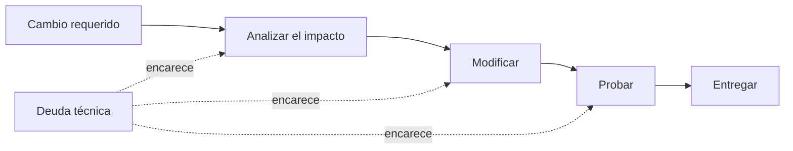

# Ingeniería de Software - Evolución de los sistemas de software

## 7.1 Conceptos y principios de mantenibilidad.

---

Un sistema útil cambia durante toda su vida: se corrigen defectos, se adapta a nuevas plataformas y regulaciones, y se le agregan funciones. La **mantenibilidad** es la facilidad con que puede hacerse ese cambio, y como el mantenimiento consume la mayor parte del costo de un sistema de vida larga (tema 1.2), es una de sus características más valiosas. Este tema define la mantenibilidad y sus componentes, presenta las leyes de Lehman sobre la evolución del software, los principios de diseño que la favorecen, la deuda técnica y las métricas para medirla, con sus límites.

### Definición

La norma ISO/IEC 25010 define la mantenibilidad como el grado de eficacia y eficiencia con que un producto puede modificarse, y la divide en cinco subcaracterísticas:

- **modularidad:** un cambio en un componente tiene un impacto mínimo en los demás;
- **reutilizabilidad:** sus partes pueden usarse en otros sistemas;
- **analizabilidad:** se puede evaluar el impacto de un cambio y diagnosticar defectos;
- **modificabilidad:** se puede cambiar sin introducir defectos ni degradar la calidad;
- **comprobabilidad:** se pueden establecer criterios de prueba y ejecutarlos (tema 6.3).

### Tipos de mantenimiento

La norma ISO/IEC 14764 distingue el mantenimiento **correctivo**, que repara defectos; el **adaptativo**, que ajusta el sistema a un entorno que cambia; el **perfectivo**, que mejora o agrega funciones, y el **preventivo**, que mejora la estructura para facilitar los cambios futuros. Los estudios clásicos de Lientz y Swanson encontraron que la corrección de defectos es una fracción minoritaria del mantenimiento: la mayor parte es adaptación y mejora, es decir, evolución.

### Leyes de Lehman

Lehman y Belady estudiaron la evolución de sistemas grandes, como el OS/360 de IBM, y formularon leyes empíricas para los sistemas de **tipo E**, los que operan en el mundo real. Las más citadas son:

- **cambio continuo:** un sistema que se usa debe cambiar o se vuelve progresivamente menos satisfactorio;
- **complejidad creciente:** conforme un sistema evoluciona, su complejidad aumenta, salvo que se trabaje para reducirla;
- **calidad decreciente:** su calidad percibida disminuye, salvo que se mantenga activamente y se adapte a su entorno.

La consecuencia práctica es que la mantenibilidad no se conserva sola: hay que invertir de forma continua en el mantenimiento preventivo, con refactorización (tema 7.6).

### Principios

- **Cohesión alta y acoplamiento bajo** (tema 5.4): lo que cambia junto, junto; lo que cambia por separado, separado.
- **Ocultamiento de información** de Parnas: cada decisión que probablemente cambie, dentro de un módulo.
- **No repetirse** (DRY): cada regla en un solo lugar, para que un cambio no requiera buscarla en varios.
- **Abierto a la extensión, cerrado a la modificación:** agregar comportamiento agregando código, no modificando el existente; por ejemplo, con una tabla de reglas o con polimorfismo en lugar de una cadena de condicionales.
- **Simplicidad:** el código más fácil de mantener es el que no existe.

### Deuda técnica

Cunningham acuñó en 1992 la metáfora de la **deuda técnica**: tomar un atajo de diseño es como pedir un préstamo, que acelera hoy pero cobra **intereses** en cada cambio futuro, en forma de trabajo extra, hasta que se paga refactorizando. Fowler la clasifica en un cuadrante, según sea **deliberada** o **inadvertida** y **prudente** o **imprudente**: "entregamos ahora y lo arreglamos después, conscientes del costo" es deliberada y prudente; "no sabíamos de diseño" es inadvertida e imprudente. La deuda no es mala en sí misma; lo es la que no se reconoce ni se paga.

### Métricas

- **Complejidad ciclomática** de McCabe, por función (tema 1.1).
- **Métricas de Halstead:** a partir del número de operadores y operandos, el **volumen** $V = N \log_2 n,$ con $N$ el total de apariciones y $n$ el vocabulario.
- **Índice de mantenibilidad** de Oman y Hagemeister (1992), en su forma de tres métricas:

$$\mathrm{MI} = 171 - 5.2 \ln V - 0.23\, G - 16.2 \ln \mathrm{LOC},$$

  con $V$ el volumen de Halstead, $G$ la complejidad ciclomática y LOC las líneas de código. Visual Studio lo normaliza a $\max(0, \mathrm{MI} \cdot 100/171),$ con 20 o más considerado mantenible.

Son indicadores, no verdades: el índice se calibró con sistemas en C y Pascal de los años noventa, combina medidas muy correlacionadas con el tamaño, y no ve aspectos clave como los nombres, la duplicación o las pruebas. Se usan mejor para comparar versiones y detectar tendencias que como calificación absoluta.



### Implementación en Python

El programa cuenta las decisiones del método Java del ejercicio 1. Para el ejercicio 2 refactoriza `calculate_total` con una tabla de reglas por tipo de artículo y dinero en `Decimal`, y comprueba con 3 000 carritos aleatorios que el resultado coincide con el original; mide la complejidad de ambas versiones con el árbol de sintaxis. Al final calcula el índice de mantenibilidad de dos funciones de tamaño distinto.

```python
import ast, math, random
from datetime import date
from decimal import Decimal

# ---------- Ejercicio 1: complejidad ciclomática contando decisiones ----------
decisiones_java = ["if (order == null)", "if (order.isValid())", "if (order.getItems().size() > 0)",
                   "for (Item item : order.getItems())", "if (item.isAvailable())"]
print(f"ejercicio 1: {len(decisiones_java)} decisiones → V(G) = {len(decisiones_java) + 1}")

# ---------- Ejercicio 2: calculate_total, original y refactorizado ----------
def calculate_total(cart, user, hoy):                       # original; 'hoy' reemplaza a datetime.now() para poder probarla
    total = 0
    for item in cart:
        if item['type'] == 'book':
            if user['membership'] == 'gold': total += item['price'] * 0.8
            elif user['membership'] == 'silver': total += item['price'] * 0.9
            else: total += item['price']
        elif item['type'] == 'electronic':
            if item['price'] > 1000: total += item['price'] * 0.95
            else: total += item['price']
        elif item['type'] == 'food':
            if item['expiry_date'] == hoy: total += item['price'] * 0.5
            else: total += item['price']
    return total
DESCUENTO_LIBROS = {"gold": Decimal("0.20"), "silver": Decimal("0.10")}
def descuento_libro(item, usuario, hoy): return DESCUENTO_LIBROS.get(usuario["membership"], Decimal("0"))
def descuento_electronico(item, usuario, hoy): return Decimal("0.05") if item["price"] > 1000 else Decimal("0")
def descuento_alimento(item, usuario, hoy): return Decimal("0.50") if item["expiry_date"] == hoy else Decimal("0")
REGLAS = {"book": descuento_libro, "electronic": descuento_electronico, "food": descuento_alimento}
def total_carrito(carrito, usuario, hoy):
    total = Decimal("0")
    for item in carrito:
        regla = REGLAS.get(item["type"])
        if regla is None: raise ValueError(f"tipo de artículo desconocido: {item['type']!r}")
        total += Decimal(str(item["price"])) * (1 - regla(item, usuario, hoy))
    return total.quantize(Decimal("0.01"))
hoy = date(2026, 11, 4)
rng = random.Random(4); diferencias = 0
for _ in range(3000):
    carrito = [{"type": rng.choice(["book", "electronic", "food"]), "price": rng.choice([10, 99.99, 1000, 1000.01, 1500]),
                "expiry_date": rng.choice([hoy, date(2026, 11, 5)])} for _ in range(rng.randint(0, 6))]
    u = {"membership": rng.choice(["gold", "silver", "basic"])}
    diferencias += abs(Decimal(str(round(calculate_total(carrito, u, hoy), 2))) - total_carrito(carrito, u, hoy)) > Decimal("0.01")
print(f"ejercicio 2: 3000 carritos aleatorios, diferencias entre original y refactorizada: {diferencias}")
print("   tipo desconocido: el original lo ignora y lo regala:", calculate_total([{"type": "toy", "price": 50}], {"membership": "x"}, hoy), end=" | ")
try: total_carrito([{"type": "toy", "price": 50}], {"membership": "x"}, hoy)
except ValueError as e: print("el nuevo lo rechaza:", e)
def complejidad(fuente):
    n = sum(isinstance(x, (ast.If, ast.For, ast.While, ast.IfExp)) for x in ast.walk(ast.parse(fuente)))
    return n + 1
import inspect
print("   V(G) original:", complejidad(inspect.getsource(calculate_total)),
      "| nuevo, por función:", {f.__name__: complejidad(inspect.getsource(f)) for f in (total_carrito, descuento_libro, descuento_electronico, descuento_alimento)})

# ---------- Índice de mantenibilidad ----------
def mi(volumen, vg, loc): return 171 - 5.2 * math.log(volumen) - 0.23 * vg - 16.2 * math.log(loc)
for nombre, (v, g, l) in {"función de 20 líneas": (300, 4, 20), "función de 200 líneas": (4000, 25, 200)}.items():
    m = mi(v, g, l); print(f"índice de mantenibilidad, {nombre}: {m:.1f} | normalizado 0-100: {max(0, m * 100 / 171):.1f}")
```

Salida:

```text
ejercicio 1: 5 decisiones → V(G) = 6
ejercicio 2: 3000 carritos aleatorios, diferencias entre original y refactorizada: 0
   tipo desconocido: el original lo ignora y lo regala: 0 | el nuevo lo rechaza: tipo de artículo desconocido: 'toy'
   V(G) original: 9 | nuevo, por función: {'total_carrito': 3, 'descuento_libro': 1, 'descuento_electronico': 2, 'descuento_alimento': 2}
índice de mantenibilidad, función de 20 líneas: 91.9 | normalizado 0-100: 53.7
índice de mantenibilidad, función de 200 líneas: 36.3 | normalizado 0-100: 21.2
```

### Ejercicios Propuestos

1. **Complejidad.** Calcula la complejidad ciclomática de:

    ```java
    public void processOrder(Order order) {
        if (order == null) {
            throw new IllegalArgumentException("Order cannot be null");
        }
        if (order.isValid()) {
            if (order.getItems().size() > 0) {
                for (Item item : order.getItems()) {
                    if (item.isAvailable()) {
                        processItem(item);
                    } else {
                        handleUnavailableItem(item);
                    }
                }
                applyDiscount(order);
            } else {
                throw new IllegalStateException("Order has no items");
            }
        } else {
            handleInvalidOrder(order);
        }
        saveOrder(order);
    }
    ```

2. **Refactorización.** Identifica los problemas de mantenibilidad de este código y propón una refactorización:

    ```python
    def calculate_total(cart, user):
        total = 0
        for item in cart:
            if item['type'] == 'book':
                if user['membership'] == 'gold':
                    total += item['price'] * 0.8
                elif user['membership'] == 'silver':
                    total += item['price'] * 0.9
                else:
                    total += item['price']
            elif item['type'] == 'electronic':
                if item['price'] > 1000:
                    total += item['price'] * 0.95
                else:
                    total += item['price']
            elif item['type'] == 'food':
                if item['expiry_date'] == datetime.now().date():
                    total += item['price'] * 0.5
                else:
                    total += item['price']
        return total
    ```

3. **Diseño.** Evalúa el acoplamiento y la cohesión de un sistema con tres módulos, Gestión de Usuarios, Procesamiento de Pedidos y Generación de Reportes, y propón mejoras.

### Soluciones

**Ejercicio 1.** Hay cinco decisiones: la verificación de nulo, `isValid`, el tamaño de la lista, el ciclo `for` y `isAvailable`; $V(G) = 5 + 1 = 6.$ Las excepciones no agregan decisiones propias: salen por ramas ya contadas. Seis caminos independientes es un valor moderado, pero el anidamiento de cuatro niveles dificulta la lectura más que el número; con **cláusulas de guarda** que terminan pronto, como `if (!order.isValid()) { handleInvalidOrder(order); return; }`, el flujo principal queda sin anidar. Hay además una inconsistencia que la refactorización revela: un pedido inválido se guarda con `saveOrder`, y uno sin artículos lanza una excepción, lo que probablemente no es intencional.

**Ejercicio 2.** Problemas:

- una función que conoce las reglas de todos los tipos de artículo: agregar un tipo obliga a modificarla, y un tipo desconocido se **ignora en silencio**, es decir, se regala, como muestra el programa;
- números mágicos, 0.8, 0.9, 0.95 y 0.5, sin nombre;
- dinero en punto flotante;
- dependencia oculta del reloj con `datetime.now()`, que hace la función imposible de probar de forma determinista;
- duplicación de `total += item['price']` en cada rama.

La refactorización separa cada regla en una función que devuelve el **porcentaje de descuento**, las registra en una tabla por tipo, recibe la fecha como parámetro, usa `Decimal` y rechaza los tipos desconocidos. La función principal baja de complejidad 9 a 3 y cada regla tiene complejidad 1 o 2; agregar un tipo es agregar una entrada a la tabla. Las 3 000 comparaciones aleatorias con el original, una prueba de caracterización como las del tema 6.7, confirman que el comportamiento no cambió, salvo el rechazo intencional de los tipos desconocidos.

**Ejercicio 3.** Los problemas típicos de una división así son: Reportes lee directamente las tablas de Usuarios y Pedidos, un acoplamiento común, de modo que cualquier cambio de esquema rompe los reportes; Pedidos consulta y modifica datos internos del usuario, como su saldo de puntos; y Usuarios mezcla autenticación, perfil y lealtad, una cohesión solo lógica. Las mejoras: que cada módulo sea dueño de sus datos y exponga una interfaz, como `Usuarios.perfil(id)`; separar la autenticación y la lealtad en módulos propios; que Pedidos **publique eventos**, como `pedido_completado`, y que Reportes construya su propio modelo de lectura a partir de ellos, como en CQRS (tema 5.6), sin acceder a las tablas de los demás.

### Referencias

1. Lehman, M. M., Programs, life cycles, and laws of software evolution. _Proceedings of the IEEE_ 68(9), 1980.
2. Oman, P., and Hagemeister, J., Metrics for assessing a software system's maintainability. _Conference on Software Maintenance_, 1992.
3. Fowler, M., Technical debt quadrant, 2009. martinfowler.com.
4. ISO/IEC/IEEE 14764:2022, _Software engineering: Software life cycle processes, Maintenance_.
5. Sommerville, I., _Software Engineering_. Pearson, 2016. Capítulo 9.
