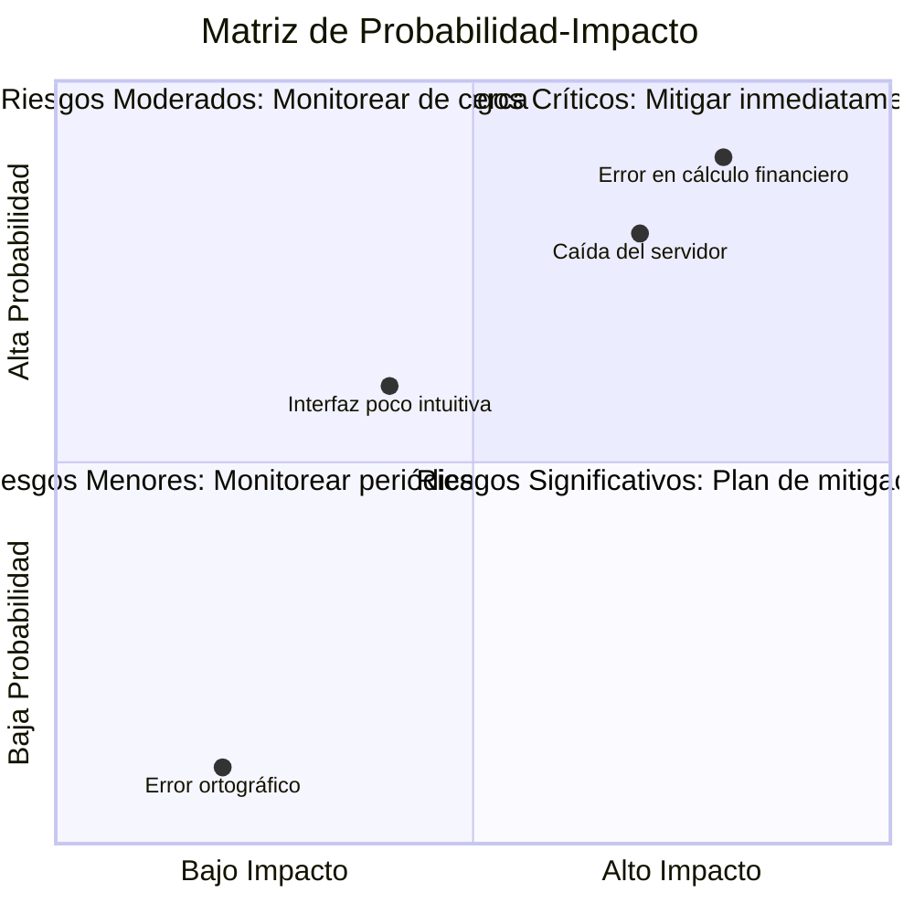
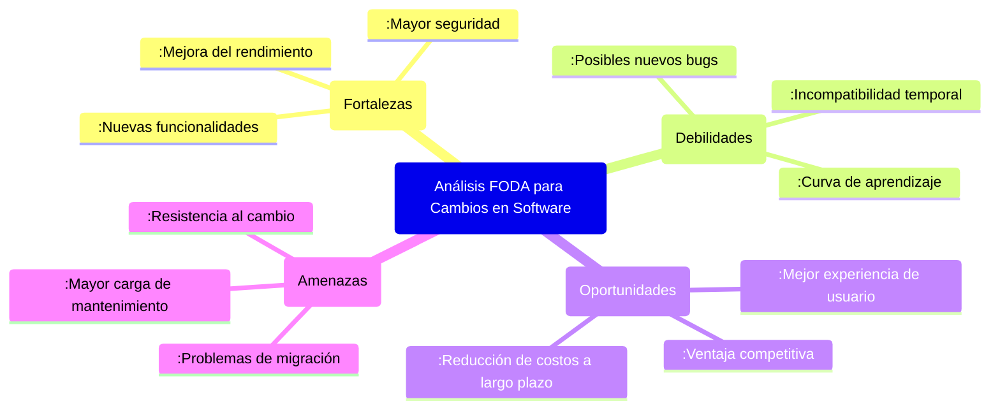

# Ingeniería de Software - Evolución de los sistemas de software

## 7.2 Análisis de riesgo e impacto.

---

El análisis de riesgo e impacto es fundamental en la evolución del software, ya que permite evaluar las consecuencias potenciales de los cambios antes de implementarlos. Según Pfleeger y Atlee (2010), este análisis ayuda a prevenir problemas costosos y garantiza que las modificaciones no degraden la calidad del sistema.

### Definición de Análisis de Riesgo e Impacto

El **análisis de impacto** es el proceso de identificar las consecuencias potenciales de un cambio en el software, mientras que el **análisis de riesgo** evalúa la probabilidad e impacto de eventos adversos resultantes de esos cambios.

### Componentes del Análisis de Riesgo

#### Fórmula Básica de Riesgo

El riesgo se puede cuantificar como:

$$ R = P \times I $$

Donde:

- $R$ = Riesgo
- $P$ = Probabilidad de ocurrencia (0 a 1)
- $I$ = Impacto o consecuencia (generalmente en unidades monetarias o de tiempo)

#### Matriz de Probabilidad-Impacto

Herramienta visual para clasificar riesgos:



### Proceso de Análisis de Impacto

#### Identificación de Componentes Afectados

```python
# Ejemplo de análisis de dependencias
def analyze_impact(change_request, system_dependencies):
    """
    Analiza el impacto de una solicitud de cambio
    """
    affected_components = []
    # Identificar componentes directamente afectados
    direct_components = identify_direct_components(change_request)

    # Identificar componentes indirectamente afectados mediante dependencias
    for component in direct_components:
        affected_components.append(component)
        # Buscar dependencias transitivas
        dependencies = find_transitive_dependencies(component, system_dependencies)
        affected_components.extend(dependencies)

    return list(set(affected_components))  # Eliminar duplicados

# Ejemplo de estructura de dependencias
system_dependencies = {
    "Module_A": ["Module_B", "Database"],
    "Module_B": ["Logger", "Security"],
    "Logger": ["FileSystem"],
    "Security": ["Authentication", "Authorization"]
}
```

#### Cálculo del Impacto Técnico

El impacto técnico se puede medir como:

$$ TI = \sum_{i=1}^{n} (C_i \times W_i) $$

Donde:

- $TI$ = Impacto Técnico total
- $C_i$ = Complejidad del componente i afectado
- $W_i$ = Peso o importancia del componente i

### Técnicas de Análisis de Riesgo

#### Análisis FODA para Evaluación de Riesgos



#### Análisis de Puntos de Función para Estimación

Los puntos de función ajustados consideran el riesgo:

$$ AFP = UFP \times [0.65 + (0.01 \times \sum_{i=1}^{14} V_i)] $$

Donde:

- $AFP$ = Puntos de función ajustados
- $UFP$ = Puntos de función sin ajustar
- $V_i$ = Factores de ajuste de valor (0-5), incluyendo factores de riesgo

### Métricas Cuantitativas de Riesgo

#### Valor Esperado de Pérdida

$$ EV = \sum_{i=1}^{n} P_i \times L_i $$

Donde:

- $EV$ = Valor esperado de pérdida
- $P_i$ = Probabilidad del escenario i
- $L_i$ = Pérdida asociada al escenario i

#### Costo del Riesgo

$$ RC = \sum_{i=1}^{n} (P_i \times C_{mitigation_i}) + \sum_{j=1}^{m} (P_j \times L_j) $$

Donde:

- $RC$ = Costo total del riesgo
- $C_{mitigation_i}$ = Costo de mitigación para el riesgo i
- $L_j$ = Pérdida esperada para el riesgo j no mitigado

### Ejercicios Propuestos

1. **Análisis de Impacto**: Dado el siguiente diagrama de dependencias, determina todos los componentes afectados por un cambio en "Module_A":

```
Module_A → Module_B, Database
Module_B → Logger, Security
Logger → FileSystem
Security → Authentication, Authorization
Database → Storage
```

2. **Cálculo de Riesgo**: Un cambio propuesto tiene:
   - 30% de probabilidad de retrasar el proyecto 2 semanas (costo: $10,000)
   - 10% de probabilidad de introducir un bug crítico (costo: $25,000)
   - 5% de probabilidad de requerir rearquitectura mayor (costo: $50,000)

   Calcula el valor esperado de pérdida y recomienda acciones si el presupuesto de mitigación es de $8,000.

3. **Matriz de Riesgo**: Clasifica los siguientes riesgos en una matriz probabilidad-impacto:
   - Error en cálculo de impuestos: Probabilidad 15%, Impacto Alto
   - Interfaz menos intuitiva: Probabilidad 60%, Impacto Medio
   - Lentitud en respuestas: Probabilidad 25%, Impacto Bajo
   - Incompatibilidad con navegadores antiguos: Probabilidad 40%, Impacto Alto

4. **Análisis FODA**: Realiza un análisis FODA para la migración de un sistema legacy a una arquitectura de microservicios.

### Caso de Estudio: Sistema de Gestión Bancaria

Analiza el riesgo e impacto de los siguientes cambios en un sistema bancario:

1. Implementación de autenticación biométrica
2. Migración de base de datos Oracle a PostgreSQL
3. Adición de nueva funcionalidad de transferencias internacionales

Considera:

- Impacto técnico
- Riesgos de seguridad
- Cumplimiento normativo
- Experiencia del usuario
- Costos asociados

### Plantilla de Documentación de Riesgos

```markdown
# Documento de Análisis de Riesgo e Impacto

### Solicitud de Cambio: [Nombre del cambio]

#### Descripción:

[Breve descripción del cambio propuesto]

#### Componentes Afectados:

- [Lista de componentes directamente afectados]
- [Lista de componentes indirectamente afectados]

#### Análisis de Impacto Técnico:

- Complejidad estimada: [Alta/Media/Baja]
- Esfuerzo estimado: [X horas/puntos de historia]
- Recursos requeridos: [Lista de recursos]

#### Identificación de Riesgos:

| Riesgo     | Probabilidad | Impacto | Mitigación           |
| ---------- | ------------ | ------- | -------------------- |
| [Riesgo 1] | [P]          | [I]     | [Plan de mitigación] |
| [Riesgo 2] | [P]          | [I]     | [Plan de mitigación] |

#### Valoración Global:

- Riesgo general: [Alto/Medio/Bajo]
- Recomendación: [Aprobar/Rechazar/Aprobar con condiciones]
```

### Referencias

#### Bibliografía Básica

1. Sommerville, Ian. (2010). _Software Engineering_ (9th edition). Addison Wesley. (Capítulos 23, 25)
2. Pfleeger, S. L., & Atlee, J. M. (2010). _Software Engineering: Theory and Practice_ (4th edition). Prentice Hall. (Capítulos 3, 7)

#### Bibliografía Complementaria

3. Boehm, B. W., & Turner, R. (2003). _Balancing Agility and Discipline: A Guide for the Perplexed_. Addison-Wesley. (Capítulo 5)
4. Monson-Haefel, R. (Ed.). (2009). _97 Things Every Software Architect Should Know_. O'Reilly Media. (Artículos 15, 28, 42)

### Conclusión

El análisis de riesgo e impacto es una disciplina crítica en la ingeniería de software que permite tomar decisiones informadas sobre cambios en el sistema. Una evaluación adecuada ayuda a prevenir problemas costosos, optimiza la asignación de recursos y garantiza que la evolución del software se realice de manera controlada y segura. La implementación sistemática de estas prácticas contribuye significativamente al éxito a largo plazo de los proyectos de software.
