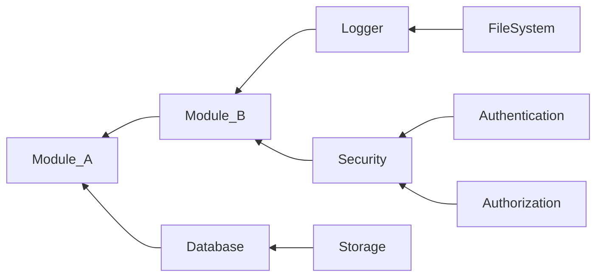

# Ingeniería de Software - Evolución de los sistemas de software

## 7.2 Análisis de riesgo e impacto.

---

Antes de cambiar un sistema en operación hay que responder dos preguntas: **qué** se verá afectado por el cambio, y **qué tan probable y qué tan grave** es que algo salga mal. La primera es el **análisis de impacto**, que estima el alcance del cambio sobre el código, los datos, las pruebas y la documentación. La segunda es el **análisis de riesgo**, que estima la probabilidad y las consecuencias de los problemas posibles para decidir si hacer el cambio, cómo y con qué precauciones. Este tema presenta ambos análisis, sus técnicas y su uso en la decisión de cambiar un sistema.

### Análisis de impacto

Bohner y Arnold distinguen el **conjunto de impacto inicial**, los artefactos que se planea modificar, del **conjunto de impacto estimado**, los que podrían verse afectados, que se obtiene siguiendo las dependencias. Las fuentes son:

- **las dependencias del código:** llamadas, herencia, uso de tipos, accesos a datos compartidos, obtenidos con análisis estático;
- **el rastreo** de requerimientos a diseño, código y pruebas (tema 4.7);
- **la historia del repositorio:** archivos que suelen cambiar juntos, aunque no haya una dependencia explícita, el **acoplamiento evolutivo**.

La **dirección** de las dependencias importa. Si A **usa** a B, un cambio en la interfaz de B puede romper a A, pero un cambio en A no afecta a B. El impacto se propaga **en sentido contrario** a las flechas de uso: desde lo que cambia hacia quienes dependen de ello. Lo que A usa solo hay que revisarlo si el cambio en A modifica **cómo** lo usa, por ejemplo con consultas nuevas a la base de datos.

### Análisis de riesgo

Cada riesgo del cambio se describe con su **probabilidad** $P$ y su **impacto** $I,$ y su exposición o pérdida esperada es $P \cdot I$ (tema 1.2). La **matriz de probabilidad e impacto** clasifica los riesgos en niveles cualitativos cuando no hay cifras, y guía la respuesta: los críticos se mitigan antes de proceder, los bajos se aceptan y se vigilan. Una **mitigación** vale la pena si su apalancamiento, la reducción de la exposición dividida entre su costo, es mayor que 1.

El valor esperado no es el único criterio. Una organización que no puede absorber una pérdida grande es **adversa al riesgo**, y pagará por reducir la probabilidad de una catástrofe aunque el valor esperado no lo justifique, como se paga un seguro.

### Reducción del riesgo del cambio

Las prácticas que reducen el riesgo de cambiar un sistema en operación son: cambios **pequeños** y frecuentes; **pruebas de regresión** automatizadas (tema 7.3); **interruptores de funciones** (*feature flags*), que permiten activar el cambio para una parte de los usuarios y desactivarlo sin un nuevo despliegue; **despliegues canario**, a un porcentaje del tráfico con monitoreo; y un **plan de reversión** probado.



El diagrama dibuja las flechas en el sentido de la propagación del impacto: un cambio en Security puede afectar a Module_B y, a través de él, a Module_A.

### Implementación en Python

El programa resuelve el ejercicio 1 recorriendo el grafo de dependencias en ambos sentidos. Para el ejercicio 2 calcula la pérdida esperada y evalúa tres mitigaciones posibles por su apalancamiento con el presupuesto disponible. Para el ejercicio 3 clasifica los riesgos en la matriz.

```python
from collections import deque

# ---------- Ejercicio 1: impacto de un cambio según la dirección de las dependencias ----------
usa = {"Module_A": ["Module_B", "Database"], "Module_B": ["Logger", "Security"], "Logger": ["FileSystem"],
       "Security": ["Authentication", "Authorization"], "Database": ["Storage"]}
def alcanzables(g, inicio):
    vistos, cola = [], deque([inicio])
    while cola:
        n = cola.popleft()
        for m in g.get(n, []):
            if m not in vistos: vistos.append(m); cola.append(m)
    return vistos
dependen_de = {}
for a, bs in usa.items():
    for b in bs: dependen_de.setdefault(b, []).append(a)
print("ejercicio 1: lo que Module_A usa, directa o indirectamente:", alcanzables(usa, "Module_A"))
print("   quién depende de Module_A (lo que un cambio en su interfaz puede romper):", alcanzables(dependen_de, "Module_A") or "nadie")
print("   un cambio en Security afecta a:", alcanzables(dependen_de, "Security"), "| en Storage:", alcanzables(dependen_de, "Storage"))

# ---------- Ejercicio 2: pérdida esperada y presupuesto de mitigación ----------
riesgos = {"retraso de 2 semanas": (0.30, 10_000), "defecto crítico": (0.10, 25_000), "rearquitectura mayor": (0.05, 50_000)}
pe = {k: p * c for k, (p, c) in riesgos.items()}
print("ejercicio 2: pérdida esperada", {k: f"{v:,.0f}" for k, v in pe.items()}, f"| total {sum(pe.values()):,.0f}")
mitigaciones = [  # (riesgo, acción, costo, probabilidad después)
    ("defecto crítico", "pruebas de regresión y revisión adicionales", 2_000, 0.03),
    ("rearquitectura mayor", "prueba de concepto de 1 semana", 4_000, 0.01),
    ("retraso de 2 semanas", "dividir el cambio en entregas", 3_000, 0.20)]
elegidas, gastado = [], 0
for r, accion, costo, p2 in sorted(mitigaciones, key=lambda m: -(pe[m[0]] - m[3] * riesgos[m[0]][1]) / m[2]):
    ahorro = pe[r] - p2 * riesgos[r][1]
    rrl = ahorro / costo
    if gastado + costo <= 8_000 and rrl > 1: elegidas.append(r); gastado += costo
    print(f"   {accion:45} costo {costo:>5,} | reduce {ahorro:>6,.0f} | RRL {rrl:.2f} | {'elegida' if r in elegidas else 'no'}")
nueva = sum(pe[r] if r not in elegidas else next(m[3] for m in mitigaciones if m[0] == r) * riesgos[r][1] for r in riesgos)
print(f"   presupuesto usado {gastado:,} de 8,000 | pérdida esperada después {nueva:,.0f} | costo total esperado {nueva + gastado:,.0f}")

# ---------- Ejercicio 3: matriz de probabilidad e impacto ----------
def nivel_p(p): return "alta" if p >= 0.5 else "media" if p >= 0.2 else "baja"
MATRIZ = {("alta", "alto"): "crítico", ("alta", "medio"): "alto", ("alta", "bajo"): "medio",
          ("media", "alto"): "alto", ("media", "medio"): "medio", ("media", "bajo"): "bajo",
          ("baja", "alto"): "medio", ("baja", "medio"): "bajo", ("baja", "bajo"): "bajo"}
casos = [("error en el cálculo de impuestos", 0.15, "alto"), ("interfaz menos intuitiva", 0.60, "medio"),
         ("lentitud en las respuestas", 0.25, "bajo"), ("incompatibilidad con navegadores antiguos", 0.40, "alto")]
for n, p, i in casos: print(f"ejercicio 3: {n:42} P = {p:.2f} ({nivel_p(p)}), impacto {i:5} → {MATRIZ[(nivel_p(p), i)]}")
```

Salida:

```text
ejercicio 1: lo que Module_A usa, directa o indirectamente: ['Module_B', 'Database', 'Logger', 'Security', 'Storage', 'FileSystem', 'Authentication', 'Authorization']
   quién depende de Module_A (lo que un cambio en su interfaz puede romper): nadie
   un cambio en Security afecta a: ['Module_B', 'Module_A'] | en Storage: ['Database', 'Module_A']
ejercicio 2: pérdida esperada {'retraso de 2 semanas': '3,000', 'defecto crítico': '2,500', 'rearquitectura mayor': '2,500'} | total 8,000
   pruebas de regresión y revisión adicionales   costo 2,000 | reduce  1,750 | RRL 0.88 | no
   prueba de concepto de 1 semana                costo 4,000 | reduce  2,000 | RRL 0.50 | no
   dividir el cambio en entregas                 costo 3,000 | reduce  1,000 | RRL 0.33 | no
   presupuesto usado 0 de 8,000 | pérdida esperada después 8,000 | costo total esperado 8,000
ejercicio 3: error en el cálculo de impuestos           P = 0.15 (baja), impacto alto  → medio
ejercicio 3: interfaz menos intuitiva                   P = 0.60 (alta), impacto medio → alto
ejercicio 3: lentitud en las respuestas                 P = 0.25 (media), impacto bajo  → bajo
ejercicio 3: incompatibilidad con navegadores antiguos  P = 0.40 (media), impacto alto  → alto
```

### Ejercicios Propuestos

1. **Impacto.** Con estas dependencias, determina todos los componentes afectados por un cambio en Module_A:

    ```text
    Module_A → Module_B, Database
    Module_B → Logger, Security
    Logger → FileSystem
    Security → Authentication, Authorization
    Database → Storage
    ```

2. **Riesgo.** Un cambio propuesto tiene 30 % de probabilidad de retrasar el proyecto 2 semanas, con un costo de 10 000; 10 % de introducir un defecto crítico, con un costo de 25 000, y 5 % de requerir una rearquitectura mayor, con un costo de 50 000. Calcula la pérdida esperada y recomienda acciones si el presupuesto de mitigación es de 8 000.

3. **Matriz.** Clasifica en una matriz de probabilidad e impacto: un error en el cálculo de impuestos, con probabilidad 15 % e impacto alto; una interfaz menos intuitiva, 60 % y medio; lentitud en las respuestas, 25 % y bajo; incompatibilidad con navegadores antiguos, 40 % y alto.

4. **FODA.** Haz un análisis FODA de la migración de un sistema heredado a microservicios.

### Soluciones

**Ejercicio 1.** La respuesta depende de qué significan las flechas, y el enunciado no lo dice. Si `Module_A → Module_B` significa que A **usa** a B, que es la lectura habitual de un diagrama de dependencias, entonces **ningún** componente del diagrama depende de A, y un cambio interno en A no afecta a ninguno de ellos; lo que A usa, los otros 8 componentes, solo debe revisarse si el cambio altera cómo A los usa. La lista de "todos los alcanzables desde A", Module_B, Database, Logger, Security, Storage, FileSystem, Authentication y Authorization, es la respuesta correcta solo si las flechas indican propagación del impacto, es decir, si B depende de A. El programa calcula ambas cosas y muestra el caso inverso: un cambio en Security afecta a Module_B y a Module_A. El error de leer el grafo en el sentido equivocado es común y lleva a probar lo que no cambió y omitir lo que se rompió.

**Ejercicio 2.** La pérdida esperada es $0.30 \cdot 10\,000 + 0.10 \cdot 25\,000 + 0.05 \cdot 50\,000 = 3\,000 + 2\,500 + 2\,500 = 8\,000,$ exactamente el presupuesto de mitigación. Con mitigaciones supuestas, ninguna tiene un apalancamiento mayor que 1: las pruebas adicionales, la mejor, reducen la exposición en 1 750 con un costo de 2 000. Con un criterio de **valor esperado**, la recomendación sería no gastar en mitigación y aceptar los riesgos. Pero hay dos razones para no detenerse ahí: si un defecto crítico o una rearquitectura de 50 000 pondrían en problemas al proyecto, la aversión al riesgo justifica pagar 2 000 por las pruebas y 4 000 por la prueba de concepto, como un seguro; y las cifras de probabilidad son estimaciones gruesas, que la prueba de concepto misma ayudaría a afinar. También conviene preguntar si el cambio vale la pena: si su beneficio esperado no supera claramente los 8 000 de pérdida esperada más el costo de hacerlo, la mejor mitigación es no hacerlo o reducir su alcance.

**Ejercicio 3.** Con probabilidad baja menor que 20 %, media hasta 50 % y alta desde 50 %:

| Riesgo                                     | Probabilidad | Impacto | Nivel |
| ------------------------------------------ | ------------ | ------- | ----- |
| Incompatibilidad con navegadores antiguos  | Media, 40 %  | Alto    | Alto  |
| Interfaz menos intuitiva                   | Alta, 60 %   | Medio   | Alto  |
| Error en el cálculo de impuestos           | Baja, 15 %   | Alto    | Medio |
| Lentitud en las respuestas                 | Media, 25 %  | Bajo    | Bajo  |

La matriz es una ayuda, no una regla: un error en el cálculo de impuestos tiene consecuencias legales, y muchas organizaciones lo tratarían como crítico por su impacto aunque sea poco probable, con pruebas exhaustivas contra casos calculados por el área fiscal. Los umbrales entre niveles son una convención que cada organización debe fijar y documentar.

**Ejercicio 4.**

- **Fortalezas** internas: el conocimiento del dominio acumulado en el sistema y en el equipo; un sistema que funciona y sirve de referencia para comparar; la posibilidad de migrar por partes.
- **Debilidades** internas: falta de pruebas y documentación del sistema heredado; poca experiencia del equipo en sistemas distribuidos; datos compartidos por todo el monolito, difíciles de separar.
- **Oportunidades** externas: escalar y desplegar por separado las partes con más demanda; servicios administrados en la nube; atraer y retener desarrolladores con tecnologías actuales.
- **Amenazas** externas: el costo operativo de muchos servicios; la consistencia de datos entre servicios; la presión del negocio para entregar funciones durante la migración; proveedores del sistema heredado que dejen de dar soporte.

La conclusión práctica del análisis es migrar de forma incremental con el patrón estrangulador (tema 5.5), empezando por las debilidades: pruebas de caracterización del sistema actual y capacitación del equipo antes del primer servicio.

### Referencias

1. Bohner, S. A., and Arnold, R. S., _Software Change Impact Analysis_. IEEE Computer Society Press, 1996.
2. Boehm, B. W., Software risk management: principles and practices. _IEEE Software_ 8(1), 1991.
3. Project Management Institute, _A Guide to the Project Management Body of Knowledge (PMBOK Guide)_. PMI, 2021.
4. Zimmermann, T., Weißgerber, P., Diehl, S., and Zeller, A., Mining version histories to guide software changes. _ICSE_, 2004.
5. Humble, J., and Farley, D., _Continuous Delivery_. Addison-Wesley, 2010.
