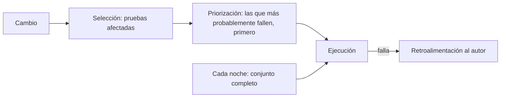

# Ingeniería de Software - Evolución de los sistemas de software

## 7.3 Pruebas de regresión.

---

Una **regresión** es un defecto en algo que antes funcionaba, introducido por un cambio. Las **pruebas de regresión** vuelven a ejecutar pruebas existentes después de cada cambio para detectarlas. Son la red de seguridad que permite modificar un sistema con confianza, y por eso son la condición para refactorizar, actualizar dependencias o integrar con frecuencia. Su problema es el costo: un conjunto de pruebas crece con el sistema, y ejecutarlo completo después de cada cambio puede tardar horas. Este tema presenta las tres estrategias para controlar ese costo, **minimización**, **selección** y **priorización**, las métricas para evaluar las pruebas de regresión y el problema de las pruebas inestables.

### Estrategias

Yoo y Harman organizan el área en tres problemas:

- **Minimización:** eliminar pruebas redundantes, conservando un subconjunto que cubra los mismos requisitos o el mismo código. Encontrar el subconjunto **mínimo** es el problema de la cobertura de conjuntos, NP-difícil en general; el **algoritmo voraz**, que elige cada vez la prueba que cubre más elementos no cubiertos, da una aproximación con un factor logarítmico, y para conjuntos pequeños se resuelve exactamente. El riesgo es que dos pruebas que cubren lo mismo no detectan necesariamente los mismos defectos.
- **Selección:** ejecutar solo las pruebas afectadas por el cambio, con un mapa de qué código ejecuta cada prueba. Es la técnica de los sistemas de compilación como Bazel, y la base de las herramientas de selección de pruebas en repositorios grandes. Es **segura** si nunca omite una prueba que podría fallar.
- **Priorización:** ejecutar todas, pero en un orden que encuentre los defectos lo antes posible: primero las que fallaron recientemente, las que cubren el código cambiado o las que cubren más código nuevo. La métrica APFD mide qué tan pronto se detectan los defectos en un orden dado.

En la práctica se combinan: en cada cambio, las pruebas seleccionadas y priorizadas; antes de una entrega o cada noche, el conjunto completo.

### Métricas

- **Porcentaje de detección de defectos** (PDD): los defectos encontrados por las pruebas sobre el total, incluidos los que llegaron a producción; es la DRE del tema 6.6 aplicada a la regresión.
- **Tasa de aprobación:** las pruebas que pasan sobre las ejecutadas. **No** mide la efectividad: una tasa de 100 % puede significar que no hay defectos o que las pruebas no detectan nada.
- **Tiempo de ejecución** y **tiempo hasta la primera falla**, que determinan la retroalimentación.
- **Tasa de pruebas inestables.**

### Pruebas inestables

Una prueba **inestable** (*flaky*) pasa y falla sin que cambie el código, por dependencias del tiempo, del orden de ejecución, de la concurrencia o de servicios externos. Estudios de Google reportaron que una fracción importante de las fallas observadas en su integración continua se debía a pruebas inestables. Son dañinas porque enseñan al equipo a ignorar las fallas. Se deben detectar, ejecutando de nuevo las que fallan; **poner en cuarentena**, fuera de la ruta que bloquea la integración, y corregir su causa, no reintentarlas indefinidamente.



### Implementación en Python

El programa resuelve el ejercicio 1 por búsqueda exhaustiva y con el algoritmo voraz, el ejercicio 2 con las métricas del enunciado y el ejercicio 3 ordenando por la tasa de fallas, con y sin suavizado de Laplace. Al final muestra la selección de pruebas por los archivos que cambiaron.

```python
from itertools import combinations

# ---------- Ejercicio 1: minimización del conjunto de pruebas (cobertura de conjuntos) ----------
cubre = {"T1": {"R1", "R2", "R3"}, "T2": {"R2", "R4"}, "T3": {"R3", "R5"}, "T4": {"R1", "R4", "R5"}, "T5": {"R2", "R3", "R5"}}
requisitos = set().union(*cubre.values())
def minimo_exacto():
    for k in range(1, len(cubre) + 1):
        sols = [c for c in combinations(sorted(cubre), k) if set().union(*(cubre[t] for t in c)) == requisitos]
        if sols: return k, sols
def voraz():
    falta, elegidas = set(requisitos), []
    while falta:
        t = max(sorted(cubre), key=lambda t: len(cubre[t] & falta)); elegidas.append(t); falta -= cubre[t]
    return elegidas
k, sols = minimo_exacto()
print(f"ejercicio 1: mínimo exacto {k} pruebas, soluciones {sols} | algoritmo voraz: {voraz()}")

# ---------- Ejercicio 2: métricas ----------
ejecutadas, pasaron, def_pruebas, def_prod = 350, 320, 15, 5
print(f"ejercicio 2: PDD = {def_pruebas}/({def_pruebas} + {def_prod}) = {def_pruebas / (def_pruebas + def_prod):.0%}"
      f" | tasa de aprobación (lo que el texto llama RTE) = {pasaron}/{ejecutadas} = {pasaron / ejecutadas:.1%}")
print(f"   pruebas fallidas {ejecutadas - pasaron} para {def_pruebas} defectos: {(ejecutadas - pasaron) / def_pruebas:.1f} fallas por defecto")

# ---------- Ejercicio 3: priorización por historial ----------
hist = {"A": (8, 10), "B": (2, 15), "C": (5, 8), "D": (1, 20)}
def tasa(f, n): return f / n
def laplace(f, n): return (f + 1) / (n + 2)                     # suaviza las muestras pequeñas
for nombre, fn in (("tasa observada", tasa), ("tasa con suavizado de Laplace", laplace)):
    orden = sorted(hist, key=lambda t: -fn(*hist[t]))
    print(f"ejercicio 3: {nombre:30}", " > ".join(f"{t} ({fn(*hist[t]):.3f})" for t in orden))

# ---------- Selección por cambios: solo las pruebas que tocan el código modificado ----------
toca = {"test_pago_tarjeta": {"pagos.py", "carrito.py"}, "test_pago_nuevo": {"pagos.py", "billetera.py"},
        "test_carrito": {"carrito.py"}, "test_envio": {"envio.py", "carrito.py"}, "test_login": {"auth.py"}}
cambiados = {"pagos.py", "billetera.py"}
sel = sorted(t for t, f in toca.items() if f & cambiados)
print(f"selección por cambios en {sorted(cambiados)}: {sel} ({len(sel)} de {len(toca)} pruebas)")
```

Salida:

```text
ejercicio 1: mínimo exacto 2 pruebas, soluciones [('T1', 'T4'), ('T4', 'T5')] | algoritmo voraz: ['T1', 'T4']
ejercicio 2: PDD = 15/(15 + 5) = 75% | tasa de aprobación (lo que el texto llama RTE) = 320/350 = 91.4%
   pruebas fallidas 30 para 15 defectos: 2.0 fallas por defecto
ejercicio 3: tasa observada                 A (0.800) > C (0.625) > B (0.133) > D (0.050)
ejercicio 3: tasa con suavizado de Laplace  A (0.750) > C (0.600) > B (0.176) > D (0.091)
selección por cambios en ['billetera.py', 'pagos.py']: ['test_pago_nuevo', 'test_pago_tarjeta'] (2 de 5 pruebas)
```

### Ejercicios Propuestos

1. **Minimización.** Las pruebas cubren los requisitos así: T1, R1, R2 y R3; T2, R2 y R4; T3, R3 y R5; T4, R1, R4 y R5; T5, R2, R3 y R5. Encuentra el conjunto mínimo de pruebas que cubra de R1 a R5.

2. **Métricas.** En una iteración se ejecutaron 350 pruebas de regresión, 320 pasaron, se detectaron 15 defectos y luego se encontraron 5 en producción. Calcula el PDD y la RTE, $\mathrm{RTE} = T_p / T_t,$ y determina la efectividad del proceso.

3. **Priorización.** Ordena por su historial de fallas: A falló 8 veces en los últimos 10 cambios; B, 2 en 15; C, 5 en 8; D, 1 en 20.

4. **Diseño.** Para un comercio electrónico que implementó un nuevo método de pago, diseña 3 pruebas de regresión de la funcionalidad existente, 2 de la nueva y 1 de integración entre ambas.

### Soluciones

**Ejercicio 1.** Ninguna prueba cubre los cinco requisitos, así que el mínimo es al menos 2, y hay dos soluciones de tamaño 2: **{T1, T4}** y **{T4, T5}**. T4 es indispensable en ambas porque es la única, junto con T2, que cubre R4, y combina R4 con R1 y R5. El algoritmo voraz encuentra {T1, T4}, que en este caso es óptima. La reducción es de 5 a 2 pruebas, pero antes de eliminar T2, T3 y T5 conviene comprobar que no detectan defectos distintos, por ejemplo con mutación: cubrir el mismo requisito no es probarlo de la misma forma.

**Ejercicio 2.** $\mathrm{PDD} = 15 / (15 + 5) = 75\,\%:$ una de cada cuatro regresiones escapó a producción. La "RTE" del texto, $320 / 350 \approx 91.4\,\%,$ es la tasa de **aprobación**, y no mide la efectividad: que pasen más pruebas no significa que sean mejores. La efectividad la mide el PDD, y 75 % es bajo para pruebas de regresión. Las 30 pruebas fallidas para 15 defectos, dos por defecto, son normales; si muchas fallas no correspondieran a defectos, habría que revisar la inestabilidad. La acción es analizar los 5 defectos de producción: qué parte del código tocaban y por qué ninguna prueba los detectó, y agregar esas pruebas.

**Ejercicio 3.** Por tasa de fallas: A, 0.80; C, 0.625; B, 0.133; D, 0.05. El orden es **A, C, B, D**. Con pocas observaciones, la tasa es incierta; el suavizado de Laplace, $(f + 1)/(n + 2),$ la acerca a 0.5 cuando hay pocos datos, y aquí no cambia el orden. Una prueba que falla 8 de cada 10 veces merece además una investigación: o el código que prueba es muy frágil, o la prueba es inestable. Los criterios reales combinan el historial con la relación con el cambio actual, como en la selección del programa, que con cambios en los pagos solo elige las dos pruebas que los tocan.

**Ejercicio 4.**

- **Regresión de lo existente:** pagar con tarjeta un carrito con varios artículos y verificar el cobro, el pedido y el correo de confirmación; rechazo de una tarjeta, sin crear el pedido; reembolso de un pedido pagado con tarjeta.
- **Nueva funcionalidad**, por ejemplo una billetera digital: pago exitoso con la billetera; tiempo límite o cancelación del usuario en la ventana de la billetera, con el carrito intacto.
- **Integración:** un pedido pagado en parte con saldo de la billetera y en parte con tarjeta, y su reembolso proporcional a cada medio.

Las pruebas de regresión deben automatizarse y entrar al conjunto permanente; las de la nueva funcionalidad, una vez estables, también.

### Referencias

1. Yoo, S., and Harman, M., Regression testing minimization, selection and prioritization: a survey. _Software Testing, Verification and Reliability_ 22(2), 2012.
2. Rothermel, G., Untch, R. H., Chu, C., and Harrold, M. J., Prioritizing test cases for regression testing. _IEEE Transactions on Software Engineering_ 27(10), 2001.
3. Luo, Q., Hariri, F., Eloussi, L., and Marinov, D., An empirical analysis of flaky tests. _FSE_, 2014.
4. Memon, A., et al., Taming Google-scale continuous testing. _ICSE SEIP_, 2017.
5. Chvátal, V., A greedy heuristic for the set-covering problem. _Mathematics of Operations Research_ 4(3), 1979.
