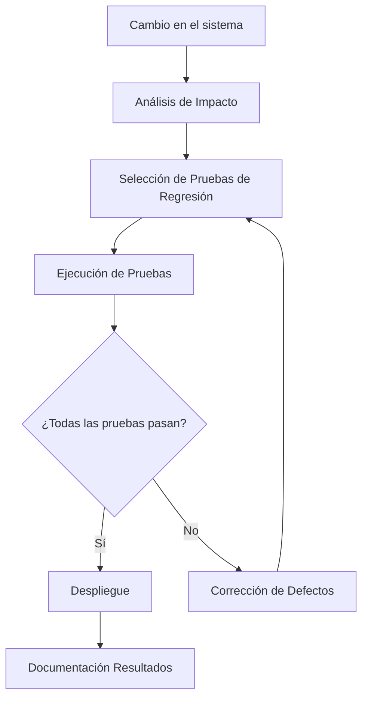

# Ingeniería de Software - Evolución de los sistemas de software

## 7.3 Pruebas de regresión.

---

Las pruebas de regresión son un componente crítico en el proceso de evolución del software que verifica que los cambios realizados no han introducido nuevos defectos en funcionalidades existentes. Según Sommerville (2010), estas pruebas son esenciales para mantener la integridad del sistema durante su ciclo de vida.

### Definición de Pruebas de Regresión

Las **pruebas de regresión** son un tipo de pruebas de software que buscan detectar errores, fallos o bugs en funcionalidades existentes después de modificaciones como enhancements, parches o configuraciones. Su objetivo principal es asegurar que los cambios no afecten adversamente el comportamiento previsto del sistema.

### Importancia de las Pruebas de Regresión

Pfleeger y Atlee (2010) destacan que entre el 60% y 80% de los costos del ciclo de vida del software corresponden a la fase de mantenimiento, donde las pruebas de regresión juegan un papel crucial para reducir costos al detectar problemas tempranamente.

### Tipos de Pruebas de Regresión

#### Pruebas de Regresión Completa

Se ejecutan todos los casos de prueba existentes para asegurar que ningún cambio ha afectado la funcionalidad existente.

#### Pruebas de Regresión Selectiva

Se selecciona un subconjunto de casos de prueba basado en el análisis de impacto de los cambios.

#### Pruebas de Regresión Progresiva

Se crean nuevos casos de prueba para nuevas funcionalidades mientras se mantienen los existentes.

### Métricas de Pruebas de Regresión

#### Porcentaje de Detección de Defectos (PDD)

$$ PDD = \frac{N_d}{N_d + N_e} \times 100 $$

Donde:

- $N_d$ = Número de defectos detectados por las pruebas de regresión
- $N_e$ = Número de defectos encontrados en producción

#### Efectividad de las Pruebas de Regresión (RTE)

$$ RTE = \frac{T_p}{T_t} \times 100 $$

Donde:

- $T_p$ = Número de pruebas que pasaron correctamente
- $T_t$ = Número total de pruebas ejecutadas

#### Cobertura de Regresión (RC)

$$ RC = \frac{C_t}{C_a} \times 100 $$

Donde:

- $C_t$ = Componentes probados
- $C_a$ = Componentes afectados por cambios

### Estrategias de Selección de Pruebas de Regresión

#### Minimización de Conjunto de Pruebas

Busca eliminar casos de prueba redundantes manteniendo la misma cobertura.

```python
# Algoritmo básico de minimización de conjunto de pruebas
def minimize_test_suite(test_cases, requirements_coverage):
    """
    Minimiza el conjunto de pruebas manteniendo la cobertura de requisitos
    """
    minimized_suite = []
    covered_requirements = set()

    # Ordenar pruebas por cobertura (mayor a menor)
    test_cases.sort(key=lambda x: len(x['coverage']), reverse=True)

    for test_case in test_cases:
        # Verificar si agrega cobertura nueva
        new_coverage = set(test_case['coverage']) - covered_requirements
        if new_coverage:
            minimized_suite.append(test_case)
            covered_requirements.update(new_coverage)

    return minimized_suite

# Ejemplo de uso
test_cases = [
    {'id': 'T1', 'coverage': ['R1', 'R2']},
    {'id': 'T2', 'coverage': ['R2', 'R3']},
    {'id': 'T3', 'coverage': ['R3', 'R4']},
    {'id': 'T4', 'coverage': ['R1', 'R4']}
]

minimized = minimize_test_suite(test_cases, ['R1', 'R2', 'R3', 'R4'])
```

#### Priorización de Pruebas

Ordena las pruebas basándose en criterios como criticidad, probabilidad de fallo o historial de cambios.

### Automatización de Pruebas de Regresión

#### Framework de Pruebas con Selenium

```java
// Ejemplo de prueba de regresión automatizada con Page Object Pattern
public class LoginRegressionTest {
    private WebDriver driver;
    private LoginPage loginPage;

    @BeforeEach
    public void setUp() {
        driver = new ChromeDriver();
        loginPage = new LoginPage(driver);
    }

    @Test
    public void testValidLogin() {
        loginPage.navigateTo();
        loginPage.enterCredentials("validUser", "correctPassword");
        loginPage.clickLogin();

        assertEquals("Dashboard", driver.getTitle(),
                   "Login válido debería redirigir al dashboard");
    }

    @Test
    public void testInvalidLogin() {
        loginPage.navigateTo();
        loginPage.enterCredentials("invalidUser", "wrongPassword");
        loginPage.clickLogin();

        assertTrue(loginPage.getErrorMessage().contains("Invalid credentials"),
                 "Debería mostrar mensaje de error con credenciales inválidas");
    }

    @AfterEach
    public void tearDown() {
        driver.quit();
    }
}
```

### Proceso de Pruebas de Regresión



### Retos en Pruebas de Regresión

#### Costo vs. Cobertura

El dilema entre ejecutar todas las pruebas (alto costo) vs. ejecutar un subconjunto (riesgo de no detectar defectos).

#### Mantenimiento del Suite de Pruebas

Las pruebas requieren actualización constante para reflejar cambios en la aplicación.

#### Entorno de Pruebas

Necesidad de mantener entornos que reflejen fielmente el entorno de producción.

### Ejercicios Propuestos

1. **Minimización de Suite de Pruebas**: Dado el siguiente conjunto de pruebas y requisitos que cubren:

   ```
   T1: Cubre R1, R2, R3
   T2: Cubre R2, R4
   T3: Cubre R3, R5
   T4: Cubre R1, R4, R5
   T5: Cubre R2, R3, R5
   ```

   Encuentra el conjunto mínimo de pruebas que cubra todos los requisitos (R1-R5).

2. **Cálculo de Métricas**: Después de una iteración de desarrollo:
   - Se ejecutaron 350 pruebas de regresión
   - 320 pruebas pasaron exitosamente
   - Se detectaron 15 defectos durante pruebas
   - Se encontraron 5 defectos en producción

   Calcula PDD, RTE y determina la efectividad del proceso.

3. **Priorización de Pruebas**: Ordena las siguientes pruebas basándote en su historial de fallos:

   ```
   Prueba A: Falló 8 veces en los últimos 10 cambios
   Prueba B: Falló 2 veces en los últimos 15 cambios
   Prueba C: Falló 5 veces en los últimos 8 cambios
   Prueba D: Falló 1 vez en los últimos 20 cambios
   ```

4. **Diseño de Pruebas**: Para un sistema de comercio electrónico que ha implementado un nuevo método de pago, diseña:
   - 3 pruebas de regresión para funcionalidad existente
   - 2 pruebas para la nueva funcionalidad
   - 1 prueba de integración entre lo antiguo y lo nuevo

### Caso de Estudio: Sistema Bancario

Analiza la estrategia de pruebas de regresión para un sistema bancario que debe:

1. Migrar de Java 8 a Java 17
2. Agregar funcionalidad de pagos internacionales
3. Mantener compatibilidad con sistemas legacy

Considera:

- Selección de pruebas críticas
- Automatización necesaria
- Plan de rollback en caso de fallos
- Métricas de éxito

### Referencias

#### Bibliografía Básica

1. Sommerville, Ian. (2010). _Software Engineering_ (9th edition). Addison Wesley. (Capítulos 23, 25)
2. Pfleeger, S. L., & Atlee, J. M. (2010). _Software Engineering: Theory and Practice_ (4th edition). Prentice Hall. (Capítulos 8, 9)

#### Bibliografía Complementaria

3. Boehm, B. W., & Turner, R. (2003). _Balancing Agility and Discipline: A Guide for the Perplexed_. Addison-Wesley. (Capítulo 6)
4. Evans, Eric. (2003). _Domain-Driven Design: Tackling Complexity in the Heart of Software_. Addison Wesley. (Capítulo 10)

### Conclusión

Las pruebas de regresión son una actividad esencial en el mantenimiento y evolución del software que garantiza la estabilidad del sistema ante cambios continuos. La implementación efectiva de estrategias de selección, priorización y automatización de pruebas permite balancear adecuadamente el costo de testing con la calidad del software entregado. La medición continua mediante métricas apropiadas es crucial para mejorar iterativamente el proceso de pruebas.
