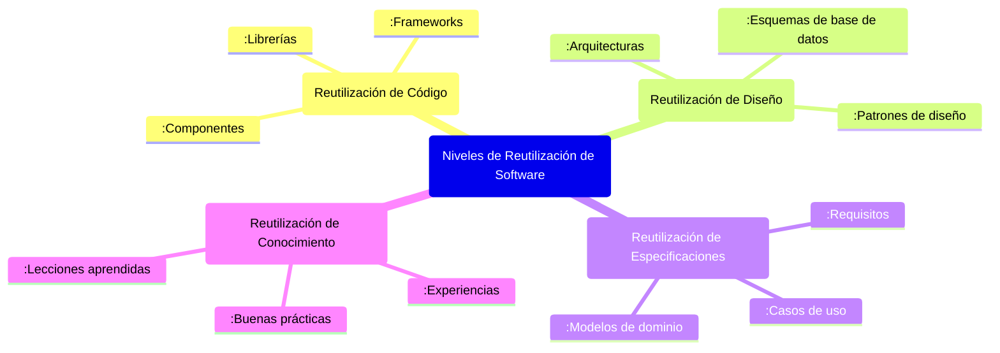
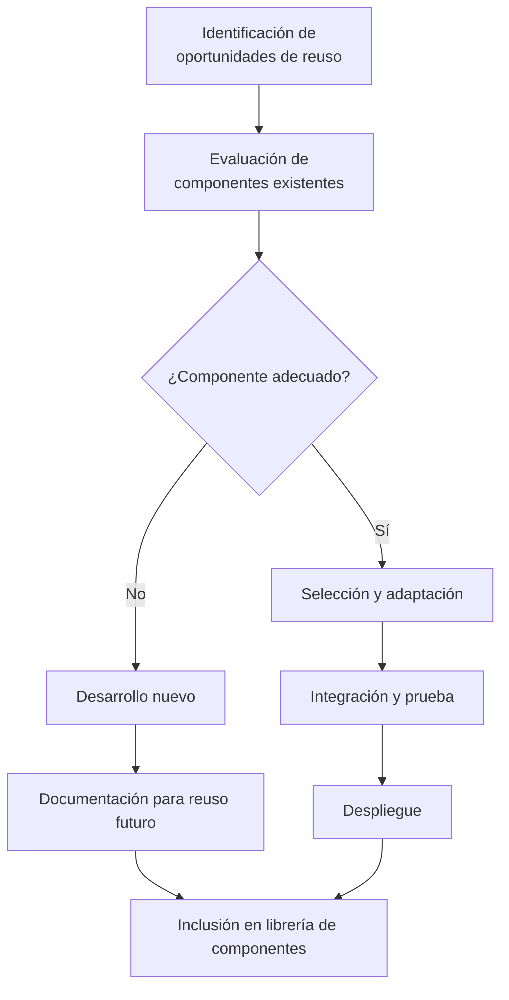

# Ingeniería de Software - Evolución de los sistemas de software

## 7.4 Reutilización de software.

---

La reutilización de software es una estrategia fundamental en la ingeniería de software que consiste en la creación y uso de activos software con el propósito de ser empleados en múltiples sistemas. Según Sommerville (2010), la reutilización sistemática puede reducir costos, mejorar la calidad y acelerar el desarrollo de sistemas software.

### Definición de Reutilización de Software

La **reutilización de software** es el proceso de crear sistemas software a partir de componentes software existentes, rather than desarrollarlos desde cero. Incluye la reutilización de código, diseños, arquitecturas, documentación, casos de prueba y experiencias.

### Beneficios de la Reutilización

#### Reducción de Costos

El costo de reutilizar un componente es significativamente menor que desarrollarlo desde cero:

$$ C_{reuse} = C_{adq} + C_{adapt} + C_{int} $$

Donde:

- $C_{reuse}$ = Costo total de reutilización
- $C_{adq}$ = Costo de adquisición del componente
- $C_{adapt}$ = Costo de adaptación del componente
- $C_{int}$ = Costo de integración en el sistema

#### Mejora de Calidad

Los componentes reutilizados suelen tener mayor calidad debido a:

- Mayor madurez (ya han sido probados y depurados)
- Mayor robustez (han sido usados en múltiples contextos)
- Mejor documentación (requerida para su reutilización)

### Niveles de Reutilización



### Métricas de Reutilización

#### Tasa de Reutilización (Reuse Rate)

$$ RR = \frac{LOC_{reused}}{LOC_{total}} \times 100 $$

Donde:

- $RR$ = Tasa de reutilización (percentage)
- $LOC_{reused}$ = Líneas de código reutilizadas
- $LOC_{total}$ = Líneas de código totales del sistema

#### Return on Investment (ROI) de Reutilización

$$ ROI_{reuse} = \frac{(C_{dev} - C_{reuse}) \times N}{C_{library}} $$

Donde:

- $C_{dev}$ = Costo de desarrollo desde cero
- $C_{reuse}$ = Costo de reutilización por proyecto
- $N$ = Número de proyectos que reutilizan el componente
- $C_{library}$ = Costo de crear y mantener la librería de componentes

### Patrones de Reutilización

#### Factory Method Pattern

```java
// Ejemplo de patrón Factory Method para reutilización
public interface PaymentProcessor {
    boolean processPayment(double amount);
}

public class CreditCardProcessor implements PaymentProcessor {
    public boolean processPayment(double amount) {
        // Lógica específica para tarjeta de crédito
        return true;
    }
}

public class PayPalProcessor implements PaymentProcessor {
    public boolean processPayment(double amount) {
        // Lógica específica para PayPal
        return true;
    }
}

public class PaymentProcessorFactory {
    public static PaymentProcessor getProcessor(String type) {
        switch (type.toLowerCase()) {
            case "creditcard":
                return new CreditCardProcessor();
            case "paypal":
                return new PayPalProcessor();
            default:
                throw new IllegalArgumentException("Tipo de procesador desconocido");
        }
    }
}

// Ugo del factory - fácil extensión para nuevos procesadores
PaymentProcessor processor = PaymentProcessorFactory.getProcessor("creditcard");
processor.processPayment(100.0);
```

#### Strategy Pattern

```python
# Ejemplo de Strategy Pattern para reutilización de algoritmos
from abc import ABC, abstractmethod

class SortingStrategy(ABC):
    @abstractmethod
    def sort(self, data):
        pass

class QuickSortStrategy(SortingStrategy):
    def sort(self, data):
        # Implementación de QuickSort
        return sorted(data)  # Simplificado para ejemplo

class MergeSortStrategy(SortingStrategy):
    def sort(self, data):
        # Implementación de MergeSort
        if len(data) <= 1:
            return data
        mid = len(data) // 2
        left = self.sort(data[:mid])
        right = self.sort(data[mid:])
        return self.merge(left, right)

    def merge(self, left, right):
        # Lógica de merge
        result = []
        i = j = 0
        while i < len(left) and j < len(right):
            if left[i] < right[j]:
                result.append(left[i])
                i += 1
            else:
                result.append(right[j])
                j += 1
        result.extend(left[i:])
        result.extend(right[j:])
        return result

class Sorter:
    def __init__(self, strategy: SortingStrategy):
        self.strategy = strategy

    def set_strategy(self, strategy: SortingStrategy):
        self.strategy = strategy

    def sort_data(self, data):
        return self.strategy.sort(data)

# Uso del strategy pattern
data = [5, 2, 8, 1, 9]
sorter = Sorter(QuickSortStrategy())
result = sorter.sort_data(data)
```

### Frameworks para Reutilización

#### Spring Framework - Ejemplo de Inversión de Control

```java
// Componente reutilizable mediante Spring
@Component
public class EmailService {
    private final EmailValidator validator;
    private final EmailSender sender;

    @Autowired
    public EmailService(EmailValidator validator, EmailSender sender) {
        this.validator = validator;
        this.sender = sender;
    }

    public void sendEmail(String to, String subject, String body) {
        if (validator.isValidEmail(to)) {
            sender.send(to, subject, body);
        } else {
            throw new IllegalArgumentException("Email inválido");
        }
    }
}

// Configuración para reutilización en diferentes contextos
@Configuration
public class AppConfig {
    @Bean
    public EmailValidator emailValidator() {
        return new StrictEmailValidator();
    }

    @Bean
    public EmailSender emailSender() {
        return new SMTPEmailSender();
    }
}
```

### Proceso de Desarrollo Orientado a Reutilización



### Ejercicios Propuestos

1. **Cálculo de ROI de Reutilización**:
   - Desarrollar un componente desde cero cuesta $15,000
   - Reutilizar el componente cuesta $3,000 por proyecto
   - Crear y mantener la librería cuesta $25,000

   ¿Cuántos proyectos necesitan reutilizar el componente para que el ROI sea positivo?

2. **Diseño para Reutilización**: Diseña una clase `Logger` que pueda ser reutilizada en diferentes proyectos con los siguientes requisitos:
   - Soporte para diferentes niveles de log (DEBUG, INFO, WARN, ERROR)
   - Múltiples destinos (consola, archivo, base de datos)
   - Formato configurable de mensajes
   - Fácil extensibilidad para nuevos destinos

3. **Análisis de Tasa de Reutilización**: Un sistema tiene 50,000 LOC totales, de los cuales:
   - 15,000 LOC son de frameworks externos
   - 8,000 LOC son componentes internos reutilizados
   - 5,000 LOC son código generado automáticamente

   Calcula la tasa de reutilización y analiza el resultado.

4. **Patrón de Diseño**: Identifica el patrón de diseño más apropiado para:
   - Un sistema que necesita diferentes algoritmos de compression
   - Un framework que debe ser extensible con nuevos tipos de documentos
   - Un sistema de notificaciones que puede usar email, SMS o push

### Caso de Estudio: Sistema de E-commerce

Analiza las oportunidades de reutilización en un sistema de e-commerce que incluye:

- Gestión de usuarios y autenticación
- Catálogo de productos y búsqueda
- Carrito de compras y checkout
- Sistema de pagos múltiples
- Gestión de inventario
- Sistema de recomendaciones

Propón:

1. Componentes candidatos para reutilización
2. Estrategia de desarrollo basada en componentes
3. Framework para gestión de componentes reutilizables
4. Métricas para evaluar el éxito de la reutilización

### Referencias

#### Bibliografía Básica

1. Sommerville, Ian. (2010). _Software Engineering_ (9th edition). Addison Wesley. (Capítulos 16, 18)
2. Pfleeger, S. L., & Atlee, J. M. (2010). _Software Engineering: Theory and Practice_ (4th edition). Prentice Hall. (Capítulos 4, 11)

#### Bibliografía Complementaria

3. Gamma, E., Helm, R., Johnson, R., & Vlissides, J. (1994). _Design Patterns: Elements of Reusable Object-Oriented Software_. Addison-Wesley.
4. Jacobson, I., Griss, M., & Jonsson, P. (1997). _Software Reuse: Architecture, Process and Organization for Business Success_. Addison-Wesley.
5. Cockburn, A. (2004). _Crystal Clear: A Human-Powered Methodology for Small Teams_. Addison-Wesley Professional.

### Conclusión

La reutilización de software representa una estrategia fundamental para la evolución eficiente de sistemas software. Cuando se implementa sistemáticamente, puede generar importantes ahorros en costos y tiempo de desarrollo, al mismo tiempo que mejora la calidad y consistencia de los sistemas. La clave para una reutilización exitosa está en el diseño consciente para reuso, la gestión adecuada de componentes y la creación de una cultura organizacional que valore y promueva la reutilización.
