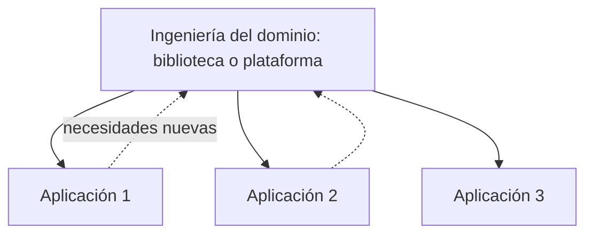

# Ingeniería de Software - Evolución de los sistemas de software

## 7.4 Reutilización de software.

---

**Reutilizar** software es construir sistemas a partir de software existente en lugar de escribirlo de nuevo. Es la forma más eficaz de reducir el costo y los defectos: el código que se reutiliza ya se escribió, se probó y se usó. Hoy es la norma, no la excepción: un sistema típico se compone en su mayor parte de bibliotecas, marcos de trabajo, servicios y componentes ajenos. Este tema presenta los niveles y las formas de reutilización, lo que hace reutilizable a un componente, la economía de construir para reutilizar, cómo medirla y sus riesgos.

### Niveles y formas

- **Por niveles de abstracción:** desde fragmentos de código y funciones, pasando por clases y componentes (tema 2.1), hasta subsistemas y aplicaciones completas; y en el diseño, con **patrones** (temas 2.4 y 5.6) y **arquitecturas de referencia**.
- **Bibliotecas:** código que la aplicación llama.
- **Marcos de trabajo** (*frameworks*): código que llama a la aplicación; invierten el control, y la aplicación se escribe completando los puntos de extensión que el marco define, como en Django o Spring.
- **Servicios:** funcionalidad reutilizada a través de la red, como una pasarela de pagos o un servicio de mapas.
- **Líneas de productos de software:** una familia de productos que comparten una plataforma común y difieren en variaciones planeadas, con un proceso de **ingeniería del dominio**, que construye la plataforma, y otro de **ingeniería de la aplicación**, que deriva cada producto.
- **Software de código abierto** y **componentes comerciales** (COTS).
- **Generación de código** a partir de modelos o especificaciones (tema 4.8).

### Diseño para la reutilización

Un componente reutilizable tiene una **interfaz** estable, pequeña y documentada; **dependencias** mínimas y explícitas; **puntos de extensión** para lo que varía, como una interfaz que otros implementan, sin modificar el componente, según el principio abierto-cerrado; **configuración** en lugar de valores fijos; **pruebas** propias, y una política de **versiones** semánticas (tema 2.2). El componente no debe conocer el contexto de quien lo usa: un registrador no decide a qué archivo escribe, lo recibe.

### Economía

Construir para reutilizar cuesta más que construir para un uso, y el beneficio llega solo con los usos siguientes. Con $C_n$ el costo de desarrollar desde cero, $C_r$ el de reutilizar en un proyecto y $C_b$ el de crear y mantener la biblioteca, el ahorro neto con $n$ proyectos es

$$A(n) = n\,(C_n - C_r) - C_b,$$

positivo cuando $n \gt C_b / (C_n - C_r).$ La **regla de tres** de la práctica dice que no conviene generalizar un componente hasta tener tres usos reales, porque con uno o dos no se sabe qué varía.

### Medición

La **tasa de reutilización** es la fracción del sistema que no se escribió para él. Su definición varía, y debe declararse: qué cuenta como reutilizado, si se incluyen las bibliotecas externas y el código generado, y si se mide en líneas, en componentes o en funcionalidad. Poulin propone contar solo el código reutilizado sin modificar, porque el modificado se mantiene como propio.

### Riesgos

Reutilizar no es gratis: se adquieren las **vulnerabilidades** y los defectos del componente, se depende de su **evolución** y de su **mantenimiento**, hay que cumplir su **licencia** (tema 2.5), y un componente genérico puede ser más complejo y lento que uno hecho para el caso. Sommerville menciona además el síndrome de **no inventado aquí**, la resistencia a usar lo ajeno, y el costo de **encontrar** y **entender** los componentes.



### Implementación en Python

El programa resuelve el ejercicio 1 con el ahorro neto para distintos números de proyectos. Para el ejercicio 2 implementa un registrador con niveles, formato configurable, un reloj inyectable y cuatro destinos con un nivel mínimo cada uno, incluida una base de datos SQLite y un destino en JSON agregado como extensión sin modificar la clase. Para el ejercicio 3 calcula la tasa de reutilización con varias definiciones.

```python
import io, json, math, sqlite3
from datetime import datetime, timezone

# ---------- Ejercicio 1: punto de equilibrio de la reutilización ----------
desde_cero, reutilizar, biblioteca = 15_000, 3_000, 25_000
n_min = math.floor(biblioteca / (desde_cero - reutilizar)) + 1
for n in range(1, 5):
    ahorro = n * (desde_cero - reutilizar) - biblioteca
    print(f"ejercicio 1: {n} {'proyecto' if n == 1 else 'proyectos'}: ahorro neto {ahorro:>7,} | ROI {ahorro / biblioteca:>6.0%}")
print(f"   el ROI es positivo a partir de {n_min} proyectos (umbral exacto {biblioteca / (desde_cero - reutilizar):.2f})")

# ---------- Ejercicio 2: un Logger reutilizable ----------
NIVELES = {"DEBUG": 10, "INFO": 20, "WARN": 30, "ERROR": 40}
class Destino:                                            # punto de extensión: un destino nuevo es una subclase
    def escribe(self, registro: dict, texto: str) -> None: raise NotImplementedError
class Consola(Destino):
    def __init__(self, flujo): self.flujo = flujo
    def escribe(self, r, texto): self.flujo.write(texto + "\n")
class Archivo(Destino):
    def __init__(self, archivo): self.archivo = archivo        # recibe un objeto archivo: se prueba con io.StringIO
    def escribe(self, r, texto): self.archivo.write(texto + "\n")
class BaseDeDatos(Destino):
    def __init__(self, conexion):
        self.c = conexion; self.c.execute("CREATE TABLE IF NOT EXISTS log (fecha TEXT, nivel TEXT, origen TEXT, mensaje TEXT)")
    def escribe(self, r, texto): self.c.execute("INSERT INTO log VALUES (?, ?, ?, ?)", (r["fecha"], r["nivel"], r["origen"], r["mensaje"]))
class Logger:
    def __init__(self, origen, nivel="INFO", formato="{fecha} [{nivel}] {origen}: {mensaje}", reloj=lambda: datetime.now(timezone.utc)):
        self.origen, self.minimo, self.formato, self.reloj, self.destinos = origen, NIVELES[nivel], formato, reloj, []
    def agrega(self, destino, nivel="DEBUG"): self.destinos.append((destino, NIVELES[nivel])); return self
    def _log(self, nivel, mensaje, **contexto):
        if NIVELES[nivel] < self.minimo: return
        r = {"fecha": self.reloj().isoformat(timespec="seconds"), "nivel": nivel, "origen": self.origen, "mensaje": mensaje, **contexto}
        texto = self.formato.format(**r)
        for d, minimo in self.destinos:
            if NIVELES[nivel] >= minimo:
                try: d.escribe(r, texto)
                except Exception as e: print(f"(falla del destino {type(d).__name__}: {e})")   # un destino roto no tumba al programa
    def debug(self, m, **k): self._log("DEBUG", m, **k)
    def info(self, m, **k): self._log("INFO", m, **k)
    def warn(self, m, **k): self._log("WARN", m, **k)
    def error(self, m, **k): self._log("ERROR", m, **k)
class JSONLineas(Destino):                                  # extensión: agregar un destino no requiere tocar Logger
    def __init__(self, flujo): self.flujo = flujo
    def escribe(self, r, texto): self.flujo.write(json.dumps(r, ensure_ascii=False) + "\n")
reloj = lambda: datetime(2026, 11, 4, 12, 0, tzinfo=timezone.utc)
consola, archivo, js, db = io.StringIO(), io.StringIO(), io.StringIO(), sqlite3.connect(":memory:")
log = Logger("pagos", nivel="DEBUG", reloj=reloj).agrega(Consola(consola), "INFO").agrega(Archivo(archivo)).agrega(BaseDeDatos(db), "ERROR").agrega(JSONLineas(js), "WARN")
log.debug("conexión abierta"); log.info("pago aceptado", pedido=17); log.warn("reintento", intento=2); log.error("pasarela caída")
print("ejercicio 2: consola:", consola.getvalue().splitlines())
print("   archivo:", len(archivo.getvalue().splitlines()), "líneas | base de datos:", db.execute("SELECT nivel, mensaje FROM log").fetchall())
print("   JSON:", js.getvalue().splitlines()[0])

# ---------- Ejercicio 3: tasa de reutilización ----------
total, externo, interno, generado = 50_000, 15_000, 8_000, 5_000
propio = total - externo - interno - generado
print(f"ejercicio 3: reutilizado (externo + interno) {(externo + interno) / total:.0%} | interno {interno / total:.0%} | "
      f"con generado {(externo + interno + generado) / total:.0%} | escrito para este sistema {propio / total:.0%}")
```

Salida:

```text
ejercicio 1: 1 proyecto: ahorro neto -13,000 | ROI   -52%
ejercicio 1: 2 proyectos: ahorro neto  -1,000 | ROI    -4%
ejercicio 1: 3 proyectos: ahorro neto  11,000 | ROI    44%
ejercicio 1: 4 proyectos: ahorro neto  23,000 | ROI    92%
   el ROI es positivo a partir de 3 proyectos (umbral exacto 2.08)
ejercicio 2: consola: ['2026-11-04T12:00:00+00:00 [INFO] pagos: pago aceptado', '2026-11-04T12:00:00+00:00 [WARN] pagos: reintento', '2026-11-04T12:00:00+00:00 [ERROR] pagos: pasarela caída']
   archivo: 4 líneas | base de datos: [('ERROR', 'pasarela caída')]
   JSON: {"fecha": "2026-11-04T12:00:00+00:00", "nivel": "WARN", "origen": "pagos", "mensaje": "reintento", "intento": 2}
ejercicio 3: reutilizado (externo + interno) 46% | interno 16% | con generado 56% | escrito para este sistema 44%
```

### Ejercicios Propuestos

1. **Retorno de la inversión.** Desarrollar un componente desde cero cuesta 15 000, reutilizarlo cuesta 3 000 por proyecto, y crear y mantener la biblioteca cuesta 25 000. ¿Cuántos proyectos deben reutilizarlo para que el retorno sea positivo?

2. **Diseño para reutilización.** Diseña una clase `Logger` reutilizable, con niveles DEBUG, INFO, WARN y ERROR, varios destinos, como consola, archivo y base de datos, formato configurable y fácil de extender con destinos nuevos.

3. **Tasa de reutilización.** Un sistema tiene 50 000 LOC, de las cuales 15 000 son de marcos externos, 8 000 de componentes internos reutilizados y 5 000 de código generado. Calcula la tasa de reutilización y analiza el resultado.

4. **Patrones.** Identifica el patrón más apropiado para un sistema que necesita distintos algoritmos de compresión, un marco que debe extenderse con nuevos tipos de documentos, y un sistema de notificaciones por correo, SMS o push.

### Soluciones

**Ejercicio 1.** Cada reutilización ahorra $15\,000 - 3\,000 = 12\,000,$ y la biblioteca cuesta 25 000. El umbral es $25\,000 / 12\,000 \approx 2.08:$ con 2 proyectos el ahorro neto todavía es negativo, de −1 000, y el retorno es positivo a partir de **3 proyectos**, con un ahorro de 11 000 y un ROI de 44 %. Si el costo de mantenimiento de la biblioteca es anual, como suele ser, el umbral crece con los años y debe compararse con el número de proyectos que la usarán en el mismo periodo.

**Ejercicio 2.** El diseño del programa separa tres responsabilidades: el **registrador** decide si un mensaje se registra según su nivel y lo formatea; el **destino**, una interfaz con un método `escribe`, decide a dónde va; y el **formato** es una plantilla configurable. Cada destino tiene su propio nivel mínimo: en el ejemplo, la consola recibe desde INFO, el archivo todo, la base de datos solo los errores y el destino JSON desde WARN. Tres decisiones lo hacen reutilizable y comprobable: los destinos reciben el flujo o la conexión en lugar de abrirlos, el reloj se inyecta, y la falla de un destino no detiene al programa. Agregar el destino JSON fue escribir una subclase, sin tocar el registrador. Antes de escribirlo, en Python, conviene recordar que el módulo `logging` de la biblioteca estándar ya ofrece exactamente este diseño, con registradores, manejadores y formateadores: la mejor reutilización a menudo es no escribir el componente.

**Ejercicio 3.** Contando como reutilizado el código externo y el interno, la tasa es $(15\,000 + 8\,000) / 50\,000 = 46\,\%;$ si se incluye el generado, 56 %, y la reutilización **interna**, la que refleja el esfuerzo de la organización, es de 16 %. El código escrito para este sistema es el 44 %. El análisis depende de qué se quiera saber: una tasa alta por los marcos externos es normal y no dice mucho de la organización; el 16 % interno es el indicador de su práctica de reutilización. Y el código generado no debería contarse como reutilizado, sino como un producto del generador, que es lo que se reutiliza.

**Ejercicio 4.**

- **Algoritmos de compresión:** **estrategia**, con una interfaz `comprime` y una implementación por algoritmo, elegida por configuración.
- **Marco extensible con nuevos tipos de documentos:** **método fábrica** o una fábrica con registro (tema 2.4), con **método plantilla** para el procesamiento común; los complementos registran su tipo sin modificar el marco.
- **Notificaciones por varios canales:** **estrategia** para el canal, o **puente** si además varía el tipo de mensaje, y **observador** si varios canales deben reaccionar al mismo evento.

### Referencias

1. Sommerville, I., _Software Engineering_. Pearson, 2016. Capítulo 15.
2. Poulin, J. S., _Measuring Software Reuse_. Addison-Wesley, 1997.
3. Clements, P., and Northrop, L., _Software Product Lines: Practices and Patterns_. Addison-Wesley, 2001.
4. Frakes, W. B., and Kang, K., Software reuse research: status and future. _IEEE Transactions on Software Engineering_ 31(7), 2005.
5. Gamma, E., Helm, R., Johnson, R., and Vlissides, J., _Design Patterns_. Addison-Wesley, 1994.
