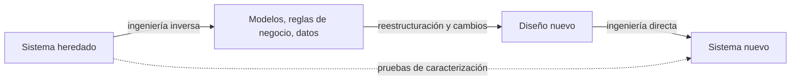

# Ingeniería de Software - Evolución de los sistemas de software

## 7.5 Reingeniería de sistemas.

---

La **reingeniería** es el examen y la modificación de un sistema para reconstituirlo en una forma nueva, como lo definieron Chikofsky y Cross en 1990. Se aplica a sistemas **heredados** (*legacy*): sistemas que siguen siendo valiosos para el negocio, a menudo críticos, pero cuyo mantenimiento se ha vuelto costoso y riesgoso porque su tecnología es obsoleta, su estructura se degradó, su documentación no existe y quienes los conocían ya no están. Este tema presenta el vocabulario de la reingeniería, las estrategias ante un sistema heredado, el proceso, la decisión económica y la migración de sistemas grandes.

### Vocabulario

Chikofsky y Cross distinguen:

- **ingeniería directa** (*forward engineering*): de los requerimientos y el diseño a la implementación, el sentido habitual;
- **ingeniería inversa:** analizar un sistema para identificar sus componentes y relaciones y crear representaciones de nivel más alto, como diagramas o especificaciones, sin modificarlo;
- **reestructuración:** transformar una representación en otra del mismo nivel, conservando el comportamiento externo; la refactorización (tema 7.6) es reestructuración del código;
- **reingeniería:** ingeniería inversa, seguida de reestructuración o de cambios funcionales, seguida de ingeniería directa.

### Estrategias

Ante un sistema heredado hay varias opciones, que Sommerville ordena según su valor para el negocio y su calidad técnica:

| Valor para el negocio | Calidad técnica | Estrategia                                                          |
| --------------------- | --------------- | ------------------------------------------------------------------- |
| Bajo                  | Baja            | Retirarlo                                                           |
| Bajo                  | Alta            | Mantenerlo con el mínimo esfuerzo                                   |
| Alto                  | Baja            | Reingeniería o reemplazo                                            |
| Alto                  | Alta            | Seguir manteniéndolo normalmente                                    |

Las opciones de modernización van de menos a más invasivas: **encapsular**, envolviendo el sistema con una API sin cambiarlo; **reubicar** (*rehost*), moviéndolo a otra infraestructura, como la nube; **reestructurar** el código; **convertir** el código a otro lenguaje, automática o manualmente; **rearquitecturar**, y **reemplazar**, con un sistema nuevo o un producto comercial.

### Proceso

1. **Inventario y evaluación:** qué hace el sistema, quién lo usa, qué datos tiene, con qué se integra y cuál es su calidad técnica.
2. **Ingeniería inversa:** recuperar la documentación, el modelo de datos y las **reglas de negocio** enterradas en el código, a menudo la parte más valiosa y la más difícil.
3. **Pruebas de caracterización** (tema 6.7) que fijen el comportamiento actual.
4. **Transformación**, de forma incremental, con las pruebas como red de seguridad.
5. **Migración de los datos**, con conciliación entre el sistema viejo y el nuevo.
6. **Convivencia y corte:** los dos sistemas operan en paralelo, con el patrón estrangulador (tema 5.5), hasta que el viejo se retira.

### La decisión económica

La reingeniería es una inversión con un costo inmediato, beneficios futuros e incertidumbre. Una razón simple como $V = B \cdot S / (C \cdot R),$ con $B$ los beneficios, $S$ la probabilidad de éxito, $C$ el costo y $R$ un factor de riesgo, da una primera idea, pero mezcla unidades si $B$ es anual y $C$ un pago único. La forma correcta es el **valor presente neto** de los flujos esperados durante el horizonte de vida del sistema, comparado con el de la alternativa de no hacer nada, que también tiene costos, como el de mantener una tecnología obsoleta y el riesgo de una falla sin nadie que sepa repararla.

Los proyectos de reemplazo total de un sistema grande en una sola entrega fracasan con frecuencia: el sistema viejo contiene décadas de reglas no documentadas, y el nuevo debe igualarlas todas antes de entrar en servicio. Por eso las migraciones incrementales son la estrategia preferida.



### Implementación en Python

El programa resuelve el ejercicio 1 con la fórmula del enunciado y con el valor presente neto a varios horizontes. Para el ejercicio 2 reestructura el cálculo del total con una tabla de reglas y `Decimal`, y comprueba con 3 000 pedidos aleatorios que el comportamiento no cambió. Para el ejercicio 4 calcula la complejidad ciclomática y el índice de mantenibilidad, desglosado por término.

```python
import math, random
from dataclasses import dataclass
from decimal import Decimal

# ---------- Ejercicio 1: viabilidad ----------
B, S, C, R = 150_000, 0.75, 80_000, 1.2
print(f"ejercicio 1: V = B·S/(C·R) = {B}·{S}/({C}·{R}) = {B * S / (C * R):.2f}")
for anios, tasa in ((1, 0.10), (3, 0.10), (5, 0.10)):
    vpn = -C * R + sum(B * S / (1 + tasa) ** k for k in range(1, anios + 1))
    print(f"   valor presente neto a {anios} {'año' if anios == 1 else 'años'} con tasa {tasa:.0%}, costo ajustado por riesgo {C * R:,.0f}: {vpn:>10,.0f}")
print(f"   recuperación de la inversión ajustada: {C * R / (B * S):.2f} años")

# ---------- Ejercicio 2: reingeniería de calculate_total ----------
@dataclass
class Cliente: membership: str
@dataclass
class Item: category: str; price: float
@dataclass
class Order: items: list; customer: Cliente
def calculate_total(order):                                 # original
    total = 0
    for item in order.items:
        if item.category == "ELECTRONICS":
            if item.price > 1000: total += item.price * 0.9
            else: total += item.price
        elif item.category == "CLOTHING":
            if order.customer.membership == "GOLD": total += item.price * 0.8
            else: total += item.price
        else: total += item.price
    return total
REGLAS = {   # categoría: (condición, descuento)
    "ELECTRONICS": (lambda item, cliente: item.price > 1000, Decimal("0.10")),
    "CLOTHING":    (lambda item, cliente: cliente.membership == "GOLD", Decimal("0.20")),
}
def precio(item, cliente):
    cond, desc = REGLAS.get(item.category, (lambda i, c: False, Decimal("0")))
    p = Decimal(str(item.price))
    return p * (1 - desc) if cond(item, cliente) else p
def total_pedido(order): return sum((precio(i, order.customer) for i in order.items), Decimal("0")).quantize(Decimal("0.01"))
rng = random.Random(9); dif = 0
for _ in range(3000):
    o = Order([Item(rng.choice(["ELECTRONICS", "CLOTHING", "FOOD"]), rng.choice([10.0, 999.99, 1000.0, 1000.01, 2500.0])) for _ in range(rng.randint(0, 6))],
              Cliente(rng.choice(["GOLD", "SILVER"])))
    dif += abs(Decimal(str(round(calculate_total(o), 2))) - total_pedido(o)) > Decimal("0.01")
print(f"ejercicio 2: 3000 pedidos aleatorios, diferencias: {dif}")

# ---------- Ejercicio 4: métricas ----------
nodos, aristas, componentes, loc, vol = 25, 30, 2, 1500, 1200
G = aristas - nodos + 2 * componentes
mi = 171 - 5.2 * math.log(vol) - 0.23 * G - 16.2 * math.log(loc)
print(f"ejercicio 4: V(G) = {aristas} − {nodos} + 2·{componentes} = {G} | MI = {mi:.1f} | normalizado {max(0, mi * 100 / 171):.1f}")
print(f"   términos: −5.2 ln V = {-5.2 * math.log(vol):.1f}, −0.23 G = {-0.23 * G:.1f}, −16.2 ln LOC = {-16.2 * math.log(loc):.1f}")
print(f"   coherencia de los datos: volumen por línea {vol / loc:.2f} (en código real suele ser de decenas por línea)")
```

Salida:

```text
ejercicio 1: V = B·S/(C·R) = 150000·0.75/(80000·1.2) = 1.17
   valor presente neto a 1 año con tasa 10%, costo ajustado por riesgo 96,000:      6,273
   valor presente neto a 3 años con tasa 10%, costo ajustado por riesgo 96,000:    183,771
   valor presente neto a 5 años con tasa 10%, costo ajustado por riesgo 96,000:    330,464
   recuperación de la inversión ajustada: 0.85 años
ejercicio 2: 3000 pedidos aleatorios, diferencias: 0
ejercicio 4: V(G) = 30 − 25 + 2·2 = 9 | MI = 13.6 | normalizado 7.9
   términos: −5.2 ln V = -36.9, −0.23 G = -2.1, −16.2 ln LOC = -118.5
   coherencia de los datos: volumen por línea 0.80 (en código real suele ser de decenas por línea)
```

### Ejercicios Propuestos

1. **Viabilidad.** Un sistema heredado tiene beneficios esperados de la reingeniería de 150 000 anuales, una probabilidad de éxito de 0.75, un costo estimado de 80 000 y un factor de riesgo de 1.2. Calcula la viabilidad con $V = B \cdot S / (C \cdot R)$ y recomienda si proceder.

2. **Reingeniería.** Aplica técnicas de reingeniería a:

    ```python
    def calculate_total(order):
        total = 0
        for item in order.items:
            if item.category == "ELECTRONICS":
                if item.price > 1000:
                    total += item.price * 0.9
                else:
                    total += item.price
            elif item.category == "CLOTHING":
                if order.customer.membership == "GOLD":
                    total += item.price * 0.8
                else:
                    total += item.price
            else:
                total += item.price
        return total
    ```

3. **Migración.** Propón una estrategia para migrar un sistema monolítico en COBOL de 500 000 LOC a una arquitectura moderna, con el análisis de riesgos, la estrategia, las herramientas y las métricas de éxito.

4. **Métricas.** Para un módulo con 25 nodos y 30 aristas en su grafo de flujo, 2 componentes conexos, 1 500 LOC y un volumen de Halstead de 1 200, calcula la complejidad ciclomática y el índice de mantenibilidad.

### Soluciones

**Ejercicio 1.** $V = 150\,000 \cdot 0.75 / (80\,000 \cdot 1.2) \approx 1.17,$ mayor que 1: viable según la fórmula. Pero la fórmula compara un beneficio **anual** con un costo **único**, y su resultado depende de la unidad de tiempo: con beneficios mensuales saldría menor que 1. El valor presente neto, con el costo ajustado por riesgo de 96 000 y los beneficios esperados de 112 500 al año descontados al 10 %, es positivo desde el primer año y llega a 330 464 en cinco años; la inversión se recupera en unos 10 meses. La recomendación es **proceder**, con dos condiciones: verificar que los 150 000 de beneficio sean incrementales respecto a no hacer nada, y estructurar el proyecto de forma incremental, de modo que la probabilidad de éxito no sea todo o nada.

**Ejercicio 2.** El proceso: primero, **pruebas de caracterización** del código actual; después, **reestructurar** extrayendo las reglas a una tabla de categoría a condición y descuento, de modo que una categoría nueva es una entrada nueva; **separar** el cálculo del precio de un artículo del total del pedido; y usar `Decimal` para el dinero. Las 3 000 comparaciones aleatorias, con precios en las fronteras de 1 000, confirman que el comportamiento es idéntico. La ingeniería inversa del código revela además reglas de negocio implícitas que conviene confirmar con el negocio: la ropa no tiene descuento para los clientes que no son GOLD, un artículo de exactamente 1 000 no tiene descuento, y las categorías desconocidas pagan precio completo sin aviso.

**Ejercicio 3.**

- **Riesgos:** reglas de negocio no documentadas en el código COBOL; datos en archivos VSAM o bases jerárquicas con formatos propios; integraciones por archivos y procesos por lotes con horarios estrictos; escasez de personas que conozcan el sistema; y la imposibilidad de detener la operación.
- **Estrategia incremental**, no de gran explosión: primero **encapsular** el sistema con API, para que los sistemas nuevos dejen de depender de sus detalles; después extraer los dominios uno por uno con el estrangulador, empezando por uno acotado y de bajo riesgo; replicar los datos con captura de cambios y conciliar diariamente; y ejecutar en **paralelo** el cálculo viejo y el nuevo, comparando resultados, antes de cada corte.
- **Herramientas:** analizadores de código COBOL para extraer el inventario de programas, las dependencias y las reglas; herramientas de captura de cambios de datos; la integración continua del código nuevo, y pruebas de comparación automatizadas entre ambos sistemas.
- **Métricas de éxito:** porcentaje de funcionalidad migrada y de tráfico atendido por el sistema nuevo; diferencias en las conciliaciones, que deben ser cero; incidentes por corte; costo de operación comparado con el del mainframe, y tiempo de entrega de cambios en los dominios migrados.

**Ejercicio 4.** $V(G) = 30 - 25 + 2 \cdot 2 = 9,$ y

$$\mathrm{MI} = 171 - 5.2 \ln 1200 - 0.23 \cdot 9 - 16.2 \ln 1500 \approx 171 - 36.9 - 2.1 - 118.5 \approx 13.6,$$

7.9 en la escala normalizada, muy por debajo de 20: el módulo es difícil de mantener. El desglose muestra que casi toda la penalización viene del tamaño, 1 500 líneas, y no de la complejidad: dividir el módulo es la primera acción. Los datos tienen dos rarezas que conviene señalar: un volumen de Halstead de 1 200 para 1 500 líneas es menos de un bit por línea, cuando en código real son decenas, y 2 componentes conexos en el grafo de un solo módulo indican que se midieron dos funciones juntas.

### Referencias

1. Chikofsky, E. J., and Cross, J. H., Reverse engineering and design recovery: a taxonomy. _IEEE Software_ 7(1), 1990.
2. Sommerville, I., _Software Engineering_. Pearson, 2016. Capítulo 9.
3. Demeyer, S., Ducasse, S., and Nierstrasz, O., _Object-Oriented Reengineering Patterns_. Morgan Kaufmann, 2002.
4. Seacord, R. C., Plakosh, D., and Lewis, G. A., _Modernizing Legacy Systems_. Addison-Wesley, 2003.
5. Brodie, M. L., and Stonebraker, M., _Migrating Legacy Systems: Gateways, Interfaces & the Incremental Approach_. Morgan Kaufmann, 1995.
