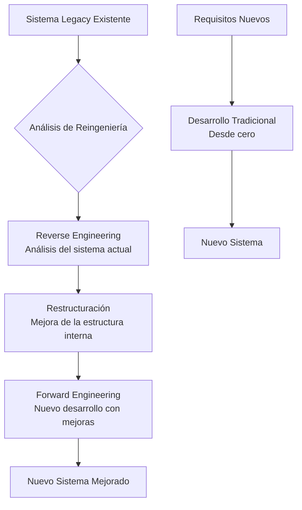
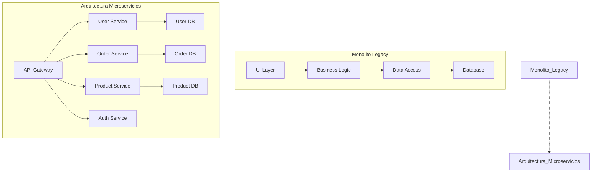

# Ingeniería de Software - Evolución de los sistemas de software

## 7.5 Reingeniería de sistemas.

---

La reingeniería de sistemas es el proceso de examinar y alterar un sistema software para reconstruirlo en una nueva forma que mejore su mantenibilidad, rendimiento y funcionalidad. Según Sommerville (2010), la reingeniería es esencial para extender el ciclo de vida de sistemas legacy y maximizar el retorno de inversión en software existente.

### Definición de Reingeniería de Software

La **reingeniería de software** es el proceso de análisis y modificación de un sistema software para reconstruirlo en una nueva forma que preserve su funcionalidad original mientras mejora su calidad, rendimiento y mantenibilidad. No es simplemente mantenimiento correctivo, sino una transformación profunda del sistema.

### Diferencias entre Reingeniería y Desarrollo Tradicional



### Proceso de Reingeniería

#### Modelo de Reingeniería de Sommerville

Sommerville (2010) propone un proceso iterativo con las siguientes etapas:

1. **Análisis del sistema existente**
2. **Extracción de abstracciones del sistema**
3. **Restructuración del sistema**
4. **Reimplementación de componentes**
5. **Validación del sistema modificado**

#### Fórmula de Viabilidad de Reingeniería

$$ V = \frac{B \times S}{C \times R} $$

Donde:

- $V$ = Viabilidad del proyecto (valores > 1 indican viabilidad)
- $B$ = Beneficios esperados (monetarios o de calidad)
- $S$ = Probabilidad de éxito (0.0 a 1.0)
- $C$ = Costo estimado del proyecto
- $R$ = Riesgo del proyecto (1.0 = bajo riesgo, >1.0 = alto riesgo)

### Técnicas de Reverse Engineering

#### Análisis de Dependencias

```python
# Ejemplo de análisis de dependencias para reverse engineering
class DependencyAnalyzer:
    def __init__(self, source_code):
        self.source_code = source_code
        self.dependencies = {}
        self.import_patterns = [
            r'import\s+([\w\.]+)',
            r'from\s+([\w\.]+)\s+import',
            r'require\([\'"]([\w\.\/\-]+)[\'"]\)',
            r'#include\s+[<"]([\w\.\/]+)[">]'
        ]

    def extract_dependencies(self):
        """Extrae dependencias del código fuente"""
        for pattern in self.import_patterns:
            matches = re.findall(pattern, self.source_code)
            for match in matches:
                module = match.split('.')[0] if '.' in match else match
                self.dependencies[module] = self.dependencies.get(module, 0) + 1

        return self.dependencies

    def calculate_coupling_factor(self):
        """Calcula el factor de acoplamiento"""
        total_modules = len(self.dependencies)
        total_dependencies = sum(self.dependencies.values())

        if total_modules == 0:
            return 0

        return total_dependencies / total_modules

# Uso del analizador
source_code = """
import pandas as pd
from numpy import array
import matplotlib.pyplot as plt
from sklearn.ensemble import RandomForestClassifier
"""

analyzer = DependencyAnalyzer(source_code)
dependencies = analyzer.extract_dependencies()
coupling = analyzer.calculate_coupling_factor()
```

#### Métricas de Calidad para Evaluación

$$ \text{Complejidad Ciclomática} = E - N + 2P $$
$$ \text{Mantenibilidad} = 171 - 5.2 \times \ln(V) - 0.23 \times (C) - 16.2 \times \ln(LOC) $$

Donde:

- $E$ = Número de aristas en el grafo de flujo
- $N$ = Número de nodos
- $P$ = Número de componentes conexos
- $V$ = Volumen de Halstead
- $C$ = Complejidad ciclomática
- $LOC$ = Líneas de código

### Estrategias de Restructuración

#### Refactorización de Código Legacy

```java
// Código legacy antes de reingeniería
public class OrderProcessor {
    public void processOrder(Order order) {
        // Lógica compleja y acoplada
        if (order != null) {
            if (order.isValid()) {
                if (order.getItems() != null && order.getItems().size() > 0) {
                    for (Item item : order.getItems()) {
                        if (item.isAvailable()) {
                            // Procesamiento complejo
                            double price = item.getPrice();
                            if (order.getCustomer().isPremium()) {
                                price = price * 0.9;
                            }
                            // Más lógica anidada...
                        }
                    }
                }
            }
        }
    }
}

// Después de reingeniería con patrón Strategy
public class OrderProcessor {
    private PricingStrategy pricingStrategy;
    private ValidationStrategy validationStrategy;

    public OrderProcessor(PricingStrategy pricingStrategy,
                         ValidationStrategy validationStrategy) {
        this.pricingStrategy = pricingStrategy;
        this.validationStrategy = validationStrategy;
    }

    public void processOrder(Order order) {
        if (!validationStrategy.isValid(order)) {
            throw new InvalidOrderException("Order validation failed");
        }

        processOrderItems(order);
    }

    private void processOrderItems(Order order) {
        order.getItems().stream()
            .filter(Item::isAvailable)
            .forEach(this::processItem);
    }

    private void processItem(Item item) {
        double finalPrice = pricingStrategy.calculatePrice(item);
        item.setFinalPrice(finalPrice);
    }
}
```

### Migración de Arquitectura

#### De Monolito a Microservicios



### Ejercicios Propuestos

1. **Análisis de Viabilidad**: Un sistema legacy tiene los siguientes parámetros:
   - Beneficios esperados: $150,000 anuales
   - Probabilidad de éxito: 0.75
   - Costo estimado: $80,000
   - Factor de riesgo: 1.2

   Calcula la viabilidad del proyecto y recomienda si proceder o no.

2. **Refactorización**: Dado el siguiente código legacy, aplique técnicas de reingeniería:

   ```python
   def calculate_total(order):
       total = 0
       for item in order.items:
           if item.category == "ELECTRONICS":
               if item.price > 1000:
                   total += item.price * 0.9
               else:
                   total += item.price
           elif item.category == "CLOTHING":
               if order.customer.membership == "GOLD":
                   total += item.price * 0.8
               else:
                   total += item.price
           else:
               total += item.price
       return total
   ```

3. **Diseño de Migración**: Proponga una estrategia para migrar un sistema monolítico COBOL con 500,000 LOC a una arquitectura moderna, considerando:
   - Análisis de riesgos
   - Estrategia de migración (big bang vs incremental)
   - Herramientas necesarias
   - Métricas de éxito

4. **Cálculo de Métricas**: Para un módulo con:
   - 25 nodos en el grafo de flujo
   - 30 aristas
   - 2 componentes conexos
   - 1500 LOC
   - Volumen de Halstead: 1200

   Calcule la complejidad ciclomática y el índice de mantenibilidad.

### Caso de Estudio: Sistema Bancario Legacy

Analice un sistema bancario legacy con:

- 20 años de antigüedad
- Tecnología COBOL/CICS
- Base de datos jerárquica IMS
- Documentación incompleta
- Personal especializado en retiro

Desarrolle un plan de reingeniería que incluya:

1. Estrategia de reverse engineering
2. Plan de migración tecnológica
3. Gestión del conocimiento
4. Métricas de progreso y éxito

### Referencias

#### Bibliografía Básica

1. Sommerville, Ian. (2010). _Software Engineering_ (9th edition). Addison Wesley. (Capítulos 26, 27)
2. Pfleeger, S. L., & Atlee, J. M. (2010). _Software Engineering: Theory and Practice_ (4th edition). Prentice Hall. (Capítulos 11, 12)

#### Bibliografía Complementaria

3. Chikofsky, E. J., & Cross, J. H. (1990). _Reverse Engineering and Design Recovery: A Taxonomy_. IEEE Software.
4. Fowler, M. (2018). _Refactoring: Improving the Design of Existing Code_. Addison-Wesley.
5. Ulrich, W. M. (2002). _Legacy Systems: Transformation Strategies_. Prentice Hall.

### Conclusión

La reingeniería de sistemas es una disciplina crítica que permite revitalizar sistemas legacy, extendiendo su vida útil y mejorando su valor empresarial. Un enfoque sistemático que combine reverse engineering, refactorización y modernización arquitectónica puede transformar sistemas obsoletos en aplicaciones modernas y mantenibles. La clave del éxito está en la evaluación cuidadosa de la viabilidad, la planificación meticulosa y la ejecución controlada de las actividades de reingeniería.
