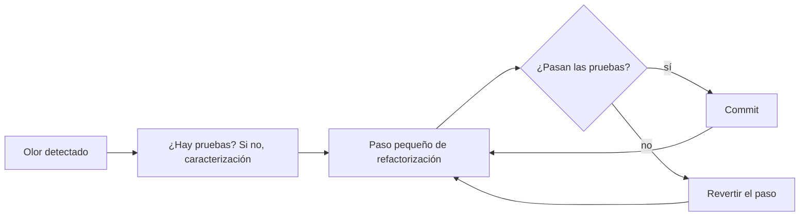

# Ingeniería de Software - Evolución de los sistemas de software

## 7.6 Refactoring.

---

**Refactorizar** es cambiar la estructura interna de un software para hacerlo más fácil de entender y de modificar, **sin cambiar su comportamiento observable**. Fowler lo definió así en su libro de 1999, que catalogó las refactorizaciones como transformaciones con nombre, con una motivación y una mecánica paso a paso, a partir del trabajo de Opdyke en su tesis de 1992. Refactorizar es la forma cotidiana de pagar la deuda técnica (tema 7.1) y de contrarrestar la ley de Lehman de la complejidad creciente. Este tema presenta cuándo refactorizar, los olores del código que lo indican, las refactorizaciones más comunes, la red de seguridad que requieren y cómo planear la refactorización de un sistema grande.

### Cuándo refactorizar

Refactorizar no es una fase del proyecto, sino una actividad continua: antes de agregar una función, para que sea fácil agregarla; al corregir un defecto, para que el código sea más claro; durante la revisión de código, y en el paso de refactorización de cada ciclo de TDD (tema 6.7). Fowler resume la regla de Beck: primero haz que el cambio sea fácil, y después haz el cambio fácil. La **regla del campamento** pide dejar el código un poco mejor de como se encontró.

No se refactoriza un código que se va a reescribir, ni sin pruebas, ni mezclado con cambios de comportamiento en el mismo commit.

### Olores del código

Los **olores** (*code smells*) son síntomas de un problema de diseño:

- **método largo** y **clase grande**;
- **código duplicado**;
- **lista larga de parámetros**;
- **condicionales repetidos** sobre un tipo, que piden polimorfismo;
- **envidia de funcionalidad**: un método que usa más los datos de otra clase que los de la suya;
- **obsesión por los primitivos**: usar cadenas o números donde debería haber un tipo, como el dinero;
- **cirugía de escopeta**: un cambio que obliga a tocar muchas clases;
- **comentarios** que explican código confuso en lugar de aclararlo.

### Refactorizaciones comunes

- **Extraer método:** un fragmento con un propósito se convierte en un método con un nombre que lo describe. Es la más usada.
- **Extraer clase**, **mover método** y **mover campo:** repartir responsabilidades.
- **Renombrar:** un buen nombre es la refactorización más barata y una de las más valiosas.
- **Introducir objeto de parámetro** y **preservar el objeto completo**.
- **Reemplazar el condicional por polimorfismo:** cada rama de un `switch` sobre un tipo se convierte en una subclase o en una estrategia.
- **Reemplazar el número mágico por una constante** y **reemplazar el primitivo por un objeto.**
- **Separar consulta y modificación:** un método que devuelve un valor no debe además cambiar el estado.

Los entornos de desarrollo modernos aplican muchas de ellas automáticamente y de forma segura.

### Red de seguridad

Como el comportamiento no debe cambiar, cada paso de una refactorización se verifica con las pruebas. Los pasos son pequeños, de modo que si una prueba falla se sabe cuál fue la causa y se revierte. Sin pruebas, primero se escriben las de caracterización. Para un sistema grande, la refactorización se **prioriza** cruzando la complejidad con la frecuencia de cambios: los **puntos calientes** que cambian a menudo y son complejos dan el mayor retorno (tema 1.5), y el código complejo que nunca cambia puede quedarse como está.



### Implementación en Python

La solución del ejercicio 1 está en Java, en la sección de soluciones, compilada y ejecutada; el programa muestra el error de redondeo que tenía el original. Para el ejercicio 2 reemplaza el condicional por polimorfismo, con subclases que se registran solas, y agrega un canal sin modificar el código existente. Para el ejercicio 3 calcula las métricas, y para el ejercicio 4 clasifica cada escenario en el cuadrante de la deuda técnica.

```python
import math
from abc import ABC, abstractmethod

# ---------- Ejercicio 1: por qué el reporte original necesitaba BigDecimal ----------
print("ejercicio 1: con double, 1200.10 + 0.20 + 0.10 =", 1200.10 + 0.20 + 0.10)

# ---------- Ejercicio 2: reemplazar el condicional por polimorfismo ----------
class Canal(ABC):
    registro = {}
    def __init_subclass__(cls, tipo=None, **kw):              # cada subclase se registra sola
        super().__init_subclass__(**kw)
        if tipo: Canal.registro[tipo] = cls
    @abstractmethod
    def envia(self, destino: str, mensaje: str) -> str: ...
class Email(Canal, tipo="EMAIL"):
    def envia(self, destino, mensaje): return f"correo a {destino}: {mensaje}"
class SMS(Canal, tipo="SMS"):
    def envia(self, destino, mensaje): return f"SMS a {destino}: {mensaje[:160]}"
class Push(Canal, tipo="PUSH"):
    def envia(self, destino, mensaje): return f"push a {destino}: {mensaje}"
def canal(tipo):
    try: return Canal.registro[tipo]()
    except KeyError: raise ValueError(f"tipo de notificación no soportado: {tipo}") from None
for t in ("EMAIL", "SMS", "PUSH"): print("ejercicio 2:", canal(t).envia("ana", "tu pedido salió"))
class WhatsApp(Canal, tipo="WHATSAPP"):                       # un canal nuevo: ninguna línea existente cambia
    def envia(self, destino, mensaje): return f"WhatsApp a {destino}: {mensaje}"
print("   canal agregado después:", canal("WHATSAPP").envia("ana", "hola"), "| registrados:", sorted(Canal.registro))
try: canal("FAX")
except ValueError as e: print("  ", e)

# ---------- Ejercicio 3: métricas ----------
n, e, p, loc, vol = 15, 20, 1, 80, 450
G = e - n + 2 * p
mi = 171 - 5.2 * math.log(vol) - 0.23 * G - 16.2 * math.log(loc)
print(f"ejercicio 3: V(G) = {e} − {n} + 2·{p} = {G} | MI = {mi:.1f} | normalizado {mi * 100 / 171:.1f}")

# ---------- Ejercicio 4: cuadrante de la deuda técnica ----------
casos = {"tecnología nueva poco madura para ganar experiencia": ("deliberada", "prudente, si se acepta el riesgo y se planea cómo salir"),
         "código rápido sin pruebas para cumplir una fecha": ("deliberada", "imprudente si no se paga; prudente si se registra y se paga después"),
         "crecimiento orgánico sin principios de diseño": ("inadvertida", "imprudente"),
         "biblioteca con vulnerabilidades descubiertas después": ("inadvertida", "prudente: no se sabía; se vuelve imprudente si se ignora")}
for c, (a, b) in casos.items(): print(f"ejercicio 4: {c:55} → {a}, {b}")
```

Salida:

```text
ejercicio 1: con double, 1200.10 + 0.20 + 0.10 = 1200.3999999999999
ejercicio 2: correo a ana: tu pedido salió
ejercicio 2: SMS a ana: tu pedido salió
ejercicio 2: push a ana: tu pedido salió
   canal agregado después: WhatsApp a ana: hola | registrados: ['EMAIL', 'PUSH', 'SMS', 'WHATSAPP']
   tipo de notificación no soportado: FAX
ejercicio 3: V(G) = 20 − 15 + 2·1 = 7 | MI = 66.6 | normalizado 39.0
ejercicio 4: tecnología nueva poco madura para ganar experiencia     → deliberada, prudente, si se acepta el riesgo y se planea cómo salir
ejercicio 4: código rápido sin pruebas para cumplir una fecha        → deliberada, imprudente si no se paga; prudente si se registra y se paga después
ejercicio 4: crecimiento orgánico sin principios de diseño           → inadvertida, imprudente
ejercicio 4: biblioteca con vulnerabilidades descubiertas después    → inadvertida, prudente: no se sabía; se vuelve imprudente si se ignora
```

### Ejercicios Propuestos

1. **Extraer método.** Refactoriza aplicando extraer método:

    ```java
    public void generateReport(List<Sale> sales) {
        double totalRevenue = 0;
        int totalUnits = 0;
        Map<String, Integer> categoryCount = new HashMap<>();

        System.out.println("=== SALES REPORT ===");
        System.out.println("Date: " + LocalDate.now());
        System.out.println("-------------------");

        for (Sale sale : sales) {
            totalRevenue += sale.getAmount();
            totalUnits += sale.getQuantity();
            categoryCount.put(sale.getCategory(),
                              categoryCount.getOrDefault(sale.getCategory(), 0) + 1);
            System.out.println(sale.getProductName() + ": $" + sale.getAmount() +
                               " (" + sale.getQuantity() + " units)");
        }

        System.out.println("-------------------");
        System.out.println("Total Revenue: $" + totalRevenue);
        System.out.println("Total Units: " + totalUnits);
        System.out.println("By Category: " + categoryCount);
    }
    ```

2. **Polimorfismo.** Refactoriza con polimorfismo:

    ```python
    class Notification:
        def send(self, message, type):
            if type == "EMAIL":
                pass
            elif type == "SMS":
                pass
            elif type == "PUSH":
                pass
            else:
                raise ValueError("Tipo de notificación no soportado")
    ```

3. **Métricas.** Para una función con 15 nodos y 20 aristas en su grafo de flujo, 1 componente conexo, 80 líneas de código y un volumen de Halstead de 450, calcula la complejidad ciclomática y el índice de mantenibilidad.

4. **Deuda técnica.** Identifica el tipo de deuda técnica en cada escenario: un equipo elige una tecnología nueva y poco madura para ganar experiencia; un desarrollador escribe código rápido sin pruebas para cumplir una fecha límite; un sistema crece orgánicamente sin seguir principios de diseño; se descubre que una biblioteca usada tiene vulnerabilidades.

### Soluciones

**Ejercicio 1.** El método mezcla tres cosas: calcular el resumen, formatear y escribir en la consola. La refactorización extrae el **cálculo** a un método puro, `summarize`, que devuelve un objeto con los totales, y la **presentación** a tres métodos, para el encabezado, cada línea y el pie. Dos cambios más, que la extracción hace evidentes: la fecha se recibe como parámetro en lugar de leer `LocalDate.now()`, y el reporte se devuelve como texto en lugar de imprimirse, de modo que el método es comprobable. Además, el original usaba `double` para el dinero, y con ventas de 1200.10, 0.20 y 0.10 habría impreso un total de 1200.3999999999999; la versión refactorizada usa `BigDecimal`. Este cambio sí altera la salida, y por eso es una corrección, que conviene hacer en un commit separado de la refactorización:

```java
import java.math.BigDecimal;
import java.time.LocalDate;
import java.util.*;

record Sale(String productName, String category, BigDecimal amount, int quantity) {}
record SalesSummary(BigDecimal totalRevenue, int totalUnits, Map<String, Integer> countByCategory) {}

class SalesReport {
    public String generateReport(List<Sale> sales, LocalDate date) {
        StringBuilder out = new StringBuilder();
        appendHeader(out, date);
        sales.forEach(sale -> appendLine(out, sale));
        appendFooter(out, summarize(sales));
        return out.toString();
    }
    static SalesSummary summarize(List<Sale> sales) {
        BigDecimal revenue = BigDecimal.ZERO;
        int units = 0;
        Map<String, Integer> byCategory = new TreeMap<>();
        for (Sale s : sales) {
            revenue = revenue.add(s.amount());
            units += s.quantity();
            byCategory.merge(s.category(), 1, Integer::sum);
        }
        return new SalesSummary(revenue, units, byCategory);
    }
    private void appendHeader(StringBuilder out, LocalDate date) {
        out.append("=== SALES REPORT ===\nDate: ").append(date).append("\n-------------------\n");
    }
    private void appendLine(StringBuilder out, Sale s) {
        out.append(s.productName()).append(": $").append(s.amount()).append(" (").append(s.quantity()).append(" units)\n");
    }
    private void appendFooter(StringBuilder out, SalesSummary sum) {
        out.append("-------------------\nTotal Revenue: $").append(sum.totalRevenue())
           .append("\nTotal Units: ").append(sum.totalUnits())
           .append("\nBy Category: ").append(sum.countByCategory()).append("\n");
    }
}
```

Con esas tres ventas, el resultado es el reporte con `Total Revenue: $1200.40`, `Total Units: 6` y `By Category: {computo=2, libros=1}`. El `TreeMap` hace que el orden de las categorías sea determinista.

**Ejercicio 2.** Cada rama se convierte en una subclase de `Canal` con su método `envia`, y una función `canal(tipo)` busca la subclase en un registro. En el programa, las subclases se registran solas al definirse, con `__init_subclass__`, de modo que agregar WhatsApp es escribir una clase nueva, sin tocar ninguna línea existente; con el condicional había que modificar el método `send` cada vez. El error para un tipo desconocido se conserva. Si los canales no tienen estado, una alternativa más ligera en Python es un diccionario de funciones.

**Ejercicio 3.** $V(G) = 20 - 15 + 2 = 7,$ y

$$\mathrm{MI} = 171 - 5.2 \ln 450 - 0.23 \cdot 7 - 16.2 \ln 80 \approx 171 - 31.8 - 1.6 - 71.0 \approx 66.6,$$

39 en la escala normalizada: mantenible según el umbral de 20, aunque mejorable. La función de 80 líneas es candidata a extraer métodos; con cuatro funciones de 20 líneas, el índice de cada una subiría a más de 90.

**Ejercicio 4.** En el cuadrante de Fowler:

- **Tecnología nueva para ganar experiencia:** deliberada y prudente, si el equipo acepta el riesgo de forma consciente y tiene un plan para cambiar si no madura.
- **Código sin pruebas para una fecha:** deliberada; prudente solo si se registra como deuda y se paga en cuanto pasa la fecha, e imprudente si se repite como costumbre.
- **Crecimiento orgánico sin diseño:** inadvertida e imprudente, la más cara, porque nadie la registró y se acumula sin control.
- **Vulnerabilidad descubierta en una biblioteca:** inadvertida y prudente, porque no se sabía; para algunos autores no es deuda técnica sino un riesgo externo. Se vuelve imprudente si, conocida, no se actualiza la biblioteca.

### Referencias

1. Fowler, M., _Refactoring: Improving the Design of Existing Code_. Addison-Wesley, 2018.
2. Opdyke, W. F., _Refactoring Object-Oriented Frameworks_. Tesis doctoral, University of Illinois, 1992.
3. Feathers, M., _Working Effectively with Legacy Code_. Prentice Hall, 2004.
4. Kerievsky, J., _Refactoring to Patterns_. Addison-Wesley, 2004.
5. Tornhill, A., _Your Code as a Crime Scene_. Pragmatic Bookshelf, 2015.
