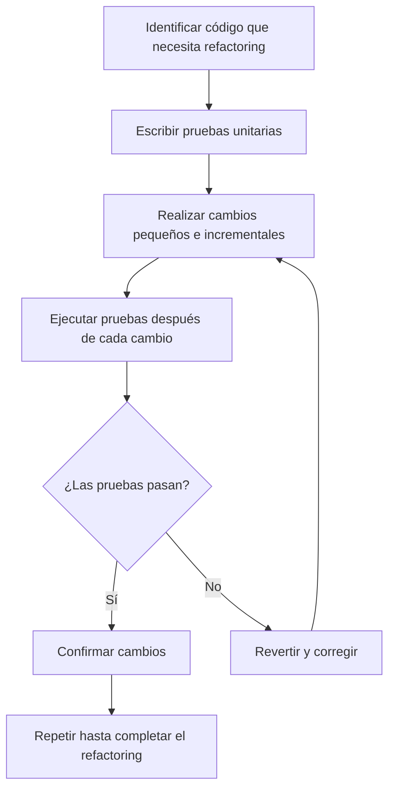
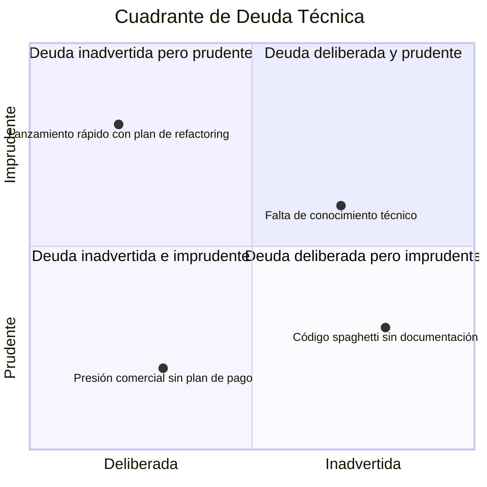

# Ingeniería de Software - Evolución de los sistemas de software

## 7.6 Refactoring.

---

El refactoring es una técnica disciplinada para restructurar código existente, alterando su estructura interna sin cambiar su comportamiento externo. Según Fowler (2018), el refactoring es esencial para mantener la salud del código y facilitar la evolución del software a lo largo del tiempo.

### Definición de Refactoring

El **refactoring** es el proceso de modificar un sistema software para mejorar su estructura interna, haciéndolo más comprensible y fácil de modificar, sin alterar su comportamiento observable. Es una práctica clave en la evolución y mantenimiento de software.

### Principios del Refactoring

#### Regla de los Dos Sombreros

Cuando desarrollamos, tenemos dos sombreros:

1. **Sombrero de agregar funcionalidad**: No cambiamos estructura existente, solo agregamos nuevas funcionalidades
2. **Sombrero de refactoring**: No agregamos funcionalidades, solo mejoramos la estructura existente

#### Principio de Deuda Técnica

$$ \text{Deuda Técnica} = Principal + Intereses $$

Donde:

- $Principal$ = Esfuerzo requerido para implementar la solución correcta inicialmente
- $Intereses$ = Costo adicional de mantenimiento debido a la solución subóptima

### Métricas para Identificar Necesidad de Refactoring

#### Complejidad Ciclomática

$$ V(G) = E - N + 2P $$

Donde:

- $V(G)$ = Complejidad ciclomática
- $E$ = Número de aristas en el grafo de flujo
- $N$ = Número de nodos
- $P$ = Número de componentes conexos

#### Índice de Mantenibilidad

$$ MI = 171 - 5.2 \times \ln(HV) - 0.23 \times (CC) - 16.2 \times \ln(LOC) $$

Donde:

- $MI$ = Índice de mantenibilidad
- $HV$ = Volumen de Halstead
- $CC$ = Complejidad ciclomática
- $LOC$ = Líneas de código

### Técnicas de Refactoring Comunes

#### Extract Method

```java
// Antes del refactoring
public void printOrderDetails(Order order) {
    System.out.println("Order ID: " + order.getId());
    System.out.println("Customer: " + order.getCustomerName());
    System.out.println("Date: " + order.getOrderDate());
    System.out.println("Total: $" + order.getTotalAmount());

    // Cálculo complejo
    double discount = 0;
    if (order.getTotalAmount() > 1000) {
        discount = order.getTotalAmount() * 0.1;
    } else if (order.getCustomer().isPremium()) {
        discount = order.getTotalAmount() * 0.05;
    }
    System.out.println("Discount: $" + discount);
    System.out.println("Final Total: $" + (order.getTotalAmount() - discount));
}

// Después del refactoring
public void printOrderDetails(Order order) {
    printOrderHeader(order);
    double discount = calculateDiscount(order);
    printOrderFooter(order, discount);
}

private void printOrderHeader(Order order) {
    System.out.println("Order ID: " + order.getId());
    System.out.println("Customer: " + order.getCustomerName());
    System.out.println("Date: " + order.getOrderDate());
    System.out.println("Total: $" + order.getTotalAmount());
}

private double calculateDiscount(Order order) {
    if (order.getTotalAmount() > 1000) {
        return order.getTotalAmount() * 0.1;
    } else if (order.getCustomer().isPremium()) {
        return order.getTotalAmount() * 0.05;
    }
    return 0;
}

private void printOrderFooter(Order order, double discount) {
    System.out.println("Discount: $" + discount);
    System.out.println("Final Total: $" + (order.getTotalAmount() - discount));
}
```

#### Replace Conditional with Polymorphism

```python
# Antes del refactoring
class OrderProcessor:
    def process_order(self, order):
        if order.type == "STANDARD":
            self.process_standard_order(order)
        elif order.type == "EXPRESS":
            self.process_express_order(order)
        elif order.type == "INTERNATIONAL":
            self.process_international_order(order)
        else:
            raise ValueError("Tipo de orden desconocido")

# Después del refactoring
from abc import ABC, abstractmethod

class Order(ABC):
    @abstractmethod
    def process(self):
        pass

class StandardOrder(Order):
    def process(self):
        # Lógica específica para orden estándar
        pass

class ExpressOrder(Order):
    def process(self):
        # Lógica específica para orden express
        pass

class InternationalOrder(Order):
    def process(self):
        # Lógica específica para orden internacional
        pass

class OrderProcessor:
    def process_order(self, order: Order):
        order.process()
```

### Proceso de Refactoring



### Patrones de Refactoring para Deuda Técnica

#### Technical Debt Quadrant



### Refactoring a Nivel de Arquitectura

#### Migración de Monolito a Microservicios

```java
// Ejemplo de refactoring arquitectural
// Antes: Monolito acoplado
@RestController
public class MonolithicController {
    @Autowired
    private UserService userService;

    @Autowired
    private OrderService orderService;

    @Autowired
    private PaymentService paymentService;

    @PostMapping("/place-order")
    public ResponseEntity placeOrder(@RequestBody OrderRequest request) {
        User user = userService.validateUser(request.getUserId());
        Order order = orderService.createOrder(request);
        Payment payment = paymentService.processPayment(order);
        return ResponseEntity.ok(payment);
    }
}

// Después: Servicios desacoplados
// User Service
@RestController
@RequestMapping("/users")
public class UserController {
    @GetMapping("/{userId}/validate")
    public User validateUser(@PathVariable String userId) {
        // Lógica de validación
    }
}

// Order Service
@RestController
@RequestMapping("/orders")
public class OrderController {
    @PostMapping
    public Order createOrder(@RequestBody OrderRequest request) {
        // Lógica de creación de orden
    }
}

// Payment Service
@RestController
@RequestMapping("/payments")
public class PaymentController {
    @PostMapping
    public Payment processPayment(@RequestBody PaymentRequest request) {
        // Lógica de procesamiento de pago
    }
}
```

### Ejercicios Propuestos

1. **Refactoring de Método Largo**: Refactorice el siguiente método aplicando "Extract Method":

   ```java
   public void generateReport(List<Sale> sales) {
       double totalRevenue = 0;
       int totalUnits = 0;
       Map<String, Integer> categoryCount = new HashMap<>();

       System.out.println("=== SALES REPORT ===");
       System.out.println("Date: " + LocalDate.now());
       System.out.println("-------------------");

       for (Sale sale : sales) {
           totalRevenue += sale.getAmount();
           totalUnits += sale.getQuantity();
           categoryCount.put(sale.getCategory(),
                           categoryCount.getOrDefault(sale.getCategory(), 0) + 1);

           System.out.println(sale.getProductName() + ": $" + sale.getAmount() +
                            " (" + sale.getQuantity() + " units)");
       }

       System.out.println("-------------------");
       System.out.println("Total Revenue: $" + totalRevenue);
       System.out.println("Total Units: " + totalUnits);
       System.out.println("By Category: " + categoryCount);
   }
   ```

2. **Reemplazo de Condicionales**: Refactorice el siguiente código usando polimorfismo:

   ```python
   class Notification:
       def send(self, message, type):
           if type == "EMAIL":
               # Lógica para enviar email
               pass
           elif type == "SMS":
               # Lógica para enviar SMS
               pass
           elif type == "PUSH":
               # Lógica para enviar notificación push
               pass
           else:
               raise ValueError("Tipo de notificación no soportado")
   ```

3. **Cálculo de Métricas**: Para una función con:
   - 15 nodos en el grafo de flujo
   - 20 aristas
   - 1 componente conexo
   - 80 líneas de código
   - Volumen de Halstead: 450

   Calcule la complejidad ciclomática y el índice de mantenibilidad.

4. **Análisis de Deuda Técnica**: Identifique el tipo de deuda técnica en los siguientes escenarios:
   - Un equipo elige una tecnología nueva pero poco madura para ganar experiencia
   - Un desarrollador escribe código rápido sin tests para cumplir una fecha límite
   - Un sistema crece orgánicamente sin seguir principios de diseño
   - Se descubre que una librería usada tiene vulnerabilidades de seguridad

### Caso de Estudio: Sistema Legacy de Reservas

Analice un sistema de reservas con:

- Alta complejidad ciclomática (>30 en métodos clave)
- Acoplamiento fuerte entre módulos
- Código duplicado en múltiples lugares
- Tests unitarios insuficientes

Desarrolle un plan de refactoring que incluya:

1. Estrategia de testing para asegurar comportamiento
2. Priorización de áreas a refactorizar
3. Técnicas específicas a aplicar
4. Métricas para medir el progreso

### Referencias

#### Bibliografía Básica

1. Sommerville, Ian. (2010). _Software Engineering_ (9th edition). Addison Wesley. (Capítulos 21, 26)
2. Pfleeger, S. L., & Atlee, J. M. (2010). _Software Engineering: Theory and Practice_ (4th edition). Prentice Hall. (Capítulos 3, 11)

#### Bibliografía Complementaria

3. Fowler, M. (2018). _Refactoring: Improving the Design of Existing Code_. Addison-Wesley. (2nd edition)
4. Martin, R. C. (2008). _Clean Code: A Handbook of Agile Software Craftsmanship_. Prentice Hall.
5. Feathers, M. (2004). _Working Effectively with Legacy Code_. Prentice Hall.

### Conclusión

El refactoring es una disciplina esencial en la evolución del software que permite mantener la salud del código a lo largo del tiempo. Cuando se practica de manera consistente y disciplinada, el refactoring reduce la deuda técnica, mejora la mantenibilidad y facilita la incorporación de nuevos requisitos. La clave del éxito está en realizar cambios pequeños e incrementales, respaldados por pruebas automáticas y métricas objetivas de calidad.
