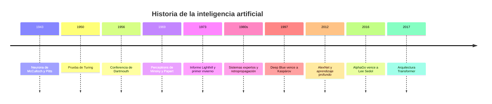

# Inteligencia Artificial - Introducción

## 1.1 Historia de AI.

---

La **inteligencia artificial** (IA) es el campo que estudia cómo construir sistemas que hagan tareas que, en las personas, requieren inteligencia: razonar, aprender, percibir, comunicarse y actuar. Russell y Norvig organizan sus definiciones en dos ejes, según busquen **pensar** o **actuar**, y **como los humanos** o **racionalmente**; su libro, el texto de referencia del área, adopta el enfoque del **agente racional**, que actúa para lograr el mejor resultado esperado (tema 1.2). Este tema recorre la historia del campo, que alternó etapas de optimismo con "inviernos" de desencanto, y las dos grandes tradiciones, la simbólica y la conexionista, cuya tensión explica buena parte de esa historia.

### Los inicios (1943-1956)

- **1943:** McCulloch y Pitts proponen la primera neurona artificial: una unidad que suma sus entradas binarias ponderadas y se activa si superan un umbral, $y = \theta\left(\sum_i w_i x_i - b\right),$ con $\theta$ la función escalón. Muestran que redes de estas unidades pueden calcular cualquier función lógica.
- **1950:** Turing publica "Computing Machinery and Intelligence" y propone el **juego de la imitación**, hoy llamado **prueba de Turing**: si un interrogador, conversando por escrito, no distingue a una máquina de una persona, la máquina debe considerarse inteligente.
- **1956:** en la **conferencia de Dartmouth**, organizada por John McCarthy, Marvin Minsky, Claude Shannon y Nathaniel Rochester, nace el campo con el nombre de "inteligencia artificial", que McCarthy había propuesto en la convocatoria de 1955. Newell y Simon presentan el **Logic Theorist**, que demostraba teoremas de los *Principia Mathematica*.

### Optimismo y primer invierno (1956-1980)

En los años siguientes aparecieron el **General Problem Solver** de Newell y Simon, el lenguaje **LISP** de McCarthy (1958), el **perceptrón** de Rosenblatt (1958), una neurona entrenable, y **ELIZA** de Weizenbaum (1966), un programa de conversación basado en patrones. Las predicciones fueron muy optimistas: Simon anunció en 1965 que en veinte años las máquinas podrían hacer cualquier trabajo humano.

Los problemas reales resultaron más difíciles. Las búsquedas se volvían intratables por la **explosión combinatoria**; el libro *Perceptrons* de Minsky y Papert (1969) demostró que un perceptrón de una capa no puede calcular funciones como XOR, que no son **linealmente separables**, lo que frenó la investigación en redes neuronales; y el **informe Lighthill** (1973) llevó al gobierno británico a recortar el financiamiento. Siguió el **primer invierno de la IA**.

### Sistemas expertos y segundo invierno (1980-1993)

Los **sistemas expertos** codificaban el conocimiento de especialistas en reglas "si-entonces", con un **motor de inferencia** que las aplicaba y un módulo de **explicación**. DENDRAL, para química, y MYCIN, para diagnosticar infecciones, mostraron su utilidad, y XCON configuraba computadoras de DEC con ahorros millonarios. En paralelo, la **retropropagación**, popularizada por Rumelhart, Hinton y Williams en 1986, permitió entrenar redes de varias capas y resolver el problema de XOR. Pero los sistemas expertos eran costosos de mantener, frágiles fuera de su dominio y no aprendían; el mercado de las máquinas LISP colapsó hacia 1987, y llegó el **segundo invierno**.

### Probabilidad, datos y aprendizaje (1990-2011)

El campo adoptó métodos matemáticos más rigurosos: **redes bayesianas** (Pearl, 1988), modelos ocultos de Markov para el habla, máquinas de vectores de soporte y aprendizaje estadístico. En 1997 **Deep Blue** de IBM venció al campeón mundial de ajedrez Garri Kaspárov, con búsqueda masiva y evaluación diseñada a mano. La disponibilidad de grandes cantidades de datos y de cómputo preparó el siguiente cambio.

### Aprendizaje profundo (2012 en adelante)

En 2012, **AlexNet**, una red convolucional entrenada en GPU, redujo drásticamente el error en el concurso de reconocimiento de imágenes ImageNet, y el **aprendizaje profundo** se impuso en visión, habla y lenguaje. En 2016 **AlphaGo** de DeepMind venció a Lee Sedol en Go, combinando redes neuronales, búsqueda y aprendizaje por refuerzo. En 2017 la arquitectura **Transformer** permitió los **modelos de lenguaje a gran escala**, como la serie GPT y otros, entrenados con enormes colecciones de texto, que desde 2022 se usan masivamente en asistentes conversacionales.



### Simbólico frente a conexionista

La IA **simbólica** representa el conocimiento con símbolos y reglas explícitas y razona manipulándolos; la **conexionista** representa el conocimiento en los pesos de redes de unidades simples y lo **aprende** de ejemplos. Hoy predominan los métodos conexionistas, pero la integración de ambos, la IA **neurosimbólica**, es un área activa, porque cada uno tiene lo que al otro le falta.

### Implementación en Python

El programa resuelve el ejercicio 2: entrena un perceptrón de Rosenblatt con OR, AND y XOR, comprueba que ninguna recta de una rejilla fina separa XOR, y entrena una red con una capa oculta que sí lo resuelve. Para el ejercicio 4 escribe la tabla del agente aspiradora en una habitación de 2x2 y simula su comportamiento.

```python
import numpy as np

# ---------- Ejercicio 2: el perceptrón de Rosenblatt aprende OR y no puede aprender XOR ----------
X = np.array([[0, 0], [0, 1], [1, 0], [1, 1]])
def perceptron(y, epocas=50, eta=1.0):
    w, b = np.zeros(2), 0.0
    for epoca in range(1, epocas + 1):
        errores = 0
        for xi, yi in zip(X, y):
            pred = int(w @ xi + b > 0)
            if pred != yi: w += eta * (yi - pred) * xi; b += eta * (yi - pred); errores += 1
        if errores == 0: return w, b, epoca
    return w, b, None
for nombre, y in (("OR", np.array([0, 1, 1, 1])), ("AND", np.array([0, 0, 0, 1])), ("XOR", np.array([0, 1, 1, 0]))):
    w, b, ep = perceptron(y)
    salida = [int(w @ xi + b > 0) for xi in X]
    print(f"ejercicio 2: {nombre:3} → pesos {w}, sesgo {b:+.0f}, salidas {salida}, " + (f"converge en la época {ep}" if ep else "no converge en 50 épocas"))
# XOR no es linealmente separable: ninguna recta w1 x1 + w2 x2 + b = 0 separa {(0,1),(1,0)} de {(0,0),(1,1)}
rejilla = np.linspace(-3, 3, 61)
separa = any(all((w1 * x[0] + w2 * x[1] + b > 0) == bool(t) for x, t in zip(X, [0, 1, 1, 0])) for w1 in rejilla for w2 in rejilla for b in rejilla)
print("   ¿alguna recta de la rejilla de 61³ separa XOR?", separa)
# una capa oculta resuelve XOR: red 2-2-1 entrenada con retropropagación
rng = np.random.default_rng(0)
W1, b1, W2, b2 = rng.normal(size=(2, 2)), np.zeros(2), rng.normal(size=2), 0.0
sig = lambda z: 1 / (1 + np.exp(-z)); y = np.array([0, 1, 1, 0])
for _ in range(10_000):
    h = sig(X @ W1 + b1); o = sig(h @ W2 + b2)
    d_o = (o - y) * o * (1 - o); d_h = np.outer(d_o, W2) * h * (1 - h)
    W2 -= 0.5 * h.T @ d_o; b2 -= 0.5 * d_o.sum(); W1 -= 0.5 * X.T @ d_h; b1 -= 0.5 * d_h.sum(0)
print("   red con una capa oculta, salidas para XOR:", np.round(sig(sig(X @ W1 + b1) @ W2 + b2), 3))

# ---------- Ejercicio 4: agente reactivo para una habitación de 2x2 ----------
def agente(percepcion):                                  # (posición, estado de la celda actual) → acción
    (fila, col), sucio = percepcion
    if sucio: return "aspirar"
    return {(0, 0): "derecha", (0, 1): "abajo", (1, 1): "izquierda", (1, 0): "arriba"}[(fila, col)]   # recorre el ciclo
print("ejercicio 4: tabla del agente:")
for pos in ((0, 0), (0, 1), (1, 0), (1, 1)):
    print(f"   posición {pos}: sucio → {agente((pos, True)):8} | limpio → {agente((pos, False))}")
mov = {"derecha": (0, 1), "izquierda": (0, -1), "arriba": (-1, 0), "abajo": (1, 0)}
mundo = {(0, 0): True, (0, 1): False, (1, 0): True, (1, 1): True}; pos, pasos = (1, 0), []
for t in range(10):
    a = agente((pos, mundo[pos])); pasos.append(a)
    if a == "aspirar": mundo[pos] = False
    else: pos = (pos[0] + mov[a][0], pos[1] + mov[a][1])
    if not any(mundo.values()): break
print(f"   simulación desde (1, 0): {pasos} | limpio en {len(pasos)} pasos")
```

Salida:

```text
ejercicio 2: OR  → pesos [1. 1.], sesgo +0, salidas [0, 1, 1, 1], converge en la época 4
ejercicio 2: AND → pesos [2. 1.], sesgo -2, salidas [0, 0, 0, 1], converge en la época 6
ejercicio 2: XOR → pesos [-1.  0.], sesgo +1, salidas [1, 1, 0, 0], no converge en 50 épocas
   ¿alguna recta de la rejilla de 61³ separa XOR? False
   red con una capa oculta, salidas para XOR: [0.018 0.983 0.979 0.016]
ejercicio 4: tabla del agente:
   posición (0, 0): sucio → aspirar  | limpio → derecha
   posición (0, 1): sucio → aspirar  | limpio → abajo
   posición (1, 0): sucio → aspirar  | limpio → arriba
   posición (1, 1): sucio → aspirar  | limpio → izquierda
   simulación desde (1, 0): ['aspirar', 'arriba', 'aspirar', 'derecha', 'abajo', 'aspirar'] | limpio en 6 pasos
```

### Ejercicios Propuestos

1. **Prueba de Turing.** ¿En qué consiste la prueba de Turing y por qué fue significativa? ¿Qué limitaciones tiene para medir la inteligencia artificial?

2. **Perceptrón.** Implementa un perceptrón que aprenda la función OR y luego la función XOR. Explica los resultados.

3. **Análisis histórico.** Compara los enfoques simbólico, como los sistemas expertos, y conexionista, como las redes neuronales, con sus ventajas y desventajas.

4. **Agente reactivo.** Diseña la tabla de un agente reactivo simple para un robot aspiradora en una habitación de 2x2 cuadrados, con estados limpio o sucio y la ubicación, y acciones mover a la izquierda, derecha, arriba o abajo, y aspirar.

### Soluciones

**Ejercicio 1.** En el juego de la imitación, un interrogador conversa por escrito con dos interlocutores ocultos, una persona y una máquina, y debe decir cuál es cuál; si no lo logra con más acierto que el azar, la máquina **pasa** la prueba. Su importancia fue sustituir la pregunta filosófica "¿pueden pensar las máquinas?", difícil de definir, por un criterio **operacional** basado en el comportamiento, y Turing anticipó y respondió en su artículo muchas de las objeciones que todavía se discuten. Sus limitaciones:

- mide la **imitación** del comportamiento humano, no la inteligencia: favorece el engaño, como mostró ELIZA, y penaliza capacidades no humanas, como calcular muy rápido;
- es solo **verbal**, y deja fuera la percepción y la acción en el mundo;
- depende del juez y de la duración de la conversación;
- el argumento de la **habitación china** de Searle (1980) sostiene que manipular símbolos correctamente no implica comprenderlos.

Los modelos de lenguaje actuales mantienen conversaciones que muchas personas no distinguen de las humanas en intercambios breves, lo que ha desplazado la discusión hacia pruebas de capacidades concretas, como razonamiento, conocimiento, planificación o uso de herramientas.

**Ejercicio 2.** El perceptrón ajusta sus pesos con la regla $w \leftarrow w + \eta\,(y - \hat{y})\,x$ cada vez que se equivoca. Con OR converge en 4 épocas, y con AND en 6: ambas son linealmente separables, y el **teorema de convergencia del perceptrón** garantiza que encuentra un separador en un número finito de pasos. Con XOR no converge: sus clases, $\{(0,1),(1,0)\}$ y $\{(0,0),(1,1)\},$ no pueden separarse con una recta. La prueba es corta: si $w_1 x_1 + w_2 x_2 + b$ fuera positivo exactamente en $(0,1)$ y $(1,0),$ entonces $w_2 + b \gt 0,$ $w_1 + b \gt 0,$ $b \le 0$ y $w_1 + w_2 + b \le 0;$ sumando las dos primeras, $w_1 + w_2 + 2b \gt 0,$ y como $b \le 0,$ $w_1 + w_2 + b \gt -b \ge 0,$ una contradicción. $\blacksquare$ Una red con una **capa oculta** de dos neuronas, entrenada con retropropagación, sí lo resuelve, con salidas cercanas a 0, 1, 1 y 0: la capa oculta transforma el espacio en uno donde las clases son separables. Es exactamente el resultado de Minsky y Papert y la salida que encontró la década de 1980.

**Ejercicio 3.**

| Aspecto              | Simbólico, como los sistemas expertos             | Conexionista, como las redes neuronales           |
| -------------------- | ------------------------------------------------- | ------------------------------------------------- |
| Conocimiento         | Explícito, escrito por expertos                   | Aprendido de datos, distribuido en pesos          |
| Explicación          | Puede mostrar la cadena de reglas aplicada        | Difícil de interpretar                            |
| Datos necesarios     | Pocos, pero mucho trabajo de expertos             | Muchos ejemplos etiquetados o texto               |
| Robustez             | Frágil fuera de las reglas previstas              | Generaliza a casos parecidos; falla de formas inesperadas |
| Razonamiento         | Lógico, composicional, exacto                     | Estadístico, aproximado                           |
| Percepción           | Débil: es difícil escribir reglas para ver u oír  | Fuerte                                            |

La historia muestra un péndulo: el enfoque simbólico dominó hasta los años ochenta, y el conexionista desde 2012. Cada uno es fuerte donde el otro es débil, lo que motiva los sistemas híbridos.

**Ejercicio 4.** El agente percibe su posición y si la celda actual está sucia. Su tabla tiene una regla por percepción: si está sucio, aspira; si está limpio, se mueve a la siguiente celda de un **ciclo** fijo, $(0,0) \to (0,1) \to (1,1) \to (1,0) \to (0,0).$ Con 4 posiciones y 2 estados de la celda son 8 percepciones. En la simulación, desde $(1,0)$ con tres celdas sucias, limpia todo en 6 pasos. El agente no sabe cuándo terminó, porque no recuerda las celdas ya visitadas, y seguiría dando vueltas: un agente **basado en modelo** (tema 1.2) podría detenerse.

### Referencias

1. Russell, S., and Norvig, P., _Artificial Intelligence: A Modern Approach_. Pearson, 2021. Capítulo 1.
2. Turing, A. M., Computing machinery and intelligence. _Mind_ 59(236), 1950.
3. McCarthy, J., Minsky, M. L., Rochester, N., and Shannon, C. E., A proposal for the Dartmouth summer research project on artificial intelligence, 1955.
4. Minsky, M., and Papert, S., _Perceptrons_. MIT Press, 1969.
5. Rumelhart, D. E., Hinton, G. E., and Williams, R. J., Learning representations by back-propagating errors. _Nature_ 323, 1986.
6. Nilsson, N. J., _The Quest for Artificial Intelligence_. Cambridge University Press, 2010.
