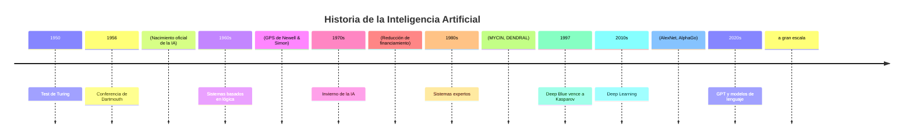
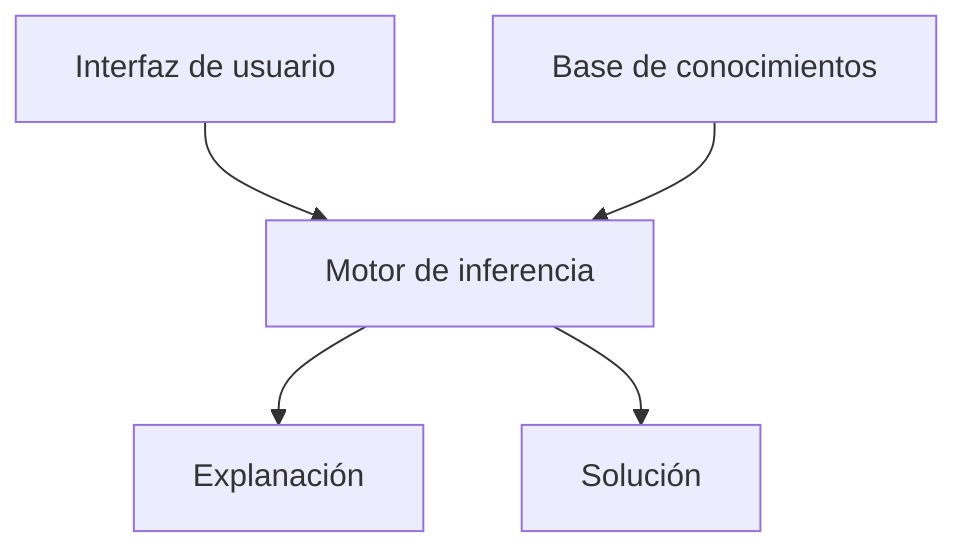

# Inteligencia Artificial - Introducción

## 1.1 Historia de AI.

---

### Definición de Inteligencia Artificial

La Inteligencia Artificial (IA) es el campo de estudio que se encarga de **crear sistemas capaces de realizar tareas que requieren inteligencia humana**. Según Russell y Norvig (2009), existen múltiples enfoques para definir la IA:

1. **Sistemas que piensan como humanos**: Automatizan actividades como la toma de decisiones o la resolución de problemas
2. **Sistemas que actúan como humanos**: Logran un desempeño similar al humano en tareas específicas
3. **Sistemas que piensan racionalmente**: Utilizan lógica formal para inferir conclusiones
4. **Sistemas que actúan racionalmente**: Maximizan su desempeño basado en objetivos definidos

### Hitos Históricos de la IA



#### Períodos Clave

##### 1. Los Inicios (1943-1956)

- **1943**: McCulloch y Pitts proponen el primer modelo de neurona artificial
- **1950**: Alan Turing publica "Computing Machinery and Intelligence" e introduce el **Test de Turing**

La neurona de McCulloch-Pitts se define como:

$$y = \theta\left(\sum_{i=1}^{n} w_i x_i - b\right)$$

donde $\theta$ es la función escalón, $w_i$ son los pesos, $x_i$ las entradas y $b$ el umbral.

##### 2. Nacimiento de la IA (1956)

- Conferencia de Dartmouth donde John Acosta acuña el término "Inteligencia Artificial"
- Allen Newell y Herbert Simon desarrollan el **Logic Theorist**

##### 3. Época Dorada (1956-1974)

- Desarrollo de sistemas de resolución de problemas generales (GPS)
- Creación del lenguaje de programación LISP por John McCarthy
- Joseph Weizenbaum crea ELIZA, el primer chatbot

##### 4. Primer Invierno de la IA (1974-1980)

- Limitaciones de hardware y expectativas no realistas
- Informe Lighthill (1973) critica el progreso de la IA

##### 5. Auge de los Sistemas Expertos (1980-1987)

- Sistemas como MYCIN y DENDRAL demuestran utilidad práctica
- Arquitectura básica de un sistema experto:



##### 6. Segundo Invierno de la IA (1987-1993)

- Dificultades para mantener sistemas expertos
- Reducción de financiamiento

##### 7. IA Moderna (1993-Presente)

- Enfoque en aprendizaje automático y datos
- 1997: Deep Blue vence al campeón de ajedrez Garry Kasparov
- 2011: Watson de IBM gana Jeopardy!
- 2016: AlphaGo vence al campeón de Go

### Conceptos Fundamentales

#### Agentes Inteligentes

Un agente inteligente es cualquier entidad que percibe su entorno mediante sensores y actúa sobre ese entorno mediante actuadores. Según Russell y Norvig, la función de un agente se define como:

$$f: P^* \rightarrow A$$

donde $P^*$ es la historia de percepciones y $A$ es la acción a tomar.

#### Tipos de Agentes

1. **Agentes reactivos simples**: $\text{acción} = buscar(\text{percepción})$
2. **Agentes basados en modelo**: Mantienen representación interna del mundo
3. **Agentes basados en objetivos**: $\text{acción} = lograr(objetivo, estado)$
4. **Agentes basados en utilidad**: Maximizan $utilidad(estado)$

### Ejemplos de Código

#### Ejemplo de Perceptrón Simple (Python)

```python
import numpy as np

class Perceptron:
    def __init__(self, input_size, lr=0.01):
        self.W = np.zeros(input_size+1)
        self.lr = lr

    def activation_fn(self, x):
        return 1 if x >= 0 else 0

    def predict(self, x):
        x = np.insert(x, 0, 1)  # Sesgo
        z = self.W.T.dot(x)
        return self.activation_fn(z)

    def train(self, X, d, epochs):
        for _ in range(epochs):
            for i in range(d.shape[0]):
                y = self.predict(X[i])
                e = d[i] - y
                self.W = self.W + self.lr * e * np.insert(X[i], 0, 1)

# Ejemplo: compuerta AND
X = np.array([[0,0], [0,1], [1,0], [1,1]])
d = np.array([0, 0, 0, 1])

perceptron = Perceptron(input_size=2)
perceptron.train(X, d, 10)

print("Predicciones después del entrenamiento:")
for x in X:
    print(f"{x} -> {perceptron.predict(x)}")
```

### Ejercicios Propuestos

#### Ejercicio 1: Test de Turing

1. ¿En qué consiste el Test de Turing y por qué fue significativo?
2. ¿Qué limitaciones tiene este test para medir la inteligencia artificial?

#### Ejercicio 2: Perceptrón

Implementa un perceptrón que aprenda la función OR y luego la función XOR. Explica los resultados.

#### Ejercicio 3: Análisis Histórico

Compara los enfoques simbólico (sistemas expertos) y conexionista (redes neuronales) en la historia de la IA. ¿Qué ventajas y desventajas tiene cada uno?

#### Ejercicio 4: Agentes Inteligentes

Diseña la tabla de un agente reactivo simple para un robot aspiradora que debe limpiar una habitación de 2x2 cuadrados. Considera:

- Estados posibles: limpio/sucio y ubicación
- Acciones: mover izquierda, derecha, arriba, abajo, aspirar

### Referencias

#### Bibliografía Básica

1. Russell, S., & Norvig, P. (2009). _Artificial Intelligence: A Modern Approach_ (3rd ed.). Prentice Hall. (Capítulos 1-2)
2. Marsland, S. (2009). _Machine Learning: An Algorithmic Perspective_. Chapman and Hall. (Capítulo 1)

#### Bibliografía Complementaria

1. Alpaydin, E. (2010). _Introduction to Machine Learning_ (2nd ed.). The MIT Press.
2. Hastie, T., Tibshirani, R., & Friedman, J. (2009). _The Elements of Statistical Learning: Data Mining, Inference, and Prediction_ (2nd ed.). Springer.
3. Davis, E. (1990). _Representations of Commonsense Knowledge_. Morgan Kaufmann.

#### Recursos Adicionales

- Documental "Lo and Behold: Reveries of the Connected World" (2016)
- Libro "The Master Algorithm" de Pedro Domingos
- Curso "CS50's Introduction to Artificial Intelligence with Python" de Harvard
