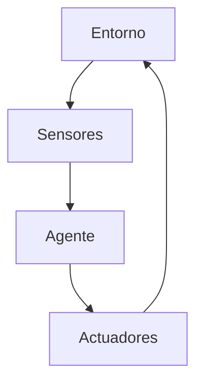
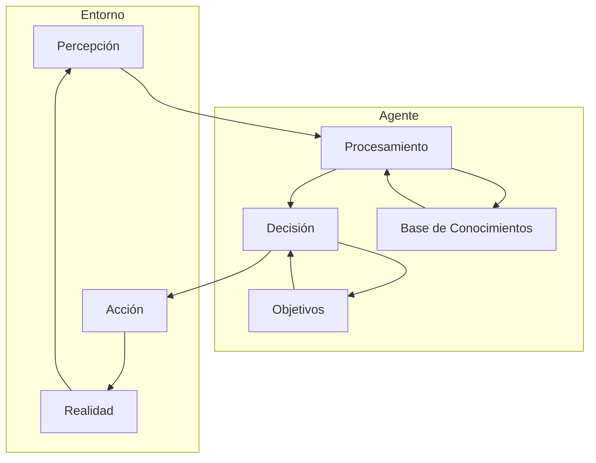
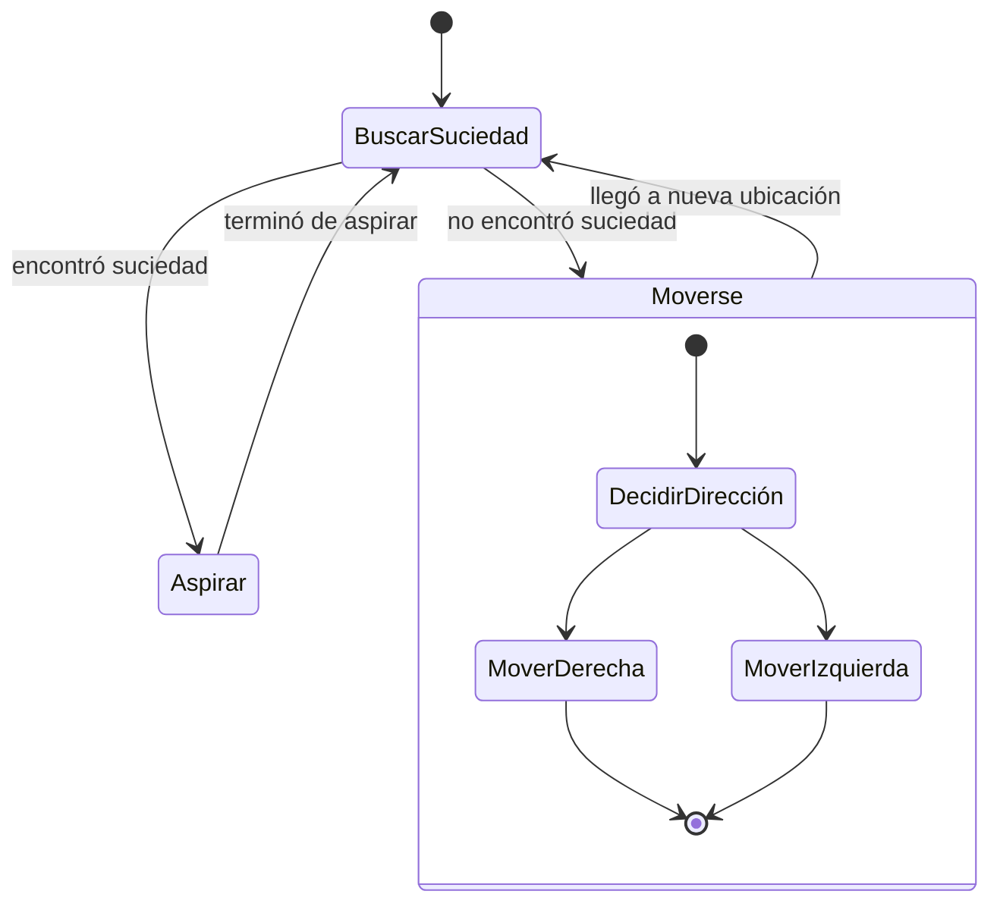

# Inteligencia Artificial - Introducción

## 1.2 Agentes.

---

### Definición de Agente Inteligente

Un **agente inteligente** es cualquier entidad que percibe su **entorno** mediante **sensores** y actúa sobre ese entorno mediante **actuadores** (Russell & Norvig, 2009). Matemáticamente, se puede definir como:

$$agente: P^* \rightarrow A$$

donde $P^*$ representa la historia de percepciones y $A$ el conjunto de acciones posibles.

La función del agente se puede expresar como:

$$f: E^* \rightarrow A$$

donde $E^*$ es la secuencia de entradas perceptivas.

### Componentes de un Agente



### Tipos de Agentes

#### 1. Agentes Reactivos Simples

Actúan basándose únicamente en la percepción actual.

$$\text{acción} = buscar(\text{percepción})$$

**Ejemplo**: Un agente que evita obstáculos en tiempo real.

#### 2. Agentes Reactivos Basados en Modelos

Mantienen un estado interno que representa aspectos del mundo.

$$\text{acción} = buscar(\text{percepción}, estado\_interno)$$

**Estado interno**:

$$estado_{t+1} = actualizar(estado_t, \text{percepción}_t)$$

#### 3. Agentes Basados en Objetivos

Actúan para alcanzar objetivos específicos.

$$\text{acción} = lograr(objetivo, estado)$$

#### 4. Agentes Basados en Utilidad

Maximizan una función de utilidad esperada.

$$\text{acción} = argmax_a \sum_{s'} P(s'|s,a) U(s')$$

donde $P(s'|s,a)$ es la probabilidad de transición y $U(s')$ es la utilidad del estado $s'$.

#### 5. Agentes que Aprenden

Mejoran su desempeño mediante la experiencia.

### Arquitectura de Agentes Inteligentes



### Medidas de Desempeño

La **medida de desempeño** evalúa la efectividad de un agente:

$$\text{DESEMPEÑO} = f(secuencia\_acciones, estado\_objetivo)$$

Las medidas comunes incluyen:

- Precisión: $\frac{aciertos}{total}$
- Recompensa acumulada: $\sum_{t=0}^{T} \gamma^t r_t$ donde $\gamma$ es el factor de descuento
- Eficiencia: $\frac{resultados\_deseados}{recursos\_utilizados}$

### Ejemplo de Implementación: Agente Reactivo Simple

```python
class SimpleReflexAgent:
    def __init__(self, rules):
        self.rules = rules  # Reglas condición-acción

    def perceive(self, environment):
        return self.get_perception(environment)

    def act(self, perception):
        for condition, action in self.rules:
            if condition(perception):
                return action
        return self.default_action()

    def run(self, environment):
        while True:
            perception = self.perceive(environment)
            action = self.act(perception)
            environment.execute(action)

# Ejemplo: Agente aspiradora
def vacuum_condition(perception):
    # perception: (location, status)
    return perception[1] == 'sucio'

def vacuum_action(perception):
    return 'aspirar'

vacuum_rules = [(vacuum_condition, vacuum_action)]
vacuum_agent = SimpleReflexAgent(vacuum_rules)
```

### Ejemplo: Agente Basado en Modelos

```python
class ModelBasedAgent:
    def __init__(self, model, actions):
        self.model = model
        self.actions = actions
        self.current_state = None

    def update_state(self, perception):
        # Actualizar el estado interno basado en la percepción
        self.current_state = self.model.update(self.current_state, perception)

    def plan(self):
        # Generar plan basado en estado actual y objetivos
        return self.model.generate_plan(self.current_state)

    def execute(self, plan):
        for action in plan:
            yield action

# Ejemplo de modelo para el mundo de la aspiradora
class VacuumModel:
    def update(self, state, perception):
        location, status = perception
        if state is None:
            return {'location': location, 'status': {location: status}}
        else:
            state['status'][location] = status
            state['location'] = location
            return state

    def generate_plan(self, state):
        if state['status'][state['location']] == 'sucio':
            return ['aspirar']
        else:
            return ['mover_a_otra_ubicacion']
```

### Ejercicios Propuestos

#### Ejercicio 1: Diseño de Agente

Diseña un agente para el problema del **mundo de la aspiradora** con las siguientes características:

- Entorno: 2 habitaciones (A y B)
- Cada habitación puede estar limpia o sucia
- El agente puede: aspirar, moverse a izquierda, moverse a derecha

1. Define la función del agente
2. Especifica las reglas condición-acción
3. Implementa el agente en Python

#### Ejercicio 2: Análisis de Medidas de Desempeño

Para el agente aspiradora, propón tres medidas de desempeño diferentes y explica cuál sería la más apropiada y por qué.

#### Ejercicio 3: Agente Basado en Utilidad

Diseña un agente basado en utilidad para un sistema de recomendación de películas. Considera:

- Estados: preferencias del usuario, historial de visualización
- Acciones: recomendar película A, B, C, etc.
- Función de utilidad: probabilidad de que al usuario le guste la película

#### Ejercicio 4: Comparación de Arquitecturas

Completa la siguiente tabla comparativa:

| Tipo de Agente      | Ventajas | Desventajas | Aplicaciones típicas |
| ------------------- | -------- | ----------- | -------------------- |
| Reactivo simple     |          |             |                      |
| Basado en modelo    |          |             |                      |
| Basado en objetivos |          |             |                      |
| Basado en utilidad  |          |             |                      |

### Diagrama de Estados para Agente Aspiradora



### Referencias

#### Bibliografía Básica

1. Russell, S., & Norvig, P. (2009). _Artificial Intelligence: A Modern Approach_ (3rd ed.). Prentice Hall. (Capítulo 2)
2. Marsland, S. (2009). _Machine Learning: An Algorithmic Perspective_. Chapman and Hall. (Capítulo 1)

#### Bibliografía Complementaria

1. Alpaydin, E. (2010). _Introduction to Machine Learning_ (2nd ed.). The MIT Press.
2. Hastie, T., Tibshirani, R., & Friedman, J. (2009). _The Elements of Statistical Learning: Data Mining, Inference, and Prediction_ (2nd ed.). Springer.

#### Recursos Adicionales

- "Rationality and Intelligence" de Stuart Russell
- "Reinforcement Learning: An Introduction" de Sutton y Barto
- Framework OpenAI Gym para desarrollo y comparación de algoritmos de aprendizaje por refuerzo
