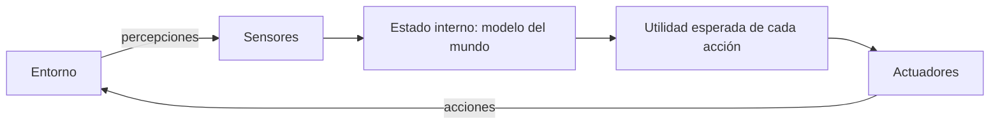

# Inteligencia Artificial - Introducción

## 1.2 Agentes.

---

Un **agente** es cualquier cosa que **percibe** su entorno mediante sensores y **actúa** sobre él mediante actuadores: una persona, un robot, un programa que negocia en la bolsa o un asistente que responde correos. Russell y Norvig organizan toda la inteligencia artificial alrededor de esta idea: el objetivo es construir **agentes racionales**, que hacen lo correcto según lo que perciben. Este tema define el agente racional, la manera de especificar su tarea, las propiedades de los entornos y los cinco tipos clásicos de programas de agente, de los reactivos simples a los que aprenden.

### Agente racional

El comportamiento de un agente lo describe su **función de agente**, que asigna a cada **secuencia de percepciones** una acción; el **programa de agente** la implementa en una arquitectura concreta. Un agente es **racional** si, para cada secuencia de percepciones posible, elige la acción que **maximiza el valor esperado de su medida de desempeño**, dados sus percepciones y su conocimiento previo. Racional no es omnisciente: el agente decide con lo que sabe, y puede equivocarse por mala suerte; sí debe recabar información cuando le conviene y **aprender** de su experiencia.

La **medida de desempeño** evalúa la secuencia de **estados del entorno**, no lo que el agente cree que hizo. Debe diseñarse según lo que se quiere lograr en el entorno, no según cómo se espera que se comporte el agente: premiar a una aspiradora por la cantidad de suciedad aspirada la incentiva a ensuciar para volver a aspirar.

### Especificación de la tarea: PEAS

Una tarea se especifica con su medida de desempeño (**P**), su entorno (**E**), sus actuadores (**A**) y sus sensores (**S**). Para un taxi autónomo: llegar seguro, rápido, legal y cómodo; calles, tráfico, peatones y pasajeros; volante, acelerador, freno y señales; cámaras, lidar, GPS y velocímetro.

### Propiedades del entorno

- **Totalmente o parcialmente observable:** si los sensores dan el estado completo.
- **Determinista o estocástico:** si el siguiente estado queda determinado por el actual y la acción.
- **Episódico o secuencial:** si cada decisión es independiente de las anteriores.
- **Estático o dinámico:** si el entorno cambia mientras el agente decide.
- **Discreto o continuo**, **conocido o desconocido**, y **de un agente o multiagente**, cooperativo o competitivo.

El caso más difícil, el del mundo real, es parcialmente observable, estocástico, secuencial, dinámico, continuo y multiagente.

### Tipos de agentes

- **Reactivo simple:** elige la acción solo con la percepción actual, con reglas condición-acción. Funciona si el entorno es totalmente observable.
- **Basado en modelo:** mantiene un **estado interno** que resume la historia, actualizado con un modelo de cómo cambia el mundo y de cómo lo afectan sus acciones; maneja la observabilidad parcial.
- **Basado en objetivos:** además del modelo, tiene **metas**, y elige acciones que las alcancen, con **búsqueda** o **planificación** (tema 2).
- **Basado en utilidad:** una **función de utilidad** asigna a cada estado un número que expresa qué tan deseable es, y elige la acción de mayor **utilidad esperada**; resuelve los conflictos entre metas y la incertidumbre.
- **Que aprende:** cualquiera de los anteriores con un **elemento de aprendizaje** que mejora su desempeño con la retroalimentación de un **crítico**, y un **generador de problemas** que propone acciones exploratorias.



### Implementación en Python

El programa resuelve el ejercicio 1 con un agente reactivo y uno basado en modelo para el mundo de la aspiradora. Para el ejercicio 2 los evalúa con tres medidas de desempeño en las ocho configuraciones iniciales, con un entorno estático y con uno en el que las habitaciones se ensucian. Para el ejercicio 3 implementa un recomendador basado en utilidad que estima la probabilidad de que una película guste a partir del historial.

```python
import math, random

# ---------- Ejercicio 1: el mundo de la aspiradora de dos habitaciones ----------
def reactivo(percepcion):                                  # función del agente: percepción → acción
    lugar, estado = percepcion
    if estado == "sucio": return "aspirar"
    return "derecha" if lugar == "A" else "izquierda"
class BasadoEnModelo:
    """Recuerda lo que sabe de cada habitación y se detiene cuando sabe que todo está limpio."""
    def __init__(self): self.conocido = {"A": None, "B": None}
    def __call__(self, percepcion):
        lugar, estado = percepcion; self.conocido[lugar] = estado
        if estado == "sucio": self.conocido[lugar] = "limpio"; return "aspirar"
        if all(v == "limpio" for v in self.conocido.values()): return "nada"
        return "derecha" if lugar == "A" else "izquierda"
def simula(agente, mundo, lugar, pasos=20, p_ensucia=0.0, rng=None):
    mundo = dict(mundo); hist = {"limpias_por_paso": [], "movimientos": 0, "aspiradas": 0}
    for _ in range(pasos):
        a = agente((lugar, mundo[lugar]))
        if a == "aspirar": mundo[lugar] = "limpio"; hist["aspiradas"] += 1
        elif a in ("derecha", "izquierda"): lugar = "B" if a == "derecha" else "A"; hist["movimientos"] += 1
        if rng and p_ensucia:
            for h in mundo:
                if rng.random() < p_ensucia: mundo[h] = "sucio"
        hist["limpias_por_paso"].append(sum(v == "limpio" for v in mundo.values()))
    return hist
print("ejercicio 1: tabla del agente reactivo:", {p: reactivo(p) for p in [("A", "limpio"), ("A", "sucio"), ("B", "limpio"), ("B", "sucio")]})

# ---------- Ejercicio 2: tres medidas de desempeño ----------
def medidas(h):
    return {"habitaciones limpias por paso": sum(h["limpias_por_paso"]) / len(h["limpias_por_paso"]),
            "+1 por limpia y paso, −1 por movimiento": sum(h["limpias_por_paso"]) - h["movimientos"],
            "aspiradas": h["aspiradas"]}
inicios = [({"A": a, "B": b}, l) for a in ("limpio", "sucio") for b in ("limpio", "sucio") for l in "AB"]
for nombre, fabrica in (("reactivo", lambda: reactivo), ("basado en modelo", BasadoEnModelo)):
    for p in (0.0, 0.1):
        res = [medidas(simula(fabrica(), m, l, p_ensucia=p, rng=random.Random(7))) for m, l in inicios]
        prom = {k: round(sum(r[k] for r in res) / len(res), 2) for k in res[0]}
        print(f"ejercicio 2: {nombre:16} ensuciamiento {p:.0%}: {prom}")

# ---------- Ejercicio 3: agente basado en utilidad para recomendar películas ----------
peliculas = {"Roma": {"drama": 1, "mexicana": 1}, "Coco": {"animación": 1, "mexicana": 1, "familia": 1},
             "Alien": {"ciencia ficción": 1, "terror": 1}, "Arrival": {"ciencia ficción": 1, "drama": 1},
             "Up": {"animación": 1, "familia": 1, "drama": 0.5}}
historial = {"Coco": 1, "Arrival": 1, "Alien": 0}          # 1: le gustó; 0: no le gustó
def perfil(historial):
    p = {}
    for t, gusto in historial.items():
        for g, v in peliculas[t].items(): p[g] = p.get(g, 0) + v * (1 if gusto else -1)
    return p
def utilidad(titulo, pf):
    """Probabilidad estimada de que le guste: función logística del puntaje de afinidad de sus géneros."""
    s = sum(pf.get(g, 0) * v for g, v in peliculas[titulo].items())
    return 1 / (1 + math.exp(-s))
pf = perfil(historial)
candidatas = {t: round(utilidad(t, pf), 3) for t in peliculas if t not in historial}
print("ejercicio 3: perfil", pf, "| utilidad esperada", candidatas, "→ recomienda", max(candidatas, key=candidatas.get))
```

Salida:

```text
ejercicio 1: tabla del agente reactivo: {('A', 'limpio'): 'derecha', ('A', 'sucio'): 'aspirar', ('B', 'limpio'): 'izquierda', ('B', 'sucio'): 'aspirar'}
ejercicio 2: reactivo         ensuciamiento 0%: {'habitaciones limpias por paso': 1.96, '+1 por limpia y paso, −1 por movimiento': 20.25, 'aspiradas': 1.0}
ejercicio 2: reactivo         ensuciamiento 10%: {'habitaciones limpias por paso': 1.29, '+1 por limpia y paso, −1 por movimiento': 13.0, 'aspiradas': 7.25}
ejercicio 2: basado en modelo ensuciamiento 0%: {'habitaciones limpias por paso': 1.96, '+1 por limpia y paso, −1 por movimiento': 38.25, 'aspiradas': 1.0}
ejercicio 2: basado en modelo ensuciamiento 10%: {'habitaciones limpias por paso': 0.87, '+1 por limpia y paso, −1 por movimiento': 16.38, 'aspiradas': 4.88}
ejercicio 3: perfil {'animación': 1, 'mexicana': 1, 'familia': 1, 'ciencia ficción': 0, 'drama': 1, 'terror': -1} | utilidad esperada {'Roma': 0.881, 'Up': 0.924} → recomienda Up
```

### Ejercicios Propuestos

1. **Diseño.** Diseña un agente para el mundo de la aspiradora con 2 habitaciones, A y B, que pueden estar limpias o sucias, y las acciones aspirar, moverse a la izquierda y moverse a la derecha: define la función del agente, sus reglas condición-acción e impleméntalo.

2. **Medidas de desempeño.** Propón tres medidas de desempeño para el agente aspiradora y explica cuál es la más apropiada.

3. **Utilidad.** Diseña un agente basado en utilidad para recomendar películas, con las preferencias y el historial del usuario como estado, recomendar una película como acción, y como utilidad la probabilidad de que le guste.

4. **Comparación.** Compara las ventajas, desventajas y aplicaciones típicas de los agentes reactivo simple, basado en modelo, basado en objetivos y basado en utilidad.

### Soluciones

**Ejercicio 1.** La percepción es el par (habitación, estado). La función de agente del reactivo tiene cuatro entradas: en cualquier habitación sucia, aspirar; en A limpia, moverse a la derecha; en B limpia, a la izquierda. Es la tabla que imprime el programa. Sus reglas condición-acción son las mismas tres: si está sucio, aspirar; si está en A, ir a la derecha; si está en B, ir a la izquierda. El programa implementa también un agente **basado en modelo**, que recuerda el último estado conocido de cada habitación y no hace nada cuando sabe que ambas están limpias.

**Ejercicio 2.** Tres medidas:

1. **Habitaciones limpias por paso**, promediada en el tiempo: mide el resultado en el entorno.
2. **La anterior menos un punto por movimiento**, que penaliza la energía y el desgaste.
3. **Cantidad de suciedad aspirada**: mide la actividad del agente.

La más apropiada es la primera o, si la energía cuesta, la segunda, porque evalúan el **estado del entorno**. La tercera es inadecuada: un agente que pudiera ensuciar sería premiado por hacerlo. La simulación muestra además que la racionalidad depende del entorno: si las habitaciones no se vuelven a ensuciar, el agente basado en modelo es mejor con la segunda medida, 38.25 contra 20.25, porque deja de moverse; con un ensuciamiento del 10 % por paso, el reactivo mantiene más habitaciones limpias, 1.29 contra 0.87, porque el basado en modelo confía en un modelo que supone que nada se ensucia. Un agente racional para ese entorno necesitaría un modelo que incluya el ensuciamiento y revisar periódicamente.

**Ejercicio 3.** El estado es el **perfil** del usuario, una afinidad por género calculada con su historial: suma los géneros de las películas que le gustaron y resta los de las que no. La utilidad de recomendar una película es la probabilidad estimada de que le guste, la función logística de la afinidad de sus géneros. El agente recomienda la película no vista de mayor utilidad esperada; con el historial del ejemplo, Up, con 0.92, sobre Roma, con 0.88. Un sistema real aprendería la probabilidad con filtrado colaborativo a partir de muchos usuarios, y su utilidad incluiría más que el gusto inmediato, como la diversidad de las recomendaciones, para no encerrar al usuario en lo que ya conoce, lo que convierte el problema en uno de **exploración** frente a **explotación** (tema 4.3).

**Ejercicio 4.**

| Tipo de agente      | Ventajas                                    | Desventajas                                         | Aplicaciones típicas                        |
| ------------------- | ------------------------------------------- | --------------------------------------------------- | ------------------------------------------- |
| Reactivo simple     | Rápido, simple, predecible                  | Requiere observabilidad total; puede ciclarse       | Termostatos, reflejos de seguridad, filtros |
| Basado en modelo    | Maneja la observabilidad parcial            | Depende de la calidad del modelo                    | Seguimiento de objetos, control de procesos |
| Basado en objetivos | Flexible: cambiar la meta cambia la conducta | La búsqueda puede ser costosa                       | Navegación, planificación de rutas, juegos  |
| Basado en utilidad  | Resuelve conflictos e incertidumbre         | Hay que definir la utilidad y estimar probabilidades | Recomendación, finanzas, vehículos autónomos |

### Referencias

1. Russell, S., and Norvig, P., _Artificial Intelligence: A Modern Approach_. Pearson, 2021. Capítulo 2.
2. Wooldridge, M., _An Introduction to MultiAgent Systems_. Wiley, 2009.
3. Poole, D. L., and Mackworth, A. K., _Artificial Intelligence: Foundations of Computational Agents_. Cambridge University Press, 2023.
4. Ricci, F., Rokach, L., and Shapira, B. (eds.), _Recommender Systems Handbook_. Springer, 2022.
